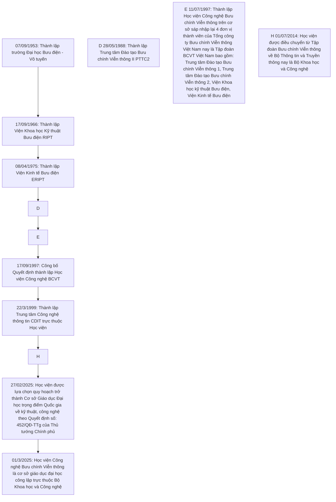
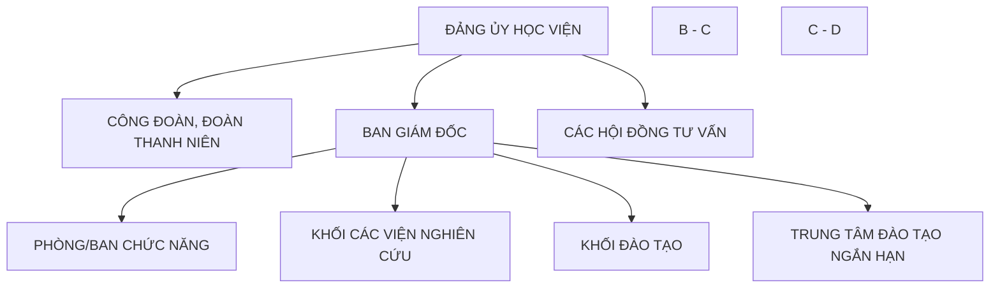

PTIT

# HỌC VIỆN CÔNG NGHỆ BƯU CHÍNH VIỄN THÔNG
Posts and Telecommunications Institute of Technology

# SỔ TAY
# SINH VIÊN

# KHÓA D26

*Hành trình mới - Khởi đầu mới - Tương lai mới*

- KIẾN THỨC
  Nền tảng vững chắc
- SÁNG TẠO
  Dẫn lối tương lai
- KẾT NỐI
  Hội nhập toàn cầu
- PHỤNG SỰ
  Vì cộng đồng & đất nước

"Be your best version.
Make an impact.
Inspire the future."

# MỤC LỤC

Lời nói đầu........................................................3

**PHẦN I: TỔNG QUAN VỀ HỌC VIỆN** **5**

Giới thiệu ..............................................................6
Lịch sử phát triển ....................................................8
Tầm nhìn, Sự mạng, Giá trị cốt lõi, Triết lý giáo dục ..............................................................8

**PHẦN II: THÔNG TIN VỀ CÁC ĐƠN VỊ TRONG HỌC VIỆN VÀ CƠ SỞ ĐÀO TẠO HÀ NỘI** **12**

ĐẢNG ỦY, BAN GIÁM ĐỐC, CÔNG ĐOÀN, ĐOÀN THANH NIÊN ..............................................................13
SƠ ĐỒ MẶT BẰNG CƠ SỞ ĐÀO TẠO HÀ NỘI ..............................................................14
THÔNG TIN VỀ CÁC KHOA, VIỆN THUỘC VÀ TRỰC THUỘC HỌC VIỆN..............................................................15

I. Khoa Cơ bản 1 ........................................................15
II. Khoa Công nghệ thông tin 1 ....................................15
III. Khoa Viễn thông 1 ..................................................16
IV. Khoa Kỹ thuật Điện tử 1 .........................................16
V. Khoa An toàn thông tin ............................................17
VI. Khoa Trí tuệ nhân tạo ............................................17
VII. Khoa Đa phương tiện ............................................17
VIII. Khoa Quản trị Kinh doanh 1 ...................................18
IX. Khoa Tài chính Kế toán .........................................18
X. Viện Kinh tế Bưu điện ..............................................18
XI. Viện Khoa học Kỹ thuật Bưu điện .............................19
XII. Viện Công nghệ thông tin và Truyền thông CDIT .......19
XIII. Viện Lãnh đạo, Quản trị, Quản lý Việt Nam ..............19
Thông tin về các phòng/trung tâm chức năng, đơn vị đoàn thể ..............................................................21

**PHẦN III: CHƯƠNG TRÌNH VÀ KẾ HOẠCH ĐÀO TẠO** **24**

Các chương trình đào tạo ................................................25
Khung các chương trình đào tạo Đại học ...........................27
Bộ phẩm chất người tốt nghiệp và chuẩn đầu ra Cơ sở giáo dục trình độ Đại học của Học viện Công nghệ Bưu chính Viễn thông ..............................................................29
Kế hoạch và tiến trình học tập chuẩn Ngành An toàn thông tin khóa 2026 ..............................................................32
Kế hoạch và tiến trình học tập chuẩn Chương trình An toàn thông tin chất lượng cao ..............................................................35
Kế hoạch và tiến trình học tập chuẩn Ngành Công nghệ thông tin khóa 2026 ..............................................................37
Kế hoạch và tiến trình học tập chuẩn Chương trình công nghệ thông tin định hướng ứng dụng ..............................................................40
Kế hoạch và tiến trình học tập chuẩn Chương trình Công nghệ thông tin - chất lượng cao ..............................................................42
Kế hoạch và tiến trình học tập chuẩn Chương trình Kỹ sư Công nghệ thông tin Việt Nhật khóa 2026 ..............................................................47
Kế hoạch và tiến trình học tập chuẩn Ngành Báo chí khóa 2026 ..............................................................49
Kế hoạch và tiến trình học tập chuẩn Ngành công nghệ đa phương tiện khóa 2026 ..............................................................51
Kế hoạch và tiến trình học tập chuẩn Ngành Công nghệ Tài chính Fintech ..............................................................54
Kế hoạch và tiến trình học tập chuẩn Ngành Công nghệ Kỹ thuật Điện – Điện tử ..............................................................56
Kế hoạch và tiến trình học tập chuẩn Chương trình công nghệ vi mạch bán dẫn khóa 2026 ..............................................................59
Kế hoạch và tiến trình học tập chuẩn Ngành Kế toán khóa 2026 ..............................................................62
Kế hoạch và tiến trình học tập chuẩn Ngành Kế toán – chất lượng cao chuẩn quốc tế ACCA khóa 2026 ..............................................................64
Kế hoạch và tiến trình học tập chuẩn Ngành Kỹ thuật Điều khiển và Tự động hóa - khóa 2026 ..............................................................67
Kế hoạch và tiến trình học tập chuẩn Ngành Kỹ thuật Điện tử Viễn thông - khóa 2026 ..............................................................70
Kế hoạch và tiến trình học tập chuẩn Ngành Khoa học Máy tính (định hướng khoa học dữ liệu) ..............................................................74
Kế hoạch và tiến trình học tập chuẩn Chương trình Quản trị logistics và quản lý chuỗi cung ứng ..............................................................76
Kế hoạch và tiến trình học tập chuẩn Ngành Mạng máy tính và Truyền thông dữ liệu (Chương trình kỹ thuật dữ liệu) - khóa 2026 ..............................................................78
Kế hoạch và tiến trình học tập chuẩn Ngành Marketing (định hướng Marketing số) - khóa 2026 ..............................................................80
Kế hoạch và tiến trình học tập chuẩn Chương trình Marketing chất lượng cao - khóa 2026 ..............................................................84
Kế hoạch và tiến trình học tập chuẩn Chương trình quan hệ công chúng (Ngành Marketing) - khóa 2026 ..............................................................87
Kế hoạch và tiến trình học tập chuẩn Ngành Quản trị kinh doanh - khóa 2026 ..............................................................89
Kế hoạch và tiến trình học tập chuẩn Ngành trí tuệ nhân tạo - khóa 2026 ..............................................................93

- 1 -

Kế hoạch và tiến trình học tập chuẩn Chương trình trí tuệ nhân tạo vạn vật (AIOT) - khóa 2026 95
Kế hoạch và tiến trình học tập chuẩn Ngành Truyền thông Đa phương tiện 97
Kế hoạch và tiến trình học tập chuẩn . Chương trình Truyền thông đa phương tiện Chất lượng cao 99
Kế hoạch và tiến trình học tập chuẩn Ngành thương mại điện tử - khóa 2026 ............................ 101
Kế hoạch và tiến trình học tập chuẩn Chương trình Thiết kế và Phát triển Game (Ngành Công nghệ Đa phương tiện) ............................ 103
Kế hoạch và tiến trình học tập chuẩn Chương trình thiết kế đồ họa game khóa 2026 105
Kế hoạch và tiến trình học tập chuẩn Chương trình Quản trị Đổi mới sáng tạo và Khởi nghiệp 107
Kế hoạch và tiến trình học tập chuẩn Chương trình Logistics trong Kinh tế tầm thấp - khóa 2026 109
Kế hoạch và tiến trình học tập chuẩn Chương trình Công nghệ Công nghiệp Văn hóa (định hướng Điện ảnh số) - khóa 2026 ............................ 112
Kế hoạch và tiến trình học tập chuẩn Chương trình Công nghệ UAV và Robot tự hành - khóa 2026 114
Kế hoạch và tiến trình học tập chuẩn Chương trình Truyền thông Hàng không Vũ trụ - khóa 2026 116
Kế hoạch và tiến trình học tập chuẩn Ngành Tài chính Ngân hàng - Chương trình Phân tích dữ liệu trong Tài chính, Kinh doanh khóa 2026 ............................ 118

**PHẦN IV: MỘT SỐ QUY CHẾ, QUY ĐỊNH VỀ QUẢN LÝ ĐÀO TẠO** 120
Quy định tổ chức thi kết thúc học phần, thi học phần thay thế tốt nghiệp trình độ Đại học của Học viện .. 145
Quy định đánh giá mức độ đạt chuẩn đầu ra học phần (CLO) và chuẩn đầu ra chương trình đào tạo (PLO) ............................ 155
Quy định tổ chức đào tạo và kiểm tra chuẩn đầu ra Tiếng Anh trình độ Đại học chính quy tại Học viện.. 159
Quy định tổ chức đào tạo và kiểm tra chuẩn đầu ra Tiếng Anh trình độ Đại học chính quy hệ chất lượng cao ............................ 167
Quy định đào tạo sinh viên tài năng ............................ 173
Quy định tổ chức thực tập tốt nghiệp, thực hiện khởi kiến tốt nghiệp ............................ 179
Hướng dẫn đăng ký môn học và tra cứu thời khóa biểu, thông tin học tập của sinh viên 187

**PHẦN V: MỘT SỐ QUY CHẾ, QUY ĐỊNH, QUY TRÌNH VỀ CÔNG TÁC SINH VIÊN, HỖ TRỢ SINH VIÊN** 195
Quy định Công tác sinh viên trình độ Đại học Chính quy ............................ 198
Quy định về tạo lập, quản lý và sử dụng ............................ 217
quỹ học bổng và hỗ trợ người học ............................ 217
Quy định về thu nộp học phí và các khoản thu khác tại Học viện ............................ 234
Quy định về văn hóa học đường và chuẩn mực ứng xử của người học ............................ 238
Một số chính sách của Nhà nước về học phí và tín dụng đối với sinh viên ............................ 243
Lịch tiếp sinh viên của phòng/trung tâm chức năng ............................ 256
Hướng dẫn thủ tục hành chính của Phòng Giáo vụ và Phòng Chính trị & Công tác sinh viên 257
Một số ứng dụng chuyển đổi số cho sinh viên ............................ 258

**PHẦN VI: CẢM NẠNG SINH VIÊN** 260
Phương pháp Power trong học tập ở bậc Đại học ............................ 261
Lập kế hoạch cho những năm học Đại học ............................ 263
Lưu trữ, sinh hoạt khi học Đại học ............................ 265
Vui chơi, giải trí ............................ 268

- 2 -

# LỜI NÓI ĐẦU

## Các bạn Tân sinh viên Khóa D26 thân mến!

Trước hết, Học viện Công nghệ Bưu chính Viễn thông nhiệt liệt chúc mừng các bạn đã chính thức trở thành thành viên của đại gia đình PTIT.

Phía sau tấm giấy báo trúng tuyển là biết bao tháng ngày miệt mài học tập, sự nỗ lực không ngừng của chính các bạn cùng sự đồng hành, kỳ vọng của gia đình và thầy cô. Thành quả hôm nay là cột mốc đáng tự hào, đồng thời cũng mở ra một hành trình mới – hành trình của những người trẻ mang khát vọng chinh phục tri thức, làm chủ công nghệ và kiến tạo tương lai.

Đại học không chỉ là nơi tiếp thu kiến thức chuyên môn mà còn là môi trường để mỗi sinh viên rèn luyện tư duy độc lập, tinh thần sáng tạo, năng lực hội nhập và trách nhiệm với cộng đồng. Tại PTIT, các bạn sẽ được học tập trong một môi trường đổi mới, nơi tri thức gắn với thực tiễn, nghiên cứu gắn với doanh nghiệp, sáng tạo gắn với chuyển đổi số và khởi nghiệp. Học viện luôn mong muốn mỗi sinh viên không chỉ trở thành một kỹ sư, cử nhân giỏi chuyên môn mà còn là một công dân số có bản lĩnh, đạo đức, tinh thần đổi mới sáng tạo và khát vọng cống hiến cho đất nước.

Để đồng hành cùng các bạn ngay từ những ngày đầu bước vào giảng đường đại học, Học viện biên soạn **Sổ tay Sinh viên Khóa D26**. Đây không chỉ là tài liệu cung cấp các thông tin cần thiết về chương trình đào tạo, quy chế học tập, quyền và nghĩa vụ của người học, các dịch vụ hỗ trợ sinh viên, mà còn là cẩm nang giúp các bạn nhanh chóng hòa nhập với môi trường đại học, chủ động xây dựng kế hoạch học tập, rèn luyện và phát triển bản thân.

Chúng tôi khuyến khích các bạn thường xuyên sử dụng Sổ tay trong suốt quá trình học tập tại Học viện. Bên cạnh những quy định và hướng dẫn quan trọng, Sổ tay sẽ giúp các bạn biết tìm đúng thông tin, liên hệ đúng đơn vị, sử dụng hiệu quả các nền tảng số và khai thác tối đa những cơ hội học tập, nghiên cứu khoa học, đổi mới sáng tạo, khởi nghiệp, hợp tác quốc tế cũng như các hoạt động Đoàn – Hội và phát triển kỹ năng.

Hành trình phía trước sẽ có nhiều thử thách, nhưng cũng sẽ là quãng thời gian đẹp nhất của tuổi trẻ – nơi các bạn khám phá chính mình, xây dựng những tình bạn bền vững, nuôi dưỡng những ước mơ lớn và từng bước hiện thực hóa khát vọng trở thành những công dân toàn cầu, những chuyên gia công nghệ, nhà quản lý, nhà nghiên cứu và doanh nhân của tương lai.

Chúc các bạn luôn giữ vững niềm đam mê học tập, tinh thần tiên phong đổi mới, dám nghĩ, dám làm, dám chinh phục những đỉnh cao mới và có một quãng đời sinh viên thật ý nghĩa dưới mái nhà chung PTIT.

Chào mừng các bạn đến với Học viện Công nghệ Bưu chính Viễn thông – nơi khởi đầu cho hành trình kiến tạo tương lai bằng tri thức, sáng tạo và trách nhiệm.

# HỌC VIỆN CÔNG NGHỆ BƯU CHÍNH VIỄN THÔNG

- 3 -

# PTIT

# Chúc mừng ❤️

TÂN SINH VIÊN

# KHÓA D26

> Hành trình mới - Khởi đầu mới - Tương lai mới

## Welcome to PTIT ❤️

### KIẾN TẠO TƯƠNG LAI
### BẰNG TRI THỨC VÀ SÁNG TẠO

|Category|Description|
|-|-|
|HÃY HỌC|bằng sự ~~tò mò~~|
|SÁNG TẠO|bằng ~~đam mê~~|
|HÀNH ĐỘNG|bằng ~~trách nhiệm~~|
|TRƯỜNG THÀNH|bằng những ~~trải nghiệm~~|

“
Đừng chỉ tốt nghiệp
với <mark>một tấm bằng>,</mark>
hãy tốt nghiệp với
<mark>tri thức, bản lĩnh,</mark>
và một <mark>khát vọng đủ lớn</mark>
để tạo nên giá trị cho
<mark>cộng đồng và đất nước.</mark>
”

- Be your best version.
- Make an impact.
- Inspire the future. ⭐

- 4 -

# PHẦN I: TỔNG QUAN VỀ HỌC VIỆN

## GIỚI THIỆU

Học viện Công nghệ Bưu chính Viễn thông (Học viện) là đơn vị sự nghiệp công lập trực thuộc Bộ Khoa học và Công nghệ. Trải qua 73 năm xây dựng và phát triển từ đơn vị Trường Bưu điện - Vô tuyến điện, Học viện Công nghệ Bưu chính Viễn thông ngày nay đã trở thành một trong những tổ chức Giáo dục Đào tạo và Khoa học Công nghệ hàng đầu, có uy tín tại Việt Nam.

Năm 1997, Học viện được thành lập trên cơ sở sáp xếp lại 4 đơn vị thành viên của Tập đoàn Bưu chính Viễn thông Việt Nam (VNPT) bao gồm: Trung tâm Đào tạo Bưu chính Viễn thông 1, Trung tâm Đào tạo Bưu chính Viễn thông 2, Viện Khoa học Kỹ thuật Bưu điện và Viện Kinh tế Bưu điện, và thành lập mới: Trung tâm Công nghệ thông tin. Học viện được tổ chức và hoạt động theo tinh thần Nghị quyết TW2 khóa VIII, thí điểm thực hiện gắn kết Đào tạo (trường Đại học)- Nghiên cứu (các Viện nghiên cứu) - Sản xuất kinh doanh (Mạng lưới), với mục tiêu đào tạo nguồn nhân lực chất lượng cao và tạo ra những sản phẩm khoa học công nghệ tiên tiến đáp ứng nhu cầu của thị trường công nghệ thông tin và truyền thông.

Từ ngày 01/07/2014, Học viện được điều chuyển từ Tập đoàn Bưu chính Viễn thông Việt Nam về Bộ Thông tin và Truyền thông (nay là Bộ Khoa học & Công nghệ). Học viện là đơn vị sự nghiệp công lập. Ngày 27/02/2025, Chính Phủ đã ban hành Quyết định số: 452/QĐ-TTg về việc Phê duyệt quy hoạch mạng lưới cơ sở giáo dục đại học và sư phạm thời kỳ 2021-2030, tầm nhìn đến năm 2050. Theo đó, Học viện Công nghệ Bưu chính Viễn thông là 1 trong 5 cơ sở giáo dục đại học được định hướng phát triển trở thành cơ sở giáo dục đại học trọng điểm Quốc gia về kỹ thuật, công nghệ có chất lượng và uy tín ngang tầm khu vực.

Với vị thế là Cơ sở Giáo dục Đại học trọng điểm Quốc gia về Kỹ thuật, Công nghệ và uy tín trong các hoạt động Nghiên cứu Khoa học, Giáo dục Đào tạo, Khởi nghiệp và Đổi mới sáng tạo, Học viện Công nghệ Bưu chính Viễn thông đóng vai trò hạt nhân, nòng cốt trong đào tạo nguồn nhân lực chất lượng cao và nhân tài; nghiên cứu, phát triển và đổi mới sáng tạo phục vụ các lĩnh vực công nghệ cao, công nghệ chiến lược và chuyển đổi số quốc gia.

Học viện là các trường công lập có năng lực, uy tín hàng đầu về đào tạo, nghiên cứu một số ngành, lĩnh vực công nghệ then chốt, mũi nhọn trong thời đại kỷ nguyên số với nhiều chương trình đào tạo công nghệ số như Công nghệ thông tin, Điện tử, Viễn thông, Trí tuệ nhân tạo, Vi mạch bán dẫn, An toàn thông tin, Khoa học Máy tính, Kỹ thuật dữ liệu ... Học viện Công nghệ Bưu chính Viễn thông là trường Đại học tiên phong trong mở các ngành đào tạo liên ngành lần đầu tiên tại Việt Nam như Công nghệ Đa phương tiện, Công nghệ tài chính, Thiết kế và Phát triển Game, Công nghệ Internet Vạn vật, Truyền thông Đa phương tiện ...

Thực hiện chủ trương định hướng về xã hội hóa giáo dục - đào tạo của Đảng và Nhà nước, Học viện đã và đang mở rộng các ngành, hệ và các hình thức đào tạo nhằm tạo điều kiện thuận lợi cho người học tham gia học tập nâng cao trình độ. Hiện Học viện đào tạo các cấp học từ Đại học, Thạc sĩ, Tiến sĩ với gần 50 chương trình đào tạo các ngành/hệ.

1. Tên trường:
- Tên tiếng Việt : Học viện Công nghệ Bưu chính Viễn thông
- Tên tiếng Anh :Posts and Telecommunications Institute of Technology
- Viết tắt: PTIT
2. Địa chỉ:
- Trụ sở chính:
Số 122, Hoàng Quốc Việt, Cầu Giấy, Hà Nội
Điện thoại: 024.37562186
Website: www.ptit.edu.vn
Email: vanphonghv@ptit.edu.vn

- 6 -

- Các cơ sở đào tạo tại Hà Nội:
- Cơ sở Hoàng Quốc Việt: Số 122, Hoàng Quốc Việt, phường Cầu Giấy, TP. Hà Nội
- Cơ sở tại Hà Đông: Số 96A, đường Trần Phú, phường Hà Đông, TP. Hà Nội
- Cơ sở tại Ngọc Trục: Số 33, đường Đại Mỗ, phường Đại Mỗ, TP. Hà Nội
Điện thoại: 024.38544451
- Cơ sở đào tạo Thành phố Hồ Chí Minh:
- Học viện cơ sở tại TP. Hồ Chí Minh: Số 11, Nguyễn Đình Chiểu, Phường Sài Gòn, TP. Hồ Chí Minh
- Cơ sở đào tạo tại TP Hồ Chí Minh: Số 97 Man Thiện, phường Tăng Nhơn Phú, TP. Hồ Chí Minh
Điện thoại: 028.38295258

- 7 -

## LỊCH SỬ PHÁT TRIỂN
### HỌC VIỆN CÔNG NGHỆ BƯU CHÍNH VIỄN THÔNG
--- ⭐ Tự hào truyền thống - Vững bước tương lai ⭐ ---

## CÁC MỐC THỜI GIAN TIÊU BIỂU TRONG QUÁ TRÌNH HÌNH THÀNH VÀ PHÁT TRIỂN

- 8 -

## PTIT

## TÂM NHÌN, SỰ MẠNG, GIÁ TRỊ CỐT LÕI, TRIẾT LÝ GIÁO DỤC

### TÂM NHÌN

Đến năm **2030**, Học viện Công nghệ Bưu chính Viễn thông là trường đại học **hàng đầu Việt Nam** về quy mô, chất lượng đào tạo, nghiên cứu khoa học; là hình mẫu tiên phong về **chuyển đổi số** trong giáo dục đại học, trở thành trường đại học **hàng đầu của khu vực**, nằm trong nhóm trường đại học **hàng đầu châu Á**, nhóm 5 trường đại học hàng đầu Đông Nam Á về công nghệ số.

### SỰ MẠNG

Sự mạng của Học viện là: **Sáng tạo** và **chuyển giao tri thức** cho xã hội thông qua việc gắn kết các hoạt động đào tạo **nguồn nhân lực chất lượng cao**, nghiên cứu phát triển và chuyển giao **khoa học công nghệ** trong lĩnh vực **thông tin, truyền thông và công nghệ số**, góp phần xây dựng đất nước **Việt Nam hùng cường**.

### GIÁ TRỊ CỐT LÕI

|🚀|Tiên phong – Sáng tạo|
|-|-|
|📈|Chất lượng – Hiệu quả|
|🛡️|Uy tín – Trách nhiệm|
|❤️|Tận tụy – Nghĩa tình|

- 9 -

## TRIẾT LÝ GIÁO DỤC

Triết lý giáo dục của Học viện Công nghệ Bưu chính Viễn thông là:

> "**Tri thức - **Sáng tạo** - **Đạo đức** - **Trách nhiệm**"**

Đây là phương châm xuyên suốt định hướng cho các hoạt động đào tạo, nghiên cứu của Học viện hướng tới mục tiêu đào tạo ra những con người "**vừa có tài, vừa có đức**" để đóng góp cho sự phát triển chung của ngành, của đất nước, của nhân loại. Trong đó:

### TRI THỨC

Tri thức là tài sản lớn nhất của một trường đại học trong vai trò là trung tâm đào tạo nguồn nhân lực chất lượng cao. Mỗi cá nhân muốn thành tài tất yếu phải trải qua quá trình tích lũy tri thức. Sáng tạo và chuyển giao tri thức là sự mệnh của Học viện Công nghệ Bưu chính Viễn thông. Vì vậy, yêu cầu đầu tiên trong quá trình giáo dục tại Học viện là giúp người học tích lũy đủ về tri thức.

### SÁNG TẠO

Sáng tạo là khả năng tạo ra cái mới và có ích cho thực tiễn từ những tri thức mà con người tích lũy được. Sáng tạo là cách sử dụng tri thức, vận dụng tri thức để hiểu được, quản lý được và dự báo được những thay đổi đang diễn ra trong xã hội. Điều này đặc biệt quan trọng khi xã hội đang thay đổi ngày một nhanh chóng như hiện nay.

### ĐẠO ĐỨC

Đạo đức là những chuẩn mực tốt đẹp trong tính cách của con người, mang đậm giá trị truyền thống tốt đẹp của con người nói chung và người Việt Nam nói riêng. Hoạt động đào tạo của Học viện hướng tới tạo ra những con người mang đậm giá trị văn hóa của dân tộc, của ngành trong hoạt động giáo dục của Học viện Công nghệ Bưu chính Viễn thông.

### TRÁCH NHIỆM

Trách nhiệm là lý trí quan trọng để mỗi cá nhân trở nên có ích cho xã hội. Giáo dục phải giúp con người biết có trách nhiệm với bản thân, với gia đình, với cộng đồng, với đất nước...

"KIẾN THỨC KẾT NỐI TƯƠNG LAI" <u>★</u>

### CHIẾN LƯỢC PHÁT TRIỂN

|📚|ĐÀO TẠO CHẤT LƯỢNG CAO|
|-|-|
|🔬|NHIÊN CỨU XUẤT SẮC|
|🔄|CHUYỂN ĐỔI SỐ TOÀN DIỆN|
|🌍|HỘI NHẬP QUỐC TẾ|

- 10 -

## CƠ CẤU TỔ CHỨC CỦA HỌC VIỆN

### ĐẢNG ỦY HỌC VIỆN

- CÔNG ĐOÀN, ĐOÀN THANH NIÊN
- **BAN GIÁM ĐỐC**
- CÁC HỘI ĐỒNG TƯ VẤN

|KHỐI CÁC VIỆN NGHIÊN CỨU|
|-|
|- Viện Khoa học Kỹ thuật Bưu Điện (122, *Hoàng Quốc Việt – Cầu Giấy – Hà Nội*)|
|- Viện Kinh tế Bưu điện (33, *đường Đại Mỗ – Đại Mỗ – Hà Nội*), bao gồm Bộ môn Marketing, Bộ môn Phát triển kỹ năng (*tầng10 - Nhà A2 - Cơ sở đào tạo Hà Nội*)|
|- Viện Công nghệ Thông tin – Truyền thông 33, *đường Đại Mỗ – Đại Mỗ – Hà Nội*|

|KHỐI ĐÀO TẠO|
|-|
|**Cơ sở Hà Nội**|
|- Khoa ATTT 1 - Khoa Cơ bản 1 - Khoa CNTT 1 - Khoa Đa phương tiện - Khoa KTĐT 1 - Khoa TCKT - Khoa QTKD 1 - Khoa Viễn thông 1 - Khoa Trí tuệ nhân tạo|
|**Cơ sở TP. HCM**|
|- Khoa Cơ bản 2 - Khoa Viễn thông 2 - Khoa CNTT 2 - Khoa KTĐT 2 - Khoa QTKD 2|

|TRUNG TÂM ĐÀO TẠO NGẮN HẠN|
|-|
|- Trung tâm Đào tạo Bưu chính Viễn thông (33, *đường Đại Mỗ – Đại Mỗ – Hà Nội*)|

- 11 -

# PHẦN II: THÔNG TIN VỀ CÁC ĐƠN VỊ TRONG HỌC VIỆN VÀ CƠ SỞ ĐÀO TẠO HÀ NỘI

## ĐẢNG ỦY, BAN GIÁM ĐỐC, CÔNG ĐOÀN, ĐOÀN THANH NIÊN

### I. ĐẢNG ỦY HỌC VIỆN

1. Bí thư Đảng ủy Học viện: PGS.TS Đặng Hoài Bắc
Địa chỉ văn phòng: Km10 - Đường Nguyễn Trãi, Hà Đông, Hà Nội.
2. Chánh Văn phòng Đảng ủy: ThS. Nguyễn Thị Nhiễu
Địa chỉ văn phòng: Km10 - Đường Nguyễn Trãi, Hà Đông, Hà Nội.

### II. BAN GIÁM ĐỐC HỌC VIỆN

1. Giám đốc Học viện: PGS.TS. Đặng Hoài Bắc
Địa chỉ văn phòng: 122, Hoàng Quốc Việt, Cầu Giấy, Hà Nội
Địa chỉ văn phòng: Km10–Đường Nguyễn Trãi, Hà Đông, Hà Nội.
2. Phó Giám đốc: PGS.TS. Trần Quang Anh
Địa chỉ văn phòng: Km10–Đường Nguyễn Trãi, Hà Đông, Hà Nội.
3. Phó Giám đốc: TS. Nguyễn Trung Kiên
Địa chỉ văn phòng: Km10–Đường Nguyễn Trãi, Hà Đông, Hà Nội.
4. Phó Giám đốc: GS.TS. Từ Minh Phương
Địa chỉ văn phòng: Km10–Đường Nguyễn Trãi, Hà Đông, Hà Nội.

### III. CÔNG ĐOÀN HỌC VIỆN

1. Chủ tịch Công đoàn Học viện: PGS.TS. Trần Quang Anh
Địa chỉ văn phòng: Km10–Đường Nguyễn Trãi, Hà Đông, Hà Nội.
2. Phó Chủ tịch Công đoàn Học viện: TS. Nguyễn Quý Sỹ
Địa chỉ văn phòng: Km10–Đường Nguyễn Trãi, Hà Đông, Hà Nội.
3. Chuyên trách Công đoàn Học viện: Ông Lê Đình Hồng
Địa chỉ văn phòng: Km10–Đường Nguyễn Trãi, Hà Đông, Hà Nội.

### IV. ĐOÀN THANH NIÊN HỌC VIỆN

1. Bí thư Đoàn TNCS Hồ Chí Minh: ThS. Nguyễn Văn Tiến
2. Phó Bí thư Đoàn TNCS Hồ Chí Minh: Ths. Vũ Thùy Linh
Địa chỉ văn phòng: Km10–Đường Nguyễn Trãi, Hà Đông, Hà Nội.

- 13 -

## SO ĐỒ MẶT BẰNG CƠ SỞ ĐÀO TẠO HÀ NỘI

|Location|Description|
|-|-|
|KTX B2 (5 tầng)||
|Cổng phụ||
|Nhà B9||
|Nhà B16||
|Nhà B17||
|KÝ TÚC XÁ B1 (5 tầng)|Trạm Y tế|
|NHÀ ĂN|Cán bộ, Sinh viên|
|P. Kế toán||
|...||
|B14||
|KÝ TÚC XÁ B5 (5 tầng)|VP Đoàn TN|
|Sân tập, học GDTC||
|Sân tập, học GDTC||
|NHÀ A3 (6 tầng)|(Khu vực các phòng học, phòng thí nghiệm, thực hành, Thư viện)|
|SÂN BÓNG ĐÁ||
|HỘI TRƯỜNG SỐ 1||
|SÂN BÓNG CHUYỀN||
|NHÀ A2 (12 tầng)|Khu vực các phòng học (Tầng G: TT KT&ĐBCGD; TT DV)|
|Nhà xe cán bộ, giảng viên||
|HỘI TRƯỜNG A2||
|NHÀ A1 (5 *Tầng)*|(Khu vực làm việc của LĐHV và các phòng, Trung tâm chức năng, VP các khoa đào tạo, Khoa Sau Đại học)|
|NHÀ XE|(sinh viên)|
|Bãi để xe Ô tô||
|CÔNG CHÍNH|*BUS*|

- 14 -

## THÔNG TIN VỀ CÁC KHOA, VIỆN THUỘC VÀ TRỰC THUỘC HỌC VIỆN

### I. Khoa Cơ bản 1

- Văn phòng Khoa: Tầng 7, nhà A3, Cơ sở đào tạo Hà Đông; Điện thoại: 024.33820856; 0914 571 616 (Bà Hoàng Hồng Hạnh – Trợ lý Khoa)
- Cơ cấu tổ chức: Khoa gồm 5 Bộ môn: Bộ môn Toán, Bộ môn Vật lý, Bộ môn Ngoại ngữ, Bộ môn Lý luận chính trị, Bộ môn Giáo dục thể chất.
- Ngành đào tạo: Khoa Cơ bản 1 không quản lý ngành đào tạo, Khoa có chức năng đào tạo và nghiên cứu khoa học thuộc lĩnh vực Khoa học cơ bản, Lý luận chính trị, Ngoại ngữ và Giáo dục thể chất.
- Liên hệ:

|ĐƠN VỊ|HỌ VÀ TÊN|CHỨC VỤ|ĐIỆN THOẠI|EMAIL|
|-|-|-|-|-|
|Lãnh đạo Khoa|GS.TS. Phạm Ngọc Anh|Trưởng khoa|0912 316 141|anhpn\@ptit.edu.vn|
|BM Toán|TS. Lê Văn Ngọc|Trưởng bộ môn|0985 913 158|ngoclV\@ptit.edu.vn|
|BM Vật lý|TS. Lê Thị Minh Thanh|Trưởng bộ môn|0904 801 508|thanhltm\@ptit.edu.vn|
|BM Ngoại ngữ|GS.TS. Phạm Ngọc Anh|Phụ trách bộ môn|0912 316 141|anhpn\@ptit.edu.vn|
|BM Lý luận chính trị|TS. Đào Mạnh Ninh|Trưởng bộ môn|0983136262|ninhdm\@ptit.edu.vn|
|BM GDTC|ThS. Nguyễn Đức Thịnh|Trưởng bộ môn|0913 556 590|thinhnd\@ptit.edu.vn|

### II. Khoa Công nghệ thông tin 1

- Văn phòng Khoa: Tầng 3-4, nhà A1, Cơ sở đào tạo Hà Đông; Điện thoại: 024.38545604 090 200 9078 (Bà Nguyễn Thị Ngọc Phương - Trợ lý Khoa)
- Cơ cấu tổ chức: Khoa gồm 3 Bộ môn: Bộ môn Khoa học máy tính, Bộ môn Hệ thống thông tin, Bộ môn Công nghệ phần mềm.
- Ngành đào tạo: Công nghệ thông tin, Công nghệ thông tin (hệ Chất lượng cao), Khoa học máy tính, Công nghệ thông tin Việt - Nhật.
- Liên hệ:

|ĐƠN VỊ|HỌ VÀ TÊN|CHỨC VỤ|ĐIỆN THOẠI|EMAIL|
|-|-|-|-|-|
|Lãnh đạo Khoa|TS. Nguyễn Duy Phương PGS.TS. Nguyễn Mạnh Hùng PGS.TS. Nguyễn Trọng Khánh|Trưởng khoa Phó Trưởng khoa Phó Trưởng khoa|0913 575 442 0987 812 082 0912 314 482|phuongnd\@ptit.edu.vn mhnguyen\@ptit.edu.vn khanhnt\@ptit.edu.vn|
|BM Khoa học máy tính|TS. Đặng Hoàng Long|Phụ trách bộ môn|0335229386|Longdh\@ptit.edu.vn|
|BM Hệ thống thông tin|TS. Nguyễn Thị Thanh Thủy|Phụ trách bộ môn|01275045411|thuyntt\@ptit.edu.vn|
|BM Công nghệ phần mềm|TS. Đào Ngọc Phong|Trưởng bộ môn|0912239696|phongdn\@ptit.edu.vn|

- 15 -

## III. Khoa Viễn thông 1

- Văn phòng Khoa: Tầng 3-4, nhà A1, Cơ sở đào tạo Hà Đông; Điện thoại: 024.38549352 0902 290 808 (Bà Nguyễn Thị Phương Dung - Trợ lý Khoa).
- Cơ cấu tổ chức: Khoa gồm 4 Bộ môn: Bộ môn Mạng viễn thông, Bộ môn Tín hiệu và Hệ thống, Bộ môn Kỹ thuật dữ liệu, Bộ môn Thông tin vô tuyến.
- Ngành đào tạo: Kỹ thuật điện tử viễn thông, Mạng máy tính và truyền thông số (định hướng Kỹ thuật dữ liệu).
- Liên hệ:

|ĐƠN VỊ|HỌ VÀ TÊN|CHỨC VỤ|ĐIỆN THOẠI|EMAIL|
|-|-|-|-|-|
|Lãnh đạo Khoa|PGS.TS. Đặng Thế Ngọc PGS.TS. Nguyễn Chiến Trinh|Phụ trách khoa Phó Trưởng khoa|0918 686 517 0915 400 946|ngocdt\@ptit.edu.vn trinhnc\@ptit.edu.vn|
|BM Mạng viễn thông|PGS.TS. Hoàng Trọng Minh|Trưởng bộ môn|0913 259 259|hoangtrongminh\@ptit.edu.vn|
|BM Tín hiệu & Hệ thống|PGS.TS. Nguyễn Chiến Trinh|Phụ trách bộ môn|0915 400 946|chinhnc\@ptit.edu.vn|
|BM Kỹ thuật dữ liệu|PGS.TS. Lê Hải Châu|Trưởng bộ môn|0911 465 080|chaulh\@ptit.edu.vn|
|BM Thông tin vô tuyến|TS. Nguyễn Việt Hưng|Phụ trách bộ môn|0969 545 289|nvhung_vt1\@ptit.edu.vn|

### IV. Khoa Kỹ thuật Điện tử 1

- Văn phòng Khoa: Tầng 3-4, nhà A1, Cơ sở đào tạo Hà Đông; Điện thoại: 024.33820 866 0914 822 786 (Bà Dương Thị Thúy Hồng - Trợ lý Khoa).
- Cơ cấu tổ chức: Khoa gồm 3 Bộ môn: Bộ môn Xử lý tín hiệu & Truyền thông, Bộ môn Điện tử máy tính, Bộ môn Điều khiển & Tự động hóa.
- Ngành đào tạo: Công nghệ Kỹ thuật điện - điện tử; Kỹ thuật điều khiển và tự động hóa (định hướng Robotics); Công nghệ Vi mạch bán dẫn.
- Liên hệ:

|ĐƠN VỊ|HỌ VÀ TÊN|CHỨC VỤ|ĐIỆN THOẠI|EMAIL|
|-|-|-|-|-|
|Lãnh đạo Khoa|TS. Nguyễn Trung Hiếu|Trưởng khoa|0916 566 268|hieunt\@ptit.edu.vn|
|BM XLTH & Truyền thông|TS. Trần Thị Thục Linh|Trưởng bộ môn|0845 016 465|linhtt\@ptit.edu.vn|
|BM Điện tử máy tính|TS. Lê Minh Tuấn|Phụ trách bộ môn|0911 528 866|tuanlm\@ptit.edu.vn|
|BM Điều khiển & Tự động hóa|TS Phạm Hoàng Anh|Phụ trách bộ môn|0886255368|anhph\@ptit.edu.vn|

- 16 -

## V. Khoa An toàn thông tin

- Văn phòng Khoa: Tầng 3-4, nhà A1, Cơ sở đào tạo Hà Đông; Điện thoại: 024.38545 604 0912 791 414 (Bà Đặng Trần Lan Anh - Trợ lý Khoa).
- Cơ cấu tổ chức: Khoa gồm 2 Bộ môn: Bộ môn An toàn mạng, Bộ môn An toàn phần mềm.
- Ngành đào tạo: An toàn thông tin, An toàn thông tin (hệ Chất lượng cao).
- Liên hệ:

|ĐƠN VỊ|HỌ VÀ TÊN|CHỨC VỤ|ĐIỆN THOẠI|EMAIL|
|-|-|-|-|-|
|Lãnh đạo Khoa|PGS.TS. Hoàng Xuân Đậu|Trưởng khoa|0904 534 390|dauhx\@ptit.edu.vn|
|BM An toàn mạng|TS. Nguyễn Ngọc Diệp|Trưởng bộ môn|0898 980 205|diepnguyenngoc\@ptit.edu.vn|
|BM An toàn phần mềm|PGS.TS. Đỗ Xuân Chợ|Trưởng bộ môn|0965 068 868|chodx\@ptit.edu.vn|

## VI. Khoa Trí tuệ nhân tạo

- Văn phòng Khoa: Tầng 3-4, nhà A1, Cơ sở đào tạo Hà Đông; Điện thoại: 0984 581 398 (Bà Phạm Thị Lệ Hằng - Trợ lý Khoa)
- Cơ cấu tổ chức: Khoa gồm 2 Bộ môn: Bộ môn Học máy, Bộ môn Trí tuệ nhân tạo ứng dụng.
- Ngành/chương trình đào tạo: Trí tuệ nhân tạo.
- Liên hệ:

|ĐƠN VỊ|HỌ VÀ TÊN|CHỨC VỤ|ĐIỆN THOẠI|EMAIL|
|-|-|-|-|-|
|Lãnh đạo Khoa|PGS.TS. Phạm Văn Cường TS. Trần Tiến Công|Trưởng khoa Phó trưởng khoa|0944643166 0986531614|cuongpv\@ptit.edu.vn congtt@@ptit.edu.vn|
|BM Trí tuệ nhân tạo ứng dụng|TS. Vũ Hoài Nam|Phụ trách bộ môn|0975401890|namvh\@ptit.edu.vn|
|BM Học máy|TS. Đỗ Thanh Hà|Phụ trách bộ môn|0913378868|dothanhha\@ptit.edu.vn|

## VII. Khoa Đa phương tiện

- Văn phòng Khoa: Tầng 3-4, nhà A1, nhà A1, Cơ sở đào tạo Hà Đông; Điện thoại: 024.33525742 0915 140 098 (Bà Trần Thị Thanh Huyền - Trợ lý Khoa)
- Cơ cấu tổ chức: Khoa gồm 4 Bộ môn Bộ môn Thiết kế Đa phương tiện, Bộ môn Truyền thông Đa phương tiện, Bộ môn Công nghệ Đa phương tiện, Bộ môn Báo chí.
- Ngành đào tạo: Công nghệ Đa phương tiện, Truyền thông Đa phương tiện, Báo chí, Truyền thông Đa phương tiện (hệ Chất lượng cao).
- Liên hệ:

|ĐƠN VỊ|HỌ VÀ TÊN|CHỨC VỤ|ĐIỆN THOẠI|EMAIL|
|-|-|-|-|-|
|Lãnh đạo Khoa|TS. Lê Thị Hằng|Phó Trưởng khoa - Phụ trách khoa|0904 826 618|hanglt\@ptit.edu.vn|
|BM Thiết kế ĐPT|TS. Phí Công Huy|Phụ trách bộ môn|0949 198 889|huypc\@ptit.edu.vn|
|BM Truyền thông|TS. Lê Thị Hằng|Trưởng bộ môn|0904 826 618|hanglt\@ptit.edu.vn|

- 17 -

|ĐƠN VỊ|HỌ VÀ TÊN|CHỨC VỤ|ĐIỆN THOẠI|EMAIL|
|-|-|-|-|-|
|**DPT**|||||
|BM Công nghệ DPT|PGS.TS. Vũ Hữu Tiến|Phụ trách bộ môn|0939.919.396|tienvh\@ptit.edu.vn|
|Bộ môn Báo chí|TS. Trần Duy|Phụ trách bộ môn|0889 985 587|tranduy\@ptit.edu.vn|

## VIII. Khoa Quản trị Kinh doanh 1

- Văn phòng Khoa: Tầng 7, nhà A3, Cơ sở đào tạo Hà Đông; Điện thoại: 024.38548333 0912 427 310 (Bà Ngô Thị Lê Vân - Trợ lý Khoa)
- Cơ cấu tổ chức: Khoa gồm 2 Bộ môn: Bộ môn Quản trị, Bộ môn Kinh tế.
- Ngành đào tạo: Quản trị kinh doanh, Thương mại điện tử, Logistics và quản trị chuỗi cung ứng.
- Liên hệ:

|ĐƠN VỊ|HỌ VÀ TÊN|CHỨC VỤ|ĐIỆN THOẠI|EMAIL|
|-|-|-|-|-|
|Lãnh đạo Khoa|TS. Vũ Trọng Phong TS. Trần Thị Thập|Trưởng khoa Phó Trưởng khoa|0912 099 811 0912 212 929|phongvt\@ptit.edu.vn thaptt\@ptit.edu.vn|
|BM Kinh tế|TS. Trần Thị Hòa|Trưởng bộ môn|0914 281 999|hoatt\@ptit.edu.vn|
|BM Quản trị|TS. Trần Thị Thập|Trưởng bộ môn|0912 212 929|thaptt\@ptit.edu.vn|

## IX. Khoa Tài chính Kế toán

- Văn phòng Khoa: Tầng 7, nhà A3, Cơ sở đào tạo Hà Đông; Điện thoại: 024.33512254 (0982 590 800) (Bà Phi Hải Yến- Trợ lý Khoa)
- Cơ cấu tổ chức: Khoa gồm 2 Bộ môn: Bộ môn Tài chính, Bộ môn Kế toán & Kiểm toán.
- Ngành đào tạo: Kế toán, Kế toán chất lượng cao (ACCA), Công nghệ tài chính Fintech.
- Liên hệ:

|ĐƠN VỊ|HỌ VÀ TÊN|CHỨC VỤ|ĐIỆN THOẠI|EMAIL|
|-|-|-|-|-|
|Lãnh đạo Khoa|PGS.TS. Đặng Thị Việt Đức PGS.TS. Nguyễn Văn Hậu|Trưởng khoa Phó Trưởng khoa|0914 932 612 0933 132 286|ducdtv\@ptit.edu.vn haunv\@ptit.edu.vn|
|BM Tài chính|TS. Vũ Quang Kết|Trưởng bộ môn|0916 353 858|ketvq\@ptit.edu.vn|
|BM Kế toán và Kiểm toán|TS. Nguyễn Thị Việt Lê|Trưởng bộ môn|0984395959|lentv\@ptit.edu.vn|

## X. Viện Kinh tế Bưu điện

- Văn phòng Viện: Cơ sở đào tạo Ngọc Trục & Tầng 7, nhà A3 Cơ sở đào tạo Hà Đông; Điện thoại: 0912 572 927 (Bà Đặng Thị Thu Huyền - Trợ lý Khoa)
- Cơ cấu tổ chức tham gia quản lý đào tạo hệ Đại học chính quy: Bộ môn Marketing, Bộ môn Phát triển kỹ năng.

- 18 -

- Ngành đào tạo: Marketing, Marketing hệ Chất lượng cao, chương trình Quản hệ công chứng.
- Liên hệ:

|ĐƠN VỊ|HỌ VÀ TÊN|CHỨC VỤ|ĐIỆN THOẠI|EMAIL|
|-|-|-|-|-|
|Lãnh đạo Viện|TS. Trần Đình Nam|Viện trưởng|0904 964 368|namtd\@ptit.edu.vn|
||PGS.TS. Nguyễn Thị Hoàng Yến|Phó Viện trưởng|0912 483 379|yenhth\@ptit.edu.vn|
|BM Marketing|PGS.TS. Nguyễn Thị Hoàng Yến|Trưởng Bộ môn|0912 483 379|yennth\@ptit.edu.vn|
|BM Phát triển kỹ năng|TS. Từ Thảo Hương Giang|Trưởng Bộ môn|0972 888 879|giangthh2\@ptit.edu.vn|

## XI. Viện Khoa học Kỹ thuật Bưu điện

- Văn phòng Viện: Tầng 1, 122 Hoàng Quốc Việt;
- Cơ cấu tổ chức tham gia quản lý đào tạo hệ Đại học chính quy: Các Đơn vị thuộc Viện Khoa học Kỹ thuật Bưu điện.
- Ngành đào tạo: Công nghệ thông tin (Cử nhân, định hướng ứng dụng), Trí tuệ nhân tạo vạn vật (AIoT).
- Liên hệ:

|ĐƠN VỊ|HỌ VÀ TÊN|CHỨC VỤ|ĐIỆN THOẠI|EMAIL|
|-|-|-|-|-|
|Lãnh đạo Viện|PGS.TS. Ngô Quốc Dũng|Viện trưởng|0913 579 683|dungnq\@ptit.edu.vn|
||TS. Trần Thiện Chính|Phó Viện trưởng|0913 000 255|chinhhtt\@ptit.edu.vn|

## XII. Viện Công nghệ thông tin và Truyền thông CDIT

- Văn phòng Viện: Tầng 3, nhà A1 – Cơ sở đào tạo Hà Đông;
- Cơ cấu tổ chức tham gia quản lý đào tạo hệ Đại học chính quy: Các Đơn vị thuộc Viện Công nghệ thông tin và Truyền thông CDIT.
- Ngành đào tạo: Chương trình Thiết kế và phát triển Game, Thiết kế Đồ họa Game, Công nghiệp Văn hóa (định hướng điện ảnh số)
- Liên hệ:

|ĐƠN VỊ|HỌ VÀ TÊN|CHỨC VỤ|ĐIỆN THOẠI|EMAIL|
|-|-|-|-|-|
|Lãnh đạo Viện|TS. Cao Minh Thắng|Phó Viện trưởng - Phụ trách Viện|0936 133 144|thangcm\@ptit.edu.vn|
||TS. Nguyễn Kim Quang|Phó Viện trưởng|0913230313|quangnk\@ptit.edu.vn|

## XIII. Viện Lãnh đạo, Quản trị, Quản lý Việt Nam

- Văn phòng Viện: Cơ sở đào tạo Ngọc Trục
- Cơ cấu tổ chức tham gia quản lý đào tạo hệ Đại học chính quy: Các Đơn vị thuộc Viện Lãnh đạo, Quản trị, Quản lý Việt nam
- Ngành đào tạo: Chương trình Quản trị Đổi mới sáng tạo và Khởi nghiệp
- Liên hệ:

- 19 -

|ĐƠN VỊ|HỌ VÀ TÊN|CHỨC VỤ|ĐIỆN THOẠI|EMAIL|
|-|-|-|-|-|
|Lãnh đạo Viện|PGS. TS. Lê Nhật Thăng|Viện trưởng|090 434 2557|thangln\@ptit.edu.vn|
||TS. Phạm Vũ Hà Thanh|Phó Viện trưởng|093 619 8686|thanhpmh\@ptit.edu.vn|

- 20 -

## Thông tin về các phòng/trung tâm chức năng, đơn vị đoàn thể

### I. PHÒNG GIÁO VỤ
- Địa chỉ: Tầng 1, nhà A1, Cơ sở đào tạo Hà Đông và Văn phòng một cửa
- Điện thoại: 0243 854 7797

Phòng Giáo vụ giải quyết các vấn đề liên quan tới: Bố trí kế hoạch học tập; thời khóa biểu; quản lý kết quả học tập học kỳ/năm học; đăng ký môn học, học lại, học 2 CTĐT đồng thời; xin chuyển trường, dừng học, thôi học, cấp trả bằng điểm, kết quả học tập; bảo lưu kết quả học tập; đăng ký xét tốt nghiệp; quản lý cấp phát thẻ sinh viên...

Lãnh đạo phòng:

|1|Ths Đỗ Hải Yến|Trưởng phòng|094 868 8080|yendh\@ptit.edu.vn|
|-|-|-|-|-|
|2|ThS. Ngô Xuân Thành|Phó Trưởng phòng|0913 053 636|thanhnx\@ptit.edu.vn|

### II. PHÒNG CHÍNH TRỊ & CÔNG TÁC SINH VIÊN
- Địa chỉ: Tầng 1, nhà A1, Cơ sở đào tạo Hà Đông và Văn phòng một cửa
- Điện thoại: 024.38547795

Phòng Chính trị & Công tác sinh viên Giải quyết các vấn đề liên quan đến các thủ tục hành chính, công tác sinh viên: chế độ, chính sách, quân sự, xác nhận sinh viên, xác nhận vay vốn, thực hiện công tác khen thưởng, kỷ luật, đánh giá rèn luyện… của sinh viên.

Lãnh đạo phòng:

|1|ThS. Nguyễn Chí Thành|Trưởng phòng|0912 453 327|thanhnc\@ptit.edu.vn|
|-|-|-|-|-|
|2|ThS. Nguyễn Thị Nhiều|Phó Trưởng phòng|0912 727 788|nhieunt\@ptit.edu.vn|

### III. PHÒNG ĐÀO TẠO
- Địa chỉ: Tầng 2, nhà A1, Cơ sở đào tạo Hà Đông và Văn phòng một cửa
- Điện thoại: 024.33512252

Phòng Đào tạo giải quyết các vấn đề liên quan tới công tác tuyển sinh, nhập học, công tác quản lý văn bằng tốt nghiệp.

Lãnh đạo phòng:

|1|ThS. Đặng Văn Tùng|Phó Trưởng phòng, Phụ trách phòng|0912 337 788|tungdv\@ptit.edu.vn|
|-|-|-|-|-|
|2|ThS. Nguyễn Thị Hồng Huệ|Phó Trưởng phòng|0912 262 694|huenth\@ptit.edu.vn|

### IV. TRUNG TÂM KHẢO THÍ & ĐẢM BẢO CHẤT LƯỢNG GIÁO DỤC
- Địa chỉ: Tầng 1, nhà A1, Cơ sở đào tạo Hà Đông và Tầng G – A1
- Điện thoại: 024.38543664

Trung tâm Khảo thí & Đảm bảo chất lượng giáo dục giải quyết các vấn đề liên quan tới: danh sách dự thi; xin vắng thi; bảng điểm thành phần; bảng điểm môn học; xin dự thi (còn quyền dự thi do vắng thi có phép); xin phúc tra bài thi...

Lãnh đạo Trung tâm:

|1|TS. Nguyễn Quý Sỹ|Trưởng Trung tâm|0913 394 091|synq\@ptit.edu.vn|
|-|-|-|-|-|
|2|ThS. Phạm Phú Tài|Phó Trưởng Trung tâm|0913 053 114|taipt\@ptit.edu.vn|

- 21 -

## V. PHÒNG TÀI CHÍNH KẾ TOÁN
- Địa chỉ: Nhà B14, Cơ sở đào tạo Hà Đông và Văn phòng một cửa
- Điện thoại: 024.38547796/ 023.33820862
Phòng Tài chính kế toán Giải quyết các vấn đề liên quan đến các thủ tục thu nộp học phí, lệ phí, chi trả tiền miễn giảm, học bổng,......

### Lãnh đạo phòng

|1|ThS. Đặng Bích Ngọc|Trưởng phòng|0912 756 769|ngocdb\@ptit.edu.vn|
|-|-|-|-|-|
|2|ThS. Nguyễn Hải Hà|Phó Trưởng phòng|0914 512 259|hanh\@ptit.edu.vn|
|3|CN. Nguyễn Minh Chi|Phó Trưởng phòng|0912 466 080|chinm\@ptit.edu.vn|

## VI. PHÒNG KHOA HỌC CÔNG NGHỆ & HỢP TÁC QUỐC TẾ
- Địa chỉ: Tầng 2, nhà A1, Cơ sở đào tạo Hà Đông
- Điện thoại: 024.33524054; 024.38548335 (Trung tâm Thông tin thư viện)
Phòng Khoa học công nghệ & Hợp tác quốc tế giải quyết các nội dung liên quan đến công tác thư viện, công tác nghiên cứu khoa học của sinh viên...

### Lãnh đạo phòng

|1|TS. Ngô Đức Thiện|Trưởng phòng|0912 928 928|thiennd\@ptit.edu.vn|
|-|-|-|-|-|
|2|TS. Đỗ Trung Anh|Phó Trưởng phòng|0913 869 328|anhdt\@ptit.edu.vn|
|3|TS. Nguyễn Việt Hưng|Phó Trưởng phòng|0969 545 289|nvhung_vt1\@ptit.edu.vn|

## VII. KHOA ĐÀO TẠO SAU ĐẠI HỌC
- Địa chỉ: Tầng 10, nhà A1, Cơ sở đào tạo Hà Đông
- Điện thoại: 024.33512254
Khoa đào tạo sau đại học quản lý công tác đào tạo sau đại học của Học viện

### Lãnh đạo khoa

|1|TS Đoàn Hiếu|Trưởng khoa|0934 683 131|doanhieu\@ptit.edu.vn|
|-|-|-|-|-|

## VIII. PHÒNG KẾ HOẠCH ĐẦU TƯ
- Địa chỉ: Nhà B14, Cơ sở đào tạo Hà Đông

### Lãnh đạo phòng

|1|ThS. Đinh Hồng Hải|Phó Trưởng phòng – Phụ trách phòng|0906 233 468|haidh\@ptit.edu.vn|
|-|-|-|-|-|
|2|ThS. Trần Hoàng Sơn|Phó Trưởng phòng|0913 003 678|sonth\@ptit.edu.vn|

## IX. PHÒNG TỔ CHỨC CÁN BỘ - LAO ĐỘNG
- Địa chỉ: Tầng 2 nhà A1, Cơ sở đào tạo Hà Đông

### Lãnh đạo phòng

|1|ThS. Đặng Thu Hà|Trưởng phòng|0904 118 828|hadt\@ptit.edu.vn|
|-|-|-|-|-|
|2|ThS. Phạm Lê Huy|Phó Trưởng phòng|0976 255 888|huypl\@ptit.edu.vn|

- 22 -

## X. TRUNG TÂM DỊCH VỤ

- Địa chỉ: Nhà B14, Cơ sở đào tạo Hà Đông
- Điện thoại: 024.38544256
- Bộ phận quản lý KTX B1, B2, B5: 024. 33510435 (B2); 024. 33525248 (B5);
- Trung tâm dịch vụ giải quyết các vấn đề liên quan đến quản lý phòng học, nhà ăn, Ký túc xá tại Cơ sở đào tạo Hà Đông.

Lãnh đạo Trung tâm:

|#|Tên|Chức vụ|Điện thoại|Email|
|-|-|-|-|-|
|1|Ông. Nguyễn Xuân Trường|Phó Giám đốc PT|0913 319 659|truongnx\@ptit.edu.vn|

## XI. TRUNG TÂM ĐÀO TẠO QUỐC TẾ

- Địa chỉ: Tầng 5 - nhà A1, Cơ sở đào tạo Hà Đông
- Trung tâm Đào tạo quốc tế quản lý các sinh viên hệ liên kết quốc tế tại Cơ sở đào tạo Hà Nội. Tham gia quản lý hệ đào tạo Chất lượng cao của Học viện.

Lãnh đạo Trung tâm:

|#|Tên|Chức vụ|Điện thoại|Email|
|-|-|-|-|-|
|1|TS. Phạm Vũ Minh Tú|Phó Giám đốc – Phụ trách Trung tâm|0904 592 738|tupvm\@ptit.edu.vn|

## XII. TRUNG TÂM ĐỔI MỚI SÁNG TẠO VÀ KHỞI NGHIỆP

- Địa chỉ: Lab Huawei – Tầng 2 Hội trường Nhà 2, Cơ sở đào tạo Hà Đông
- Trung tâm Đổi mới Sáng tạo và Khởi nghiệp quản lý và tổ chức các hoạt động Khởi nghiệp sinh viên, kết nối và hỗ trợ việc làm sinh viên

Lãnh đạo Trung tâm:

|#|Tên|Chức vụ|Điện thoại|Email|
|-|-|-|-|-|
|1|TS. Đỗ Trung Anh|Giám đốc|0913 869 328|anhdtd\@ptit.edu.vn|

## XIII. VĂN PHÒNG ĐẢNG ỦY HỌC VIỆN

- Địa chỉ: Tầng 1 nhà A1, Cơ sở đào tạo Hà Đông (Cùng vị trí với Phòng CT&CTSV)
- Văn phòng Đảng ủy Học viện là đầu mối tiếp nhận hồ sơ chuyển sinh hoạt Đảng của sinh viên, quản lý đảng viên sinh viên.

Lãnh đạo Văn phòng Đảng ủy:

|#|Tên|Chức vụ|Điện thoại|Email|
|-|-|-|-|-|
|1|ThS. Nguyễn Thị Nhiễu|Chánh văn phòng|0912 727 788|nhieunt\@ptit.edu.vn|

## XII. VĂN PHÒNG ĐOÀN TNCS HỒ CHÍ MINH HỌC VIỆN

- Địa chỉ: Tầng 1 – KTX B5, Cơ sở đào tạo Hà Đông
- Văn phòng Đoàn thanh niên Học viện là đầu mối tiếp nhận hồ sơ chuyển sinh hoạt Đoàn của sinh viên, quản lý đoàn viên sinh viên.

Ban chấp hành Đoàn:

|#|Tên|Chức vụ|Điện thoại|Email|
|-|-|-|-|-|
|1|ThS. Nguyễn Văn Tiến|Bí thư|0984 686 212|tiennv\@ptit.edu.vn|
|2|ThS. Vũ Thùy Linh|Phó Bí thư|090 602 4296|linhvt\@ptit.edu.vn|

- 23 -

# PHẦN III: CHƯƠNG TRÌNH VÀ KẾ HOẠCH ĐÀO TẠO

## CÁC CHƯƠNG TRÌNH ĐÀO TẠO

Hiện nay, Học viện tuyển sinh và đào tạo các bậc, ngành với các hình thức sau:

### I. Bậc, hệ đào tạo
- Nghiên cứu sinh (Tiến sĩ);
- Cao học (Thạc sĩ);
- Đại học (chính quy, vừa làm vừa học, giáo dục từ xa);

#### II. Ngành đào tạo sau đại học (tiến sĩ, thạc sĩ)
- Chuyên ngành Kỹ thuật điện tử
- Chuyên ngành Kỹ thuật viễn thông
- Chuyên ngành Khoa học máy tính
- Chuyên ngành Hệ thống thông tin
- Chuyên ngành Quản trị kinh doanh.

#### III. Các chương trình tài năng tích hợp Thạc sĩ cử nhân
- An toàn thông tin
- Hệ thống thông tin
- Khoa học máy tính (định hướng Trí tuệ nhân tạo),
- Kỹ thuật Điện tử
- Kỹ thuật viễn thông

##### IV. Ngành đào tạo/chương trình Đại học chính quy dài hạn
- An toàn thông tin (mã ngành XT: 7480202);
- Báo chí (mã ngành XT: 7320101);
- Công nghệ Kỹ thuật Điện, điện tử (mã ngành XT: 7510301);
- Công nghệ thông tin (mã ngành XT: 7480201);
- Công nghệ đa phương tiện (mã ngành XT: 7329001);
- Công nghệ Tài chính (Fintech) (mã ngành XT: 7340208);
- Công nghệ Internet vạn vật IoT (mã ngành XT: 7520208);
- Công nghệ Vi mạch bán dẫn (mã ngành XT: 7510301_MBD);
- Kỹ thuật Điện tử viễn thông (mã ngành XT: 7520207);
- Kế toán (mã ngành XT: 7340301);
- Kỹ thuật điều khiển và tự động hóa (mã ngành XT: 7520216);
- Khoa học máy tính (định hướng Khoa học dữ liệu) (mã ngành XT: 7480101);
- Logistics và quản lý chuỗi cung ứng (mã ngành XT: 7340101_LOG);
- Marketing (mã ngành XT: 7340115);
- Mạng máy tính và truyền thông dữ liệu (Chương trình Kỹ thuật dữ liệu) (mã ngành: 7480102);
- Truyền thông đa phương tiện (mã ngành XT: 7320104);
- Thương mại điện tử (mã ngành XT: 7340122);
- Trí tuệ nhân tạo (mã ngành XT: 7480107);
- Trí tuệ nhân tạo vạn vật AIoT (mã ngành XT: 7520207_AIoT);
- Quản trị kinh doanh (mã ngành XT: 7340101);
- Quan hệ công chúng (mã ngành XT: 7340115_QHC);
- Công nghệ UAV và Robot di động tự hành (Mã ngành XT: 7520216);
- Kỹ thuật Truyền thông Hàng không Vũ trụ (Mã ngành XT: 7520207);
- Công nghệ Công nghiệp văn hóa (định hướng điện ảnh số) (Mã ngành XT:: 7329001);
- Logistics trong kinh tế tầm thấp (Mã ngành Xt: 7340101);
- Phân tích dữ liệu trong tài chính, kinh doanh (Mã ngành XT 7340201);
- Thiết kế đồ họa Game (mã ngành XT: 7329001);

- 25 -

Quản trị đổi mới sáng tạo và khởi nghiệp (mã ngành XT: 7340101).

###### V. Chương trình chất lượng cao, đặc thù (07)
An toàn thông tin – Chất lượng cao (mã ngành XT: 7480202_CLC);
Công nghệ thông tin – Chất lượng cao (mã ngành XT: 7480201_CLC);
Kế toán – Chất lượng cao (chuẩn quốc tế ACCA) (mã ngành XT: 7340301_CLC);
Marketing – Chất lượng cao (mã ngành XT: 7340115_CLC);
Truyền thông đa phương tiện – Chất lượng cao (mã ngành XT: 7320104_CLC);
Chương trình Cử nhân Công nghệ thông tin - Định hướng ứng dụng (mã ngành XT: 7480201_UDU);
Chương trình Công nghệ thông tin Việt Nhật (mã ngành XT: 7480201_VNH)
Chương trình Thiết kế và phát triển Game (mã ngành XT: 7329001_GAM)

###### VI. Các chương trình đào tạo đại học liên kết quốc tế
Công nghệ thông tin Liên kết với Đại học Macquarie, Australia) (mã ngành XT: 7480201_LK)
Công nghệ tài chính (Liên kết đại học Huddersfield, Vương Quốc Anh) (mã ngành XT: 7340205_LK)
Truyền thông Đa phương tiện (Liên kết với đại học Công nghệ Queensland, Úc ((mã ngành XT: 7320104_LK))
Công nghệ Đa phương tiện (Liên kết với đại học Canberra, Australia) (mã ngành XT: 7329001_LK)

VII. Các chương trình đào tạo Đại học hệ Vừa làm vừa học, hệ Đại học theo hình thức Giáo dục từ xa.

- 26 -

## KHUNG CÁC CHƯƠNG TRÌNH ĐÀO TẠO ĐẠI HỌC

### 1. Yêu cầu về chuẩn đầu ra khi tốt nghiệp

#### a. Về Kiến thức và kỹ năng chuyên môn
Đối với mỗi chương trình đào tạo, Học viện xây dựng yêu cầu chuẩn đầu ra về kiến thức và kỹ năng chuyên môn. Chi tiết các yêu cầu chuẩn ra về kiến thức và kỹ năng chuyên môn được Học viện cung cấp cho sinh viên trong quá trình tổ chức đào tạo và thông báo cụ thể trên website Học viện: https://daotao.ptit.edu.vn

#### b. Về Kỹ năng mềm
- Có kỹ năng giao tiếp và thuyết trình tốt thể hiện qua việc trình bày rõ ràng, tự tin và thuyết phục các vấn đề liên quan đến chuyên môn và các vấn đề kinh tế xã hội;
- Có kỹ năng làm việc nhóm, biết thành lập và tổ chức tốt công việc theo nhóm;
- Có các kỹ năng cá nhân và phẩm chất nghề nghiệp trong việc giải quyết vấn đề, tư duy sáng tạo, lập kế hoạch và tổ chức công việc;
- Có phương pháp làm việc khoa học và chuyên nghiệp, tư duy hệ thống và tư duy phân tích và làm việc hiệu quả trong nhóm (đa ngành), hội nhập được trong môi trường quốc tế.

#### c. Về Năng lực tự chủ và trách nhiệm
- Có thức nghề nghiệp, trách nhiệm công dân, chủ động sáng tạo, có ý thức và năng lực hợp tác trong công việc;
- Có khả năng tự định hướng, thích nghi với các môi trường làm việc khác nhau; tự học tập, tích lũy kiến thức, kinh nghiệm để nâng cao trình độ chuyên môn nghiệp vụ;
- Có sáng kiến trong quá trình thực hiện nhiệm vụ được giao; có khả năng đưa ra được kết luận về các vấn đề nghiệp vụ về ngành nghề được đào tạo;
- Có năng lực lập kế hoạch, điều phối, phát huy trí tuệ tập thể và đánh giá, cải tiến các hoạt động chuyên môn.

#### d. Về Hành vi đạo đức
- Có phẩm chất đạo đức tốt, tính kỷ luật cao, biết làm việc tập thể theo nhóm, theo dự án, say mê khoa học và luôn tự rèn luyện nâng cao phẩm chất chính trị và năng lực chuyên môn;
- Hiểu biết về các giá trị đạo đức và nghề nghiệp, ý thức về những vấn đề đương đại, hiểu rõ vai trò của các giải pháp chuyên môn liên quan đến ngành học trong bối cảnh kinh tế, môi trường, xã hội toàn cầu và trong bối cảnh riêng của đất nước;
- Ý thức được sự cần thiết phải thường xuyên học tập nâng cao trình độ, có năng lực chuyên môn và khả năng ngoại ngữ để tự học suốt đời.

#### e. Về Ngoại ngữ (Tiếng Anh)
- Đạt trình độ tiếng Anh 450 điểm TOEIC quốc tế hoặc tương đương hệ Đại học chính quy đại trà; Đối với hệ Chất lượng cao đạt trình độ tiếng Anh 5.5 IELTS hoặc tương đương.
- Có khả năng sử dụng tiếng Anh phục vụ học tập, nghiên cứu, hoà nhập nhanh với cộng đồng công nghệ thông tin khu vực và quốc tế sau khi ra trường.
- Có khả năng sử dụng tiếng Anh tốt trong các hoạt động liên quan đến nghề nghiệp được đào tạo.

### 2. Chương trình và thời gian đào tạo

- Chương trình đào tạo được thực hiện trong 4,5 năm gồm 9 học kỳ: có 8 học kỳ tích lũy kiến thức tại Học viện và 1 kỳ thực tập chuyên sâu và thực tập thực tế tại cơ sở (đối với các ngành ATTT, CNTT, CNKT Đ-ĐT, KT ĐTVT, ATTT, CNĐPT, KT ĐK&TDH, KHMT, IoT, MMT&TTDL...) và 4 năm gồm 8 học kỳ: có 7 học kỳ tích lũy kiến thức tại Học viện và 1 kỳ thực tập chuyên sâu và thực tập thực tế tại cơ sở (đối với các ngành QTKD, Kế toán, Marketing, TT ĐPT, TMDT, CN Tài chính, Báo chí, chương trình cử nhân CNTT, Quan hệ công chúng, Thiết kế và phát triển Game...).

- 27 -

Cuối khóa sinh viên làm đồ án/khóa luận tốt nghiệp hoặc học các học phần thay thế tốt nghiệp theo quy chế đào tạo.
- Sinh viên được đào tạo theo Quy chế đào tạo đại học áp dụng theo Thông tư số 08/2021/TT-BGDĐT ngày 18 tháng 3 năm 2021 của Bộ trưởng Bộ Giáo dục và Đào tạo.
- Thời gian học tập tối thiểu là từ 3,5-4 năm và thời gian học tập tối đa là 8-9 năm tùy theo từng ngành.

#### 3. Khối lượng kiến thức
- Khối lượng kiến thức đối với các ngành đào tạo 4,5 năm khoảng 150-155 Tín chỉ bắt buộc tùy từng ngành (chưa bao gồm các học phần Giáo dục thể chất, Giáo dục quốc phòng, Kỹ năng mềm) và đối với các ngành đào tạo 4 năm là 120-140 tín chỉ bao gồm Khối kiến thức Giáo dục đại cương, Khối kiến thức Giáo dục chuyên nghiệp và Thực tập, thi tốt nghiệp.
- Ngoài khối lượng kiến thức bắt buộc nêu trên, sinh viên phải hoàn thành các môn học Giáo dục thể chất, Giáo dục quốc phòng, kỹ năng mềm theo quy định của Học viện.

##### 4. Các hệ đào tạo khác
Ngoài hệ Đại học chính quy, Học viện còn có các hệ đào tạo khác: Hệ liên kết quốc tế, Hệ đào tạo bằng Tiếng Anh; Hệ văn bằng 2; Hệ Sau đại học, hệ Đại học Vừa làm vừa học, Hệ Đại học theo hình thức giáo dục từ xa...

Chi tiết có thể tham khảo trên website của Học viện: https://www.ptit.edu.vn/.

- 28 -

## BỘ PHÁM CHẤT NGƯỜI TỐT NGHIỆP VÀ CHUẨN ĐẦU RA CƠ SỞ GIÁO DỤC TRÌNH ĐỘ ĐẠI HỌC CỦA HỌC VIỆN CÔNG NGHỆ BƯU CHÍNH VIỄN THÔNG

*(Kèm theo Quyết định số 164/QĐ-HV ngày 31 tháng 3 năm 2025 của Giám đốc Học viện)*

### 1. Tên gọi
a) Tên tiếng Việt: Bộ phẩm chất người tốt nghiệp và chuẩn đầu ra cơ sở giáo dục (CSGD) trình độ đại học của Học viện Công nghệ Bưu chính Viễn thông (PTIT).
b) Tên tiếng Anh: PTIT's Graduate Attributes (GAs) and University Learning Outcomes (ULOs)

### 2. Mục tiêu
Bộ phẩm chất người tốt nghiệp và chuẩn đầu ra CSGD trình độ đại học của Học viện Công nghệ Bưu chính Viễn thông (Học viện) được xác định để:
a) Cụ thể hóa tầm nhìn, sứ mạng và giá trị cốt lõi của Học viện trong đào tạo nguồn nhân lực ở trình độ đại học.
b) Định hướng việc thiết kế, phát triển và tổ chức các chương trình đào tạo trình độ đại học dựa trên nền tảng chung của toàn Học viện nhằm tăng cường tính liên thông, liên kết giữa các chương trình đào tạo trong toàn hệ thống đào tạo của Học viện.
c) Hình thành phẩm chất đặc trưng và toàn diện hướng đến chuẩn quốc tế của sinh viên tốt nghiệp tại Học viện, qua đó khẳng định vị thế nhân lực chất lượng cao cho xã hội trong thời đại mới, đáp ứng xu hướng hội nhập quốc tế và nâng cao khả năng thành công trong nghề nghiệp và cuộc sống.

### 3. Định nghĩa
a) Phẩm chất người tốt nghiệp (Graduate Attributes – GAs) của CSGD là những đặc tính chung của sinh viên toàn CSGD, được kỳ vọng phát triển và sở hữu sau khi hoàn thành chương trình đào tạo tại CSGD. Phẩm chất người tốt nghiệp của CSGD cần phù hợp với tầm nhìn và sứ mệnh của CSGD và đáp ứng nhu cầu năng lực cốt lõi của nguồn nhân lực tương lai của địa phương, quốc gia, khu vực và toàn cầu.
b) Chuẩn đầu ra CSGD (University Learning Outcomes – ULOs) là những phát biểu kỳ vọng về kiến thức, kỹ năng, thái độ của người tốt nghiệp từ bất kể lĩnh vực, khối ngành, ngành đào tạo thuộc CSGD có thể đạt được vào thời điểm tốt nghiệp và được xem là thành quả của quá trình học tập. Chuẩn đầu ra là phát biểu cụ thể của Phẩm chất.

### 4. Mô tả nội dung

|Phẩm chất người tốt nghiệp (Graduate Attributes)|Chuẩn đầu ra CSGD (University Learning Outcomes)||||
|-|-|-|-|-|
|GA1|Tri thức – Sáng tạo – Khởi nghiệp (Subject Expertise - Innovation - Entrepreneurship)|UOL1: Khả năng xác định, phân tích và giải quyết vấn đề trong lĩnh vực chuyên môn một cách hiệu quả trong các bối cảnh nhất định bằng cách áp dụng các kiến thức và nguyên tắc liên quan, hướng tiếp cận đối mới sáng tạo và các công nghệ tiên tiến có thể có, đồng thời xem xét các mục tiêu phát|ULO1.1: Xác định và phân tích các vấn đề, áp dụng các kiến thức và nguyên lý liên quan để giải quyết vấn đề trong lĩnh vực chuyên môn (Identify and analyze problems, and apply related knowledge and principles to solve problems in the specialized field)|ULO1.2: Tạo ra ý tưởng, chấp nhận rủi ro, nhận biết cơ hội, phát triển các giải pháp khả thi trong bối cảnh cụ thể, xem xét các mục tiêu phát triển bền vững để đưa ra quyết định trong *quá trình giải quyết vấn đề cũng như*|

- 29 -

|Phẩm chất người tốt nghiệp (Graduate Attributes)|Chuẩn đầu ra CSGD (University Learning Outcomes)|||
|-|-|-|-|
|||triển bền vững và cơ hội khởi nghiệp (The ability to identify, analyze, and solve problems effectively in the specialized field within the given contexts by applying relevant knowledge and principles, and possible innovative approaches and advanced technologies, considering sustainable development goals and entrepreneurial opportunities)|nhận diện các cơ hội khởi nghiệp tiềm năng (Generate ideas, take risks, recognize opportunities, develop possible feasible solutions within the given context, consider sustainable development goals, to make decisions in problem-solving as well as recognize potential entrepreneurship chances)|
||||ULO1.3: Ứng dụng các phương pháp và công nghệ tiên tiến trong việc giải quyết vấn đề và ra quyết định (Utilize advanced methods and technologies in solving problems and in making decisions)|
|GA2|Đạo đức – Trách nhiệm nghề nghiệp (Professional Ethics – Responsibility)|ULO2: Khả năng vận dụng các nguyên tắc đạo đức và trách nhiệm nghề nghiệp trong thực hành nghề nghiệp, cũng như cần nhắc các yếu tố có thể ảnh hưởng ở cấp độ địa phương và toàn cầu (The ability to apply ethical principles and professional responsibilities in professional practice, as well as consider possible local and global impact factors)|ULO2.1: Nhận biết và mô tả trách nhiệm nghề nghiệp trong hành động và những hậu quả tiềm ẩn của chúng (Recognize and describe professional responsibilitie of action and their potential consequences)|
||||ULO2.2: Nhận biết và mô tả các vấn đề đạo đức liên quan đến môi trường nghề nghiệp (Recognize and describe ethical issues involved in a professional setting)|
||||ULO2.3: Đưa ra những nhận định sáng suốt dựa trên các nguyên tắc pháp lý và đạo đức cũng như trách nhiệm nghề nghiệp có xem xét các yếu tố tác động đến địa phương và toàn cầu (Make informed judgments based on legal and ethical principles and on professional responsibilities considering local and global impact factors)|
|GA3|Giao tiếp – Hợp tác – Quản lý (Communication - Collaboration - Management)|ULO3: Khả năng giao tiếp và thực hiện công việc nhóm một cách hiệu quả nhằm đạt được các mục tiêu|ULO3.1: Hoạt động hiệu quả với tư cách là thành viên hoặc lãnh đạo của một nhóm để đạt được mục tiêu chung (Function effectively as a member or leader of a team to achieve a common|

- 30 -

|Phẩm chất người tốt nghiệp (Graduate Attributes)|Chuẩn đầu ra CSGD (University Learning Outcomes)||
|-|-|-|
||nghề nghiệp, cũng như quản lý các hoạt động chuyên môn dựa trên tư duy khởi nghiệp (The ability to effectively communicate and efficiently perform in a team to achieve professional goals, and manage professional practices with an entrepreneurial mindset)|goal) ULO3.2: Áp dụng các kỹ năng giao tiếp bằng lời nói, văn bản và kỹ thuật số phù hợp để chia sẻ thông tin một cách hiệu quả với nhiều đối tượng khác nhau (Apply suitable verbal, written, digital skills to share information effectively with a range of audience) ULO3.3: Thể hiện khả năng quản lý các hoạt động chuyên môn với tư duy khởi nghiệp (Demonstrate management of professional activities with an entrepreneurial mindset)|

- 31 -

## KẾ HOẠCH VÀ TIẾN TRÌNH HỌC TẬP CHUẨN NGÀNH AN TOÀN THÔNG TIN KHÓA 2026

#### NĂM HỌC THỨ NHẤT

|TT|Tên môn học/học phần|Số TC|Học kỳ|
|-|-|-|-|
|1|Đại số|3|HK1|
|2|Giải tích 1|3|HK1|
|3|Vật lý ứng dụng|4|HK1|
|4|Nhập môn công nghệ số và ứng dụng AI|2|HK1|
|5|Nhập môn lập trình và ATTT 3||HK1|
||Giáo dục thể chất 1|||
||Giáo dục quốc phòng|||
|||*15*||
|6|Tiếng Anh (Course 1)|4|HK2|
|7|Giải tích 2|3|HK2|
|8|Toán rời rạc 1|3|HK2|
|9|Mạng máy tính|3|HK2|
|10|Kiến trúc máy tính và hệ điều hành|3|HK2|
|11|Cơ sở an toàn thông tin|3|HK2|
||Giáo dục thể chất 2|||
|||*19*||

#### NĂM HỌC THỨ HAI

|TT|Tên môn học/học phần|Số TC|Học kỳ|
|-|-|-|-|
|1|Tiếng Anh (Course 2)|4|HK3|
|2|Xác suất thống kê|3|HK3|
|3|Cấu trúc dữ liệu và giải thuật|3|HK3|
|4|Cơ sở dữ liệu|3|HK3|
|5|Hệ điều hành Windows và Linux/Unix|3|HK3|
|6|Python cho An toàn thông tin|3|HK3|
|||*19*||
|7|Triết học Mác Lênin|3|HK4|
|8|Tiếng Anh (Course 3)|4|HK4|
|9|Lập trình hướng đối tượng|3|HK4|
|10|Lập trình Web|3|HK4|
|11|Mật mã học cơ sở|3|HK4|
|12|Phương pháp luận NCKH|2|HK4|
||Kỹ năng mềm 1|||
|||*18*||

#### NĂM HỌC THỨ BA

|TT|Tên môn học/học phần|Số TC|Học kỳ|
|-|-|-|-|
|1|Kinh tế chính trị Mác Lênin|2|HK5|
|2|Tiếng Anh (Course 3 Plus)|2|HK5|
|3|Điện tử số|3|HK5|
|4|Nhập môn trí tuệ nhân tạo|3|HK5|
|5|Hợp ngữ và dịch ngược|3|HK5|
|6|Thực tập cơ sở|4|HK5|
||Kỹ năng mềm 2|||
|||*17*||
|7|Chủ nghĩa xã hội khoa học|2|HK6|
|8|Nhập môn công nghệ phần mềm|3|HK6|
|9|Phân tích mã độc|3|HK6|
|10|An toàn ứng dụng web và cơ sở dữ liệu|3|HK6|
|11|Kiểm thử xâm nhập|3|HK6|
|12|An toàn mạng|3|HK6|
||Kỹ năng mềm 3|||
|||*17*||

### CHUYẾN NGÀNH AN NINH MẠNG

#### NĂM HỌC THỨ TƯ

|TT|Tên môn học/học phần|Số TC|Học kỳ|
|-|-|-|-|
|1|Tư tưởng Hồ Chí Minh|2|HK7|
|2|Quản lý và đánh giá an toàn|3|HK7|
|8|Lịch sử Đảng cộng sản VN|2|HK8|
|9|Giám sát an toàn mạng|3|HK8|

- 32 -

thông tin

|STT|Môn học|Số|HK|STT|Môn học|Số|HK|
|-|-|-|-|-|-|-|-|
|3|An toàn mạng nâng cao|3|HK7|10|An toàn điện toán đám mây|3|HK8|
|4|Nhập môn DevOps|3|HK7|11|Ứng dụng AI trong ATTT|3|HK8|
|5|Pháp luật và sở hữu trí tuệ|2|HK7|12|Học phần tự chọn 1.2 (\*)|3|HK8|
|6|Học phần tự chọn 1.1 (\*)|3|HK7|13|Học phần tự chọn 2.2 (\*\*)|2|HK8|
|7|Học phần tự chọn 2.1 (\*\*)|2|HK7|||||
|||*18*||||*16*||

#### NĂM THỨ NĂM

Thực tập và tốt nghiệp 12 HK9

<mark>12</mark>

TỔNG CỘNG: **<mark>151</mark>**

---

(*) : Các học phần tự chọn 1

|STT|Môn học|Số|
|-|-|-|
|1|Phân tích dữ liệu lớn cho ATTT|3|
|2|Nhập môn Blockchain|3|
|3|Nhập môn điều tra số|3|
|4|An toàn IoT|3|
|5|Quản trị an toàn hệ thống|3|

(**): Các học phần tự chọn 2

|STT|Môn học|Số|
|-|-|-|
|1|Mật mã học nâng cao|2|
|2|Phát triển phần mềm an toàn|2|
|3|An toàn hệ điều hành|2|
|4|Các kỹ thuật giấu tin|2|
|5|An toàn cho AI|2|

### CHUYẾN NGÀNH BLOCKCHAIN VÀ ỨNG DỤNG

#### NĂM HỌC THỨ TƯ

|TT|Tên môn học/học phần|Số TC|Học kỳ|TT|Tên môn học/học phần|Số TC|Học kỳ||
|-|-|-|-|-|-|-|-|-|
|1|Tư tưởng Hồ Chí Minh|2|HK7|8|Lịch sử Đảng cộng sản VN|2|HK8||
|2|Quản lý và đánh giá an toàn thông tin|3|HK7|9|Bảo mật Blockchain|3|HK8||
|3|Nhập môn Blockchain|3|HK7|10|Phát triển ứng dụng phi tập trung|3|HK8||
|4|Lập trình hợp đồng thông minh|3|HK7|11|Ứng dụng AI trong ATTT|3|HK8||
|5|Pháp luật và sở hữu trí tuệ|2|HK7|12|Học phần tự chọn 1.2 (\*)|3|HK8||
|6|Học phần tự chọn 1.1 (\*)|3|HK7|13|Học phần tự chọn 2.2 (\*\*)|2|HK8||
|7|Học phần tự chọn 2.1 (\*\*)|2|HK7||||||
|||*18*|||||*16*||

#### NĂM THỨ NĂM

Thực tập và tốt nghiệp 12 HK9

<mark>12</mark>

TỔNG CỘNG: **<mark>151</mark>**

---

(*) : Các học phần tự chọn 1

|STT|Môn học|Số|
|-|-|-|
|1|Các nền tảng Blockchain|3|
|2|Ứng dụng Blockchain trong tài sản số|3|

(**): Các học phần tự chọn 2

|STT|Môn học|Số|
|-|-|-|
|1|Mật mã học nâng cao|2|
|2|Phát triển phần mềm an toàn|2|

- 33 -

|3|Nhập môn DevOps|3|
|-|-|-|
|4|Phân tích dữ liệu lớn cho ATTT|3|
|5|Nhập môn điều tra số|3|

|3|An toàn hệ điều hành|2|
|-|-|-|
|4|Các kỹ thuật giấu tin|2|
|5|An toàn cho AI|2|

##### CHUYỀN NGÀNH ĐIỀU TRA SỐ

#### NĂM HỌC THỨ TƯ

|TT|Tên môn học/học phần|Số TC|Học kỳ|
|-|-|-|-|
|1|Tư tưởng Hồ Chí Minh|2|HK7|
|2|Quản lý và đánh giá an toàn thông tin|3|HK7|
|3|Nhập môn điều tra số|3|HK7|
|4|Điều tra số trên máy tính|3|HK7|
|5|Pháp luật và sở hữu trí tuệ|2|HK7|
|6|Học phần tự chọn 1.1 (\*)|3|HK7|
|7|Học phần tự chọn 2.1 (\*\*)|2|HK7|
|||**18**||
|TT|Tên môn học/học phần|Số TC|Học kỳ|
|8|Lịch sử Đảng cộng sản VN|2|HK8|
|9|Điều tra số trên mạng|3|HK8|
|10|Ứng phó và xử lý sự cố|3|HK8|
|11|Ứng dụng AI trong ATTT|3|HK8|
|12|Học phần tự chọn 1.2 (\*)|3|HK8|
|13|Học phần tự chọn 2.2 (\*\*)|2|HK8|
|||**16**||

#### NĂM THỨ NĂM

Thực tập và tốt nghiệp 12 HK9

12

TỔNG CỘNG: **151**

|(\*) Các học phần tự chọn 1|||
|-|-|-|
|1|Điều tra số cho đám mây|3|
|2|Điều tra số trên thiết bị di động|3|
|3|Giám sát an toàn mạng|3|
|4|Nhập môn DevOps|3|
|5|Nhập môn Blockchain|3|

|(\*\*): Các học phần tự chọn 2|||
|-|-|-|
|1|Mật mã học nâng cao|2|
|2|Phát triển phần mềm an toàn|2|
|3|An toàn hệ điều hành|2|
|4|Các kỹ thuật giấu tin|2|
|5|An toàn cho AI|2|

Chi tiết về chương trình đào tạo sinh viên xem tại: https://daotao.ptit.edu.vn/ctdt/dai-hoc/

- 34 -

## KẾ HOẠCH VÀ TIẾN TRÌNH HỌC TẬP CHUẨN CHƯƠNG TRÌNH AN TOÀN THÔNG TIN CHẤT LƯỢNG CAO KHÓA 2026

|NĂM HỌC THỨ NHẤT TT|NĂM HỌC THỨ NHẤT Tên môn học/học phần|NĂM HỌC THỨ NHẤT Số TC|NĂM HỌC THỨ NHẤT Học kỳ|NĂM HỌC THỨ HAI TT|NĂM HỌC THỨ HAI Tên môn học/học phần|NĂM HỌC THỨ HAI Số TC|NĂM HỌC THỨ HAI Học kỳ|
|-|-|-|-|-|-|-|-|
|1|Đại số|3|HK1|1|Tiếng Anh (Course 3_*CLC*)|8|HK3|
|2|Giải tích 1|3|HK1|2|Kiến trúc máy tính và hệ điều hành|3|HK3|
|3|Nhập môn tin học và ATTT|3|HK1|3|Cơ sở An toàn thông tin|3|HK3|
|4|Tiếng Anh (Course 1_*CLC*)|8|HK1|4|Cấu trúc dữ liệu và giải thuật|3|HK3|
||Giáo dục thể chất 1|||5|Xác suất thống kê|3|HK3|
||Giáo dục quốc phòng||||Kỹ năng làm mềm 2|||
|5|Giải tích 2|3|HK2|6|Triết học Mác Lênin|3||
|6|Tiếng Anh (Course 2_*CLC*)|8|HK2|7|Toán rời rạc 1|3|HK4|
|7|Vật lý ứng dụng|4|HK2|8|Phương pháp luận NCKH|2|HK4|
|8|Mạng máy tính|3|HK2|9|Python cho ATTT|3|HK4|
||Giáo dục thể chất 2||HK2|10|Lập trình hướng đối tượng|3|HK4|
||Kỹ năng mềm 1|||11|Hệ điều hành Windows và Linux/Unix Kỹ năng mềm 3|3|HK4|
|||**17**||||**20**||
|||**18**||||**17**||

|NĂM HỌC THỨ BA TT|NĂM HỌC THỨ BA Tên môn học/học phần|NĂM HỌC THỨ BA Số TC|NĂM HỌC THỨ BA Học kỳ|NĂM HỌC THỨ TƯ TT|NĂM HỌC THỨ TƯ Tên môn học/học phần|NĂM HỌC THỨ TƯ Số TC|NĂM HỌC THỨ TƯ Học kỳ|
|-|-|-|-|-|-|-|-|
|1|Kinh tế chính trị Mác Lênin|2|HK5|1|Tư tưởng Hồ Chí Minh|2|HK7|
|2|Điện tử số|3|HK5|2|Quản lý và đánh giá an toàn thông tin|3|HK7|
|3|Mật mã học cơ sở|3|HK5|3|An toàn mạng nâng cao|3|HK7|
|4|Cơ sở dữ liệu|3|HK5|4|Phân tích mã độc|3|HK7|
|5|Hợp ngữ và dịch ngược|3|HK5|5|Học phần tự chọn 1.1 (\*)|3|HK7|
|6|Lập trình web|3|HK5|6|Học phần tự chọn 2.1 (\*\*)|2|HK7|
|||**17**||||**16**||
|7|Chủ nghĩa xã hội khoa học|2|HK6|7|Lịch sử Đảng cộng sản VN|2|HK8|
|8|Nhập môn công nghệ phần mềm|3|HK6|8|Giám sát an toàn mạng|3|HK8|
|9|Nhập môn trí tuệ nhân tạo|3|HK6|9|Kiểm thử xâm nhập|3|HK8|
|10|An toàn ứng dụng web và cơ sở dữ liệu|3|HK6|10|Pháp luật đại cương|2|HK8|

- 35 -

11 An toàn mạng 3 HK6 11 Học phần tự chọn 1.2 (*) 3 HK8
12 Thực tập cơ sở 4 HK6 12 Học phần tự chọn 2.2 (**) 2 HK8

<mark>18</mark> <mark>15</mark>

#### NĂM THỨ NĂM

Thực tập và tốt nghiệp 16 HK9

<mark>16</mark> TỔNG CỘNG: **154**

(*) : Các học phần tự chọn 1

(**): Các học phần tự chọn 2

|1|Nhập môn DevOps|3|
|-|-|-|
|2|Ứng dụng AI trong ATTT|3|
|3|Phân tích dữ liệu lớn cho ATTT|3|
|4|Nhập môn Blockchain|3|
|5|Nhập môn điều tra số|3|

|1|Mật mã học nâng cao|2|
|-|-|-|
|2|Phát triển phần mềm an toàn|2|
|3|An toàn hệ điều hành|2|
|4|Các kỹ thuật giấu tin|2|
|5|An toàn cho AI|2|

Chi tiết về chương trình đào tạo sinh viên xem tại: https://daotao.ptit.edu.vn/ctdt/dai-hoc/

- 36 -

## KẾ HOẠCH VÀ TIẾN TRÌNH HỌC TẬP CHUẨN NGÀNH CÔNG NGHỆ THÔNG TIN KHÓA 2026

|NĂM HỌC THỨ NHẤT TT|NĂM HỌC THỨ NHẤT Tên môn học/học phần|NĂM HỌC THỨ NHẤT Số TC|NĂM HỌC THỨ NHẤT Học kỳ|NĂM HỌC THỨ HAI TT|NĂM HỌC THỨ HAI Tên môn học/học phần|NĂM HỌC THỨ HAI Số TC|NĂM HỌC THỨ HAI Học kỳ|
|-|-|-|-|-|-|-|-|
|1|Triết học Mác Lênin|3|HK1|1|Chủ nghĩa xã hội khoa học|2|HK3|
|2|Giải tích 1|3|HK1|2|Tiếng Anh (Course 2)|4|HK3|
|3|Nhập môn tin học và lập trình|3|HK1|3|Toán rời rạc 2|3|HK3|
|4|Đại số|3|HK1|4|Xác suất thống kê|3|HK3|
|5|Nhập môn công nghệ số và ứng dụng AI|2|HK1|5|Điện tử số|3|HK3|
||Giáo dục thể chất 1|||6|Cấu trúc dữ liệu và giải thuật|3|HK3|
||Giáo dục quốc phòng|||7|Pháp luật và sở hữu trí tuệ|2|HK3|
|||**14**||||**20**||
|6|Kinh tế chính trị Mác Lênin|2|HK2|8|Tư tưởng Hồ Chí Minh|2|HK4|
|7|Tiếng Anh (Course 1)|4|HK2|9|Tiếng Anh (Course 3)|4|HK4|
|8|Giải tích 2|3|HK2|10|Kiến trúc máy tính|3|HK4|
|9|Vật lý ứng dụng|4|HK2|11|Hệ điều hành|3|HK4|
|10|Ngôn ngữ lập trình C++|3|HK2|12|Lập trình với Python|3|HK4|
|11|Toán rời rạc 1|3|HK2|13|Lý thuyết thông tin|3|HK4|
||Giáo dục thể chất 2||||Kỹ năng mềm 2|||
|||**19**||||**18**||

#### NĂM HỌC THỨ BA

|TT|Tên môn học/học phần|Số TC|Học kỳ|TT|Tên môn học/học phần|Số TC|Học kỳ|
|-|-|-|-|-|-|-|-|
|1|Lịch sử Đảng cộng sản Việt Nam|2|HK5|8|An toàn bảo mật HTTT|3|HK6|
|2|Nhập môn công nghệ phần mềm|3|HK5|9|Xử lý ảnh|3|HK6|
|3|Nhập môn trí tuệ nhân tạo|3|HK5|10|Phân tích và thiết kế HTTT|3|HK6|
|4|Mạng máy tính|3|HK5|11|Lập trình web|3|HK6|
|5|Lập trình hướng đối tượng|3|HK5|12|Phương pháp luận NCKH|2|HK6|
|6|Cơ sở dữ liệu|3|HK5|13|Thực tập cơ sở|4|HK6|
|7|Tiếng Anh (Course 3 Plus)|2|HK5||Kỹ năng mềm 3|||
|||**19**||||**18**||

### CHUYÊN NGÀNH HỆ THÔNG THÔNG TIN

#### NĂM HỌC THỨ TƯ

|TT|Tên môn học/học phần|Số TC|Học kỳ|TT|Tên môn học/học phần|Số TC|Học kỳ|
|-|-|-|-|-|-|-|-|
|1|Triển khai và vận hành hệ thống|3|HK7|7|Phân tích dữ liệu|3|HK8|

- 37 -

2 Học phần tự chọn 1 (*) 3 HK7
3 Cơ sở dữ liệu phân tán 3 HK7
4 IoT và ứng dụng 3 HK7
5 Kho dữ liệu và khai phá dữ liệu 3 HK7
6 Học phần tự chọn 2 (*) 3 HK7
18

8 Phát triển hệ thống thương mại điện tử 3 HK8
9 Các hệ thống phân tán 3 HK8
10 Học phần tự chọn 3 (*) 3 HK8
11 Thực tập tốt nghiệp 6 HK8
18

#### NĂM THỨ NĂM
Đồ án tốt nghiệp 6 HK9
6

**TỔNG CỘNG:** <mark>150</mark>

(*): Các học phần tự chọn

|STT|Tên môn học/học phần|Số TC|
|-|-|-|
|1|Phát triển hệ thống thông tin quản lý|3|
|2|Các hệ thống dựa trên trí thức|3|
|3|Hệ trợ giúp quyết định|3|
|4|Quản trị nghiệp vụ thông minh|3|
|5|Hệ cơ sở dữ liệu đa phương tiện|3|
|6|Hệ thống dữ liệu lớn|3|
|7|Quản lý dự án phần mềm|3|
|8|Điện toán đám mây|3|
|9|Trí tuệ nhân tạo trong HTTT|3|
|10|Tương tác người máy|3|
|11|Blockchain trong HTTT|3|
|12|HTTT doanh nghiệp|3|
|13|HTTT địa lí|3|
|14|Nhập môn tin sinh|3|
|15|Công nghệ và hạ tầng số|3|

### CHUYÊN NGÀNH CÔNG NGHỆ PHẦN MỀM

#### NĂM HỌC THỨ TƯ

|TT|Tên môn học/học phần|Số TC|Học kỳ|TT|Tên môn học/học phần|Số TC|Học kỳ|
|-|-|-|-|-|-|-|-|
|1|Học phần tự chọn 1 (\*)|3|HK7|7|Dự án (Project)|3|HK8|
|2|Quản lý dự án phần mềm|3|HK7|8|Đảm bảo chất lượng phần mềm|3|HK8|
|3|Kiến trúc và thiết kế phần mềm|3|HK7|9|Phát triển ứng dụng cho các thiết bị di động|3|HK8|
|4|Học phần tự chọn 2 (\*)|3|HK7|10|Học phần tự chọn 3 (\*)|3|HK8|
|5|Phân tích yêu cầu phần mềm|3|HK7|11|Thực tập tốt nghiệp|6|HK8|
|6|Phát triển các hệ thống thông minh|3|HK7|||||
|||*18*||||*18*||

#### NĂM THỨ NĂM
Đồ án tốt nghiệp 6 HK9

- 38 -

6 TỔNG CỘNG: 150

(*) Các học phần tự chọn

|TT|Tên môn học/học phần|Số TC|Học kỳ|
|-|-|-|-|
|1|Phát triển phần mềm hướng Agent|3||
|2|Các hệ thống phân tán|3||
|3|Tương tác người máy|3||
|4|Cấu trúc dữ liệu và giải thuật nâng cao trên Java|3||
|5|Xây dựng phần mềm an toàn|3||
|6|Phát triển phần mềm hướng dịch vụ|3||
|7|IOT và ứng dụng|3||
|8|Xây dựng các hệ thống nhúng|3||
|9|Lập trình mạng|3||
|10|Cơ sở dữ liệu phân tán|3||
|11|Hệ thống dữ liệu lớn|3||
|12|Học máy|3||
|13|Mã hóa thông tin|3||
|14|Điện toán đám mây|3||
|15|An ninh mạng|3||
|16|Phân tích và trực quan hóa dữ liệu|3||

CHUYÊN NGÀNH MẠNG MÁY TÍNH & TRUYỀN THÔNG DỮ LIỆU

NĂM HỌC THỨ TƯ

|TT|Tên môn học/học phần|Số TC|Học kỳ|
|-|-|-|-|
|1|Quản lý dự án phần mềm|3|HK7|
|2|Học phần tự chọn 1 (\*)|3|HK7|
|3|IOT và ứng dụng|3|HK7|
|4|Học phần tự chọn 2 (\*)|3|HK7|
|5|Cơ sở dữ liệu phân tán|3|HK7|
|6|Thiết kế mạng máy tính|3|HK7|
|7|Lập trình mạng|3|HK8|
|8|Quản lý mạng máy tính|3|HK8|
|9|An ninh mạng|3|HK8|
|10|Học phần tự chọn 3 (\*)|3|HK8|
|11|Thực tập tốt nghiệp|6|HK8|

NĂM THỨ NĂM

Đồ án tốt nghiệp 6 HK9

TỔNG CỘNG: 150

(*) Các học phần tự chọn

|TT|Tên môn học/học phần|Số TC|
|-|-|-|
|1|Kiến trúc và thuật toán song song|3|
|2|Hệ cơ sở dữ liệu đa phương tiện|3|
|3|Mạng viễn thông thế hệ mới|3|
|4|Điện toán đám mây|3|
|5|Nhập môn khoa học dữ liệu|3|
|6|Các hệ thống phân tán|3|
|7|Học máy|3|
|8|Hệ thống dữ liệu lớn|3|
|9|Công nghệ và hạ tầng số|3|

Chi tiết về chương trình đào tạo sinh viên xem tại: https://daotao.ptit.edu.vn/ctdt/dai-hoc/

- 39 -

## KẾ HOẠCH VÀ TIẾN TRÌNH HỌC TẬP CHUẨN CHƯƠNG TRÌNH CÔNG NGHỆ THÔNG TIN ĐỊNH HƯỚNG ỨNG DỤNG KHÓA 2026

#### NĂM HỌC THỨ NHẤT

|TT|Tên môn học/học phần|Số TC|Học kỳ|
|-|-|-|-|
|1|Đại số|3|HK1|
|2|Giải tích 1|3|HK1|
|3|Nhập môn lập trình với Python|3|HK1|
|4|Pháp luật đại cương|2|HK1|
|5|Nhập môn CNS và Ứng dụng AI|2|HK1|
||Giáo dục thể chất|||
||Giáo dục Quốc phòng|||
|||**13**||
|6|Giải tích 2|3|HK2|
|7|Xác suất thống kê|2|HK2|
|8|Lập trình với ngôn ngữ Script|3|HK2|
|9|Tiếng Anh (Course 1)|4|HK2|
|10|Cơ sở dữ liệu|3|HK2|
||Giáo dục thể chất|||
|||**15**||

#### NĂM HỌC THỨ HAI

|TT|Tên môn học/học phần|Số TC|Học kỳ|
|-|-|-|-|
|1|Triết học Mác Lênin|3|HK3|
|2|Lập trình web|3|HK3|
|3|Tiếng Anh (Course 2)|4|HK3|
|4|Lập trình hướng đối tượng|3|HK3|
|5|Toán rời rạc|3|HK3|
|||**16**||
|6|Kinh tế chính trị Mác Lênin|2|HK4|
|7|Thực hành lập trình Web|3|HK4|
|8|Tiếng Anh (Course 3)|4|HK4|
|9|An toàn bảo mật HTTTP|3|HK4|
|10|Quản lý dự án phần mềm|2|HK4|
|11|Học phần doanh nghiệp 1|3|HK4|
|||**17**||

### CHUYẾN NGÀNH HỆ THỐNG THÔNG TIN

#### NĂM HỌC THỨ BA

|TT|Tên môn học/học phần|Số TC|Học kỳ|
|-|-|-|-|
|1|Chủ nghĩa xã hội khoa học|2|HK5|
|2|Phát triển ứng dụng cho các TBDD|3|HK5|
|3|Tiếng Anh (Course 3 plus)|2|HK5|
|4|Cấu trúc dữ liệu và giải thuật|3|HK5|
|5|Nhập môn công nghệ nền tảng (Platform Technologies)|3|HK5|
|6|Nhập môn tích hợp hệ thống (System Integration)|2|HK5|
|||**15**||
|7|Tư tưởng Hồ Chí Minh|2|HK6|
|8|Học phần doanh nghiệp 2|3|HK6|
|9|Mạng máy tính theo CCNA|4|HK6|
|10|Nhập môn DevOps|3|HK6|
|11|Quản trị cơ sở dữ liệu nâng cao|3|HK6|
|12|Điện toán đám mây|3|HK6|

#### NĂM HỌC THỨ TƯ

|TT|Tên môn học/học phần|Số TC|Học kỳ|
|-|-|-|-|
|1|Lịch sử Đảng CSVN|2|HK7|
|2|Kho dữ liệu và khai phá dữ liệu|3|HK7|
|3|Các hệ thống phân tán|3|HK7|
|4|Thực hành DevOps|3|HK7|
|5|Phát triển hệ thống thông tin quản lý|3|HK7|
|6|Học phần tự chọn|3|HK7|
|||**17**||
|7|Thực tập và tốt nghiệp|12|HK8|

- 40 -

18 12

TỔNG CỘNG: 123

Các học phần tự chọn

|1 2 3|Hệ trợ giúp quyết định Các hệ thống dựa trên trí thức Phát triển ứng dụng phân toán|3 3 3|
|-|-|-|

### CHUYẾN NGÀNH CÔNG NGHỆ PHẦN MỀM

#### NĂM HỌC THỨ BA

|TT|Tên môn học/học phần|Số TC|Học kỳ|
|-|-|-|-|
|1|Chủ nghĩa xã hội khoa học|2|HK5|
|2|Phát triển ứng dụng cho các thiết bị di động|3|HK5|
|3|Tiếng Anh (Course 3 plus)|2|HK5|
|4|Cấu trúc dữ liệu và giải thuật|3|HK5|
|5|Nhập môn công nghệ nền tảng (Platform Technologies)|3|HK5|
|6|Nhập môn tích hợp hệ thống (System Integration)|2|HK5|
|**15**||||
|7|Tư tưởng Hồ Chí Minh|2|HK6|
|8|Học phần doanh nghiệp 2|3|HK6|
|9|Mạng máy tính theo CCNA|4|HK6|
|10|Nhập môn công nghệ phần mềm|3|HK6|
|11|Kiến trúc và thiết kế phần mềm|3|HK6|
|12|Thiết kế giao diện người dùng|3|HK6|
|**18**||||

#### NĂM HỌC THỨ TƯ

|TT|Tên môn học/học phần|Số TC|Học kỳ|
|-|-|-|-|
|1|Lịch sử Đảng CSVN|2|HK7|
|2|Lập trình Web nâng cao|3|HK7|
|3|Đảm bảo chất lượng phần mềm|3|HK7|
|4|Phân tích nghiệp vụ|3|HK7|
|5|Phát triển ứng dụng di động đa nền tảng|3|HK7|
|6|Học phần tự chọn|3|HK7|
|**17**||||
|7|Thực tập và tốt nghiệp|12|HK8|
|**12**||||

TỔNG CỘNG: 123

Các học phần tự chọn

|1 2 3|Phát triển phần mềm hướng agent Tương tác người máy Phát triển phần mềm hướng dịch vụ|3 3 3|
|-|-|-|

Chi tiết về chương trình đào tạo sinh viên xem tại: https://daotao.ptit.edu.vn/ctdt/dai-hoc/

- 41 -

## KẾ HOẠCH VÀ TIẾN TRÌNH HỌC TẬP CHUẨN CHƯƠNG TRÌNH CÔNG NGHỆ THÔNG TIN - CHẤT LƯỢNG CAO - KHÓA 2026

|NĂM HỌC THỨ NHẤT TT|NĂM HỌC THỨ NHẤT Tên môn học/học phần (Name courses)|NĂM HỌC THỨ NHẤT Số TC Credit|NĂM HỌC THỨ NHẤT Học kỳ /Sem|NĂM HỌC THỨ HAI TT|NĂM HỌC THỨ HAI Tên môn học/học phần (Name courses)|NĂM HỌC THỨ HAI Số TC Credit|NĂM HỌC THỨ HAI Học kỳ /Sem|
|-|-|-|-|-|-|-|-|
|1|Introduction to Computing and Programming (Nhập môn tin học và lập trình)|3|HK1|1|Discrete Mathematics 1 (Toán rời rạc 1)|3|HK3|
|2|Calculus 1 (Giải tích 1)|3|HK1|2|Data Structures and Algorithms (Cấu trúc dữ liệu và giải thuật)|3|HK3|
|3|Algebra (Đại số)|3|HK1|3|Probability and Statistics (Xác suất thống kê)|3|HK3|
|4|Tiếng Anh (Course 1_CLC) Giáo dục thể chất 1 Giáo dục quốc phòng|8|HK1|4|Tiếng Anh (Course 3_CLC) Kỹ năng mềm 1|8|HK3|
|||**17**||||**17**||
|5|Tiếng Anh (Course 2_CLC)|8|HK2|5|Triết học Mác Lênin|3|HK4|
|6|Physics 1 (Vật lý 1 và thí nghiệm)|4|HK2|6|Digital Electronics (Điện tử số)|3|HK4|
|7|Calculus 2 (Giải tích 2)|3|HK2|7|Python Programming (Lập trình Python)|3|HK4|
|8|Programming with C++ (Ngôn ngữ lập trình C++)|3|HK2|8|Scientific Research Methodology (Phương pháp luận NCKH)|2|HK4|
||Giáo dục thể chất 2||HK2|9|Discrete Mathematics 2 (Toán rời rạc 2)|3|HK4|
|||**18**||10|Computer Architecture (Kiến trúc máy tính)|3|HK4|
|||||11|General Law (Pháp luật đại cương) Kỹ năng mềm 2|2|HK4|
|||**18**||||**19**||
|**NĂM HỌC THỨ BA**||||||||
|TT|Tên môn học/học phần (Name courses)|Số TC Credit|Học kỳ /Sem|TT|Tên môn học/học phần (Name courses)|Số TC Credit|Học kỳ /Sem|
|1|Kinh tế chính trị Mác Lênin|2|HK5|7|Chủ nghĩa xã hội khoa học|2|HK6|
|2|Computer Networks (Mạng máy tính)|3|HK5|8|Introduction to Software Engineering (Nhập môn Công nghệ phần mềm)|3|HK6|

- 42 -

3 Object - Oriented Programming (Lập trình hướng đối tượng) 3 HK5
4 Databases (Cơ sở dữ liệu) 3 HK5
5 Operating Systems (Hệ điều hành) 3 HK5
6 Fundamentals of Information Security (Cơ sở an toàn thông tin) 3 HK5
<mark>17</mark>

9 Introduction to Artificial Intelligence (Nhập môn Trí tuệ nhân tạo) 3 HK6
10 Database Management Systems (Hệ quản trị cơ sở dữ liệu) 3 HK6
11 Web Programming (Lập trình web) 3 HK6
12 Internship (Thực tập cơ sở) 4 HK6
Kỹ năng mềm 3
<mark>18</mark>

### CHUYẾN NGÀNH CÔNG NGHỆ PHẦN MỀM

#### NĂM HỌC THỨ TƯ

|TT|Tên môn học/học phần (Name courses)|Số TC Credit|Học kỳ /Sem|
|-|-|-|-|
|1|Tư tưởng Hồ Chí Minh|2|HK7|
|2|Analysis and Design of Information Systems (Phân tích và thiết kế HTTT)|3|HK7|
|3|Mobile Application Development (Phát triển ứng dụng cho các thiết bị di động)|3|HK7|
|4|Software Project Management (Quản lý dự án phần mềm)|3|HK7|
|5|Tự chọn 1 (Elective 1)|3|HK7|
|6|Tự chọn 2 (Elective 2)|3|HK7|
|||*17*||
|7|Lịch sử Đảng cộng sản Việt Nam|2|HK8|
|8|Software Quality Assurance (Đảm bảo chất lượng phần mềm)|3|HK8|
|9|Advanced Topics in Software Engineering (Chuyên đề công nghệ phần mềm)|1|HK8|
|10|Software Requirement Analysis (Phân tích yêu cầu phần mềm)|3|HK8|
|11|Software Architecture and Design (Kiến trúc và thiết kế phần mềm)|3|HK8|
|12|Tự chọn 3 (Elective 3)|3|HK8|
|||*15*||

#### NĂM THỨ NĂM

|TT|Tên môn học/học phần (Name courses)|Số TC Credit|Học kỳ /Sem|
|-|-|-|-|
||Internship and Graduation Thesis (Thực tập và tốt nghiệp) (or Graduation Module)|16|HK9|

- 43 -

16 TỔNG CỘNG: 154

(*)): Các học phần tự chọn (Elective courses)

|1 2 3 4|Service - Oriented Software Development (Phát triển phần mềm hướng dịch vụ) Distributed Systems (Các hệ thống phân tán) Human - Computer Interaction (Tương tác người máy) Embedded Systems Development (Xây dựng các hệ thống nhúng)|3 3 3 3|
|-|-|-|
|5|Secure Software Development (Phát triển phần mềm an toàn)|3|
|6|Network Programming (Lập trình mạng)|3|
|7|Intelligent System Development (Phát triển hệ thống thông minh)|3|

CHUYÊN NGÀNH HỆ THỐNG THÔNG TIN

NĂM HỌC THỨ TƯ

|TT|Tên môn học/học phần (Name courses)|Số TC Credit|Học kỳ /Sem|TT|Tên môn học/học phần (Name courses)|Số TC Credit|Học kỳ /Sem|
|-|-|-|-|-|-|-|-|
|1|Tư tưởng Hồ Chí Minh|2|HK7|7|Lịch sử Đảng cộng sản Việt Nam|2|HK8|
|2|Analysis and Design of Information Systems (Phân tích và thiết kế hệ thống thông tin)|3|HK7|8|Embedded System Development (Xây dựng các hệ thống nhúng)|3|HK8|
|3|Mobile Application Development (Phát triển ứng dụng cho các thiết bị di động)|3|HK7|9|Advanced Topics in Information Systems (Chuyên đề hệ thống thông tin)|1|HK8|
|4|IoT and Applications (IoT và ứng dụng)|3|HK7|10|Tự chọn 1 (Elective 1)|3|HK8|
|5|Data Mining (Khai phá dữ liệu)|3|HK7|11|Tự chọn 2 (Elective 2)|3|HK8|
|6|Distributed Systems (Các hệ thống phân tán)|3|HK7|12|Tự chọn 3 (Elective 3)|3|HK8|
|||\<box>17\</box>||||\<box>15\</box>||

NĂM THỨ NĂM

|TT|Tên môn học/học phần (Name courses)|Số TC Credit|Học kỳ /Sem|
|-|-|-|-|
||Internship and Graduation Thesis (Thực tập và tốt nghiệp)|16|HK9|

- 44 -

(or Graduation Module) **16**

TỔNG CỘNG: **154**

(*): Các học phần tự chọn (Elective courses)

|1 2 3 4 5 6|Data Warehousing (Kho dữ liệu) Intelligent System Development (Phát triển hệ thống thông minh) Distributed Databases (Cơ sở dữ liệu phân tán) Multimedia Database Systems (Hệ cơ sở dữ liệu đa phương tiện) Software Project Management (Quản lý dự án phần mềm) Business Intelligence (Quản trị nghiệp vụ thông minh)|3 3 3 3 3 3|
|-|-|-|

### CHUYẾN NGÀNH TRÍ TUỆ NHÂN TẠO

#### NĂM HỌC THỨ TƯ

|TT|Tên môn học/học phần (Name courses)|Số TC Credit|Học kỳ /Sem|
|-|-|-|-|
|1|Tư tưởng Hồ Chí Minh|2|HK7|
|2|Analysis and Design of Information Systems (Phân tích và thiết kế hệ thống thông tin)|3|HK7|
|3|Mobile Application Development (Phát triển ứng dụng cho các thiết bị di động)|3|HK7|
|4|Image Processing (Xử lý ảnh)|3|HK7|
|5|Machine Learning (Học máy)|3|HK7|
|6|Introduction to Data Science (Nhập môn Khoa học dữ liệu)|3|HK7|
|||**17**||
|7|Lịch sử Đảng cộng sản Việt Nam|2|HK8|
|8|Introduction to Deep Learning (Nhập môn học sâu)|3|HK8|
|9|Advanced Topics in Artificial Intelligence (Chuyên đề trí tuệ nhân tạo)|1|HK8|
|10|Tự chọn 1 (Elective 1)|3|HK8|
|11|Tự chọn 2 (Elective 2)|3|HK8|
|12|Tự chọn 3 (Elective 3)|3|HK8|
|||**15**||

#### NĂM THỨ NĂM

|TT|Tên môn học/học phần (Name courses)|Số TC Credit|Học kỳ /Sem|
|-|-|-|-|
||Internship and Graduation Thesis (Thực tập và tốt nghiệp)|16|HK9|

- 45 -

(or Graduation Module) 16

TỔNG CỘNG: 154

(*)): Các học phần tự chọn (Elective courses)

|#|Course Name|Credits|
|-|-|-|
|1|Intelligent System Development (Phát triển hệ thống thông minh)|3|
|2|Natural Language Processing (Xử lý ngôn ngữ tự nhiên)|3|
|3|Information Retrieval (Truy xuất thông tin)|3|
|4|Mining Massive Data Sets (Khai phá dữ liệu lớn)|3|
|5|Text Mining and Analytics (Phân tích và khai phá dữ liệu văn bản)|3|
|6|Human Computer Interaction (Tương tác người máy)|3|

Chi tiết về chương trình đào tạo sinh viên xem tại: https://daotao.ptit.edu.vn/ctdt/dai-hoc/

- 46 -

## KẾ HOẠCH VÀ TIẾN TRÌNH HỌC TẬP CHUẨN CHƯƠNG TRÌNH KỸ SUẤT CÔNG NGHỆ THÔNG TIN VIỆT NHẬT KHÓA 2026

|NĂM HỌC THỨ NHẤT TT|NĂM HỌC THỨ NHẤT Tên môn học/học phần|NĂM HỌC THỨ NHẤT Số TC|NĂM HỌC THỨ NHẤT Học kỳ|NĂM HỌC THỨ HAI TT|NĂM HỌC THỨ HAI Tên môn học/học phần|NĂM HỌC THỨ HAI Số TC|NĂM HỌC THỨ HAI Học kỳ|
|-|-|-|-|-|-|-|-|
|1|Triết học Mác Lênin|3|HK1|1|Chủ nghĩa xã hội khoa học|2|HK3|
|2|Giải tích 1|3|HK1|2|Tiếng Anh (Course 2)|4|HK3|
|3|Nhập môn tin học và lập trình|3|HK1|3|Toán rời rạc 1|3|HK3|
|4|Đại số|3|HK1|4|Vật lý ứng dụng|4|HK3|
|5|Tiếng Nhật 1|3|HK1|5|Cấu trúc dữ liệu và giải thuật|3|HK3|
||Giáo dục thể chất 1||HK1|6|Tiếng Nhật 3|3|HK3|
||Giáo dục quốc phòng||HK1|||||
|||**15**||||**19**||
|6|Kinh tế chính trị Mác Lênin|2|HK2|7|Tư tưởng Hồ Chí Minh|2|HK4|
|7|Tiếng Anh (Course 1)|4|HK2|8|Xác suất thống kê|3|HK4|
|8|Ngôn ngữ lập trình C++|3|HK2|9|Kiến trúc máy tính|3|HK4|
|9|Giải tích 2|3|HK2|10|Toán rời rạc 2|3|HK4|
|10|Pháp luật đại cương|2|HK2|11|Lập trình với Python|3|HK4|
|11|Tiếng Nhật 2|3|HK2|12|Lý thuyết thông tin|3|HK4|
||Giáo dục thể chất 2||HK2|13|Tiếng Nhật 4|3|HK4|
|||**17**||||**20**||

|NĂM HỌC THỨ BA TT|NĂM HỌC THỨ BA Tên môn học/học phần|NĂM HỌC THỨ BA Số TC|NĂM HỌC THỨ BA Học kỳ|NĂM HỌC THỨ TƯ TT|NĂM HỌC THỨ TƯ Tên môn học/học phần|NĂM HỌC THỨ TƯ Số TC|NĂM HỌC THỨ TƯ Học kỳ|
|-|-|-|-|-|-|-|-|
|1|Lịch sử Đảng cộng sản Việt Nam|2|HK5|1|Phát triển các hệ thống thông minh|3|HK7|
|2|Lập trình hướng đối tượng|3|HK5|2|Quản lý dự án phần mềm|3|HK7|
|3|Hệ điều hành|3|HK5|3|Phân tích và thiết kế HTT T|3|HK7|
|4|Cơ sở dữ liệu|3|HK5|4|Xử lý ảnh|3|HK7|
|5|Mạng máy tính|3|HK5|5|PTUD cho thiết bị di động|3|HK7|
|6|Phương pháp luận nghiên cứu khoa học|2|HK5|6|Cơ sở an toàn thông tin|3|HK7|
|7|Tiếng Nhật 5|3|HK5|||||
|||**19**||||**18**||
|8|Nhập môn trí tuệ nhân tạo|3|HK6|7|Học phần tự chọn 1 (\*)|3|HK8|
|9|Nhập môn công nghệ phần mềm|3|HK6|8|Học phần tự chọn 2 (\*)|3|HK8|
|10|Lập trình Web|3|HK6|9|Học phần tự chọn 3 (\*)|3|HK8|

- 47 -

11 Cơ sở dữ liệu phân tán 3 HK6 10 Đảm bảo chất lượng phần mềm 3 HK8
12 Tiếng Nhật 6 3 HK6 11 Xây dựng các hệ thống nhúng 3 HK8
13 Thực tập cơ sở 4 HK6 12 Cơ sở văn hoá Nhật Bản 3 HK8

19

NĂM THỨ NĂM
Thực tập và tốt nghiệp 12 HK9

12

TỔNG CỘNG: 157

(<*>): Các học phần tự chọn

|#|Học phần|Crédit|
|-|-|-|
|1|Phân tích yêu cầu phần mềm|3|
|2|Kiến trúc và thiết kế phần mềm|3|
|3|IoT và ứng dụng|3|
|4|Phát triển phần mềm hướng dịch vụ|3|
|5|Các hệ thống phân tán|3|
|6|Tương tác người máy|3|

|#|Học phần|Crédit|
|-|-|-|
|7|Xây dựng phần mềm an toàn|3|
|8|Lập trình mạng|3|
|9|Khai phá dữ liệu|3|
|10|Tiếng Nhật chuyên ngành|3|

Chi tiết về chương trình đào tạo sinh viên xem tại: https://daotao.ptit.edu.vn/ctdt/dai-hoc/

- 48 -

## KẾ HOẠCH VÀ TIẾN TRÌNH HỌC TẬP CHUẨN NGÀNH BÁO CHÍ KHÓA 2026

|NĂM HỌC THỨ NHẤT TT|NĂM HỌC THỨ NHẤT Tên môn học/học phần|NĂM HỌC THỨ NHẤT Số TC|NĂM HỌC THỨ NHẤT Học kỳ|NĂM HỌC THỨ HAI TT|NĂM HỌC THỨ HAI Tên môn học/học phần|NĂM HỌC THỨ HAI Số TC|NĂM HỌC THỨ HAI Học kỳ|
|-|-|-|-|-|-|-|-|
|1|Triết học Mác-Lênin|3|HK1|1|Chủ nghĩa xã hội khoa học|2|HK3|
|2|Cơ sở lý luận báo chí truyền thông|2|HK1|3|Pháp luật, Đạo đức và Lao động báo chí|3|HK3|
|3|Phương pháp luận NCKH|2|HK1|4|Tiếng Anh (course 2)|4|HK3|
|3|Cơ sở văn hóa Việt Nam|2|HK1|4|Các loại hình báo chí|3|HK3|
|4|Nhập môn Công nghệ số và Ứng dụng AI|2|HK1|5|Nhập môn thiết kế và sáng tạo trong báo chí|2|HK3|
||Giáo dục thể chất 1||HK1|6|Nhiếp ảnh báo chí|3|HK3|
||Giáo dục quốc phòng||HK1|7|Nhập môn công nghệ báo chí số|2|HK3|
|||**11**||||**19**||
|5|Kinh tế chính trị Mác-Lênin|2|HK2|8|Tư tưởng Hồ Chí Minh|2|HK4|
|6|Tiếng Anh (course 1)|4|HK2|9|Tiếng Anh (course 3)|4|HK4|
|7|Văn hóa và truyền thông đại chúng|2|HK2|10|Ngôn ngữ báo chí và sáng tạo tác phẩm báo chí|3|HK4|
|8|Logic học đại cương|2|HK2|11|Thiết kế đồ họa báo chí|3|HK4|
|9|Tâm lý học báo chí|2|HK2|12|Kỹ thuật Quay và dựng video|4|HK4|
|10|Tiếng Việt thực hành|2|HK2|13|Kịch bản cho tác phẩm báo chí số|2|HK4|
|11|Mỹ thuật đại cương|2|HK2|||||
|12|Tin học cơ sở 3|2|HK2|||||
||Giáo dục thể chất 2||HK2|||**18**||
|||**18**||||||

|NĂM HỌC THỨ BA TT|NĂM HỌC THỨ BA Tên môn học/học phần|NĂM HỌC THỨ BA Số TC|NĂM HỌC THỨ BA Học kỳ|NĂM HỌC THỨ TƯ TT|NĂM HỌC THỨ TƯ Tên môn học/học phần|NĂM HỌC THỨ TƯ Số TC|NĂM HỌC THỨ TƯ Học kỳ|
|-|-|-|-|-|-|-|-|
|1|Tiếng Anh (course 3 plus)|2|HK5|1|Dẫn chương trình|2|HK7|
|2|Kinh tế báo chí|2|HK5|2|Vận hành tòa soạn báo chí số|2|HK7|
|3|Thương hiệu và xây dựng thương hiệu trong báo chí|2|HK5|3|Công nghệ AI trong phân tích dữ liệu báo chí số|3|HK7|
|4|Công cụ xử lý hiệu ứng trong báo chí số|3|HK5|4|Báo chí và dư luận xã hội|2|HK7|
|5|Báo chí dữ liệu|2|HK5|5|Báo chí đương đại|2|HK7|
|6|Lịch sử Đảng CS Việt Nam|2|HK5|6|03 môn tự chọn (\*\*)|6|HK7|
|7|Nghệ thuật chữ và nguyên tắc ứng dụng trên các nền tảng phân phối|3|HK5|||||
|8|Báo chí và phương tiện truyền thông XH|2|HK5|||||

- 49 -

9 Internet và công nghệ web 18 3 HK6
10 Thiết kế minh họa trong báo chí số 3 HK6
11 Viết chuyên nghiệp 3 HK6
12 Thu thập và xử lý dữ liệu báo chí số 3 HK6
03 môn tự chọn (*) 6 HK6
18

Thực tập và tốt nghiệp 17 10 HK8

TỔNG CỘNG: 10
129

Các học phần tự chọn (*)

|1 2 3 4 5 6 7 8 9|Thiết kế tương tác trong báo chí số Văn hóa đại chúng châu Á Thống kê xã hội học Truyền thông và phát triển xã hội Quản trị khủng hoảng truyền thông Tổ chức sự kiện Tư duy đổi mới trong báo chí Giao tiếp kinh doanh trong báo chí Nhập môn Quan hệ công chúng|2 2 2 2 2 2 2 2 2|
|-|-|-|

Học phần tự chọn chuyên ngành (**)

|1|Mô hình kinh doanh trong báo chí|2|
|-|-|-|
|2|Giao tiếp và phát ngôn trong báo chí|2|
|3|Quảng cáo trên báo chí số|2|
|4|Tổ chức sản xuất sản phẩm đa phương tiện|2|
|5|Thiết kế giao diện người dùng|2|
|6|Công nghệ mô phỏng trong báo chí số|2|
|7|Bản quyền số|2|

Chi tiết về chương trình đào tạo sinh viên xem tại: https://daotao.ptit.edu.vn/ctdt/dai-hoc/

- 50 -

## KẾ HOẠCH VÀ TIẾN TRÌNH HỌC TẬP CHUẨN NGÀNH CÔNG NGHỆ ĐA PHƯƠNG TIỆN KHÓA 2026

#### NĂM HỌC THỨ NHẤT

|TT|Tên môn học/học phần|Số TC|Học kỳ|
|-|-|-|-|
|1|Triết học Mác Lênin|3|HK1|
|2|Toán cao cấp 1|2|HK1|
|3|Nhập môn CNS và Ứng dụng AI|2|HK1|
|4|Cơ sở tạo hình|3|HK1|
|5|Nhập môn Đa phương tiện Giáo dục thể chất 1 Giáo dục quốc phòng|2|HK1|
|||**12**||
|6|Kinh tế chính trị Mác Lênin|2|HK2|
|7|Tiếng Anh (Course 1)|4|HK2|
|8|Toán cao cấp 2|2|HK2|
|9|Tin học cơ sở 2|2|HK2|
|10|Kỹ thuật nhiếp ảnh|2|HK2|
|11|Mỹ thuật cơ bản|3|HK2|
|12|Thiết kế đồ họa Giáo dục thể chất 2|3|HK2|
|||**18**||

#### NĂM HỌC THỨ HAI

|TT|Tên môn học/học phần|Số TC|Học kỳ|
|-|-|-|-|
|1|Chủ nghĩa xã hội khoa học|2|HK3|
|2|Tiếng Anh (Course 2)|4|HK3|
|3|Toán rời rạc 1|3|HK3|
|4|Kỹ thuật quay phim|3|HK3|
|5|Xác suất thống kê|2|HK3|
|6|Ngôn ngữ lập trình C++|3|HK3|
|7|Thiết kế hình động 1 Môn Kỹ năng mềm 1|3|HK3|
|||**20**||
|8|Thiết kế tương tác đa phương tiện|3|HK4|
|9|Xử lý và truyền thông đa phương tiện|2|HK4|
|10|Thiết kế đồ họa 3D|3|HK4|
|11|Tiếng Anh (Course 3)|4|HK4|
|12|Kiến trúc máy tính & hệ điều hành|2|HK4|
|13|Cấu trúc dữ liệu và giải thuật|3|HK4|
|14|Tư tưởng Hồ Chí Minh Môn Kỹ năng mềm 2|2|HK4|
|||**19**||

### CHUYÊN NGÀNH PHÁT TRIỂN ỨNG DỤNG ĐA PHƯƠNG TIỆN

#### NĂM HỌC THỨ BA

|TT|Tên môn học/học phần|Số TC|Học kỳ|
|-|-|-|-|
|1|Thiết kế Web cơ bản|3|HK5|
|2|Kỹ xảo đa phương tiện|2|HK5|
|3|Tổ chức sản xuất sản phẩm đa phương tiện|2|HK5|
|4|Kịch bản đa phương tiện|2|HK5|
|5|Dụng audio và video phi tuyến|3|HK5|
|6|Tiếng Anh (Course 3 Plus)|2|HK5|
|7|Lịch sử Đảng CS Việt Nam|2|HK5|
|8|01 học phần tự chọn (\*)|3|HK5|
|||**19**||
|9|Nhập môn công nghệ phần mềm|3|HK6|
|10|Cơ sở dữ liệu|3|HK6|

#### NĂM THỨ TƯ

|TT|Tên môn học/học phần|Số TC|Học kỳ|
|-|-|-|-|
|1|Lập trình Web|3|HK7|
|2|Xử lý ảnh và video|3|HK7|
|3|Lập trình ứng dụng trên đầu cuối di động|3|HK7|
|4|Lập trình Game cơ bản|3|HK7|
|5|Chuyên đề Phát triển ứng dụng đa phương tiện|1|HK7|
|6|01 Học phần tự chọn|3|HK7|
|||**16**||
|7|Khai phá dữ liệu đa phương tiện|3|HK8|
|8|Phát triển ứng dụng thực|3|HK8|

- 51 -

tại áo

|STT|Môn học|Số tín chỉ|HK|
|-|-|-|-|
|11|Kỹ thuật đồ họa|3|HK6|
|12|Lập trình âm thanh|2|HK6|
|13|Phương pháp luận NCKH|2|HK6|
|14|Bản quyền số|2|HK6|
|15|01 học phần tự chọn|3|HK6|
|Môn Kỹ năng mềm 3||||
||||**18**|
|9|Phát triển ứng dụng IoT|3|HK8|
|10|Thực hành chuyên sâu|4|HK8|
|11|01 Học phần tự chọn|3|HK8|
||||**16**|

#### NĂM HỌC THỨ NĂM

|TT|Tên môn học/học phần|Số TC|Học kỳ|
|-|-|-|-|
|1|Thực tập và tốt nghiệp|12|HK9|
|||**12**||
|**TỔNG CỘNG:** **150**||||

Các học phần tự chọn (*):

|STT|Môn học|Số tín chỉ|
|-|-|-|
|1|Ngôn ngữ lập trình Java|3|
|2|Kỹ thuật âm thanh|3|
|3|Mỹ học|3|

Các học phần tự chọn (**):

|STT|Môn học|Số tín chỉ|
|-|-|-|
|1|Lập trình mạng với C++|3|
|2|Lập trình ứng dụng đa phương tiện|3|
|3|Thị giác máy tính|3|
|4|Thiết kế Game|3|
|5|An toàn thông tin|3|
|6|Lập trình Game nâng cao|3|

### CHUYẾN NGÀNH THIẾT KẾ ĐA PHƯƠNG TIỆN

#### NĂM HỌC THỨ BA

|STT|Tên môn học/học phần|Số TC|Học kỳ|
|-|-|-|-|
|1|Thiết kế Web cơ bản|3|HK5|
|2|Kỹ xảo đa phương tiện|2|HK5|
|3|Tiếng Anh (Course 3 Plus)|2|HK5|
|4|Kịch bản đa phương tiện|2|HK5|
|5|Đựng audio và video phi tuyến|3|HK5|
|6|Tổ chức sản xuất sản phẩm đa phương tiện|2|HK5|
|7|Lịch sử Đảng CS Việt Nam|2|HK5|
|8|01 học phần tự chọn (\*)|3|HK5|
|||**19**||
|9|Cơ sở tạo hình nâng cao|3|HK6|
|10|Thiết kế sản phẩm đa phương tiện|3|HK6|

#### NĂM THỨ TƯ

|STT|Tên môn học/học phần|Số TC|Học kỳ|
|-|-|-|-|
|1|Kịch bản phân cảnh|3|HK7|
|2|Thiết kế ứng dụng trên đầu cuối di động|3|HK7|
|3|Thiết kế ấn phẩm điện tử 1|3|HK7|
|4|Thiết kế hình động 3D|3|HK7|
|5|Thiết kế game|3|HK7|
|6|01 Học phần tự chọn (\*\*)|3|HK7|
|||**18**||
|7|Đồ án thiết kế sản phẩm đa phương tiện|2|HK8|
|8|Bản quyền số|2|HK8|

- 52 -

11 Thiết kế hình động 2 3 HK 6
12 Nghệ thuật đồ họa chữ (Typography) 3 HK 6
13 Luật xa gần 3 HK 6
14 01 học phần tự chọn (**) 3 HK 6
Môn Kỹ năng mềm 3 HK 6

[18]

NĂM HỌC THỨ NĂM

|T|Tên môn học/học phần|Số TC|Học kỳ|
|-|-|-|-|
|1|Thực tập và tốt nghiệp|12|HK 9|

[12]

TỔNG CỘNG: [150]

Các học phần tự chọn (*):

|1|Ngôn ngữ lập trình Java|3|
|-|-|-|
|2|Kỹ thuật âm thanh|3|
|3|Mỹ học|3|

9 Phương pháp NCKH 2 HK 8
10 Chuyên đề Thiết kế đa phương tiện 1 HK 8
11 Thực hành chuyên sâu 4 HK 8
01 Học phần tự chọn (**) 3 HK 8

Các học phần tự chọn (**):

|1|Thiết kế giao diện người dùng|3|
|-|-|-|
|2|Lịch sử Mỹ thuật và Thiết kế|3|
|3|Mỹ thuật nâng cao|3|
|4|Thiết kế nhận diện thương hiệu|3|
|5|Thiết kế tương tác đa phương tiện nâng cao|3|
|6|Thiết kế ấn phẩm điện tử 2|3|

Chi tiết về chương trình đào tạo sinh viên xem tại: https://daotao.ptit.edu.vn/ctdt/dai-hoc/

- 53 -

## KẾ HOẠCH VÀ TIẾN TRÌNH HỌC TẬP CHUẨN NGÀNH CÔNG NGHỆ TÀI CHÍNH FINTECH KHÓA 2026

#### NĂM HỌC THỨ NHẤT

|TT|Học phần|Tín chỉ|Học kỳ|
|-|-|-|-|
|1|Triết học Mác-Lênin|3|HK1|
|2|Pháp luật đại cương|2|HK1|
|3|Toán cao cấp 1|2|HK1|
|4|Nhập môn Công nghệ số và Ứng dụng AI|2|HK1|
|5|Nguyên lý kế toán|3|HK1|
||Giáo dục thể chất 1|||
||Giáo dục quốc phòng|||
|||**12**||
|6|Kinh tế chính trị Mác-Lênin|2|HK2|
|7|Tiếng Anh (Course 1)|4|HK2|
|8|Toán cao cấp 2|2|HK2|
|9|Cơ sở dữ liệu (Fintech)|3|HK2|
|10|Tin học cơ sở 2|2|HK2|
|11|Kế toán quản trị|3|HK2|
|12|Tài chính tiền tệ|3|HK2|
||Giáo dục thể chất 2|||
|||**19**||

#### NĂM HỌC THỨ HAI

|TT|Học phần|Tín chỉ|Học kỳ|
|-|-|-|-|
|1|Chủ nghĩa xã hội khoa học|2|HK3|
|2|Tiếng Anh (Course 2)|4|HK3|
|3|Lý thuyết xác suất thống kê|3|HK3|
|4|Lập trình Python (Fintech)|3|HK3|
|5|Tài chính doanh nghiệp|3|HK3|
|6|Xuất nhập khẩu và thanh toán QT|3|HK3|
|||**18**||
|7|Lịch sử Đảng Cộng sản Việt Nam|2|HK4|
|8|Tiếng Anh (Course 3)|4|HK4|
|9|Công nghệ tài chính căn bản|3|HK4|
|10|Phân tích nghiệp vụ kinh doanh|3|HK4|
|11|Lập trình Web (Fintech)|3|HK4|
|12|01 môn học tự chọn (\*)|3|HK4|
|||**18**||

#### NĂM HỌC THỨ BA

|TT|Học phần|Tín chỉ|Học kỳ|
|-|-|-|-|
|1|Tư tưởng Hồ Chí Minh|2|HK5|
|2|Tiếng Anh (Course 3 plus)|2|HK5|
|3|Đầu tư tài chính|3|HK5|
|4|Phân tích và thiết kế hệ thống thông tin quản lý (Fintech)|3|HK5|
|5|Phân tích và lập kế hoạch tài chính|3|HK5|
|6|An toàn bảo mật thông tin (Fintech)|3|HK5|
|7|01 môn học tự chọn (\*)|3|HK5|
|||**19**||
|8|Nghiệp vụ ngân hàng thương mại|3|HK6|
|9|Công nghệ Blockchain và ứng dụng trong tài chính|3|HK6|
|10|Tài chính hành vi|3|HK6|
|11|Kinh tế lượng tài chính|3|HK6|

#### NĂM HỌC THỨ TƯ

|TT|Học phần|Tín chỉ|Học kỳ|
|-|-|-|-|
|1|Trí tuệ nhân tạo trong tài chính|3|HK7|
|2|Quản trị rủi ro tài chính|3|HK7|
|3|Đổi mới sáng tạo tài chính|3|HK7|
|4|Quản lý và ứng dụng dữ liệu trong tài chính|3|HK7|
|5|Phân tích dữ liệu tài chính quy mô lớn|3|HK7|
|6|01 môn học tự chọn (\*\*)|3|HK7|
|||**18**||
|1|Thực tập và tốt nghiệp|10|HK8|

- 54 -

12 Đề án Công nghệ tài chính 3 HK6
13 01 môn học tự chọn (**) 3 HK6
18
10

TỔNG SỐ TÍN CHỈ 132

(*) Môn lựa chọn kiến thức ngành

|1|Môn học|Tín chỉ|
|-|-|-|
|1|Marketing căn bản|3|
|2|Phát triển hệ thống thương mại điện tử (Fintech)|3|
|3|Thương mại điện tử căn bản|3|
|4|Nhập môn khoa học dữ liệu|3|
|5|Quản lý dự án Fintech|3|
|6|Nhập môn kinh doanh|3|

(**) Môn lựa chọn kiến thức chuyên ngành

|1|Môn học|Tín chỉ|
|-|-|-|
|1|Tài chính quốc tế|3|
|2|Ứng dụng ERP, CRM trong tài chính|3|
|3|Phát triển ứng dụng trên di động|3|
|4|Công cụ tài chính phái sinh|3|
|5|Hệ thống thanh toán điện tử|3|
|6|Tài chính xanh|3|

Chi tiết về chương trình đào tạo sinh viên xem tại: https://daotao.ptit.edu.vn/ctdt/dai-hoc/

- 55 -

## KẾ HOẠCH VÀ TIẾN TRÌNH HỌC TẬP CHUẨN NGÀNH CÔNG NGHỆ KỸ THUẬT ĐIỆN – ĐIỆN TỬ KHÓA 2026

#### NĂM HỌC THỨ NHẤT

|TT|Tên môn học/học phần|Số TC|Học kỳ|
|-|-|-|-|
||Nhập môn Công nghệ số & Ứng dụng AI|2|HK1|
|1|Ứng dụng AI|2|HK1|
|2|Giải tích 1|3|HK1|
|3|Nhập môn Kỹ thuật Điện tử|2|HK1|
|4|Đại số|3|HK1|
|5|Vật lý 1 và thí nghiệm|4|HK1|
||Giáo dục thể chất 1||HK1|
||Giáo dục quốc phòng|||
|||**14**||
|6|Cấu kiện điện tử|3|HK2|
|7|Tiếng Anh (Course 1)|4|HK2|
|8|Giải tích 2|3|HK2|
|9|Vật lý 2 và thí nghiệm|4|HK2|
|10|Xác suất thống kê|2|HK2|
|11|Cơ sở lập trình|3|HK2|
|12|Giáo dục thể chất 2||HK2|
|||**19**||

#### NĂM HỌC THỨ HAI

|TT|Tên môn học/học phần|Số TC|Học kỳ|
|-|-|-|-|
|1|Triết học Mác-Lê nin|3|HK3|
|2|Tiếng Anh (Course 2)|4|HK3|
|3|Toán kỹ thuật|3|HK3|
|4|Cấu trúc dữ liệu và giải thuật|3|HK3|
|5|Lý thuyết mạch|3|HK3|
|6|Pháp luật và Sở hữu trí tuệ|2|HK3|
|7|Môn kỹ năng mềm 1||HK3|
|||**18**||
|8|Kinh tế chính trị Mác - Lênin|2|HK4|
|9|Lý thuyết trường điện tử và siêu cao tần|3|HK4|
|10|Tiếng Anh (Course 3)|4|HK4|
|11|Xử lý tín hiệu số|3|HK4|
|12|Điện tử số|3|HK4|
|13|Điện tử tương tự|3|HK4|
||||HK4|
|||**18**||

#### NĂM HỌC THỨ BA

|TT|Tên môn học/học phần|Số TC|Học kỳ|
|-|-|-|-|
|1|Lý thuyết thông tin|3|HK5|
|2|Thiết kế logic số|3|HK5|
|3|Tiếng Anh (Course 3 plus)|2|HK5|
|4|Kiến trúc máy tính|3|HK5|
|5|Chủ nghĩa xã hội Khoa học|2|HK5|
|6|Đồ án thiết kế mạch điện tử|2|HK5|
|7|Cơ sở điều khiển tự động|3|HK5|
|||**18**||
|8|Thực hành cơ sở|3|HK6|
|9|Điện tử công suất|3|HK6|
|10|Truyền thông số|3|HK6|
|11|Nhập môn trí tuệ nhân tạo|3|HK6|
|12|Kỹ thuật vi xử lý|3|HK6|
|13|Phương pháp luận NCKH|2|HK6|
|14|Tư tưởng Hồ Chí Minh|2|HK6|
|||**19**||

### CHUYÊN NGÀNH ĐIỆN TỬ MÁY TÍNH

#### NĂM HỌC THỨ TƯ

|TT|Tên môn học/học phần|Số TC|Học kỳ|
|-|-|-|-|
|1|Các môn Kỹ năng mềm 2,3||HK7|
|2|Thiết kế hệ thống VLSI|3|HK7|
|3|CAD/CAM|3|HK7|
|4|Hệ thống nhúng|3|HK7|
|5|Đồ án Thiết kế hệ thống số|2|HK7|
|8|Đồ án Thiết kế hệ thống nhúng|2|HK8|
|9|Mạng cảm biến|3|HK8|
|10|Hệ điều hành nhúng|3|HK8|
|11|Thực tập chuyên sâu|3|HK8|
|12|Các học phần tự chọn|5|HK8|

- 56 -

6 Các học phần tự chọn 5 HK7
Lịch sử Đảng Cộng sản Việt
7 Nam 2 HK7
18

#### NĂM THỨ NĂM

Thực tập và tốt nghiệp 12 HK9
12

TỔNG CỘNG: 152

(*)): Các học phần tự chọn

|STT|Tên môn học/học phần|Số TC|
|-|-|-|
|1|Thiết bị ngoại vi và kỹ thuật ghép nối|2|
|2|Kỹ thuật logic khả trình PLC|2|
|3|Thiết kế vi mạch số|3|
|4|Cảm biến và cơ cấu chấp hành|2|
|5|Thị giác máy tính|3|
|6|Xử lý ảnh và Ứng dụng|3|
|7|Thiết kế điện tử tiên tiến|2|
|8|Kinh tế vi mô|3|
|9|Chuyên đề Công nghệ bán dẫn|2|
|10|Học sâu và ứng dụng trong xử lý tín hiệu|3|
|11|Cơ sở dữ liệu|3|
|12|Mạng máy tính|3|
|13|Đổi mới sáng tạo & Chuyển đổi số|2|
|14|Quản lý dự án|2|

CHUYÊN NGÀNH XỬ LÝ TÍN HIỆU VÀ TRUYỀN THÔNG

#### NĂM HỌC THỨ TƯ

|TT|Tên môn học/học phần|Số TC|Học kỳ|
|-|-|-|-|
|1|Các môn Kỹ năng mềm 2,3||HK7|
|2|Xử lý tiếng nói|3|HK7|
|3|Thị giác máy tính|3|HK7|
|4|Hệ thống nhúng|3|HK7|
|5|Đồ án Xử lý tín hiệu số|2|HK7|
|6|Các học phần tự chọn|5|HK7|
|7|Lịch sử Đảng Cộng sản Việt|||
|7|Nam|2|HK7|
|16||||
|8|Xử lý tín hiệu số thời gian thực|3|HK8|
|9|Học sâu và ứng dụng trong xử lý tín hiệu|3|HK8|
|10|Chuyên đề Xử lý tín hiệu và truyền thông|2|HK8|
|11|Thực tập chuyên sâu|3|HK8|
|12|Các học phần tự chọn|5|HK8|
|16||||

#### NĂM THỨ NĂM

Thực tập và tốt nghiệp 12 HK9
12

TỔNG CỘNG: 152

(*)): Các học phần tự chọn

|STT|Tên môn học/học phần|Số TC|
|-|-|-|
|1|CAD/CAM|3|
|2|Xử lý ảnh y sinh|3|
|8|Truyền thông đa phương tiện|2|
|9|Kinh tế vi mô|3|

- 57 -

|3|Thiết bị ngoại vi và kỹ thuật ghép nối|2|
|-|-|-|
|4|Xử lý tín hiệu y sinh|3|
|5|Xử lý ảnh và Ứng dụng|3|
|6|Xử lý tín hiệu trong hệ thống IoT|2|
|7|Mật mã học và ứng dụng|3|
|10|Công nghệ phát thanh truyền hình số|2|
|11|Cơ sở dữ liệu|3|
|12|Mạng máy tính|3|
|13|Đổi mới sáng tạo và Chuyển đổi số|2|
|14|Quản lý dự án|2|

### CHUYẾN NGÀNH THIẾT KẾ VI MẠCH

#### NĂM HỌC THỨ TƯ

|TT|Tên môn học/học phần|Số TC|Học kỳ|
|-|-|-|-|
|1|Các môn Kỹ năng mềm 2,3||HK7|
|2|Thiết kế hệ thống VLSI|3|HK7|
|3|CAD/CAM|3|HK7|
|4|Hệ thống nhúng|3|HK7|
|5|Đồ án Thiết kế hệ thống số|2|HK7|
|6|Các học phần tự chọn|5|HK7|
|7|Lịch sử Đảng Cộng sản Việt Nam|2|HK7|
||Nam|2|HK7|
|||**18**||
|TT|Tên môn học/học phần|Số TC|Học kỳ|
|8|Cơ sở đóng gói và dài mạch|2|HK8|
|9|Thiết kế vi mạch số|3|HK8|
|10|Thiết kế vi mạch tương tự|3|HK8|
|11|Thực tập chuyên sâu|3|HK8|
|12|Các học phần tự chọn|5|HK8|
|||**16**||

#### NĂM THỨ NĂM

Thực tập và tốt nghiệp 12 HK9

**12**

TỔNG CỘNG: **152**

|(\*) Các học phần tự chọn|||
|-|-|-|
|1|Thiết bị ngoại vi và kỹ thuật ghép nối|2|
|2|Mạng cảm biến|3|
|3|Chuyên đề Công nghệ bán dẫn|2|
|4|Thiết kế vi mạch cao tần|2|
|5|Thị giác máy tính|3|
|6|Kiểm thử và thử nghiệm IC|3|
|7|Thiết kế vi mạch tín hiệu trộn|2|
|8|Đồ án thiết kế hệ thống nhúng|2|
|9|Kinh tế vi mô|3|
|10|Học sâu & Thiết kế ngược|3|
|11|Cơ sở dữ liệu|3|
|12|Mạng máy tính|3|
|13|Đổi mới sáng tạo & Chuyển đổi số|2|
|14|Quản lý dự án|2|

Chi tiết về chương trình đào tạo sinh viên xem tại: https://daotao.ptit.edu.vn/ctdt/dai-hoc/

- 58 -

## KẾ HOẠCH VÀ TIẾN TRÌNH HỌC TẬP CHUẨN CHƯƠNG TRÌNH CÔNG NGHỆ VI MẠCH BÁN DẪN KHÓA 2026

|NĂM HỌC THỨ NHẤT TT|NĂM HỌC THỨ NHẤT Tên môn học/học phần|NĂM HỌC THỨ NHẤT Số TC|NĂM HỌC THỨ NHẤT Học kỳ|NĂM HỌC THỨ HAI TT|NĂM HỌC THỨ HAI Tên môn học/học phần|NĂM HỌC THỨ HAI Số TC|NĂM HỌC THỨ HAI Học kỳ|
|-|-|-|-|-|-|-|-|
|1|Giải tích 1|3|HK1|1|Lý thuyết mạch|3|HK3|
|2|Nhập môn Công nghệ số và Ứng dụng AI|2|HK1|2|Tiếng Anh (Course 2)|4|HK3|
|3|Nhập môn điện tử và vi mạch bán dẫn|2|HK1|3|Toán kỹ thuật|3|HK3|
|4|Đại số|3|HK1|4|Linh kiện và mạch điện tử|3|HK3|
|5|Vật lý 1 và Thí nghiệm Giáo dục thể chất 1 Giáo dục quốc phòng|4|HK1|5|Triết học Mác-Lê nin|3|HK3|
|||||6|Cơ học lượng tử|2|HK3|
||||||Học phần kỹ năng mềm 1|3|HK3|
|||*14*||||*18*||
|6|Tiếng Anh (Course 1)|4|HK2|7|Lý thuyết trường điện từ và siêu cao tần|3|HK4|
|7|Giải tích 2|3|HK2|8|Tiếng Anh (Course 3)|4|HK4|
|8|Cấu trúc dữ liệu và giải thuật|3|HK2|9|Kinh tế chính trị Mác - Lênin|2|HK4|
|9|Vật lý bán dẫn|3|HK2|10|Điện tử số|3|HK4|
|10|Xác suất thống kê|2|HK2|11|Xử lý tín hiệu số|3|HK4|
|11|Cơ sở lập trình|3|HK2|12|Vật liệu và công nghệ bán dẫn|3|HK4|
|12|Pháp luật và sở hữu trí tuệ Giáo dục thể chất 2|2|HK2|13|Ngoại ngữ 2 (3\*) Học phần kỹ năng mềm 2|2|HK4|
|||*20*||||*20*||

|NĂM HỌC THỨ BA TT|NĂM HỌC THỨ BA Tên môn học/học phần|NĂM HỌC THỨ BA Số TC|NĂM HỌC THỨ BA Học kỳ|NĂM HỌC THỨ TƯ TT|NĂM HỌC THỨ TƯ Tên môn học/học phần|NĂM HỌC THỨ TƯ Số TC|NĂM HỌC THỨ TƯ Học kỳ|
|-|-|-|-|-|-|-|-|
|1|Kiến trúc máy tính và Hệ thống trên chip|3|HK5|1|Tiếng Anh chuyên ngành (2\*)|4|HK7|
|2|Thiết kế logic số|3|HK5|2|Thực hành Điện tử và Bán dẫn|3|HK7|
|3|Tiếng Anh (Course 3 plus)|2|HK5|3|Lịch sử Đảng Cộng sản Việt Nam|2|HK7|
|4|Chủ nghĩa xã hội Khoa học|2|HK5|4|Quy trình sản xuất bán dẫn|3|HK7|
|5|Công nghệ màng mỏng và khoa học nano|3|HK5|5|Phương pháp luận NCKH|2|HK7|
|6|Môn tự chọn 1|3|HK5|6|Hệ thống nhúng và công nghệ IoT|3|HK7|
|7|Môn tự chọn 2 Học phần kỹ năng mềm 3|3|HK5|7|Môn tự chọn 4|3|HK7|
|||*19*||||*20*||

- 59 -

8 Đồ án vật liệu bán dẫn 2 HK6
9 Thiết kế hệ thống VLSI 3 HK6
10 Tư tưởng Hồ Chí Minh 2 HK6
11 Thiết kế vi mạch tương tự 3 HK6
12 Thiết kế vi mạch số 3 HK6
13 CAD/CAM 3 HK6
14 Môn tự chọn 3 3 HK6
19

8 Thực tập chuyên sâu 3 HK8
9 Kiểm tra và xác minh IC 3 HK8
10 Đồ án thiết kế vi mạch bán dẫn 2 HK8
11 Các môn tự chọn 5 8 HK8
16

#### NĂM HỌC THỨ NĂM

|TT|Tên môn học/học phần|Số TC|Học kỳ|
|-|-|-|-|
|1|Thực tập tốt nghiệp|6|HK9|
|2|Đồ án tốt nghiệp|6|HK9|
|||12||

TỔNG CỘNG: 158

##### Môn tự chọn 1: 3 Tín chỉ (chọn một trong 2 môn)

|1|Điện tử công suất|3|
|-|-|-|
|2|Kỹ thuật vi xử lý|3|

##### Tiếng Anh chuyên ngành (2*): tự chọn 4 tín chỉ

|1|Tiếng Anh cho phần tử và mạch tích hợp bán dẫn cơ bản semiconductor IC and devices English for fundamental|4|
|-|-|-|
|2|Tiếng Anh cho sản xuất bán dẫn và ứng dụng English for Semiconductor fabrication and applications|4|

##### Môn tự chọn 2: 3 Tín chỉ (chọn một trong 2 môn)

|1|Cảm biến và đo lường|3|
|-|-|-|
|2|Đo lường bán dẫn|3|

##### Môn tự chọn 3: 3 Tín chỉ (chọn một trong 2 môn)

|1|Học sâu và thiết kế ngược|3|
|-|-|-|
|2|Lập trình hướng đối tượng|3|

##### Môn tự chọn 4: 3 Tín chỉ (chọn một trong 3 môn)

|1|Công nghệ đóng gói vi mạch|3|
|-|-|-|
|2|Vật liệu đóng gói bán dẫn|3|
|3|Giới thiệu về đóng gói bán dẫn|3|

##### Ngoại ngữ 2 (3*) (tự chọn): 2 tín chỉ

|1|Tiếng Hàn Quốc|2|
|-|-|-|
|2|Tiếng Nhật|2|
|3|Tiếng Pháp|2|
|4|Tiếng Nga|2|
|5|Tiếng Trung|2|

##### Môn tự chọn 5: 8 Tín chỉ

|1|Thiết kế vi mạch tín hiệu trộn|2|
|-|-|-|
|2|Thiết kế vi mạch cao tần|2|
|3|Máy tính lượng tử|2|
|4|Công nghệ MEMS/NEMS|2|
|5|Công nghệ phòng sạch|2|
|6|Quản lý dự án|2|

|9|Quang tử|2|
|-|-|-|
|10|Quang điện tử|3|
|11|Quang bán dẫn|3|
|12|Nhập môn trí tuệ nhân tạo|3|
|13|Hệ điều hành nhúng|3|
|14|Công nghệ plasma trong chế|3|

- 60 -

|||||
|-|-|-|-|
|7|Khởi nghiệp|2||
|8|Đổi mới sáng tạo và chuyển đổi số|2||
|15|tạo bán dẫn Phương pháp phân tích khuyết tật bán dẫn|3||

Chi tiết về chương trình đào tạo sinh viên xem tại: https://daotao.ptit.edu.vn/ctdt/dai-hoc/

- 61 -

## KẾ HOẠCH VÀ TIẾN TRÌNH HỌC TẬP CHUẨN NGÀNH KẾ TOÁN KHÓA 2026

#### NĂM HỌC THỨ NHẤT

|TT|Học phần|Tín chỉ|Học kỳ|
|-|-|-|-|
|1|Tài chính tiền tệ|3|HK1|
|2|Toán cao cấp cho khối ngành kinh tế|4|HK1|
|3|Pháp luật và Sở hữu trí tuệ|2|HK1|
|4|Nhập môn công nghệ số và ứng dụng AI|2|HK1|
|5|Kinh tế học đại cương|4|HK1|
||Giáo dục thể chất 1||HK1|
||Giáo dục quốc phòng||HK1|
|||**15**||
|6|Triết học Mác - Lênin|3|HK2|
|7|Tiếng Anh (Course 1)|4|HK2|
|8|Nguyên lý kế toán|3|HK2|
|9|Quản trị tài chính DN|3|HK2|
|10|Khoa học dữ liệu và AI cho kế toán|3|HK2|
|11|Giáo dục thể chất 2||HK2|
||Học phần kỹ năng mềm 1||HK2|
||Học phần kỹ năng mềm 2||HK2|
|||**18**||

#### NĂM HỌC THỨ HAI

|TT|Học phần|Tín chỉ|Học kỳ|
|-|-|-|-|
|1|Kinh tế chính trị Mác - Lênin|2|HK3|
|2|Pháp luật kế toán, kiểm toán|3|HK3|
|3|Tiếng Anh (Course 2)|4|HK3|
|4|Phương pháp luận nghiên cứu khoa học|2|HK3|
|5|Kế toán tài chính 1|4|HK3|
|6|Học phần lựa chọn \* (1 trong 4 học phần) Học phần kỹ năng mềm 3|3|HK3|
|||**18**||
|7|Chủ nghĩa xã hội khoa học|2|HK4|
|8|Tiếng Anh (Course 3)|4|HK4|
|9|Kế toán tài chính 2|4|HK4|
|10|Kế toán quản trị 1|3|HK4|
|11|Marketing căn bản|3|HK4|
|13|CFA|3|HK4|
|||**19**||

#### NĂM HỌC THỨ BA

|TT|Học phần|Tín chỉ|Học kỳ|
|-|-|-|-|
|1|Tiếng Anh (Course 3 Plus)|2|HK5|
|2|Tư tưởng Hồ Chí Minh|2|HK5|
|3|ACCA|3|HK5|
|4|Kế toán quản trị 2|3|HK5|
|5|Kiểm toán căn bản|3|HK5|
|6|Hệ thống thông tin kế toán|3|HK5|
|||**17**||
|6|Đổi mới sáng tạo trong Tài chính kế toán|3|HK6|
|7|Kiểm toán tài chính|3|HK6|

#### NĂM HỌC THỨ TƯ

|TT|Học phần|Tín chỉ|Học kỳ|
|-|-|-|-|
|1|Kế toán hành chính sự nghiệp|3|KH7|
|2|Phân tích dữ liệu trong kế toán|3|HK7|
|3|Kế toán ngân hàng thương mại|3|HK7|
|4|Báo cáo tài chính quốc tế - IFRS|3|HK7|
|5|Kế toán số|3|HK7|
|6|Học phần lựa chọn \*\* (1 trong 4 học phần)|3|KH7|
|||**19**||
|1|Thực tập và tốt nghiệp|10|HK8|

- 62 -

8 Lịch sử Đảng cộng sản Việt Nam 2 HK6
9 Phân tích tài chính doanh nghiệp 3 HK6
10 Thuế và kế toán thuế 4 HK6
11 Ghi sổ và lập báo cáo tài chính 3 HK6
18
10

TỔNG SỐ TÍN CHỈ <mark>130</mark>

(*) Môn lựa chọn kiến thức ngành

|1 2 3 4|Ngân hàng và nghiệp vụ ngân hàng Định giá doanh nghiệp Xuất nhập khẩu và thanh toán quốc tế Đầu tư tài chính|3 3 3 3|
|-|-|-|

(**) Môn lựa chọn kiến thức chuyên ngành

|1 2 3|Kế toán xuất nhập khẩu Kế toán doanh nghiệp xây lắp Kế toán doanh nghiệp bảo hiểm Kế toán doanh nghiệp dịch vụ|3 3 3 3|
|-|-|-|

Chi tiết về chương trình đào tạo sinh viên xem tại: https://daotao.ptit.edu.vn/ctdt/dai-hoc/

- 63 -

## KẾ HOẠCH VÀ TIẾN TRÌNH HỌC TẬP CHUẨN NGÀNH KẾ TOÁN – CHẤT LƯỢNG CAO CHUẨN QUỐC TẾ ACCA KHÓA 2026

|NĂM HỌC THỨ NHẤT T|NĂM HỌC THỨ NHẤT Tên môn học/học phần (Name courses)|NĂM HỌC THỨ NHẤT Số TC Credit|NĂM HỌC THỨ NHẤT Học kỳ /Sem|NĂM HỌC THỨ HAI T|NĂM HỌC THỨ HAI Tên môn học/học phần (Name courses)|NĂM HỌC THỨ HAI Số TC Credit|NĂM HỌC THỨ HAI Học kỳ /Sem|
|-|-|-|-|-|-|-|-|
|1|Triết học Mács Lênin (Philosophy of marxism and Leninism)|3|HK1|1|Chủ nghĩa xã hội khoa học (Scientific socialism)|2|HK3|
|2|Toán cao cấp cho kinh tế (Advanced mathematics for economics)|4|HK1|2|Tiếng Anh (Course 3)_CLC (English – Course 3- High quality)|8|HK3|
|3|Tiếng Anh (Course 1)_CLC (English – Course 1- High quality)|8|HK1|3|Kinh doanh và công nghệ 2 - ACCA (Business and Technology 2 - ACCA)|4|HK3|
|4|Giáo dục thể chất 1 (Physical education 1)||HK1|4|Kế toán tài chính 1- ACCA (Fianancial Accounting 1 -ACCA)|4|HK3|
|5|Giáo dục quốc phòng (National Defense Education)||||Thi F1|**18**||
|||**15**||||||
|6|Kinh tế chính trị Mács Lênin (Political economics of Marxism and Leninism)|2|HK2|5|Tư tưởng Hồ Chí Minh (Ho Chi Minh Ideology)|2|HK4|
|7|Tiếng Anh (Course 2)_CLC (English – Course 2- High quality)|8|HK2|6|Tin học cơ sở theo chuẩn quốc tế (Basic informatics- International standard)|3|HK4|
|8|Pháp luật đại cương (General law)|2|HK2|7|Luật kinh doanh (Business law)|2|HK4|
|9|Kinh doanh và công nghệ 1-ACCA (Business and Technology 1 - ACCA)|4|HK2|8|Tài chính tiền tệ (Money and finance)|3|HK4|
|10|Nguyên lý kế toán (Principles of Accounting)|3|HK2|9|Kế toán Quản trị 1 - ACCA (Management Accounting 1 - ACCA)|4|HK4|
|11|Giáo dục thể chất 2 (Physical education 2)|||10|Kế toán tài chính 2 - ACCA (Fianancial Accounting 2 - ACCA)|4|HK4|
|||**19**|||Thi F3|**18**||
|**NĂM HỌC THỨ BA**||||**NĂM HỌC THỨ TƯ**||||
|T|Tên môn học/học phần (Name courses)|Số TC Credit|Học kỳ /Sem|T|Tên môn học/học phần (Name courses)|Số TC Credit|Học kỳ /Sem|
|1|Lịch sử Đảng Cộng Sản Việt Nam (History of Vietnamese communist|2|HK5|1|Kế toán thuế (Tax Accounting)|3|HK7|

- 64 -

party)
2 Kế toán Quản trị 2 - ACCA (Management Accounting 2 - ACCA) 4 HK5
3 Kiểm toán và dịch vụ đảm bảo - ACCA (Audit and Assurance - ACCA) 4 HK5
4 Kế toán doanh nghiệp Việt Nam (Vietnam Corporation Accounting) 3
5 Tổ hợp môn tự chọn *(Optional group 1) 6 HK5
Thi F2

|19|||
|-|-|-|

6 Thuế 1 - ACCA (Taxation 1 - ACCA) 4 HK6
7 Báo cáo tài chính 1 - ACCA (Financial Reporting 1 - ACCA) 4 HK6
8 Báo cáo tài chính 2 - ACCA (Financial Reporting 2 - ACCA) 2 HK6
9 Quản trị hiệu quả hoạt động- ACCA (Performance Management - ACCA) 3 HK6
10 Kiểm toán tài chính (Financial Audit) 3 HK6
11 Hệ thống thông tin kế toán (Accounting Information System) 2 HK6
Thi F7

|18|
|-|

(*) Các tổ hợp học phần tự chọn/Optional groups

2 Thuế 2- ACCA (Taxation 2- ACCA) 2 HK7
3 Quản trị tài chính 1 - ACCA (Financial Management 1 - ACCA) 4 HK7
4 Quản trị tài chính 2 - ACCA (Financial Management 2- ACCA) 2 HK7
5 Tổ hợp môn tự chọn **(Optional group 2) 6 HK7
Thi F6, F9

|17|
|-|

6 Thực tập (Graduation Internship) 4 HK8
7 Tốt nghiệp/Đề án tốt nghiệp (Dissertation of Gradution Module) 6 HK8

TỔNG SỐ TÍN CHỈ

|134|
|-|

(**) Các tổ hợp học phần tự chọn /Optional groups

|I|Tổ hợp tự chọn 1||
|-|-|-|
|1|Đổi mới sáng tạo trong tài chính, kế toán (Innovation in accounting and Finance)|2|
|2|Thanh toán quốc tế (International payment)|2|
|3|Đầu tư chứng khoán (Securities and Investments)|2|
|II|Tổ hợp tự chọn 2||

|I|Tổ hợp tự chọn 3||
|-|-|-|
|1|Công nghệ và dữ liệu kế toán (Technology and data in Accounting)|2|
|2|Ghi sổ và lập BCTC (Financial Recording and Reporting)|2|
|3|Kế toán số (Digital Accounting)|2|
|II|Tổ hợp tự chọn 4||

- 65 -

|4|Phân tích hoạt động kinh doanh (Business analysis)|2|
|-|-|-|
|5|Thương mại điện tử (Digital commerce)|2|
|6|Quản trị bán hàng (Sale Management)|2|

|4|Kiểm toán hoạt động (Performance Audit)|2|
|-|-|-|
|5|Kiểm toán nội bộ (Internal Audit)|2|
|6|Kiểm soát quản lý (Management Control)|2|

Thi F1 - F9: là các đợt thi lấy Chứng chỉ quốc tế ACCA

Chi tiết về chương trình đào tạo sinh viên xem tại: https://daotao.ptit.edu.vn/ctdt/dai-hoc/

- 66 -

## KẾ HOẠCH VÀ TIẾN TRÌNH HỌC TẬP CHUẨN NGÀNH KỸ THUẬT ĐIỀU KHIỂN VÀ TỰ ĐỘNG HÓA - KHÓA 2026

|NĂM HỌC THỨ NHẤT TT|NĂM HỌC THỨ NHẤT Tên môn học/học phần|NĂM HỌC THỨ NHẤT Số TC|NĂM HỌC THỨ NHẤT Học kỳ|NĂM HỌC THỨ HAI TT|NĂM HỌC THỨ HAI Tên môn học/học phần|NĂM HỌC THỨ HAI Số TC|NĂM HỌC THỨ HAI Học kỳ|
|-|-|-|-|-|-|-|-|
|1|Đại số|3|HK1|1|Triết học Mác Lênin|3|HK3|
|2|Giải tích 1|3|HK1|2|Tiếng Anh (Course 2)|4|HK3|
|3|Nhập môn Công nghệ số và Ứng dụng AI|2|HK1|3|Toán kỹ thuật|3|HK3|
|4|Vật lý 1 và thí nghiệm|4|HK1|4|Ngôn ngữ lập trình C++|3|HK3|
||Giáo dục thể chất 1|HK1||5|Phần mềm mô phỏng|3|HK3|
||Giáo dục quốc phòng|HK1||6|Kỹ thuật điện tử|3|HK3|
|||**12**||||**19**||
|5|Nhập môn điều khiển và TDH|2|HK2|7|Kinh tế chính trị Mác - Lênin|2|HK4|
|6|Vật lý 2 và thí nghiệm|4|HK2|8|Cơ sở điều khiển tự động|3|HK4|
|7|Tiếng Anh (Course 1)|4|HK2|9|Tiếng Anh (Course 3)|4|HK4|
|8|Giải tích 2|3|HK2|10|Kỹ thuật đo điện|2|HK4|
|9|Tin học cơ sở 2|2|HK2|11|Cấu trúc dữ liệu và giải thuật|3|HK4|
|10|Xác suất thống kê|2|HK2|12|Thiết bị và hệ thống tự động|2|HK4|
|11|Mạch điện|3|HK2|13|Xử lý tín hiệu số|2|HK4|
||Giáo dục thể chất 2|HK2||||**18**||
|||**20**||||||

### CHUYÊN NGÀNH ĐIỀU KHIỂN VÀ TỰ ĐỘNG HÓA

|NĂM HỌC THỨ BA TT|NĂM HỌC THỨ BA Tên môn học/học phần|NĂM HỌC THỨ BA Số TC|NĂM HỌC THỨ BA Học kỳ|NĂM HỌC THỨ TƯ TT|NĂM HỌC THỨ TƯ Tên môn học/học phần|NĂM HỌC THỨ TƯ Số TC|NĂM HỌC THỨ TƯ Học kỳ|
|-|-|-|-|-|-|-|-|
|1|Chủ nghĩa xã hội khoa học|2|HK5|1|Tư tưởng Hồ Chí Minh|2|HK7|
|2|Xử lý ảnh|3|HK5|2|Phương pháp luận NCKH|2|HK7|
|3|Hệ thống thủy lực - khí nén|2|HK5|3|Thiết kế cơ điện|3|HK7|
|4|Điện tử công suất|3|HK5|4|Quản lý bảo trì công nghiệp|2|HK7|
|5|Vi điều khiển|3|HK5|5|Kỹ thuật logic khả trình PLC|3|HK7|
|6|Thực hành cơ sở (DK\&TDH)|4|HK5|6|Mô hình hóa và mô phỏng|2|HK7|
|7|Tiếng Anh (Course 3 plus)|2|HK5|7|Điều khiển mờ và mạng nơ ron|3|HK7|
|||19||||**17**||
|||**19**||||||
|8|Lịch sử Đảng cộng sản Việt Nam|2|HK6|8|Hệ thống điều khiển phân tán|3|HK8|
|9|Pháp luật đại cương|2|HK6|9|Hệ thống giám sát điều khiển và thu thập dữ liệu|3|HK8|
|10|Hệ thống điều khiển quá trình|3|HK6|10|Chuyên đề tự động hóa|2|HK8|
|11|Hệ thống điều khiển phi tuyến|2|HK6|11|Đồ án tự động hóa|2|HK8|
|12|Truyền động điện|3|HK6|12|Thực tập chuyên sâu (DK\&TDH)|3|HK8|
|13|Rô bốt công nghiệp|2|HK6|13|Tự chọn 1 (\*)|2|HK8|
|14|Mạng truyền thông công|2|HK6|14|Tự chọn 2 (\*)|2|HK8|

- 67 -

nghiep
15 An toàn điện 2 HK6
18
17

#### NĂM HỌC THỨ NĂM

|TT|Tên môn học/học phần|Số TC|Học kỳ|
|-|-|-|-|
|1|Thực tập và tốt nghiệp|12|HK9|

TỔNG CỘNG: 152

(*) Các học phần tự chọn

|1|Quản lý dự án công nghiệp|2|
|-|-|-|
|2|Kỹ thuật công nghiệp 4.0|2|
|3|Điều khiển hiện đại|2|
|4|Hệ thống cung cấp điện|2|
|5|Kỹ thuật điện lạnh|2|
|6|Hệ thống điều khiển số cho máy điện|2|
|7|Học sâu|2|
|8|Máy học|2|
|9|Lập trình điều khiển với Python|2|

### CHUYẾN NGÀNH ROBOT VÀ TRÍ TUỆ NHÂN TẠO

#### NĂM HỌC THỨ BA

|TT|Tên môn học/học phần|Số TC|Học kỳ|
|-|-|-|-|
|1|Chủ nghĩa xã hội khoa học|2|HK5|
|2|Xử lý ảnh|3|HK5|
|3|Hệ thống thủy lực - khí nén|2|HK5|
|4|Điện tử công suất|3|HK5|
|5|Vi điều khiển|3|HK5|
|6|Thực hành cơ sở (ĐK\&TDH)|4|HK5|
|7|Tiếng Anh (Course 3 plus)|2|HK5|
|8|Lịch sử Đảng cộng sản Việt Nam|2|HK6|
|9|Cơ học ứng dụng|3|HK6|
|10|Hệ thống điều khiển phi tuyến|2|HK6|
|11|Cảm biến và cơ cấp chấp hành rô bot|3|HK6|
|12|Rô bot công nghiệp|2|HK6|
|13|Học sâu|2|HK6|
|14|Pháp luật đại cương|2|HK6|
|15|Mạng truyền thông công nghiệp|2|HK6|

#### NĂM HỌC THỨ TƯ

|TT|Tên môn học/học phần|Số TC|Học kỳ|
|-|-|-|-|
|1|Tư tưởng Hồ Chí Minh|2|HK7|
|2|Phương pháp luận nghiên cứu khoa học|2|HK7|
|3|Lập trình rô bot|3|HK7|
|4|Thiết kế rô bot|3|HK7|
|5|Động học và động lực học|3|HK7|
|6|Mô hình hóa và mô phỏng|2|HK7|
|7|Điều khiển mờ và mạng nơ ron|3|HK7|
|8|Thị giác máy tính|2|HK7|
|9|Giải thuật cho rô bot thông minh|2|HK8|
|10|Nhập môn trí tuệ nhân tạo|3|HK8|
|11|Đồ án thiết kế và xây dựng rô bot|2|HK8|
|12|Thực tập chuyên sâu (ĐK\&TDH)|3|HK8|
|13|Tự chọn 1 (\*)|2|HK8|
|14|Tự chọn 2 (\*)|2|HK8|

19
18

NĂM HỌC THỨ NĂM

|TT|Tên môn học/học phần|Số|Học|
|-|-|-|-|

- 68 -

||TC|kỳ|
|-|-|-|
|1|Thực tập và tốt nghiệp|12 HK9|
|TỔNG CỘNG: **152**|||

(*) Các học phần tự chọn

|1|Quản lý dự án công nghiệp|2|
|-|-|-|
|2|Dữ liệu lớn|2|
|3|Hệ điều hành cho rô bốt|2|
|4|Internet vạn vật|2|

|1|Lập trình điều khiển với Python|2|
|-|-|-|
|2|Thiết kế kiểu dáng công nghiệp|2|
|3|Tương tác người máy|2|
|4|Điều khiển hiện đại|2|

Chi tiết về chương trình đào tạo sinh viên xem tại: https://daotao.ptit.edu.vn/ctdt/dai-hoc/

- 69 -

## KẾ HOẠCH VÀ TIẾN TRÌNH HỌC TẬP CHUẨN NGÀNH KỸ THUẬT ĐIỆN TỬ VIỄN THÔNG - KHÓA 2026

|NĂM HỌC THỨ NHẤT TT|NĂM HỌC THỨ NHẤT Tên môn học/học phần|NĂM HỌC THỨ NHẤT Số TC|NĂM HỌC THỨ NHẤT Học kỳ|NĂM HỌC THỨ HAI TT|NĂM HỌC THỨ HAI Tên môn học/học phần|NĂM HỌC THỨ HAI Số TC|NĂM HỌC THỨ HAI Học kỳ|
|-|-|-|-|-|-|-|-|
|1|Triết học Mács - Lênin|3|HK1|1|Chủ nghĩa xã hội khoa học|2|HK3|
|2|Đại số|3|HK1|2|Tín hiệu và Hệ thống|3|HK3|
|3|Giải tích 1|3|HK1|3|Tiếng Anh (Course 2)|4|HK3|
|4|Nhập môn công nghệ số và ứng dụng AI|2|HK1|4|Lý thuyết mạch|3|HK3|
||Giáo dục thể chất 1||HK1|5|Linh kiện và mạch điện tử|3|HK3|
||Giáo dục quốc phòng||HK1|6|Vật lý 2 và thí nghiệm|4|HK3|
||||||Môn kỹ năng mềm 1||HK3|
|||**11**||||**19**||
|5|Kinh tế chính trị Mács - Lênin|2|HK2|7|Tư tưởng Hồ Chí Minh|2|HK4|
|6|Giải tích 2|3|HK2|8|Tiếng Anh (Course 3)|4|HK4|
|7|Vật lý 1 và thí nghiệm|4|HK2|9|Điện tử số|3|HK4|
|8|Tiếng Anh (Course 1)|4|HK2|10|Pháp luật đại cương|3|HK4|
|9|Xác xuất thống kê|2|HK2|11|Lý thuyết truyền tin|3|HK4|
|10|Tin học cơ sở 2|2|HK2|12|Kỹ thuật siêu cao tần|3|HK4|
||Giáo dục thể chất 2||HK2||Môn kỹ năng mềm 2||HK4|
|||**17**||||**18**||

#### NĂM HỌC THỨ BA

|TT|Tên môn học/học phần|Số TC|Học kỳ|TT|Tên môn học/học phần|Số TC|Học kỳ|
|-|-|-|-|-|-|-|-|
|1|Lịch sử đảng cộng sản Việt Nam|2|HK5|1|Kỹ thuật mạng truyền thông|3|HK6|
|2|Truyền sóng và anten|3|HK5|2|Kỹ thuật thông tin quang|3|HK6|
|3|Kỹ thuật vi xử lý|3|HK5|3|Kỹ thuật thông tin vô tuyến|3|HK6|
|4|Kiến trúc máy tính|2|HK5|4|Hệ điều hành|2|HK6|
||Toán rời rạc|3|HK5|5|Cấu trúc dữ liệu và giải thuật|3|HK6|
||Kỹ thuật lập trình|3|HK5|6|Công nghệ phần mềm|2|HK6|
||Tiếng Anh (Course 3 Plus)|2|HK5|7|Mô phỏng hệ thống truyền thông|2|HK6|
||Môn kỹ năng mềm 3||HK5|8|Thực tập cơ sở|2|HK6|
|||**18**||||**20**||

CHUYÊN NGÀNH MẠNG & DỊCH VỤ INTERNET

#### NĂM HỌC THỨ TƯ

- 70 -

|T|Tên môn học/học phần|Số TC|Học kỳ|
|-|-|-|-|
|1|Mạng truyền thông quang|3|HK7|
|2|Thông tin di động|3|HK7|
|3|Internet và các giao thức|3|HK7|
|4|An toàn mạng thông tin|3|HK7|
|5|Cơ sở dữ liệu|3|HK7|
|6|Phương pháp luận NCKH|2|HK7|
|7|Môn lựa chọn tự do|||
|||**17**||
|1|Điện toán đám mây|3|HK8|
|2|Lập trình hướng đối tượng|3|HK8|
|3|Tự chọn 1|3|HK8|
|4|Tự chọn 2|3|HK8|
|5|Tự chọn 3|3|HK8|
|6|Tự chọn 4|3|HK8|
|7|Tự chọn 5|3|HK8|
|||**21**||

#### NĂM THỨ NĂM

Thực tập và tốt nghiệp 12 HK9

**12**

(*)): Các học phần tự chọn:
Tự chọn 1, 2:

||Tên môn học/học phần|Số TC|
|-|-|-|
|1|SDN & NFV|3|
|2|Công nghệ vô tuyến hệ mới|3|
|3|Hệ thống nhúng IoT|3|
|4|Học máy và ứng dụng|3|
|5|Công nghệ mạng truyền thông tiên tiến|3|
|6|Quản trị mạng|3|

Tự chọn 3, 4:

||Tên môn học/học phần|Số TC|
|-|-|-|
|1|Mạng truyền thông vô tuyến|3|
|2|Kiến trúc và giao thức IoT|3|
|3|Mạng cảm biến không dây|3|
|4|Tự động hoá mạng|3|
|5|Lưu trữ và phân tích dữ liệu|3|

Tự chọn 5:

||Tên môn học/học phần|Số TC|
|-|-|-|
|1|Thiết kế và hiệu năng mạng|3|
|2|Công nghệ truyền thông dữ liệu|3|
|3|Phát triển ứng dụng truyền thông|3|

TỔNG CỘNG: **152**

### CHUYỂN NGÀNH THÔNG TIN VÔ TUYẾN VÀ DI ĐỘNG

#### NĂM HỌC THỨ TƯ

|T|Tên môn học/học phần|Số TC|Học kỳ|
|-|-|-|-|
|1|Mạng truyền thông quang|3|HK7|
|2|Thông tin di động|3|HK7|
|3|Internet và các giao thức|3|HK7|
|4|An toàn mạng thông tin|3|HK7|
|5|Cơ sở dữ liệu|3|HK7|
|1|Thông tin vệ tinh|3|HK8|
|2|Kỹ thuật thu phát vô tuyến|3|HK8|
|3|Tự chọn 1|3|HK8|
|4|Tự chọn 2|3|HK8|
|5|Tự chọn 3|3|HK8|

- 71 -

6 Phương pháp luận NCKH 2 HK7
7 Môn lựa chọn tự do <box>17</box>

6 Tự chọn 4 3 HK8
7 Tự chọn 5 3 HK8 <box>21</box>

#### NĂM THỨ NĂM
Thực tập và tốt nghiệp 12 HK9 <box>12</box>

TỔNG CỘNG: <box>152</box>

(*) : Các học phần tự chọn:
Tự chọn 1, 2:

|1|Tên môn học|Số TC|
|-|-|-|
|1|SDN & NFV|3|
|2|Điện toán đám mây|3|
|3|Hệ thống và mạng thông tin vô tuyến tiên tiến|3|
|4|Hệ thống nhúng IoT|3|
|5|Các giải pháp và hệ thống IoT tiên tiến|3|
|6|Công nghệ Vô tuyến thế hệ mới|3|

Tự chọn 3, 4:

|1|Tên môn học|Số TC|
|-|-|-|
|1|Mạng cảm biến không dây|3|
|2|Lập trình hướng đối tượng|3|
|3|Lưu trữ và phân tích dữ liệu|3|
|4|Kiến trúc và giao thức IoT|3|
|5|Mạng truyền thông vô tuyến|3|

Tự chọn 5:

|1|Tên môn học|Số TC|
|-|-|-|
|1|Quy hoạch và tối ưu mạng di động|3|
|2|Phát triển ứng dụng truyền thông|3|
|3|An ninh mạng thông tin vô tuyến|3|

### CHUYẾN NGÀNH HỆ THỐNG IOT

#### NĂM HỌC THỨ TƯ

|T|Tên môn học/học phần|Số TC|Học kỳ|
|-|-|-|-|
|1|Mạng truyền thông quang|3|HK7|
|2|Thông tin di động|3|HK7|
|3|Internet và các giao thức|3|HK7|
|4|An toàn mạng thông tin|3|HK7|
|5|Cơ sở dữ liệu|3|HK7|
|6|Phương pháp luận NCKH|2|HK7|
|7|Môn lựa chọn tự do|||
|||\<box>17\</box>||

|T|Tên môn học/học phần|Số TC|Học kỳ|
|-|-|-|-|
|1|Thông tin vệ tinh|3|HK8|
|2|Kỹ thuật thu phát vô tuyến|3|HK8|
|3|Tự chọn 1|3|HK8|
|4|Tự chọn 2|3|HK8|
|5|Tự chọn 3|3|HK8|
|6|Tự chọn 4|3|HK8|
|7|Tự chọn 5|3|HK8|
|||\<box>21\</box>||

#### NĂM THỨ NĂM
Thực tập và tốt nghiệp 12 HK9 <box>12</box>

TỔNG CỘNG: <box>152</box>

(*) : Các học phần tự

- 72 -

chọn:
Tự chọn 1, 2:

|1|Course Name|3|
|-|-|-|
|1|Công nghệ vô tuyến thế hệ mới|3|
|2|Điện toán đám mây|3|
|3|Học máy và ứng dụng|3|
|4|SDN & NFV|3|
|5|Các giải pháp và hệ thống IoT tiên tiến|3|
|6|Phát triển hệ thống và ứng dụng IoT|3|

Tự chọn 3, 4:

|1|Course Name|3|
|-|-|-|
|1|Trí tuệ nhân tạo trong viễn thông|3|
|2|Lập trình hướng đối tượng|3|
|3|Mạng cảm biến không dây|3|
|4|Mạng truyền thông vô tuyến|3|
|5|Lưu trữ và phân tích dữ liệu|3|

Tự chọn 5:

|1|Course Name|3|
|-|-|-|
|1|Hệ thống cảm biến|3|
|2|Phát triển ứng dụng truyền thông|3|
|3|Thiết kế và hiệu năng mạng|3|

Chi tiết về chương trình đào tạo sinh viên xem tại: https://daotao.ptit.edu.vn/ctdt/dai-hoc/

- 73 -

## KẾ HOẠCH VÀ TIẾN TRÌNH HỌC TẬP CHUẨN NGÀNH KHOA HỌC MÁY TÍNH (ĐỊNH HƯỚNG KHOA HỌC DỮ LIỆU) - KHÓA 2026

#### NĂM HỌC THỨ NHẤT

|TT|Tên môn học/học phần|Số TC|Học kỳ|
|-|-|-|-|
|1|Triết học Mács Lênin|3|HK1|
|2|Giải tích 1|3|HK1|
|3|Nhập môn Công nghệ số và Ứng dụng AI|2|HK1|
|4|Đại số|3|HK1|
||Giáo dục thể chất 1||HK1|
||Giáo dục quốc phòng||HK1|
|||**11**||
|5|Kinh tế chính trị Mács Lênin|2|HK2|
|6|Tiếng Anh (Course 1)|4|HK2|
|7|Giải tích 2|3|HK2|
|8|Vật lý 1 và thí nghiệm|4|HK2|
|9|Tin học cơ sở 2|2|HK2|
|10|Kỹ thuật số|2|HK2|
|11|Xác suất thống kê|2|HK2|
||Giáo dục thể chất 2|||
|||**19**||

#### NĂM HỌC THỨ HAI

|TT|Tên môn học/học phần|Số TC|Học kỳ|
|-|-|-|-|
|1|Chủ nghĩa xã hội khoa học|2|HK3|
|2|Tiếng Anh (Course 2)|4|HK3|
|3|Toán rời rạc 1|3|HK3|
|4|Vật lý 3 và thí nghiệm|4|HK3|
|5|Xử lý tín hiệu số|2|HK3|
|6|Ngôn ngữ lập trình C++|3|HK3|
||Kỹ năng mềm 1|||
|||**18**||
|7|Tư tưởng Hồ Chí Minh|2|HK4|
|8|Tiếng Anh (Course 3)|4|HK4|
|9|Kiến trúc máy tính|3|HK4|
|10|Toán rời rạc 2|3|HK4|
|11|Cấu trúc dữ liệu và giải thuật|3|HK4|
|12|Lý thuyết thông tin|3|HK4|
||Kỹ năng mềm 2|||
|||**18**||

#### NĂM HỌC THỨ BA

|TT|Tên môn học/học phần|Số TC|Học kỳ|
|-|-|-|-|
|1|Lịch sử Đảng cộng sản Việt Nam|2|HK5|
|2|Lập trình với Python|3|HK5|
|3|Hệ điều hành|3|HK5|
|4|Mạng máy tính|3|HK5|
|5|Lập trình hướng đối tượng|3|HK5|
|6|Cơ sở dữ liệu|3|HK5|
|7|Tiếng Anh (Course 3 Plus)|2|HK5|
|||**19**||
|8|Lập trình web|3|HK6|
|9|An toàn và bảo mật hệ thống thông tin|3|HK6|
|10|Nhập môn công nghệ phần mềm|3|HK6|
|11|Nhập môn trí tuệ nhân tạo|3|HK6|
|12|Hệ quản trị cơ sở dữ liệu|3|HK6|

#### NĂM HỌC THỨ TƯ

|TT|Tên môn học/học phần|Số TC|Học kỳ|
|-|-|-|-|
|1|Nhập môn khoa học dữ liệu|3|HK7|
|2|Học máy|3|HK7|
|3|Phân tích và thiết kế HTTT|3|HK7|
|4|Xử lý ảnh|3|HK7|
|5|Học phần tự chọn 1 (\*)|3|HK7|
|6|Phương pháp luận NCKH|2|HK7|
|||**17**||
|7|Nhập môn học sâu|3|HK8|
|8|Khai phá dữ liệu lớn|3|HK8|
|9|Học phần tự chọn 2 (\*)|3|HK8|
|10|Học phần tự chọn 3 (\*)|3|HK8|
|11|Học phần tự chọn 4 (\*)|3|HK8|

- 74 -

13 Thực tập cơ sở 3 HK6 12 Học phần tự chọn 5 (*) 3 HK8
Kỹ năng mềm 3 <mark>18</mark> <mark>18</mark>

#### NĂM THỨ NĂM
Thực tập và tốt nghiệp 12 HK9

TỔNG CỘNG: <mark>150</mark>

(*) : Các học phần tự chọn

|1|Phân tích và khai phá dữ liệu văn bản|3|
|-|-|-|
|2|Phân tích dữ liệu chuỗi thời gian|3|
|3|Phân tích dữ liệu ảnh và video|3|
|4|Xử lý ngôn ngữ tự nhiên|3|
|5|IoT và ứng dụng|3|
|6|Truy xuất thông tin|3|
|7|Phân tích và thiết kế thuật toán|3|
|8|Hệ khuyến nghị|3|
|9|Các hệ thống phân tán|3|

Chi tiết về chương trình đào tạo sinh viên xem tại: https://daotao.ptit.edu.vn/ctdt/dai-hoc/

- 75 -

## KẾ HOẠCH VÀ TIẾN TRÌNH HỌC TẬP CHUẨN CHƯƠNG TRÌNH QUẢN TRỊ LOGISTICS VÀ QUẢN LÝ CHUỖI CUNG ỨNG - KHÓA 2026

#### NĂM HỌC THỨ NHẤT

|TT|Tên môn học/học phần|Số TC|Học kỳ|
|-|-|-|-|
|1|Triết học Mác-Lênin|3|HK1|
|2|Nhập môn Công nghệ số và Ứng dụng AI|2|HK1|
|3|Toán cao cấp 1|2|HK1|
|4|Pháp luật đại cương|2|HK1|
|5|Kinh tế vĩ mô 1|3|HK1|
||Giáo dục thể chất 1||HK1|
||Giáo dục quốc phòng||HK1|
|||**12**||
|6|Kinh tế chính trị Mác-Lênin|2|HK2|
|7|Tiếng Anh (Course 1)|4|HK2|
|8|Toán cao cấp 2|2|HK2|
|9|Lý thuyết xác suất và thống kê|3|HK2|
|10|Kinh tế vĩ mô 1|3|HK2|
|11|Nguyên lý cơ bản về logistics và quản lý chuỗi cung ứng|3|HK2|
|12|Tin học cơ sở 3|2|HK2|
||Giáo dục thể chất 2|||
|||**19**||

#### NĂM HỌC THỨ HAI

|TT|Tên môn học/học phần|Số TC|Học kỳ|
|-|-|-|-|
|1|Chủ nghĩa xã hội khoa học|2|HK3|
|2|Tiếng Anh (Course 2)|4|HK3|
|3|Toán kinh tế|3|HK3|
|4|Quản trị học|3|HK3|
|5|Nguyên lý thống kê kinh tế|3|HK3|
|6|Quản trị chuỗi cung ứng|3|HK3|
|||**18**||
|7|Tiếng Anh (Course 3)|4|HK4|
|8|Kế toán cho kinh doanh|3|HK4|
|9|Marketing căn bản|3|HK4|
|10|Thương mại điện tử căn bản|3|HK4|
|11|Chuyên đề 1|2|HK4|
|12|Lịch sử Đảng cộng sản Việt Nam|2|HK4|
|13|Hệ thống thông tin logistics|2|HK4|
|||**19**||

#### NĂM HỌC THỨ BA

|TT|Tên môn học/học phần|Số TC|Học kỳ|
|-|-|-|-|
|1|Tư tưởng Hồ Chí Minh|2|HK5|
|2|Kinh doanh quốc tế|3|HK5|
|3|Kinh tế lượng|3|HK5|
|4|Học phần lựa chọn 1\*|3|HK5|
|5|Học phần lựa chọn 2\*|3|HK5|
|6|Học phần lựa chọn 3\*|3|HK5|
|7|Tiếng Anh (Course 3 Plus)|2|HK5|
|||**19**||
|8|Quản trị chiến lược|3|HK6|
|9|Quản trị mua và nguồn cung ứng|2|HK6|
|10|Logistics trong thương mại điện tử|2|HK6|
|11|Quản lý kho và trung tâm phân|2|HK6|

#### NĂM HỌC THỨ TƯ

|TT|Tên môn học/học phần|Số TC|Học kỳ|
|-|-|-|-|
|1|Nghiệp vụ kinh doanh xuất nhập khẩu|3|HK7|
|2|Quản trị vận hành và chuỗi cung ứng|3|HK7|
|3|Chuyên đề 2:|2|HK7|
|4|Phương pháp luận NCKH|2|HK7|
|5|Học phần lựa chọn 1\*\*|2|HK7|
|6|Học phần lựa chọn 2\*\*|2|HK7|
|7|Học phần lựa chọn 3\*\*|2||
|||**16**||
|8|Thực tập và tốt nghiệp|||
||- Thực tập tốt nghiệp:|4|HK8|
||- Khóa luận tốt nghiệp|6|HK8|

- 76 -

phối

|12|Nghiệp vụ hải quan|2|HK6|HK8|
|-|-|-|-|-|
||Pháp luật trong kinh doanh và thương mại quốc tế|3|HK6|HK8|
|13||3|HK6||
|15|Giao nhận, vận tải và bảo hiểm hàng hóa|3|HK6|HK8|
|14|Tâm lý quản lý|2|HK6||
|**19**|||HK6|**10**|
|TỔNG CỘNG:||||**150**|

(*) : Danh sách các học phần tự chọn (thuộc kiến thức cơ sở):

|1|Thiết kế và quản trị cơ sở dữ liệu|3|
|-|-|-|
|2|Quản trị dự án|3|
|3|Kinh doanh thương mại|3|
|4|Trí tuệ nhân tạo|3|
|5|Phân tích kinh doanh|3|
|6|Marketing số|3|
|7|Hành vi tổ chức|3|
|8|Phân tích dữ liệu|3|
|9|Quản trị tài chính doanh nghiệp|3|

(**): Danh sách các học phần tự chọn (thuộc kiến thức chuyên ngành):

|1|Chuỗi cung ứng bền vững|2|
|-|-|-|
|2|Cơ sở hạ tầng logistics|2|
|3|Logistics quốc tế|2|
|4|Quản trị rủi ro trong chuỗi cung ứng|2|
|5|Vận tải đa phương thức|2|
|6|Kinh doanh dịch vụ logistics|2|
|7|Quản lý tài chính trong chuỗi cung ứng|2|

Chi tiết về chương trình đào tạo sinh viên xem tại: https://daotao.ptit.edu.vn/ctdt/dai-hoc/

- 77 -

## KẾ HOẠCH VÀ TIẾN TRÌNH HỌC TẬP CHUẨN NGÀNH MẠNG MÁY TÍNH VÀ TRUYỀN THÔNG DỮ LIỆU
### (CHƯƠNG TRÌNH KỸ THUẬT DỮ LIỆU) - KHÓA 2026

#### NĂM HỌC THỨ NHẤT

|TT|Tên môn học/học phần|Số TC|Học kỳ|
|-|-|-|-|
|1|Triết học Mác Lênin|3|HK1|
|2|Giải tích 1|3|HK1|
|3|Ứng dụng AI|2|HK1|
|4|Đại số|3|HK1|
|5|Toán rời rạc|3|HK1|
||Giáo dục thể chất 1||HK1|
||Giáo dục quốc phòng||HK1|
|||**14**||
|6|Kinh tế chính trị Mác Lênin|2|HK2|
|7|Tiếng Anh (Course 1)|4|HK2|
|8|Giải tích 2|3|HK2|
|9|Kiến trúc máy tính|2|HK2|
|10|Tin học cơ sở 2|2|HK2|
|11|Lý thuyết xác suất|2|HK2|
|12|Nhập môn Kỹ thuật dữ liệu|3|HK2|
||Giáo dục thể chất 2|||
|||**18**||

#### NĂM HỌC THỨ HAI

|TT|Tên môn học/học phần|Số TC|Học kỳ|
|-|-|-|-|
|1|Chủ nghĩa xã hội khoa học|2|HK3|
|2|Tiếng Anh (Course 2)|4|HK3|
|3|Kỹ thuật lập trình|3|HK3|
|4|Vật lý 1 và thí nghiệm|4|HK3|
|5|Hệ điều hành|3|HK3|
|6|Xử lý dữ liệu đa phương tiện|3|HK3|
||Lịch sử Đảng cộng sản Việt|||
|7|Nam|2|HK4|
|8|Tiếng Anh (Course 3)|4|HK4|
|9|Vật lý 2 và thí nghiệm|4|HK4|
|10|Mạng truyền dữ liệu|3|HK4|
|11|Cấu trúc dữ liệu và giải thuật|3|HK4|
|12|Cơ sở dữ liệu|3|HK4|
|13|Pháp luật đại cương|2|HK4|
||Kỹ năng mềm 1|||
|||**19**||

#### NĂM HỌC THỨ BA

|TT|Tên môn học/học phần|Số TC|Học kỳ|
|-|-|-|-|
|1|Tư tưởng Hồ Chí Minh|2|HK5|
|2|Nhập môn trí tuệ nhân tạo|3|HK5|
|3|Tiếng Anh (Course 3 Plus)|2|HK5|
|4|Điện toán đám mây|2|HK5|
|5|Hệ quản trị cơ sở dữ liệu|3|HK5|
|6|liệu|3|HK5|
|7|Lưu trữ dữ liệu|3|HK5|
||Kỹ năng mềm 2|||
|||**18**||
|8|Phương pháp luận nghiên cứu khoa học|2|HK6|
|9|Tính toán song song và hệ thống phân tán|3|HK6|
|10|Kỹ thuật phân tích dữ liệu|3|HK6|
|11|Lập trình hướng đối tượng|3|HK6|
|12|An toàn mạng thông tin|3|HK6|
|13|Khai phá dữ liệu|3|HK6|

#### NĂM HỌC THỨ TƯ

|TT|Tên môn học/học phần|Số TC|Học kỳ|
|-|-|-|-|
|1|Công nghệ phần mềm|3|HK7|
|2|Kho dữ liệu|3|HK7|
|3|Trực quan hóa dữ liệu|3|HK7|
|4|Dữ liệu lớn|3|HK7|
|5|Tự chọn 1|3|HK7|
|6|Thực tập cơ sở|2|HK7|
|||**17**||
|7|Phân tích dữ liệu lớn|3|HK8|
|8|Hệ thống dữ liệu|2|HK8|
|9|Tự chọn 2|3|HK8|
|10|Tự chọn 3|3|HK8|
|11|Tự chọn 4|3|HK8|

- 78 -

14 Đồ án ngành 2 HK6
Kỹ năng mềm 3 <box>19</box> 14

#### NĂM THỨ NĂM
Thực tập và tốt nghiệp 12 HK9

TỔNG CỘNG: <box>152</box>

(*)): Các học phần tự chọn

|#|Học phần|Tiêu điểm|
|-|-|-|
|1|Hệ thời gian thực|3|
|2|Công nghệ truyền thông dữ liệu|3|
|3|Phát triển ứng dụng truyền thông|3|
|4|Tính toán thông minh|3|
|5|Thiết kế hệ cơ sở dữ liệu|3|
|6|Bảo mật dữ liệu|3|
|7|Thị giác máy tính|3|
|8|Blockchain & ứng dụng|3|
|9|Nền tảng dữ liệu mã nguồn mở|3|
|10|An toàn ứng dụng Web và cơ sở dữ liệu|3|
|11|Hệ cơ sở dữ liệu đa phương tiện|3|
|12|Tương tác người máy|3|
|13|Hệ thống nhúng IoT|3|
|14|Mạng truyền thông vô tuyến|3|

Chi tiết về chương trình đào tạo sinh viên xem tại: https://daotao.ptit.edu.vn/ctdt/dai-hoc/

- 79 -

## KẾ HOẠCH VÀ TIẾN TRÌNH HỌC TẬP CHUẨN NGÀNH MARKETING (ĐỊNH HƯỚNG MARKETING SỐ) - KHÓA 2026

|NĂM HỌC THỨ NHẤT TT|NĂM HỌC THỨ NHẤT Tên môn học/học phần|NĂM HỌC THỨ NHẤT Số TC|NĂM HỌC THỨ NHẤT Học kỳ|NĂM HỌC THỨ HAI TT|NĂM HỌC THỨ HAI Tên môn học/học phần|NĂM HỌC THỨ HAI Số TC|NĂM HỌC THỨ HAI Học kỳ|
|-|-|-|-|-|-|-|-|
|1|Pháp luật và Sở hữu trí tuệ|2|HK1|1|Kinh tế chính trị Mác - Lênin|2|HK3|
|2|Nhập môn Công nghệ số và Ứng dụng AI|2|HK1|2|Tiếng Anh (Course 2)|4|HK3|
|3|Toán cao cấp cho kinh tế|4|HK1|3|Kế toán cho kinh doanh|3|HK3|
|4|Kinh tế vĩ mô 1|3|HK1|4|Kinh tế lượng|3|HK3|
|5|Marketing căn bản|3|HK1|5|Quản trị marketing|2|HK3|
||Giáo dục thể chất 1||HK1|6|Quản trị học|3|HK3|
||Giáo dục quốc phòng||HK1||Học phần kỹ năng mềm 2 (\*\*\*)||HK3|
|||**14**|||Học phần kỹ năng mềm 3 (\*\*\*)||HK3|
|6|Triết học Mác - Lênin|3|HK2|7|Chủ nghĩa xã hội khoa học|2|HK4|
|7|Tiếng Anh (Course 1)|4|HK2|8|Tiếng Anh (Course 3)|4|HK4|
|8|Lý thuyết xác suất và thống kê|3|HK2|9|Các hệ thống thông tin trong doanh nghiệp|3|HK4|
|9|Kinh tế vĩ mô 1|3|HK2|10|Marketing công nghiệp|2|HK4|
|10|hành vi người tiêu dùng|3|*HK2*|11|Phân tích kinh doanh|3|HK4|
||Giáo dục thể chất 2||HK2|12|Marketing dịch vụ|2|HK4|
||Học phần kỹ năng mềm 1 (\*\*\*)||HK2|13|Phương pháp luận nghiên cứu khoa học|2|HK4|
|||**16**||||**18**||

### CHUYÊN NGÀNH INTERNET MARKETING

|NĂM HỌC THỨ BA TT|NĂM HỌC THỨ BA Tên môn học/học phần|NĂM HỌC THỨ BA Số TC|NĂM HỌC THỨ BA Học kỳ|NĂM HỌC THỨ TƯ TT|NĂM HỌC THỨ TƯ Tên môn học/học phần|NĂM HỌC THỨ TƯ Số TC|NĂM HỌC THỨ TƯ Học kỳ|
|-|-|-|-|-|-|-|-|
|1|Tiếng Anh (Course 3 Plus)|2|HK5|1|Marketing qua phương tiện truyền thông xã hội|3|HK7|
|2|Internet và ứng dụng trong kinh doanh|3|HK5|2|Đề án: Kế hoạch Internet Marketing|2|KH7|
|3|Phương pháp nghiên cứu marketing|3|HK5|3|Marketing bằng công cụ tìm kiếm|3|HK7|
|4|Tư tưởng Hồ Chí Minh|2|HK5|4|Học phần lựa chọn 1 (\*\*)|3|HK7|
|5|Học phần lựa chọn 1 (\*)|2|HK5|5|Học phần lựa chọn 2 (\*\*)|3|HK7|
|6|Học phần lựa chọn 2 (\*)|2|HK5|6|Học phần lựa chọn 3 (\*\*)|3|HK7|
|7|Học phần lựa chọn 3 (\*)|2|HK5|||||
|8|Truyền thông marketing tích hợp|3|HK5|||||
|||**19**||||**17**||
|9|Phân tích web|3|HK6|7|Thực tập tốt nghiệp|4|HK8|
|10|Lịch sử ĐCS Việt Nam|2|HK6|8|Đề án tốt nghiệp|6|HK8|

- 80 -

11 Quản trị thương hiệu 2 HK6
12 Marketing số 3 HK6
13 Quản trị cơ sở dữ liệu kinh doanh 2 HK6
14 Sáng tạo và phát triển nội dung 3 HK6
15 Tổng quan về biên tập web 3 HK6
18

10

TỔNG CỘNG:
129

(*) :Danh sách các học phần tự chọn (thuộc kiến thức cơ sở)
(**): Danh sách các học phần tự chọn (thuộc kiến thức chuyên ngành):

|1 2 3 4 5|Khởi sự doanh nghiệp truyền thông Thương mại điện tử Quản trị bán hàng Quản lý dự án Luật kinh doanh|2 2 2 2 2|
|-|-|-|

CHUYÊN NGÀNH TRUYỀN THÔNG MARKETING

|NĂM HỌC THỨ BA TT 1 2 3 4 5 6 7 8 9 10 11 12 13 13 14|NĂM HỌC THỨ BA Tên môn học/học phần Tiếng Anh (Course 3 Plus) Tư tưởng Hồ Chí Minh Truyền thông marketing tích hợp Internet và ứng dụng trong kinh doanh Học phần lựa chọn 1 (\*) Học phần lựa chọn 2 (\*) Học phần lựa chọn 3 (\*) Phương pháp nghiên cứu marketing Quan hệ công chúng Lịch sử Đảng cộng sản Việt Nam Quản trị thương hiệu Marketing số Quản trị cơ sở dữ liệu kinh doanh Sáng tạo và phát triển nội dung Chiến lược phương tiện truyền thông|NĂM HỌC THỨ BA Số TC 2 2 3 3 2 2 2 3 19 3 2 2 3 2 3 3|NĂM HỌC THỨ BA Học kỳ HK5 HK5 HK5 HK5 HK5 HK5 HK5 HK5 HK6 HK6 HK6 HK6 HK6 HK6 HK6|NĂM HỌC THỨ TƯ TT 1 2 3 4 5 6 7 8|NĂM HỌC THỨ TƯ Tên môn học/học phần Marketing trực tiếp Quản trị quảng cáo Đề án: Kế hoạch truyền thông marketing Học phần lựa chọn 1 (\*\*) Học phần lựa chọn 2 (\*\*) Học phần lựa chọn 3 (\*\*) Thực tập tốt nghiệp Đề án tốt nghiệp|NĂM HỌC THỨ TƯ Số TC 3 3 2 3 3 3 17 4 6|NĂM HỌC THỨ TƯ Học kỳ HK7 HK7 HK7 HK7 HK7 HK7 HK8|
|-|-|-|-|-|-|-|-|

- 81 -

|1|Marketing quốc tế|3||
|-|-|-|-|
|2|Quản trị quan hệ khách hàng|3||
|3|Truyền thông nội bộ trong tổ chức|3||
|4|Marketing lĩnh vực công|3||
|5|Marketing xã hội|3||
|6|Đạo đức Marketing|3||

18  10

TỔNG CỘNG:  **129**

||(\*):Danh sách các học phần tự chọn (thuộc kiến thức cơ sở) (\*\*): Danh sách các học phần tự chọn (thuộc kiến thức chuyên ngành):|||||
|-|-|-|-|-|-|
|1|Khởi sự doanh nghiệp truyền thông|2|1|Quản trị khủng hoảng truyền thông|3|
|2|Thương mại điện tử|2|2|Truyền thông nội bộ trong tổ chức|3|
|3|Quản trị bán hàng|2|3|Tổ chức sự kiện|3|
|4|Quản lý dự án|2|4|Đạo đức Marketing|3|
|5|Luật kinh doanh|2|5|Marketing quốc tế|3|
||||6|Marketing xã hội|3|

CHUYÊN NGÀNH PHÂN TÍCH DỮ LIỆU MARKETING SỐ

|NĂM HỌC THỨ BA TT|NĂM HỌC THỨ BA Tên môn học/học phần|NĂM HỌC THỨ BA Số TC|NĂM HỌC THỨ BA Học kỳ|NĂM HỌC THỨ TƯ TT|NĂM HỌC THỨ TƯ Tên môn học/học phần|NĂM HỌC THỨ TƯ Số TC|NĂM HỌC THỨ TƯ Học kỳ|
|-|-|-|-|-|-|-|-|
|1|Tiếng Anh (Course 3 Plus)|2|HK5|1|Trí tuệ marketing|2|HK7|
|2|Tư tưởng Hồ Chí Minh|2|HK5|2|Marketing qua phương tiện truyền thông xã hội|3|HK7|
|3|Truyền thông marketing tích hợp|3|HK5|3|Phân tích Marketing|3|HK7|
|4|Internet và ứng dụng trong kinh doanh|3|HK5|4|Học phần lựa chọn 1 (\*\*)|3|HK7|
|5|Học phần lựa chọn 1 (\*)|2|HK5|5|Học phần lựa chọn 2 (\*\*)|3|HK7|
|6|Học phần lựa chọn 2 (\*)|2|HK5|6|Học phần lựa chọn 3 (\*\*)|3|HK7|
|7|Học phần lựa chọn 3 (\*)|2|HK5|||||
|8|Phương pháp nghiên cứu marketing|3|HK5|||||
|||**19**||||**17**||
|9|Phân tích web|3|HK6|7|Thực tập tốt nghiệp|4|HK8|
|10|Lịch sử Đảng cộng sản Việt Nam|2|HK6|8|Đề án tốt nghiệp|6||
|11|Quản trị thương hiệu|2|HK6|||||
|12|Marketing số|3|HK6|||||
|13|Quản trị cơ sở dữ liệu kinh doanh|2|HK6|||||
|14|Sáng tạo và phát triển nội dung|3|HK6|||||
|15|Khai phá dữ liệu trong marketing|3|HK6|||**10**||
|||**18**||||||

TỔNG CỘNG:  **129**

- 82 -

||(\*):Danh sách các học phần tự chọn (thuộc kiến thức cơ sở)|||
|-|-|-|-|
|1|Khởi sự doanh nghiệp truyền thông|2||
|2|Thương mại điện tử|2||
|3|Quản trị bán hàng|2||
|4|Quản lý dự án|2||
|5|Luật kinh doanh|2||
|||||

||(\*\*): Danh sách các học phần tự chọn (thuộc kiến thức chuyên ngành):|(\*\*): Danh sách các học phần tự chọn (thuộc kiến thức chuyên ngành):|(\*\*): Danh sách các học phần tự chọn (thuộc kiến thức chuyên ngành):|
|-|-|-|-|
|1|Quản trị quan hệ khách hàng|3||
|2|Marketing dựa trên giá trị|3||
|3|Đạo đức Marketing|3||
|4|Marketing quốc tế|3||
|5|Marketing xã hội|3||
|6|Marketing lĩnh vực công|3||

Chi tiết về chương trình đào tạo sinh viên xem tại: https://daotao.ptit.edu.vn/ctdt/dai-hoc/

- 83 -

## KẾ HOẠCH VÀ TIẾN TRÌNH HỌC TẬP CHUẨN CHƯƠNG TRÌNH MARKETING CHẤT LƯỢNG CAO - KHÓA 2026

|NĂM HỌC THỨ NHẤT TT|NĂM HỌC THỨ NHẤT Tên môn học/học phần (Name courses)|NĂM HỌC THỨ NHẤT Số TCCredit|NĂM HỌC THỨ NHẤT Học kỳ /Sem|NĂM HỌC THỨ HAI TT|NĂM HỌC THỨ HAI Tên môn học/học phần (Name courses)|NĂM HỌC THỨ HAI Số TCCredit|NĂM HỌC THỨ HAI Học kỳ /Sem|
|-|-|-|-|-|-|-|-|
|1|Nguyên lý Marketing (Principles of Marketing)|3|HK1|1|Tiếng Anh (Course 3)_CLC (English – Course 3- High quality)|8|HK3|
|2|Toán cao cấp cho kinh tế (Advanced Mathematics for Economics)|4|HK1|2|Kế toán quản trị phục vụ cho việc ra quyết định (Managerial Accounting for Decision Making)|3|HK3|
|3|Tiếng Anh (Course 1)_CLC (English – Course 1- High quality)|8|HK1|3|Hành vi người tiêu dùng (Consumer Behavior)|3|HK3|
|4|Kinh tế vi mô (Microeconomics)|3|HK1|4|Kinh tế lượng (Econometrics)|3|HK3|
|5|Phát triển nghề nghiệp Marketing (Professional Development in Marketing)|||5|Triết học Mác Lênin (Philosophy of Marxism and Leninism)|3|HK3|
|6|Giáo dục thể chất 1 (Physical Education 1)|||||||
|7|Giáo dục quốc phòng (Military Education)|||||||
|||**18**||||**20**||
|8|Tiếng Anh (Course 2)_CLC (English – Course 2- High quality)|8|HK2|6|Kinh tế chính trị Mác Lênin (Political Economics of Marxism and Leninism)|2|HK4|
|9|Xác xuất và thống kê trong kinh tế (Probability & Statistics for Economics)|3|HK2|7|Quản trị tổ chức (Orrganizational Leadership)|2|HK4|
|10|Tin học cơ sở (theo chuẩn quốc tế) (Basic informatics- International standard)|3|HK2|8|Marketing chiến lược (Strategic Marketing)|3|HK4|
|11|Kinh tế vĩ mô (Macroeconomics)|3|HK2|9|Nghiên cứu marketing (Marketing Research)|3|HK4|
|12|Kỹ năng truyền thông (Communication Skills)|||10|Hệ thống thông tin trong kinh doanh (Business Information System)|3|HK4|
|13|Kỹ năng tương tác liên cá nhân (Interpersonal Skills)|||11|Truyền thông Marketing tích hợp (Intergrated Marketing Communication)|3|HK4|
|14|Giáo dục thể chất 2 (Physical Education 2)|||12|Pháp luật đại cương (General Law)|2|HK4|
|||**17**||||**18**||

#### NĂM HỌC THỨ BA

|TT|Tên môn học/học phần|Số|Học|
|-|-|-|-|
|||||

#### NĂM HỌC THỨ TƯ

|TT|Tên môn học/học phần|Số|Học|
|-|-|-|-|
|||||

- 84 -

|(Name courses)|TC Credit|kỳ /Sem|
|-|-|-|
|1|Chủ nghĩa xã hội khoa học (Scientific Socialism)|2 5|
|2|Quản trị bán hàng (Sales Management)|2 5|
|3|Đạo đức Marketing (Marketing Ethics)|3 HK5|
|4|Marketing dịch vụ (Service Marketing)|2 HK5|
|5|Học phần lựa chọn 1 (\*) (Elective Course 1 (\*))|2 HK5|
|6|Học phần lựa chọn 2 (\*) (Elective Course 2 (\*))|2 HK5|
|7|Học phần lựa chọn 3 (\*) (Elective Course 3 (\*))|2 HK5|
|8|Học phần lựa chọn 4 (\*) (Elective Course 4 (\*\*))|2 HK5|
||**17**||
|9|Tư tưởng Hồ Chí Minh (Ho Chi Minh Ideology)|2 HK6|
|10|Marketing số (Digital Marketing)|3 HK6|
|11|Quản trị thương hiệu (Brand Management)|2 HK6|
|12|Thiết kế UI/UX (UI/UX Designs)|2 HK6|
|13|Sáng tạo và phát triển nội dung số (Digital Content Creation and Development)|3 HK6|
|14|Công nghệ Marketing số (Digital Marketing Technologies)|3 HK6|
|15|Phân tích Marketing (Marketing Analytics)|3 HK6|
||**18**||

|(Name courses)|TC Credit|kỳ /Sem|
|-|-|-|
|1|Lịch sử Đảng cộng sản Việt Nam (History of Vietnamese Communist Party)|2 HK7|
|2|Chuyên đề: Xu hướng công nghệ marketing số (Perspectives of Digital Marketing Technologies)|2 HK7|
|3|Đề án Kế hoạch Marketing số (Digital Marketing Capstone Project)|2 HK7|
|4|Marketing qua phương tiện truyền thông xã hội (Social Media Marketing)|3 HK7|
|5|Phát triển sản phẩm mới và cải tiến (New Product Development & Innovation)|3 HK7|
|6|Học phần lựa chọn 1 (\*\*) (Elective Course 1 (\*\*))|3 HK7|
|7|Học phần lựa chọn 2 (\*\*) (Elective Course 2 (\*\*))|3|
||**18**||
||Thực tập và tốt nghiệp (Internship and Dissertation) (Or Graduated replacement Modules)|10 HK8|
||Total|**136**|

(*) : Danh sách các học phần tự chọn/Elective Courses

||||
|-|-|-|
|1|Thương mại điện tử (E-commerce)|2|
|2|Khởi sự doanh nghiệp (Entrepreneurship)|2|
|3|Quản trị giá (Price Management)|2|

(**): Danh sách các học phần tự chọn/Elective Courses

||||
|-|-|-|
|1|Marketing đa kênh (Ommichannel Marketing)|3|
|2|Marketing di động (Mobile Marketing)|3|
|3|Phân tích web (Web Analytics)|3|

- 85 -

||||
|-|-|-|
|4|Quản trị dự án marketing (Marketing Project Management)|2|
|5|Marketing B2B (B2B Marketing)|2|
|6|Marketing quốc tế (International Marketing)|2|
|7|Phân tích hoạt động sản xuất kinh doanh (Business Analysis)|2|
|8|Quản trị quan hệ khách hàng (Customer Relationship Management)|2|
|9|Quản trị kênh phân phối (Distribution Channel Management)|2|
|10|Phương pháp nghiên cứu khoa học trong marketing (Academic Research in Marketing)|2|
|4|Trí tuệ kinh doanh và marketing (Marketing and Business Intelligence)|3|
|5|Chỉ số marketing (Marketing Metrics)|3|
|6|Marketing xã hội (Social Marketing)|3|
|7|Marketing bằng công cụ tìm kiếm (Search Engine Marketing)|3|

Chi tiết về chương trình đào tạo sinh viên xem tại: https://daotao.ptit.edu.vn/ctdt/dai-hoc/

- 86 -

## KẾ HOẠCH VÀ TIẾN TRÌNH HỌC TẬP CHUẨN CHƯƠNG TRÌNH QUAN HỆ CÔNG CHỨNG (NGÀNH MARKETING) - KHÓA 2026

|NĂM HỌC THỨ NHẤT TT|NĂM HỌC THỨ NHẤT Tên môn học/học phần|NĂM HỌC THỨ NHẤT SốTC|NĂM HỌC THỨ NHẤT Học kỳ|NĂM HỌC THỨ HAI TT|NĂM HỌC THỨ HAI Tên môn học/học phần|NĂM HỌC THỨ HAI SốTC|Học kỳ|
|-|-|-|-|-|-|-|-|
|1|Triết học Mács - Lênin|3|HK1|1|Chủ nghĩa xã hội khoa học|2|HK3|
|2|Nhập môn Công nghệ số và Ứng dụng AI|2|HK1|2|Tiếng Anh (Course 2)|4|HK3|
|3|Cơ sở văn hóa Việt Nam|2|HK1|3|Lý thuyết xác suất và thống kê|3|HK3|
|4|Kinh tế học đại cương|4|HK1|4|Pháp luật đại cương|2|HK3|
|5|Marketing căn bản|3|HK1|5|Quản trị học|3|HK3|
||Giáo dục thể chất 1||HK1|6|Pháp luật và đạo đức truyền thông|2|HK3|
||Giáo dục quốc phòng||HK1||Học phần kỹ năng mềm 2 (\*\*\*)||HK3|
||||||Học phần kỹ năng mềm 3 (\*\*\*)||HK3|
|||**14**||||**16**||
|6|Kinh tế chính trị Mács - Lênin|2|HK2|7|Tư tưởng Hồ Chí Minh|2|HK4|
|7|Tiếng Anh (Course 1)|4|HK2|8|Tiếng Anh (Course 3)|4|HK4|
|8|Toán cao cấp cho khối ngành kinh tế|4|HK2|9|Truyền thông Marketing tích hợp|3|HK4|
|9|Hành vi người tiêu dùng|3|HK2|10|Marketing số|3|HK4|
|10|Nguyên lý quan hệ công chúng|3|HK2|11|Phương tiện truyền thông trong QHCC|3|HK4|
|11|Giáo dục thể chất 2||HK2|12|Quan hệ công chúng quốc tế|3|HK4|
|12|Học phần kỹ năng mềm 1 (\*\*\*)||HK2|||**18**||
|||**16**||||||

|NĂM HỌC THỨ BA TT|NĂM HỌC THỨ BA Tên môn học/học phần|NĂM HỌC THỨ BA SốTC|NĂM HỌC THỨ BA Học kỳ|NĂM HỌC THỨ TƯ TT|NĂM HỌC THỨ TƯ Tên môn học/học phần|NĂM HỌC THỨ TƯ SốTC|NĂM HỌC THỨ TƯ Học kỳ|
|-|-|-|-|-|-|-|-|
|1|Lịch sử Đảng cộng sản Việt Nam|2|HK5|1|Phương pháp luận nghiên cứu khoa học|2|HK7|
|2|Phương pháp nghiên cứu marketing|3|HK5|2|Chuyên đề: QHCC trong môi trường số|2|HK7|
|3|Tiếng Anh (Course 3 plus)|2|HK5|3|Đề án: chiến dịch QHCC|2|HK7|
|4|Học phần lựa chọn 1 (\*)|3|HK5|4|Truyền thông chính sách|2|HK7|
|5|Học phần lựa chọn 2 (\*)|3|HK5|5|Học phần lựa chọn 1 (\*\*)|2|HK7|
|6|Học phần lựa chọn 3 (\*)|3|HK5|6|Học phần lựa chọn 2 (\*\*)|2|HK7|
|7|Học phần lựa chọn 4 (\*)|3|HK5|7|Học phần lựa chọn 3 (\*\*)|2|HK7|
|||**19**||8|Học phần lựa chọn 4 (\*\*)|2|HK7|
|8|Lập kế hoạch quan hệ công chúng|3|HK6|9|Học phần lựa chọn 5 (\*\*)|2|HK7|
|||||10|Thực tập và tốt nghiệp|10|HK8|
|||||||**18**||

- 87 -

9 Sáng tạo và phát triển nội dung 3 HK6
10 Tổ chức sự kiện 3 HK6
11 Quản trị tài trợ 3 HK6
12 Quản trị khủng hoảng truyền thông 3 HK6
13 Viết đa phương tiện 2 HK6
14 Quản trị thương hiệu 2 HK6
19
10
Tổng cộng: 136

(*)): Danh sách các học phần tự chọn (thuộc kiến thức cơ sở):

|#|Học phần|Crédits|
|-|-|-|
|1|Quản trị quảng cáo|3|
|2|Truyền thông nội bộ trong tổ chức|3|
|3|Ứng dụng đồ họa đa phương tiện|3|
|4|Marketing quan hệ|3|
|5|Kỹ thuật nhiếp ảnh|3|
|6|Marketing xã hội|3|
|7|Marketing lĩnh vực công|3|
|8|Thiết kế đồ họa cơ bản|3|
|9|Quay phim|3|

(**): Danh sách các học phần tự chọn (thuộc kiến thức chuyên ngành):

|#|Học phần|Crédits|
|-|-|-|
|1|Khởi sự doanh nghiệp truyền thông|2|
|2|Quản trị và biên tập website truyền thông|2|
|3|Các loại hình báo chí hiện đại|2|
|4|Diễn thuyết trước công chúng|2|
|5|Phỏng vấn: lý thuyết và thực hành|2|
|6|Quản lý dự án truyền thông|2|
|7|Truyền thông và dự luận xã hội|2|
|8|Kịch bản đa phương tiện|2|

Chi tiết về chương trình đào tạo sinh viên xem tại: https://daotao.ptit.edu.vn/ctdt/dai-hoc/

- 88 -

## KẾ HOẠCH VÀ TIẾN TRÌNH HỌC TẬP CHUẨN NGÀNH QUẢN TRỊ KINH DOANH - KHÓA 2026

|NĂM HỌC THỨ NHẤT TT|NĂM HỌC THỨ NHẤT Tên môn học/học phần|NĂM HỌC THỨ NHẤT Số TC|NĂM HỌC THỨ NHẤT Học kỳ|NĂM HỌC THỨ HAI TT|NĂM HỌC THỨ HAI Tên môn học/học phần|NĂM HỌC THỨ HAI Số TC|NĂM HỌC THỨ HAI Học kỳ|
|-|-|-|-|-|-|-|-|
|1|Triết học Mác-Lênin|3|HK1|1|Chủ nghĩa xã hội khoa học Nguyên lý cơ bản về|2|HK3|
|2|Nhập môn công nghệ số và ứng dụng AI|2|HK1|2|logistics và quản lý chuỗi cung ứng|3|HK3|
|3|Toán cao cấp cho kinh tế|4|HK1|3|Toán kinh tế|3|HK3|
|4|Pháp luật và sở hữu trí tuệ|2|HK1|4|Tiếng Anh (Course 2)|4|HK3|
||Giáo dục thể chất 1||HK1|5|Thống kê doanh nghiệp|3|HK3|
||Giáo dục quốc phòng||HK1|6|Kinh tế vĩ mô 1|3|HK3|
|||**11**||||**18**||
|5|Lý thuyết xác suất và thống kê|3|HK2|7|Lịch sử Đảng cộng sản Việt Nam|2|HK4|
|6|Tiếng Anh (Course 1)|4|HK2|8|Tiếng Anh (Course 3)|4|HK4|
|7|Kinh tế chính trị Mác-Lênin|2|HK2|9|Kế toán cho kinh doanh|3|HK4|
|8|Quản trị học|3|**HK2**|10|Marketing căn bản|3|HK4|
|9|Tin học cơ sở 3|2|HK2|11|Thương mại điện tử căn bản|3|HK4|
|10|Kinh tế vĩ mô 1|3|HK2|12|Hệ thống thông tin quản lý|2|HK4|
|11|Tâm lý quản lý|2||||||
||Giáo dục thể chất 2||HK2|||**17**||
|||**19**||||||

### CHUYÊN NGÀNH QUẢN TRỊ DOANH NGHIỆP

|NĂM HỌC THỨ BA TT|NĂM HỌC THỨ BA Tên môn học/học phần|NĂM HỌC THỨ BA Số TC|NĂM HỌC THỨ BA Học kỳ|NĂM HỌC THỨ TƯ TT|NĂM HỌC THỨ TƯ Tên môn học/học phần|NĂM HỌC THỨ TƯ Số TC|NĂM HỌC THỨ TƯ Học kỳ|
|-|-|-|-|-|-|-|-|
|1|Tư tưởng Hồ Chí Minh|2|HK5|1|Quản trị doanh nghiệp|3|HK7|
|2|Kinh doanh quốc tế|3|HK5|2|Quản trị rủi ro và khủng hoảng|3|HK7|
|3|Kinh tế lượng|3|HK5|3|Phương pháp luận nghiên cứu khoa học|2|KH7|
|4|Học phần lựa chọn 1\*|3|HK5|4|Khởi sự kinh doanh|3|HK7|
|5|Học phần lựa chọn 2\*|3|HK5|5|Học phần lựa chọn 1\*\*|2|HK7|
|6|Học phần lựa chọn 3\*|3|HK5|6|Học phần lựa chọn 2\*\*|2|HK7|
|7|Tiếng Anh (Course 3 Plus)|2|HK5|7|Chuyên đề Quản trị doanh nghiệp Lựa chọn kỹ năng mềm 3|3|HK7|
|||**19**||||**18**||
|8|Quản trị chiến lược|3|HK6|8|Thực tập tốt nghiệp:|4|HK8|
|9|Quản trị tài chính doanh nghiệp|3|HK6||Khóa luận tốt nghiệp|6|HK8|
|10|Luật kinh doanh|2|HK6|||||
|11|Quản trị nhân lực|3|HK6|||||
|12|Phân tích kinh doanh|3|HK6|||||

- 89 -

13 Quản trị vận hành 3 HK6
14 Marketing số 3 HK6
Lựa chọn kỹ năng mềm 1 HK6
Lựa chọn kỹ năng mềm 2 HK6
20

TỔNG CỘNG: 10
132

(*)): Danh sách các học phần tự chọn (thuộc kiến thức cơ sở):
(**): Danh sách các học phần tự chọn (thuộc kiến thức chuyên ngành):

|1|Quản trị dự án|3||
|-|-|-|-|
|2|Giao tiếp và đảm phản trong kinh doanh|3||
|3|Trí tuệ nhân tạo|3||
|4|Thiết kế và quản trị cơ sở dữ liệu|3||
|5|Kinh doanh dịch vụ|3||
|6|Quản trị công nghệ và đổi mới sáng tạo|3||
|7|Hành vi tổ chức|3||
|8|Kế toán quản trị|3||
|9|Đạo đức, văn hóa kinh doanh và trách nhiệm xã hội của doanh nghiệp|3||

CHUYÊN NGÀNH KINH DOANH QUỐC TẾ

#### NĂM HỌC THỨ BA

|TT|Tên môn học/học phần|Số TC|Học kỳ|
|-|-|-|-|
|1|Tư tưởng Hồ Chí Minh|2|HK5|
|2|Kinh doanh quốc tế|3|HK5|
|3|Kinh tế lượng|3|HK5|
|4|Học phần lựa chọn 1\*|3|HK5|
|5|Học phần lựa chọn 2\*|3|HK5|
|6|Học phần lựa chọn 3\*|3|HK5|
|7|Tiếng Anh (Course 3 Plus)|2|HK5|
|||**19**||
|8|Quản trị chiến lược|3|HK6|
|9|Quản trị tài chính doanh nghiệp|3|HK6|
|10|Luật kinh doanh|2|HK6|

#### NĂM HỌC THỨ TƯ

|TT|Tên môn học/học phần|Số TC|Học kỳ|
|-|-|-|-|
|1|Nghiệp vụ kinh doanh xuất nhập khẩu|3|HK7|
|2|Quản trị rủi ro và khủng hoảng|3|HK7|
|3|Phương pháp luận nghiên cứu khoa học|2|KH7|
|4|Giao nhận, vận tải và bảo hiểm quốc tế|3|HK7|
|5|Học phần lựa chọn 1\*\*|2|HK7|
|6|Học phần lựa chọn 2\*\*|2|HK7|
|7|Chuyên đề Kinh doanh quốc tế|3||
||Lựa chọn kỹ năng mềm 3||HK7|
|||**18**||
|8|Thực tập tốt nghiệp:|4|HK8|
||Khóa luận tốt nghiệp|6|HK8|

- 90 -

|1|Lãnh đạo và quản lý sự thay đổi|2||
|-|-|-|-|
|2|Quản trị bán hàng và phân phối sản phẩm|2||
|3|Lãnh đạo và quản lý hiệu suất doanh nghiệp|2||
|4|Nghiệp vụ hải quan|2||
|5|Quản trị đa văn hóa|2||
|6|Vận tải đa phương thức|2||
|7|Chính phủ điện tử|2||
|8|Thanh toán điện tử|2||
|||||

11 Logistics và quản lý chuỗi cung ứng toàn cầu 3 HK6
12 Thanh toán quốc tế và tài chính thương mại 3 HK6
13 Marketing quốc tế 3 HK6
14 Quản trị công ty đa quốc gia 3 HK6
Lựa chọn kỹ năng mềm 1 HK6
Lựa chọn kỹ năng mềm 2 HK6
20

(**): Danh sách các học phần tự chọn (thuộc kiến thức cơ sở):

TỔNG CỘNG:

|10|
|-|
|132|
||

(**): Danh sách các học phần tự chọn (thuộc kiến thức chuyên ngành):

|1|Quản trị dự án|3||
|-|-|-|-|
|2|Giao tiếp và đàm phán trong kinh doanh|3||
|3|Trí tuệ nhân tạo|3||
|4|Thiết kế và quản trị cơ sở dữ liệu|3||
|5|Kinh doanh dịch vụ|3||
|6|Quản trị công nghệ và đổi mới sáng tạo|3||
|7|Hành vi tổ chức|3||
|8|Kế toán quản trị|3||
|9|Đạo đức, văn hóa kinh doanh và trách nhiệm xã hội của doanh nghiệp|3||

|1|Lãnh đạo và quản lý sự thay đổi|2||
|-|-|-|-|
|2|Quản trị bán hàng và phân phối sản phẩm|2||
|3|Lãnh đạo và quản lý hiệu suất doanh nghiệp|2||
|4|Nghiệp vụ hải quan|2||
|5|Quản trị đa văn hóa|2||
|6|Vận tải đa phương thức|2||
|7|Chính phủ điện tử|2||
|8|Thanh toán điện tử|2||
|||||

### CHUYỂN NGÀNH KINH DOANH SỐ

#### NĂM HỌC THỨ BA

|TT|Tên môn học/học phần|Số TC|Học kỳ|
|-|-|-|-|
|1|Tư tưởng Hồ Chí Minh|2|HK5|
|2|Kinh doanh quốc tế|3|HK5|
|3|Kinh tế lượng|3|HK5|
|4|Học phần lựa chọn 1\*|3|HK5|
|5|Học phần lựa chọn 2\*|3|HK5|
|6|Học phần lựa chọn 3\*|3|HK5|
|7|Tiếng Anh (Course 3 Plus)|2|HK5|

#### NĂM HỌC THỨ TƯ

|TT|Tên môn học/học phần|Số TC|Học kỳ|
|-|-|-|-|
|1|Quản lý và phát triển thương hiệu trong môi trường số|3|HK7|
|2|Quản trị rủi ro và khủng hoảng|3|HK7|
|3|Phương pháp luận nghiên cứu khoa học|2|KH7|
|4|Khởi nghiệp đổi mới sáng tạo|3|HK7|
|5|Học phần lựa chọn 1\*\*|2|HK7|
|6|Học phần lựa chọn 2\*\*|2|HK7|
|7|Chuyên đề Kinh doanh số|3|HK7|
||Lựa chọn kỹ năng mềm 3|||

- 91 -

8 Quản trị chiến lược 3 HK6 19
9 Quản trị tài chính doanh nghiệp 3 HK6
10 Luật kinh doanh 2 HK6
11 Marketing số 3 HK6
12 Kinh doanh số 3 HK6
13 Ứng dụng trí tuệ nhân tạo trong kinh doanh 3 HK6
14 An toàn hệ thống thông tin cho kinh doanh 3 HK6
Lựa chọn kỹ năng mềm 1
Lựa chọn kỹ năng mềm 2
20

9 Thực tập tốt nghiệp: 4 HK8
Khóa luận tốt nghiệp 6 HK8

TỔNG CỘNG: 132

(**): Danh sách các học phần tự chọn (thuộc kiến thức chuyên ngành):

|1|Quản trị dự án|3||
|-|-|-|-|
|2|Giao tiếp và đảm phán trong kinh doanh|3||
|3|Trí tuệ nhân tạo|3||
|4|Thiết kế và quản trị cơ sở dữ liệu|3||
|5|Kinh doanh dịch vụ|3||
|6|Quản trị công nghệ và đổi mới sáng tạo|3||
|7|Hành vi tổ chức|3||
|8|Kế toán quản trị|3||
|9|Đạo đức, văn hóa kinh doanh và trách nhiệm xã hội của doanh nghiệp|3||

(*)): Danh sách các học phần tự chọn (thuộc kiến thức cơ sở):

|1|Lãnh đạo và quản lý sự thay đổi|2||
|-|-|-|-|
|2|Quản trị bán hàng và phân phối sản phẩm|2||
|3|Lãnh đạo và quản lý hiệu suất doanh nghiệp|2||
|4|Nghiệp vụ hải quan|2||
|5|Quản trị đa văn hóa|2||
|6|Vận tải đa phương thức|2||
|7|Chính phủ điện tử|2||
|8|Thanh toán điện tử|2||
|||||

Chi tiết về chương trình đào tạo sinh viên xem tại: https://daotao.ptit.edu.vn/ctdt/dai-hoc/

- 92 -

## KẾ HOẠCH VÀ TIẾN TRÌNH HỌC TẬP CHUẨN NGÀNH TRÍ TUỆ NHÂN TẠO - KHÓA 2026

#### NĂM HỌC THỨ NHẤT

|TT|Tên môn học/học phần|Số TC|Học kỳ|
|-|-|-|-|
|1|Giải tích 1|3|HK1|
|2|Lập trình Python cơ bản|3|HK1|
|3|Đại số|3|HK1|
|4|Pháp luật đại cương|2|HK1|
|5|Nhập môn CNS và ứng dụng AI|2|HK1|
||Giáo dục thể chất 1|||
||Giáo dục quốc phòng|||
|||**13**||
|5|Tiếng Anh (Course 1)|4|HK2|
|6|Giải tích 2|3|HK2|
|7|Vật lý ứng dụng|4|HK2|
|8|Phương pháp lập trình cơ bản|3|HK2|
|9|Xác suất thống kê|3|HK2|
|10|Cơ sở dữ liệu|3|HK2|
||Giáo dục thể chất 2|||
|||**20**||

#### NĂM HỌC THỨ HAI

|TT|Tên môn học/học phần|Số TC|Học kỳ|
|-|-|-|-|
|1|Cấu trúc dữ liệu và giải thuật|3|HK3|
|2|Tiếng Anh (Course 2)|4|HK3|
|3|Toán rời rạc 1|3|HK3|
|4|Khoa học dữ liệu cơ bản|3|HK3|
|5|Điện tử số|3|HK3|
|6|Nền tảng phát triển trí tuệ nhân tạo|3|HK3|
||Kỹ năng mềm 1|||
|||**19**||
|7|Triết học Mác Lê-nin|3|HK4|
|8|Lý thuyết đồ thị|3|HK4|
|9|Trí tuệ nhân tạo cơ bản|3|HK4|
|10|Kiến trúc máy tính|3|HK4|
|11|Tiếng Anh (Course 3)|4|HK4|
|12|Lập trình hướng đối tượng|3|HK4|
||Kỹ năng mềm 2|||
|||**19**||

#### NĂM HỌC THỨ BA

|TT|Tên môn học/học phần|Số TC|Học kỳ|
|-|-|-|-|
|1|Kinh tế chính trị Mác Lê-nin|2|HK5|
|2|Xử lý ảnh|3|HK5|
|3|Lập trình web|3|HK5|
|4|Mạng máy tính|3|HK5|
|5|Nhập môn Học máy|3|HK5|
|6|Xử lý ngôn ngữ tự nhiên|3|HK5|
|7|Tiếng Anh (Course 3 Plus)|2|HK5|
|||**19**||
|8|Chủ nghĩa xã hội khoa học|2|HK6|
|9|Đạo đức và chính sách trí tuệ nhân tạo|3|HK6|
|10|Nhập môn công nghệ phần mềm|3|HK6|
|11|Học phần tự chọn 1 (\*)|3|HK6|
|12|Nhập môn học sâu|3|HK6|

#### NĂM HỌC THỨ TƯ

|TT|Tên môn học/học phần|Số TC|Học kỳ|
|-|-|-|-|
|1|Tư tưởng Hồ Chí Minh|2|HK7|
|2|Mô hình ngôn ngữ lớn|3|HK7|
|3|Thị giác máy tính|3|HK7|
|4|Học phần tự chọn 2 (\*)|3|HK7|
|5|Trí tuệ nhân tạo cho an toàn bảo mật thông tin|3|HK7|
|6|Công cụ triển khai và vận hành ứng dụng TTNT|3|HK7|
|||**17**||
|7|Học tăng cường và ứng dụng|3|HK8|
|8|Phát triển ứng dụng trí tuệ nhân tạo|3|HK8|
|9|Lịch sử Đảng CSVN|2|HK8|
|10|Truy xuất thông tin|3|HK8|
|11|Học phần tự chọn 3 (\*)|3|HK8|

- 93 -

13 Phương pháp luận NCKH 2 HK6
14 Thực tập cơ sở 4
Kỹ năng mềm 3
20

12 Học phần tự chọn 4 (*) 3 HK8
17

#### NĂM HỌC THỨ NĂM

|TT|Tên môn học/học phần|Số TC|Học kỳ|
|-|-|-|-|
|1|Thực tập và tốt nghiệp|12|HK9|

12

TỔNG CỘNG: **156**

(*)): Các học phần tự chọn

|1|Nhập môn robotics|3|
|-|-|-|
|2|Lập trình song song|3|
|3|Mô hình tạo sinh|3|
|4|Mô hình học máy đồ thị và ứng dụng|3|
|5|Hệ khuyến nghị|3|
|6|Khai phá dữ liệu|3|
|7|IoT và ứng dụng|3|
|8|Các hệ thông phân tán|3|
|9|Phân tích dữ liệu chuỗi thời gian|3|
|10|Trí tuệ nhân tạo cho tính toán biên|3|

Chi tiết về chương trình đào tạo sinh viên xem tại: https://daotao.ptit.edu.vn/ctdt/dai-hoc/

- 94 -

## KẾ HOẠCH VÀ TIẾN TRÌNH HỌC TẬP CHUẨN CHƯƠNG TRÌNH TRÍ TUỆ NHÂN TẠO VẠN VẬT (AIOT) - KHÓA 2026

#### NĂM HỌC THỨ NHẤT

|TT|Tên môn học/học phần|Số TC|Học kỳ|
|-|-|-|-|
|1|Đại số|3|HK1|
|2|Giải tích 1|3|HK1|
|3|Nhập môn lập trình với Python|3|HK1|
|4|Pháp luật đại cương|2|HK1|
|5|Nhập môn CNS và ứng dụng AI Giáo dục thể chất 1 Giáo dục quốc phòng|2|HK1|
|||**13**||
|5|Triết học Mác-Lênin|3|HK2|
|6|Giải tích 2|3|HK2|
|7|Nhập môn trí tuệ nhân tạo vạn vật|2|HK2|
|8|Vật lý 1 và thí nghiệm|4|HK2|
|9|Tiếng Anh (Course 1)|4|HK2|
|10|Xác suất thống kê Giáo dục thể chất 2|2|HK2|
|||**18**||

#### NĂM HỌC THỨ HAI

|TT|Tên môn học/học phần|Số TC|Học kỳ|
|-|-|-|-|
|1|Kinh tế chính trị Mác-Lênin|2|HK3|
|2|Tiếng Anh (Course 2)|4|HK3|
|3|Kiến trúc máy tính|2|HK3|
|4|Linh kiện và mạch điện tử|3|HK3|
|5|Vật lý 2 và thí nghiệm|4|HK3|
|6|Lập trình Web|3|HK3|
|7|Tín hiệu và hệ thống Môn kỹ năng mềm 1|3|HK3|
|||**21**||
|7|Chủ nghĩa xã hội khoa học|2|HK4|
|8|Tiếng Anh (Course 3)|4|HK4|
|9|Điện tử số|3|HK4|
|10|Xử lý tín hiệu số|3|HK4|
|11|Nhập môn học máy|3|HK4|
|12|Hệ điều hành Môn kỹ năng mềm 2|2|HK4|
|||**17**||

#### NĂM HỌC THỨ BA

|TT|Tên môn học/học phần|Số TC|Học kỳ|
|-|-|-|-|
|1|Tư tưởng Hồ Chí Minh|2|HK5|
|2|Nhập môn công nghệ phần mềm|3|HK5|
|3|Toán rời rạc|3|HK5|
|4|Cơ sở an toàn thông tin|3|HK5|
|5|Tiếng Anh (Course 3 Plus)|2|HK5|
|6|Kỹ thuật mạng truyền thông|3|HK5|
|7|Kiến trúc và giao thức IoT|2|HK5|
|||**18**||
|8|Lịch sử Đảng cộng sản Việt Nam|2|HK6|
|9|Mạng cảm biến thông minh|3|HK6|
|10|Nhập môn phân tích dữ liệu|2|HK6|
|11|Nhập môn DevOps|3|HK6|

#### NĂM HỌC THỨ TƯ

|TT|Tên môn học/học phần|Số TC|Học kỳ|
|-|-|-|-|
|1|Phát triển ứng dụng trí tuệ nhân tạo|3|HK7|
|2|Học sâu và ứng dụng trong IoT|3|HK7|
|3|Quản trị cơ sở dữ liệu nâng cao|3|HK7|
|4|Học phần tự chọn 2(\*)|3|HK7|
|5|Phát triển ứng dụng IoT|3|HK7|
|6|An toàn Internet of Things|3|HK7|
|||**18**||
|7|Đổi mới sáng tạo và Khởi nghiệp|3|HK8|
|8|Điện toán đám mây|3|HK8|
|9|Học phần tự chọn 3(\*)|3|HK8|
|10|Học phần tự chọn 4(\*)|3|HK8|

- 95 -

12 Hệ quản trị cơ sở dữ liệu và ứng dụng 3 HK6
13 Học phần tự chọn 1(*) 3 HK6
14 Đề án cơ sở 2 HK6
Môn kỹ năng mềm 3

|18|
|-|

#### NĂM HỌC THỨ NĂM

|TT|Tên môn học/học phần|Số TC|Học kỳ|
|-|-|-|-|
|1|Thực tập và tốt nghiệp|12|HK9|
|12||||

TỔNG CỘNG: **153**

(*)): Các học phần tự chọn

|1|Nhập môn Robotics|3|
|-|-|-|
|2|Hệ thống nhúng IoT|3|
|3|Cấu trúc dữ liệu và giải thuật|3|
|4|Phân tích dữ liệu chuỗi thời gian|3|
|5|Mô hình tạo sinh|3|
|6|Lập trình song song|3|
|7|Trí tuệ nhân tạo cho tính toán biên|3|
|8|Thông tin di động|3|
|9|Hệ trợ giúp quyết định|3|

Chi tiết về chương trình đào tạo sinh viên xem tại: https://daotao.ptit.edu.vn/ctdt/dai-hoc/

- 96 -

## KẾ HOẠCH VÀ TIẾN TRÌNH HỌC TẬP CHUẨN NGÀNH TRUYỀN THÔNG ĐA PHƯƠNG TIỆN - KHÓA 2026

|NĂM HỌC THỨ NHẤT TT|NĂM HỌC THỨ NHẤT Tên môn học/học phần|NĂM HỌC THỨ NHẤT Số TC|NĂM HỌC THỨ NHẤT Học kỳ|NĂM HỌC THỨ HAI TT|NĂM HỌC THỨ HAI Tên môn học/học phần|NĂM HỌC THỨ HAI Số TC|NĂM HỌC THỨ HAI Học kỳ|
|-|-|-|-|-|-|-|-|
|1|Triết học Mács - Lênin|3|HK1|1|Chủ nghĩa xã hội khoa học|2|HK3|
|2|Cơ sở văn hóa Việt Nam|2|HK1|2|Tiếng Anh Course 2|4|HK3|
|3|Lịch sử văn minh thế giới|2|HK1|3|đại|2|HK3|
|4|Pháp luật đại cương|2|HK1|4|Lý thuyết truyền thông|2|HK3|
|5|Nhập môn Công nghệ số và Ứng dụng AI Giáo dục thể chất 1 Giáo dục quốc phòng|2|HK1|5|Lý thuyết PR|2|HK3|
|||*11*||||*17*||
|6|Kinh tế chính trị Mács - Lênin|2|HK2|8|Ứng dụng đồ họa đa phương tiện|3|HK4|
|7|Tiếng Anh Course 1|4|HK2|9|Quay phim|3|HK4|
|8|Marketing căn bản|3|HK2|10|Viết đa phương tiện|2|HK4|
|9|Nhập môn quảng cáo|2|HK2|11|Tiếng Anh Course 3|4|HK4|
|10|Nhập môn truyền thông|2|HK2|12|Biên tập đa phương tiện|3|HK4|
|11|Kỹ thuật nhiếp ảnh|3|HK2|13|Tư tưởng Hồ Chí Minh|2|HK4|
|12|Nhập môn PR Giáo dục thể chất 2|2|HK2|||*17*||
|||*18*||||||

|NĂM HỌC THỨ BA TT|NĂM HỌC THỨ BA Tên môn học/học phần|NĂM HỌC THỨ BA Số TC|NĂM HỌC THỨ BA Học kỳ|NĂM HỌC THỨ TƯ TT|NĂM HỌC THỨ TƯ Tên môn học/học phần|NĂM HỌC THỨ TƯ Số TC|NĂM HỌC THỨ TƯ Học kỳ|
|-|-|-|-|-|-|-|-|
|1|Truyền thông và dư luận xã hội|2|HK5|1|Truyền thông chính sách Rủi ro và xử lý khủng hoảng|2|HK7|
|2|truyền thông|2|HK5|2|hoảng truyền thông|2|HK7|
|3|Tiếng Anh Course 3 Plus|2|HK5|3|Tổ chức sản xuất video|3|HK7|
|4|Nghệ thuật kể chuyện đa phương tiện|2|HK5|4|**Quảng cáo: Chiến lược và thực hành**|3|HK7|
|5|Lịch sử Đảng cộng sản Việt Nam|2|HK5|5|1 học phần tự chọn (\*)|2|HK7|
|6|Ứng dụng thiết kế web|3|HK5|6|Thực hành chuyên sâu|4|HK7|
|7|Phương pháp luận NCKH Quản lý dự án truyền thông|2|HK5|||*16*||
|8|thông|2|HK5|||||
|9|1 học phần tự chọn (\*)|2|HK5|||||
|||*19*||||||
|9|PR: Chiến lược và thực hành|3|HK6||Thực tập và tốt nghiệp|10|HK8|
|10|Phỏng vấn: Lý thuyết và thực hành|2|HK6|||||
|11|Báo chí dữ liệu|2|HK6|||||
|12|Quảng cáo đa phương tiện|2|HK6|||||

- 97 -

13 Tổ chức sản xuất podcast 3 HK6
14 Diễn thuyết trước công chúng 2 HK6
15 Phương pháp nghiên cứu truyền thông 2 HK6
16 1 học phần tự chọn (*) 2 HK6
18

TỔNG CỘNG:

|10|
|-|
|126|

(*)：Các học phần tự chọn

|1|Báo chí điều tra|2|
|-|-|-|
|2|Thiết kế ấn phẩm báo chí|2|
|3|Thiết kế tương tác đa phương tiện|2|
|4|Ngôn ngữ truyền thông|2|
|5|Truyền thông quốc tế|2|
|6|Kinh tế truyền thông|2|
|7|Báo chí đa phương tiện|2|

Chi tiết về chương trình đào tạo sinh viên xem tại: https://daotao.ptit.edu.vn/ctdt/dai-hoc/

- 98 -

## KẾ HOẠCH VÀ TIẾN TRÌNH HỌC TẬP CHUẨN CHƯƠNG TRÌNH TRUYỀN THÔNG ĐA PHƯƠNG TIỆN CHẤT LƯỢNG CAO - KHÓA 2026

|NĂM HỌC THỨ NHẤT TT|NĂM HỌC THỨ NHẤT Tên môn học/học phần|NĂM HỌC THỨ NHẤT Số TC|NĂM HỌC THỨ NHẤT Học kỳ|NĂM HỌC THỨ HAI TT|NĂM HỌC THỨ HAI Tên môn học/học phần|NĂM HỌC THỨ HAI Số TC|NĂM HỌC THỨ HAI Học kỳ|
|-|-|-|-|-|-|-|-|
|1|English Course 1_CLC|8|HK1|1|Chủ nghĩa xã hội khoa học|2|HK3|
|2|Pháp luật đại cương|2|HK1|2|English Course 3_CLC|8|HK3|
|3|Triết học Mác-Lênin|3|HK1|3|Quay phim|3|HK3|
|4|Tin học cơ sở (theo chuẩn quốc tế)|3|HK1|4|Phương pháp luận NCKH|2|HK3|
|5|Giáo dục thể chất 1||HK1|5|Thiết kế đồ họa cơ bản|3|HK3|
|6|Giáo dục quốc phòng||HK1|||||
|||**16**||||**18**||
|7|Kinh tế chính trị Mác-Lênin|2|HK2|6|Tư tưởng Hồ Chí Minh|2|HK4|
|8|Marketing căn bản|3|HK2|7|Quảng cáo đa phương tiện|2|HK4|
|9|English Course 2_CLC|8|HK2|8|Nhập môn truyền thông Pháp luật và Đạo đức nghề nghiệp trong hoạt động Truyền thông-Báo chí|2|HK4|
|10|Kỹ thuật nhiếp ảnh|3|HK2|9|Truyền thông-Báo chí Truyền thông và văn hóa toàn cầu|3|HK4|
|11|Giáo dục thể chất 2||HK2|10|Thiết kế truyền thông thị giác|3|HK4|
|||**16**||12|Cơ sở văn hóa Việt Nam|2|HK4|

|NĂM HỌC THỨ BA TT|NĂM HỌC THỨ BA Tên môn học/học phần|NĂM HỌC THỨ BA Số TC|NĂM HỌC THỨ BA Học kỳ|NĂM HỌC THỨ TƯ TT|NĂM HỌC THỨ TƯ Tên môn học/học phần|NĂM HỌC THỨ TƯ Số TC|NĂM HỌC THỨ TƯ Học kỳ|
|-|-|-|-|-|-|-|-|
|1|Phóng vấn: Lý thuyết và thực hành|2|HK5|1|Tổ chức sản xuất video|3|HK7|
|2|Lịch sử Đảng cộng sản Việt Nam|2|HK5|2|Chiến lược truyền thông mạng xã hội|3|HK7|
|3|Diễn thuyết trước công chúng|2|HK5|3|PR: Chiến lược và thực hành|3|HK7|
|4|Kinh tế truyền thông|2|HK5|4|Tổ chức sự kiện|3|HK7|
|5|Công chúng và thị trường truyền thông|3|HK5|5|1 học phần tự chọn (\*)|2|HK7|
|6|Truyền thông nội bộ|3|HK5||||HK7|
|7|1 học phần tự chọn (\*)|2|HK5|||||
|||**16**||||**14**||
|8|Truyền thông chính sách|2|HK6|6|Thực tập|4|HK8|
|9|Tổ chức sản xuất podcast|3|HK6|7|Tốt nghiệp|6|HK8|
|10|Viết và biên tập đa phương tiện|3|HK6|||||
|11|Quảng cáo: Chiến lược và thực hành|3|HK6|||||
|12|1 học phần tự chọn (\*)|2|HK6|||||

- 99 -

13

10

TỔNG CỘNG: **120**

(*)): Các học phần tự chọn

|1|Thiết kế sản phẩm truyền thông|2|
|-|-|-|
|2|Thiết kế tương tác đa phương tiện|2|
|3|Ngôn ngữ truyền thông|2|
|4|Quản lý dự án truyền thông|2|
|5|Nghệ thuật kể chuyện đa phương tiện|2|

Chi tiết về chương trình đào tạo sinh viên xem tại: https://daotao.ptit.edu.vn/ctdt/dai-hoc/

- 100 -

## KẾ HOẠCH VÀ TIẾN TRÌNH HỌC TẬP CHUẨN NGÀNH THƯƠNG MẠI ĐIỆN TỬ - KHÓA 2026

|NĂM HỌC THỨ NHẤT TT|NĂM HỌC THỨ NHẤT Tên môn học/học phần|NĂM HỌC THỨ NHẤT Số TC|NĂM HỌC THỨ NHẤT Học kỳ|NĂM HỌC THỨ HAI TT|NĂM HỌC THỨ HAI Tên môn học/học phần|NĂM HỌC THỨ HAI Số TC|NĂM HỌC THỨ HAI Học kỳ|
|-|-|-|-|-|-|-|-|
|1|Triết học Mács - Lê nin|3|HK1|1|Chủ nghĩa xã hội khoa học|2|HK3|
|2|Toán cao cấp 1|2|HK1|2|Tiếng Anh (Course 2)|4|HK3|
|3|Tâm lý quản lý|2|HK1|3|Toán kinh tế|3|HK3|
|4|Pháp luật đại cương|2|HK1|4|Nguyên lý lập trình (BU)|3|HK3|
|5|Nhập môn Công nghệ số và Ứng dụng AI|2|HK1|5|Kinh tế vĩ mô 1|3|HK3|
||Giáo dục thể chất 1||HK1|6|Nhập môn kinh doanh|3|HK3|
||Giáo dục quốc phòng||HK1|||||
|||**11**||||**18**||
|6|Kinh tế chính trị Mács - Lênin|2|HK2|7|Tư tưởng Hồ Chí Minh|2|HK4|
|7|Tiếng Anh (Course 1)|4|HK2|8|Thương mại điện tử căn bản|3|HK4|
|8|Toán cao cấp 2|2|HK2|9|Quản trị học|3|HK4|
|9|Lý thuyết xác suất và thống kê|3|HK2|10|Tiếng Anh (Course 3)|4|HK4|
|10|Tin học cơ sở 3|2|HK2|11|Nhập môn cơ sở dữ liệu (BU)|3|HK4|
|11|Kinh tế vĩ mô 1|3|HK2|12|Marketing căn bản|3|HK4|
|12|Phương pháp luận NCKH|2|HK2||||**18**|
||Giáo dục thể chất 2|||||||
|||**18**||||||

|NĂM HỌC THỨ BA TT|NĂM HỌC THỨ BA Tên môn học/học phần|NĂM HỌC THỨ BA Số TC|NĂM HỌC THỨ BA Học kỳ|NĂM HỌC THỨ TƯ TT|NĂM HỌC THỨ TƯ Tên môn học/học phần|NĂM HỌC THỨ TƯ Số TC|NĂM HỌC THỨ TƯ Học kỳ|
|-|-|-|-|-|-|-|-|
|1|Kế toán cho kinh doanh|3|HK5|1|Phân tích dữ liệu cho kinh doanh (Data Analysis for Business)|2|HK7|
|2|Quản trị sản xuất|3|HK5|2|Chính phủ điện tử|2|HK7|
|3|Thống kê doanh nghiệp|3|HK5|3|Bán lẻ trực tuyến|3|HK7|
|4|Tiếng Anh (Course 3 Plus)|2|HK5|4|Chuyên đề Quản trị TMDT|2|HK7|
|5|Hệ quản trị cơ sở dữ liệu (BU)|3|HK5|5|Chuyên đề tác nghiệp thương mại điện tử|2|HK7|
|6|Logistics căn bản|2|HK5|6|E-Marketing|2|HK7|
|7|Lịch sử Đảng cộng sản Việt Nam|2|HK5|7|An toàn HTTT kinh doanh|2|HK7|
|||**18**||8|02 học phần tự chọn (b)|4|HK7|
|8|Quản trị bán hàng và phân phối sản phẩm|2|HK6||Thực tập và khóa luận tốt nghiệp (c)|10|HK8|
|9|Thiết kế và triển khai website TMDT|3|HK6|||||
|10|Quản trị chiến lược|3|HK6|||||
|12|Kinh doanh quốc tế|3|HK6|||||

- 101 -

13 Khởi nghiệp Đổi mới sáng tạo 3 HK6
14 2 học phần tự chọn (a) 4 KH6

[18] TỔNG CỘNG: [130]

### Các học phần tự chọn (a)

|1 2 3 4 5 6|Luật kinh doanh Hệ thống thông tin quản lý Quản trị dự án Giao tiếp trong kinh doanh Đạo đức kinh doanh và văn hóa doanh nghiệp Phân tích hoạt động kinh doanh|2 2 2 2 2 2|
|-|-|-|

### Các học phần tự chọn (b)

|1 2 3 4 5|Pháp luật về thương mại điện tử và an toàn thông tin Phân tích thiết kế hệ thống thương mại điện tử Thanh toán điện tử Quản trị rủi ro Quản trị quan hệ đối tác|2 2 2 2 2|
|-|-|-|

### Các học phần thay thế tốt nghiệp (c)

|1 2 3|Truyền thông thương hiệu trong môi trường trực tuyến Quản trị đổi mới sáng tạo Thương mại di động|2 2 2|
|-|-|-|

Chi tiết về chương trình đào tạo sinh viên xem tại: https://daotao.ptit.edu.vn/ctdt/dai-hoc/

- 102 -

## KẾ HOẠCH VÀ TIẾN TRÌNH HỌC TẬP CHUẨN CHƯƠNG TRÌNH THIẾT KẾ VÀ PHÁT TRIỂN GAME (NGÀNH CÔNG NGHỆ ĐA PHƯƠNG TIỆN) KHÓA 2026

|NĂM HỌC THỨ NHẤT TT|NĂM HỌC THỨ NHẤT Tên môn học/học phần|NĂM HỌC THỨ NHẤT Số TC|NĂM HỌC THỨ NHẤT Học kỳ|NĂM HỌC THỨ HAI TT|NĂM HỌC THỨ HAI Tên môn học/học phần|NĂM HỌC THỨ HAI Số TC|NĂM HỌC THỨ HAI Học kỳ|
|-|-|-|-|-|-|-|-|
|1|Triết học Mác Lênin|3|HK1|1|Chủ nghĩa xã hội khoa học|2|HK3|
|2|Đại số|3|HK1|2|Tiếng Anh (Course 2)|4|HK3|
|3|Giải tích 1|3|HK1|3|Xác suất thống kê|3|HK3|
|4|Nhập môn Công nghệ Game|2|HK1|4|Lịch sử văn minh thế giới|2|HK3|
|5|Nhập môn CNS và Ứng dụng AI|2|HK1|5|Thiết kế đồ họa|3|HK3|
||Giáo dục thể chất 1||HK1|6|Cấu trúc dữ liệu và giải thuật|3|HK3|
||Giáo dục quốc phòng||HK1|7|Marketing căn bản|3|HK3|
|||**13**||||**20**||
|7|Kinh tế chính trị Mác Lênin|2|HK2|8|Tư tưởng Hồ Chí Minh|2|HK4|
|8|Tiếng Anh (Course 1)|4|HK2|9|Tiếng Anh (Course 3)|4|HK4|
|9|Giải tích 2|3|HK2|10|Pháp luật đại cương|2|HK4|
|10|Nghiên cứu người chơi|3|HK2|11|Lập trình đồ họa game|3|HK4|
|11|Toán rời rạc 1|3|HK2|12|Lập trình hướng đối tượng|3|HK4|
|12|Ngôn ngữ lập trình C++|3|HK2|13|Cơ sở dữ liệu|3|HK4|
|13|Cơ sở văn hóa Việt Nam|2|HK2|14|Kiến trúc máy tính và hệ điều hành|2|HK4|
|14|Giáo dục thể chất 2||HK2|15|Thiết kế câu chuyện game|2|HK4|
|||**20**||||**21**||

|NĂM HỌC THỨ BA TT|NĂM HỌC THỨ BA Tên môn học/học phần|NĂM HỌC THỨ BA Số TC|NĂM HỌC THỨ BA Học kỳ|NĂM HỌC THỨ TƯ TT|NĂM HỌC THỨ TƯ Tên môn học/học phần|NĂM HỌC THỨ TƯ Số TC|NĂM HỌC THỨ TƯ Học kỳ|
|-|-|-|-|-|-|-|-|
|1|Lịch sử Đảng cộng sản VN|2|HK5|1|Phương pháp luận NCKH|2|HK7|
|2|Tiếng Anh (Course 3 Plus)|2|HK5|2|Kinh tế trong game|3|HK7|
|3|Lập trình âm thanh|2|HK5|3|Lập trình game nâng cao|3|HK7|
|4|Lập trình game cơ bản|3|HK5|4|Trí tuệ nhân tạo trong Game|3|HK7|
|5|Thiết kế giao diện người chơi game|3|HK5|5|Học phần tự chọn (\*)|3|HK7|
|6|An toàn game|3|HK5|6|Dự án game 2|3|HK7|
|7|Thiết kế cơ chế và màn chơi game|3|HK5|||||
|||**18**||||**17**||
|8|Xây dựng chuyển động trong game|3|HK6|8|Thực tập|4|HK8|
|9|Cân bằng game|3|HK6|9|Đồ án tốt nghiệp|6|HK8|
|10|Kiểm thử game|3|HK6|||||
|11|Phát triển game cho thiết bị|3|HK6|||||

- 103 -

di động

12 Phát triển game trên web 3 HK6
13 Dự án game 1 3 HK6

18

10

Tổng cộng: 137

(*) Chọn 1 trong 3 học phần:

|1 2 3|Thiết kế ứng dụng game hóa Phát triển game thực tế ảo Thiết kế đồ họa 3D|3 3 3|
|-|-|-|

Chi tiết về chương trình đào tạo sinh viên xem tại: https://daotao.ptit.edu.vn/ctdt/dai-hoc/

- 104 -

## KẾ HOẠCH VÀ TIẾN TRÌNH HỌC TẬP CHUẨN CHƯƠNG TRÌNH THIẾT KẾ ĐỒ HỌA GAME KHÓA 2026

|NĂM HỌC THỨ NHẤT TT|NĂM HỌC THỨ NHẤT Tên môn học/học phần|NĂM HỌC THỨ NHẤT Số TC|NĂM HỌC THỨ NHẤT Học kỳ|NĂM HỌC THỨ HAI TT|NĂM HỌC THỨ HAI Tên môn học/học phần|NĂM HỌC THỨ HAI Số TC|NĂM HỌC THỨ HAI Học kỳ|
|-|-|-|-|-|-|-|-|
|1|Triết học Mác-Lênin|3|HK1|1|Chủ nghĩa xã hội khoa học|2|HK3|
|2|Nhập môn công nghệ số và ứng dụng AI|2|HK1|2|Tiếng Anh (Course 2)|4|HK3|
|3|Lịch sử mỹ thuật và thiết kế|3|HK1|3|Mỹ học|3|HK3|
|4|Nhập môn Công nghệ Game|3|HK1|4|Mỹ thuật cơ bản|3|HK3|
||Giáo dục thể chất 1||HK1|5|Thiết kế đồ họa|3|HK3|
||Giáo dục quốc phòng||HK1|6|Cơ sở tạo hình nâng cao|3|HK3|
|||**11**||||**18**||
|5|Kinh tế chính trị Mác-Lênin|2|HK2|7|Tư tưởng Hồ Chí Minh|2|HK4|
|6|Tiếng Anh (Course 1)|4|HK2|8|Tiếng Anh (Course 3)|4|HK4|
|7|Pháp luật và sở hữu trí tuệ|2|HK2|9|Kịch bản phân cảnh|3|HK4|
|8|Cơ sở tạo hình|3|HK2|10|Thiết kế đồ họa 3D|3|HK4|
||||||Thiết kế giao diện người chơi Game|3|HK4|
|9|Văn hóa trong Game|3|HK2|11|Học phần tự chọn 1 (\*)|3|HK4|
|10|Nghiên cứu người chơi|3|HK2|12|Học phần tự chọn 1 (\*)|3|HK4|
||Giáo dục thể chất 2||HK2|||||
|||**17**||||**18**||

|NĂM HỌC THỨ BA TT|NĂM HỌC THỨ BA Tên môn học/học phần|NĂM HỌC THỨ BA Số TC|NĂM HỌC THỨ BA Học kỳ|NĂM HỌC THỨ TƯ TT|NĂM HỌC THỨ TƯ Tên môn học/học phần|NĂM HỌC THỨ TƯ Số TC|NĂM HỌC THỨ TƯ Học kỳ|
|-|-|-|-|-|-|-|-|
|1|Lịch sử Đảng cộng sản Việt Nam|2|HK5|1|Phương pháp luận nghiên cứu khoa học|2|HK7|
|2|Tiếng Anh (Course 3 Plus)|2|HK5|2|Kỹ xảo trong game|3|HK7|
|3|Luật xa gần|3|HK5|3|Phát triển hình ảnh cho game|3|HK7|
|4|Học phần tự chọn 2(\*)|3|HK5|4|Học phần tự chọn 4(\*)|3|HK7|
|5|Thiết kế nhân vật game|3|HK5|5|Dự án game 2|3|HK7|
|6|Thiết kế chuyển động 2D trong Game|3|HK5|||||
|||**16**||||**14**||
|7|Thiết kế chuyển động 3D trong Game|3|HK6|8|Thực tập|4|HK8|
|8|Thiết kế bối cảnh game|4|HK6|9|Đồ án tốt nghiệp|6|HK8|
|9|Thiết kế đồ họa truyền thông game|3|HK6|||||
|10|Học phần tự chọn 3(\*)|3|HK6|||||
|11|Dự án game 1|3|HK6|||**10**||
|||**16**||||||

TỔNG CỘNG: **120**

- 105 -

(*) Các học phần tự chọn (Chọn 1 <u>trong 4</u> tổ hợp) - <u>Tổng</u> số: 12 TC

|Tổ hợp tự chọn 1||Tổ hợp tự chọn 3||||
|-|-|-|-|-|-|
|1|Mỹ thuật nâng cao|3|1|Hình họa|3|
|2|Vẽ kỹ thuật số|3|2|Nghệ thuật đồ họa chữ (Typography)|3|
|3|Điều khắc số|3|3|Thiết kế hình động 1|3|
|4|Thiết kế nhân vật game nâng cao|3|4|Thiết kế hình động 3D|3|
|*Tổ hợp tự chọn 2*||*Tổ hợp tự chọn 4*||||
|1|Mỹ thuật nâng cao|3|1|Hình họa|3|
|2|Thiết kế câu chuyện game|3|2|Nghệ thuật đồ họa chữ (Typography)|3|
|3|Thiết kế cơ chế và màn chơi game|3|3|Thiết kế tương tác đa|3|
|4|Marketing game|3|4|Thiết kế hình động 2|3|

Chi tiết về chương trình đào tạo sinh viên xem tại: https://daotao.ptit.edu.vn/ctdt/dai-hoc/

- 106 -

## KẾ HOẠCH VÀ TIẾN TRÌNH HỌC TẬP CHUẨN CHƯƠNG TRÌNH QUẢN TRỊ ĐỔI MỚI SÁNG TẠO VÀ KHỞI NGHIỆP

|NĂM HỌC THỨ NHẤT TT|NĂM HỌC THỨ NHẤT Tên môn học/học phần|NĂM HỌC THỨ NHẤT Số TC|NĂM HỌC THỨ NHẤT Học kỳ|NĂM HỌC THỨ HAI TT|NĂM HỌC THỨ HAI Tên môn học/học phần|NĂM HỌC THỨ HAI Số TC|NĂM HỌC THỨ HAI Học kỳ|
|-|-|-|-|-|-|-|-|
|1|Triết học Mác Lênin|3|HK1|1|Chủ nghĩa xã hội khoa học|2|HK3|
|2|Toán cao cấp cho khối ngành kinh tế|4|HK1|2|Tiếng Anh (Course 2)|4|HK3|
|3|Pháp luật và sở hữu trí tuệ|2|HK1|3|Toán kinh tế|3|HK3|
|4|Lập trình Python cơ bản|3|HK1|4|Nhập môn khoa học dữ liệu|3|HK3|
|5|Nhập môn công nghệ số và ứng dụng AI|2|HK1|5|Kinh tế vĩ mô 1|3|HK3|
||Giáo dục thể chất 1|||6|Tư duy thiết kế và giải quyết vấn đề|3|HK3|
||Giáo dục quốc phòng|||||||
|||**14**||||**18**||
|6|Kinh tế chính trị Mác Lênin|2|HK2|8|Lịch sử Đảng Cộng Sản Việt Nam|2|HK4|
|7|Tiếng Anh (Course 1)|4|HK2|9|Tiếng Anh (Course 3)|4|HK4|
|8|Lý thuyết xác suất và thống kê|3|HK2|10|Phân tích dữ liệu trong kinh doanh|3|HK4|
|9|Quản trị học|3|HK2|11|Marketing căn bản|3|HK4|
|10|Kinh tế vĩ mô 1|3|HK2|12|Hành vi tổ chức|3|HK4|
|11|Tâm lý quản lý|2|HK2|13|Nền tảng phát triển trí tuệ nhân tạo|3|HK4|
||Giáo dục thể chất 2||HK2|||||
|||**17**||||**18**||

|NĂM HỌC THỨ BA TT|NĂM HỌC THỨ BA Tên môn học/học phần|NĂM HỌC THỨ BA Số TC|NĂM HỌC THỨ BA Học kỳ|NĂM HỌC THỨ TƯ TT|NĂM HỌC THỨ TƯ Tên môn học/học phần|NĂM HỌC THỨ TƯ Số TC|NĂM HỌC THỨ TƯ Học kỳ|
|-|-|-|-|-|-|-|-|
|1|Tư tưởng Hồ Chí Minh|2|HK5|1|Tài chính khởi nghiệp|3|HK7|
|2|Phân tích và thiết kế hệ thống thông tin quản lý|3|HK5|2|Quản trị sản phẩm|3|HK7|
|3|Tiếng Anh (Course 3 Plus)|2|HK5|3|Đổi mới mô hình kinh doanh sáng tạo|3|HK7|
|4|Quản trị công nghệ và đổi mới sáng tạo|3|HK5|4|Quản trị rủi ro và khủng hoảng|3|HK7|
|5|Khởi nghiệp đổi mới sáng tạo|3|HK5|5|Phương pháp luận nghiên cứu khoa học|2|HK7|
|6|Tổ hợp học phần tự chọn 1|6|HK5|6|02 học phần tự chọn|4|HK7|
|||**19**||||**18**||
|7|Kế toán cho kinh doanh|3|HK6|7|Thực tập|4|HK8|
|8|Ứng dụng phân tích dữ liệu trong đổi mới sản phẩm|3|HK6|8|Đồ án tốt nghiệp|6|HK8|
|9|Quản trị dự án đổi mới sáng tạo và khởi nghiệp|3|HK6|||||
|10|Quản trị tài năng|3|HK6|||||

- 107 -

11 Học phần doanh nghiệp 4 HK6 10

16

TỔNG CỘNG: 130

### Tổ hợp học phần tự chọn 1 (chọn 1 trong 2 Tổ hợp)

#### (1) Tổ hợp 1 kinh doanh và quản lý
- Văn hóa kinh doanh và trách nhiệm xã hội của doanh nghiệp 3
- Giao tiếp và đàm phán trong kinh doanh 3
- Thương mại điện tử căn bản 3
- Kinh doanh quốc tế 3
- Quản trị vận hành 3

#### (2) Tổ hợp 2 công nghệ
- Nhập môn học máy 3
- Nhập môn học sâu 3
- Phát triển ứng dụng trí tuệ nhân tạo 3
- An toàn hệ thống thông tin kinh doanh 3
- Ứng dụng trí tuệ nhân tạo trong kinh doanh 3

Học phần tự chọn
- Lãnh đạo và quản lý sự thay đổi 2
- E-marketing 2
- Quản trị đa văn hóa 2
- Quản lý tài sản trí tuệ 2
- Quản trị ESG và phát triển bền vững 2

Chi tiết về chương trình đào tạo sinh viên xem tại: https://daotao.ptit.edu.vn/ctdt/dai-hoc/

- 108 -

## KẾ HOẠCH VÀ TIẾN TRÌNH HỌC TẬP CHUẨN CHƯƠNG TRÌNH LOGISTICS TRONG KINH TẾ TÂM THẤP - KHÓA 2026

|NĂM HỌC THỨ NHẤT TT|NĂM HỌC THỨ NHẤT Tên môn học/học phần|NĂM HỌC THỨ NHẤT Số TC|NĂM HỌC THỨ NHẤT Học kỳ|NĂM HỌC THỨ HAI TT|NĂM HỌC THỨ HAI Tên môn học/học phần|NĂM HỌC THỨ HAI Số TC|NĂM HỌC THỨ HAI Học kỳ|
|-|-|-|-|-|-|-|-|
|1|Nhập môn công nghệ logistics và quản lý chuỗi cung ứng|3|HK1|1|Tối ưu hóa trong logistics và chuỗi cung ứng|3|HK3|
|2|Nhập môn công nghệ số và ứng dụng AI|2|HK1|2|Marketing căn bản|3|HK3|
|3|Toán cao cấp cho kinh tế|4|HK1|3|Triết học Mác-Lênin|3|HK3|
|4|Pháp luật và sở hữu trí tuệ|2|HK1|4|Tiếng Anh (Course 2)|4|HK3|
|5|Kinh tế vĩ mô 1|3|HK1|5|Kinh tế tâm thấp|2|HK3|
||Giáo dục thể chất 1||HK1|6|Kế toán cho kinh doanh|3|HK3|
||Giáo dục quốc phòng||HK1|||||
|||**14**||||**18**||
|6|Quản trị học|3|HK2|7|Nguyên lý thống kê kinh tế|3|HK4|
|7|Nhập môn lập trình và hệ thống mạng|3|HK2|8|Kinh tế chính trị Mác-Lênin|2|HK4|
|8|Tiếng Anh (Course 1) (\*)|4|HK2|9|Tiếng Anh (Course 3)|4|HK4|
|9|Lý thuyết xác suất và thống kê|3|HK2|10|Thương mại điện tử căn bản|3|HK4|
|10|Kinh tế vĩ mô 1|3|HK2|11|Hệ thống thông tin logistics|2|HK4|
|11|Tâm lý quản lý|2|HK2|12|Học phần tự chọn (\*)|3|HK4|
||Giáo dục thể chất 2||HK2|||||
|||**18**||||**17**||

|NĂM HỌC THỨ BA TT|NĂM HỌC THỨ BA Tên môn học/học phần|NĂM HỌC THỨ BA Số TC|NĂM HỌC THỨ BA Học kỳ|NĂM HỌC THỨ TƯ TT|NĂM HỌC THỨ TƯ Tên môn học/học phần|NĂM HỌC THỨ TƯ Số TC|NĂM HỌC THỨ TƯ Học kỳ|
|-|-|-|-|-|-|-|-|
|1|Chủ nghĩa xã hội khoa học|2|HK5|1|Lịch sử Đảng cộng sản Việt Nam|2|HK7|
|2|Ứng dụng điện toán đám mây trong logistics|3|HK5|2|Quản lý vận tải trong không gian tâm thấp|3|HK7|
|3|Công nghệ và Hệ thống vận hành UAV/Drone|3|HK5|3|Chuyên đề: Thiết kế giải pháp logistics tâm thấp|2|HK7|
|4|Tiếng Anh (Course 3 Plus)|2|HK5|4|Quản trị logistics trong kinh tế tâm thấp|3|KH7|
|5|Quản trị chiến lược|3|HK5|5|Phương pháp luận nghiên cứu khoa học|2|HK7|
|6|Trí tuệ nhân tạo trong logistics|3|HK5|6|Học phần tự chọn chuyên ngành (\*\*)|6|HK7|
|7|Học phần tự chọn (\*)|3|HK5|||||
|||**19**||||**18**||
|8|Quản lý và tự động hóa kho|3|HK6|7|Thực tập và tốt nghiệp|10|HK8|
|9|Khoa học dữ liệu cho logistics|3|HK6|||||
|10|Tư tưởng Hồ Chí Minh|2|HK6|||||
|11|Ứng dụng Blockchain trong logistics|3|HK6|||||
|12|Luật kinh doanh|2|HK6|||||
|13|Quản trị chuỗi cung ứng|3|HK6|||||

- 109 -

16

10

TỔNG CỘNG:
<mark>130</mark>

(*) : Học phần tự chọn cơ sở ngành

|#|Học phần|Crédits|
|-|-|-|
|1|Văn hóa kinh doanh và trách nhiệm xã hội của doanh nghiệp|3|
|2|Kinh tế lượng|3|
|3|Giao tiếp và đàm phán trong kinh doanh|3|
|4|Phân tích kinh doanh|3|
|5|Quản trị công nghệ và đổi mới sáng tạo|3|
|6|Hành vi tổ chức|3|
|7|Quản trị dự án|3|
|8|Quản trị nguồn nhân lực|3|
|9|Kinh doanh quốc tế|3|

(**): Học phần tự chọn chuyên ngành

|#|Học phần|Crédits|
|-|-|-|
|1|Logistics và Quản lý chuỗi cung ứng toàn cầu|3|
|2|Nghiệp vụ kinh doanh xuất nhập khẩu|3|
|3|Giao nhận, vận tải và bảo hiểm hàng hóa|3|
|4|Logistics trong thương mại điện tử|2|
|5|Nghiệp vụ hải quan|2|
|6|Chuỗi cung ứng bền vững|2|
|7|Cơ sở hạ tầng logistics|2|
|8|Vận tải đa phương thức|2|
|9|Quản lý tài chính trong chuỗi cung ứng|2|

Chi tiết về chương trình đào tạo sinh viên xem tại: https://daotao.ptit.edu.vn/ctdt/dai-hoc/

- 110 -

## KẾ HOẠCH VÀ TIẾN TRÌNH HỌC TẬP CHUẨN CHƯƠNG TRÌNH CÔNG NGHỆ CÔNG NGHIỆP VĂN HÓA (ĐỊNH HƯỚNG ĐIỆN ẢNH SỐ) - KHÓA 2026

#### NĂM HỌC THỨ NHẤT

|TT|Tên môn học/học phần|Số TC|Học kỳ|
|-|-|-|-|
|1|Triết học Mác Lênin|3|HK1|
|2|Nhập môn công nghệ số và ứng dụng AI|2|HK1|
|3|Lịch sử Điện ảnh|3|HK1|
|4|Văn hoá|3|HK1|
|5|Cơ sở văn hoá Việt Nam và Lịch sử văn minh thế giới|3|HK1|
||Giáo dục thể chất 1||HK1|
||Giáo dục quốc phòng||HK1|
|||**14**||
|6|Kinh tế chính trị Mác Lênin|2|HK2|
|7|Tiếng Anh (Course 1)|4|HK2|
|8|Pháp luật và sở hữu trí tuệ|2|HK2|
|9|Mỹ thuật cơ bản|3|HK2|
|10|Kỹ thuật nhiếp ảnh|2|HK2|
|11|Kỹ thuật quay phim|3|HK2|
||Giáo dục thể chất 2||HK2|
|||**16**||

#### NĂM HỌC THỨ HAI

|TT|Tên môn học/học phần|Số TC|Học kỳ|
|-|-|-|-|
|1|Chủ nghĩa xã hội khoa học|2|HK3|
|2|Tiếng Anh (Course 2)|4|HK3|
|3|Thiết kế đồ hoạ|3|HK3|
|4|Thiết kế hình động 1|3|HK3|
|5|Dựng phim cơ bản|3|HK3|
|6|Kịch bản Đa phương tiện|2|HK3|
|||**17**||
|7|Tư tưởng Hồ Chí Minh|2|HK4|
|8|Tiếng Anh (Course 3)|4|HK4|
|9|Ngôn ngữ hình ảnh|3|HK4|
|10|Kỹ xảo cơ bản|3|HK4|
|11|Học phần tự chọn 1(\*)|3|HK4|
|||**15**||

#### NĂM HỌC THỨ BA

|TT|Tên môn học/học phần|Số TC|Học kỳ|
|-|-|-|-|
|1|Lịch sử Đảng cộng sản Việt Nam|2|HK5|
|2|Tiếng Anh (Course 3 Plus)|2|HK5|
|3|Dựng phim cho phim Điện ảnh|3|HK5|
|4|Thiết kế đồ hoạ 3D|3|HK5|
|5|Kịch bản phân cảnh|3|HK5|
|6|Học phần tự chọn 2(\*)|3|HK5|
|||**16**||
|7|Dựng phim cho phim ngắn & quảng cáo|3|HK6|
|8|Kỹ xảo nâng cao|3|HK6|
|9|Phân tích phim|3|HK6|
|10|Học phần tự chọn 3 (\*)|3|HK6|
|11|Dự án 1|3|HK6|
|||**15**||

#### NĂM HỌC THỨ TƯ

|TT|Tên môn học/học phần|Số TC|Học kỳ|
|-|-|-|-|
|1|Phương pháp luận NCKH|2|HK7|
|3|Dự án 2|3|HK7|
|4|Sản xuất bối cảnh ảo Dựng phim cho phim trên|3|HK7|
|5|thiết bị di động|3|HK7|
|6|AI trong Điện ảnh|3|HK7|
|7|Học phần tự chọn 4(\*)|3|HK7|
|||**17**||
|8|Thực tập|4|HK8|
|9|Đồ án tốt nghiệp|6|HK8|
|||**10**||
|TỔNG CỘNG:||**120**||

(*) Các học phần tự chọn (Chon

- 111 -

4/8):

|#|Topic|Pages|
|-|-|-|
|1|Cơ sở tạo hình|3|
|2|Luật xa gần|3|
|3|Kỹ thuật âm thanh|3|
|4|Thiết kế tương tác đa phương tiện|3|
|5|Nghiên cứu người chơi|3|
|6|Đạo diễn|3|
|7|Thiết kế hình động 3D|3|
|8|Kỹ xảo trong Game|3|

Chi tiết về chương trình đào tạo sinh viên xem tại: https://daotao.ptit.edu.vn/ctdt/dai-hoc/

- 112 -

## KẾ HOẠCH VÀ TIẾN TRÌNH HỌC TẬP CHUẨN CHƯƠNG TRÌNH CÔNG NGHỆ UAV VÀ ROBOT TỰ HÀNH - KHÓA 2026

#### NĂM HỌC THỨ NHẤT

|TT|Tên môn học/học phần|Số TC|Học kỳ|
|-|-|-|-|
|1|Đại số|3|HK1|
|2|Giải tích 1|3|HK1|
|3|Nhập môn công nghệ số và ứng dụng AI|2|HK1|
|4|Vật lý 1 và thí nghiệm Giáo dục thể chất 1 Giáo dục quốc phòng|4|HK1|
|||**12**||
|5|Nhập môn điều khiển và tự động hóa|2|HK2|
|6|Vật lý 2 và thí nghiệm|4|HK2|
|7|Tiếng Anh (Course 1)|4|HK2|
|8|Giải tích 2|3|HK2|
|9|Cơ sở lập trình|3|HK2|
|10|Mạch điện Giáo dục thể chất 2|3|HK2|
|||**19**||

#### NĂM HỌC THỨ HAI

|TT|Tên môn học/học phần|Số TC|Học kỳ|
|-|-|-|-|
|1|Triết học Mác Lênin|3|HK3|
|2|Tiếng Anh (Course 2)|4|HK3|
|3|Toán kỹ thuật|3|HK3|
|4|Xác suất thống kê|2|HK3|
|5|Phần mềm mô phỏng|3|HK3|
|6|Linh kiện và mạch điện tử|3|HK3|
|||**18**||
|7|Kinh tế chính trị Mác - Lênin|2|HK4|
|8|Cơ sở điều khiển tự động|3|HK4|
|9|Tiếng Anh (Course 3)|4|HK4|
|10|Cấu trúc dữ liệu và giải thuật|3|HK4|
|11|Điện tử số|3|HK4|
|12|Xử lý tín hiệu số|3|HK4|
|||**18**||

#### NĂM HỌC THỨ BA

|TT|Tên môn học/học phần|Số TC|Học kỳ|
|-|-|-|-|
|1|Chủ nghĩa xã hội khoa học|2|HK5|
|2|CAD/CAM ứng dụng|3|HK5|
|3|Điện tử công suất|3|HK5|
|4|Vi điều khiển|3|HK5|
|5|Thực hành cơ sở|3|HK5|
|6|Tiếng Anh (Course 3 plus)|2|HK5|
|7|Kỹ thuật đo điện|2|HK5|
|||**18**||
|8|Tư tưởng Hồ Chí Minh|2|HK6|
|9|Pháp luật và sở hữu trí tuệ|2|HK6|
|10|Hệ thống thông tin và trạm điều khiển mặt đất|3|HK6|
|11|Tự chọn 1|3|HK6|
|12|Tự chọn 2|3|HK6|
|13|Tự chọn 3|2|HK6|
|14|Tự chọn 4|3|HK6|

#### NĂM HỌC THỨ TƯ

|TT|Tên môn học/học phần|Số TC|Học kỳ|
|-|-|-|-|
|1|Lịch sử Đảng cộng sản Việt Nam|2|HK7|
|2|Phương pháp luận NCKH|2|HK7|
|3|Hệ thống điều khiển cho phương tiện tự hành|3|HK7|
|4|Đồ án 1|2|HK7|
|5|Hệ thống định vị và dẫn đường|3|HK7|
|6|Mô hình hóa và mô phỏng động lực học|3|HK7|
|7|Tự chọn 5|3|HK7|
|||**18**||
|8|Thiết kế hệ thống tự hành|3|HK8|
|9|Đồ án 2|3|HK8|
|10|Hệ thống năng lượng cho phương tiện tự hành|3|HK8|
|11|Thực tập chuyên sâu|3|HK8|
|12|Ứng dụng AI cho hệ thống tự hành|3|HK8|
|13|Tự chọn 6|2|HK8|

- 113 -

18

#### NĂM HỌC THỨ NĂM

|TT|Tên môn học/học phần|Số TC|Học kỳ|||
|-|-|-|-|-|-|
|1|Thực tập và tốt nghiệp|12|HK9|||
|*12*|||Tổng cộng: **150**|||
|(\*) Các học phần tự chọn||||||
|Tự chọn 1||||||
|1|Cơ học UD cho phương tiện tự hành|3|9|Tự chọn 4||
|2|Cơ học ứng dụng|3|10|Thị giác máy tính và ứng dụng|3|
|Tự chọn 2|||Tự chọn 5|||
|3|Cảm biến và cơ cấu chấp hành robot|3|11|Lập trình robot|3|
|4|Cảm biến và cơ cấu chấp hành|3|12|Giải thuật cho robot thông minh|3|
|Tự chọn 3|||Tự chọn 6|||
|5|Robot công nghiệp|2|13|Học tăng cường ứng dụng|2|
|6|Lập trình điều khiển với Python|2|14|Điều khiển hiện đại|2|
|7|Hệ điều hành cho Robot|2|15|Hệ thống robot đa tác tử|2|
|8|Hệ thống điều khiển phi tuyến|2|16|Điều hướng robot nâng cao|2|

Chi tiết về chương trình đào tạo sinh viên xem tại: https://daotao.ptit.edu.vn/ctdt/dai-hoc/

- 114 -

## KẾ HOẠCH VÀ TIẾN TRÌNH HỌC TẬP CHUẨN CHƯƠNG TRÌNH TRUYỀN THÔNG HÀNG KHÔNG VŨ TRỤ - KHÓA 2026

|NĂM HỌC THỨ NHẤT TT|NĂM HỌC THỨ NHẤT Tên môn học/học phần|NĂM HỌC THỨ NHẤT Số TC|NĂM HỌC THỨ NHẤT Học kỳ|NĂM HỌC THỨ HAI TT|NĂM HỌC THỨ HAI Tên môn học/học phần|NĂM HỌC THỨ HAI Số TC|Học kỳ|
|-|-|-|-|-|-|-|-|
|1|Triết học Mács - Lênin|3|HK1|1|Chủ nghĩa xã hội khoa học|2|HK3|
|2|Đại số|3|HK1|2|Tín hiệu và Hệ thống|3|HK3|
|3|Giải tích 1|3|HK1|3|Tiếng Anh (Course 2)|4|HK3|
|4|Nhập môn công nghệ số và ứng dụng AI|2|HK1|4|Lý thuyết mạch|3|HK3|
|5|Nhập môn TT hàng không vũ trụ|2|HK1|5|Linh kiện và mạch điện tử|3|HK3|
||Giáo dục thể chất 1||HK1|6|Vật lý 2 và thí nghiệm|4|HK3|
||Giáo dục quốc phòng||HK1|||||
|||**13**||||**19**||
|6|Kinh tế chính trị Mács - Lênin|2|HK2|8|Tư tưởng Hồ Chí Minh|2|HK4|
|7|Giải tích 2|3|HK2|9|Tiếng Anh (Course 3)|4|HK4|
|8|Vật lý 1 và thí nghiệm|4|HK2|10|Điện tử số|3|HK4|
|9|Tiếng Anh (Course 1)|4|HK2|11|Pháp luật và sở hữu trí tuệ|2|HK4|
|10|Xác xuất thống kê|2|HK2|12|Lý thuyết truyền tin|3|HK4|
|11|Nhập môn Thiên văn học|2|HK2|13|Kỹ thuật siêu cao tần|3|HK4|
||Giáo dục thể chất 2||HK2|||**17**||
|||**17**||||**17**||

|NĂM HỌC THỨ BA TT|NĂM HỌC THỨ BA Tên môn học/học phần|NĂM HỌC THỨ BA Số TC|NĂM HỌC THỨ BA Học kỳ|NĂM HỌC THỨ TƯ TT|NĂM HỌC THỨ TƯ Tên môn học/học phần|NĂM HỌC THỨ TƯ Số TC|NĂM HỌC THỨ TƯ Học kỳ|
|-|-|-|-|-|-|-|-|
|1|Lịch sử đảng cộng sản Việt Nam|2|HK5|1|Thông tin di động|3|HK7|
|2|Truyền sóng và anten|3|HK5|2|Cơ sở dữ liệu|3|KH7|
|3|Kỹ thuật máy tính|3|HK5|3|An toàn mạng thông tin|3|HK7|
|4|Xử lý tín hiệu và hình ảnh trong vũ trụ|3|HK5|4|Tư tuệ nhân tạo trong viễn thông|3|HK7|
|5|Toán rời rạc|3|HK5|5|Phương pháp luận NCKH|2|HK7|
|6|Kỹ thuật lập trình|3|HK5|6|Kỹ thuật thu phát vô tuyến|3|HK7|
|7|Tiếng Anh (Course 3 Plus)|2|HK5|7|Thực tập cơ sở|2|HK7|
|||**19**||||**19**||
|9|Kỹ thuật mạng truyền thông|3|HK6|9|Thông tin vệ tinh|3|HK8|
|10|Truyền thông quang không gian|3|HK6|10|Tự chọn 1|3|HK8|
|11|Kỹ thuật thông tin vô tuyến|3|HK6|11|Tự chọn 2|3|HK8|
|12|Cấu trúc dữ liệu và giải thuật|3|HK6|12|Tự chọn 3|3|HK8|
|13|Công nghệ phần mềm|2|HK6|13|Tự chọn 4|3|HK8|
|13|Mô hình hóa hệ thống viễn thông|2|HK6|14|Tự chọn 5|3|HK8|
|||**16**||||**18**||

|NĂM HỌC THỨ NĂM TT|NĂM HỌC THỨ NĂM Tên môn học/học phần|NĂM HỌC THỨ NĂM Số TC|Học kỳ|
|-|-|-|-|
|1|Thực tập tốt nghiệp|6|HK9|
|2|Đồ án tốt nghiệp|6|HK9|

- 115 -

12

TỔNG CỘNG: <mark>150</mark>

(*) : Danh sách các học phần tự chọn:
Tự chọn 1, 2

|#|Học phần|Tiêu điểm|
|-|-|-|
|1|Mạng truyền thông phi mặt đất|3|
|2|Định vị và dẫn đường|3|
|3|SDN và NFV|3|
|4|Hệ thống nhúng IoT|3|
|5|Công nghệ vô tuyến thế hệ mới|3|
|6|Hệ thống vô tuyến thông minh|3|
|Tự chọn 3, 4|||
|1|Kỹ thuật Radar|3|
|2|Kỹ thuật viễn thám|3|
|3|Công nghệ vệ tinh|3|
|4|Mạng cảm biến không dây|3|
|5|Lưu trữ và phân tích dữ liệu|3|
|Tự chọn 5|||
|1|Phân tích dữ liệu không gian|3|
|2|Thiết kế và hiệu năng mạng|3|
|3|An ninh mạng thông tin vô tuyến|3|

Chi tiết về chương trình đào tạo sinh viên xem tại: https://daotao.ptit.edu.vn/ctdt/dai-hoc/

- 116 -

## KẾ HOẠCH VÀ TIẾN TRÌNH HỌC TẬP CHUẨN NGÀNH TÀI CHÍNH NGÂN HÀNG - CHƯƠNG TRÌNH PHÂN TÍCH DỮ LIỆU TRONG TÀI CHÍNH, KINH DOANH KHÓA 2026

|NĂM HỌC THỨ NHẤT TT|NĂM HỌC THỨ NHẤT Tên môn học/học phần|NĂM HỌC THỨ NHẤT Số TC|NĂM HỌC THỨ NHẤT Học kỳ|NĂM HỌC THỨ HAI TT|NĂM HỌC THỨ HAI Tên môn học/học phần|NĂM HỌC THỨ HAI Số TC|NĂM HỌC THỨ HAI Học kỳ|
|-|-|-|-|-|-|-|-|
|1|Nhập môn Công nghệ số và Ứng dụng AI|2|HK1|1|Kinh tế chính trị Mác-Lênin|2|HK3|
|2|Toán cao cấp 1|2|HK1|2|Tiếng Anh (Course 2)|4|HK3|
|3|Pháp luật và sở hữu trí tuệ|2|HK1|3|Kế toán quản trị|3|HK3|
|4|Cơ sở dữ liệu (Fintech)|3|HK1|4|Tài chính tiền tệ|3|HK3|
|5|Kinh tế học đại cương|4|HK1|5|Nhập môn Khoa học dữ liệu|3|HK3|
||||HK1|6|Quản trị doanh nghiệp|3|HK3|
|||**13**||||**18**||
|6|Triết học Mác-Lênin|3|HK2|7|Chủ nghĩa xã hội khoa học|2|HK4|
|7|Tiếng Anh (Course 1)|4|HK2|8|Tiếng Anh (Course 3)|4|HK4|
|8|Nguyên lý kế toán|3|HK2|9|Tài chính doanh nghiệp|3|HK4|
|9|Lập trình Python trong kinh tế|3|HK2|10|Phân tích nghiệp vụ kinh doanh|3|HK4|
|10|Toán cao cấp 2|2|HK2|11|Lập trình ứng dụng trong tài chính, kinh doanh|3|HK4|
|11|Lý thuyết xác suất và thống kê|3|HK2|12|Khoa học dữ liệu trong kinh tế và kinh doanh|3|HK4|
|||**18**||||**18**||

|NĂM HỌC THỨ BA TT|NĂM HỌC THỨ BA Tên môn học/học phần|NĂM HỌC THỨ BA Số TC|NĂM HỌC THỨ BA Học kỳ|NĂM HỌC THỨ TƯ TT|NĂM HỌC THỨ TƯ Tên môn học/học phần|NĂM HỌC THỨ TƯ Số TC|NĂM HỌC THỨ TƯ Học kỳ|
|-|-|-|-|-|-|-|-|
|1|Tư tưởng Hồ Chí Minh|2|HK5|1|Phát triển hệ thống thông minh kinh doanh (BI)|3|HK7|
|2|Tiếng Anh (Course 3 Plus)|2|HK5|2|Phân tích dữ liệu lớn trong tài chính|3|HK7|
|3|Đầu tư tài chính|3|HK5|3|Quản trị rủi ro ngân hàng|3|HK7|
|4|Trí tuệ nhân tạo trong tài chính|3|HK5|4|Phân tích và lập kế hoạch tài chính|3|HK7|
|5|Nghiệp vụ ngân hàng thương mại|3|HK5|5|2 học phần tự chọn (chuyên ngành)\*\*|6|HK7|
|6|2 học phần tự chọn (cơ sở ngành)\*|6|HK5|||||
|||**19**||||**18**||
|7|Lịch sử Đảng cộng sản Việt Nam|2|HK6|6|Thực tập tốt nghiệp|4|HK8|
|8|Tài sản số và tài chính phi tập trung|3|HK6|7|Khóa luận tốt nghiệp|6|HK8|
|9|Đề án phân tích dữ liệu|2|HK6|||||
|10|An toàn bảo mật thông tin (Fintech)|3|HK6|||||
|11|Quản lý và ứng dụng dữ liệu|3|HK6|||||

- 117 -

trong tài chính, kinh doanh

12 Kinh tế lượng tài chính 3 HK6 <box>16</box> 10

TỔNG CỘNG: <box>130</box>

(*) Các học phần tự chọn (cơ sở ngành)
Quản lý dự án Fintech 3
Tài chính quốc tế 3
Thương mại điện tử căn bản 3
Maketing căn bản 3
Hệ thống thanh toán điện tử 3
Kế toán ngân hàng thương mại 3
Đổi mới sáng tạo tài chính 3

(**) Các học phần tự chọn (chuyên ngành)
Ngân hàng số 3
Hệ thống hoạch định nguồn lực doanh nghiệp (ERP) 3
Phân tích dữ liệu chuỗi cung ứng 3
Phân tích chuỗi thời gian trong tài chính, kinh doanh 3

Chi tiết về chương trình đào tạo sinh viên xem tại: https://daotao.ptit.edu.vn/ctdt/dai-hoc/

- 118 -

# PHẦN IV: MỘT SỐ QUY CHẾ, QUY ĐỊNH VỀ QUẢN LÝ ĐÀO TẠO

## QUY ĐỊNH ĐÀO TẠO ĐẠI HỌC THEO TÍN CHỈ CỦA HỌC VIỆN
*(Trích Quy định đào tạo đại học theo tín chỉ của Học viện được ban hành theo Quyết định số 838/QĐ-HV ngày 11/10/2021 của Giám đốc Học viện)*

### Chương I: NHỮNG QUY ĐỊNH CHUNG

##### Điều 1. Phạm vi điều chỉnh và đối tượng áp dụng

1. Quy chế này quy định về tổ chức và quản lý đào tạo trình độ đại học theo tín chỉ, bao gồm: Chương trình đào tạo, thời gian học tập; hình thức và phương thức tổ chức đào tạo; lập kế hoạch và tổ chức giảng dạy; đánh giá kết quả học tập và cấp bằng tốt nghiệp; những quy định khác đối với sinh viên của Học viện Công nghệ Bưu chính Viễn thông (viết tắt là Học viện).

2. Quy chế này áp dụng đối với các đơn vị, cá nhân liên quan trong đào tạo trình độ đại học theo hình thức chính quy và hình thức vừa làm vừa học. Các chương trình đào tạo liên kết với nước ngoài và do cơ sở giáo dục nước ngoài cấp bằng, bao gồm cả chương trình liên kết đào tạo với thời gian đào tạo 100% trong nước hoặc một phần thời gian đào tạo trong nước được áp dụng quy chế này cho thời gian học tập ở trong nước.

3. Quy chế này không áp dụng đối với hình thức đào tạo giáo dục từ xa.

##### Điều 2. Mục tiêu đào tạo

1. **Mục tiêu chung:** Đào tạo nguồn nhân lực có chất lượng cao đáp ứng yêu cầu sự thay đổi và phát triển của ngành thông tin và truyền thông; phục vụ nhu cầu phát triển kinh tế, xã hội, sự nghiệp công nghiệp hóa, hiện đại hóa của đất nước; từng bước tiếp cận với chuẩn mực chất lượng giáo dục tiên tiến của khu vực và thế giới.

2. **Mục tiêu đào tạo:** Đào tạo những kỹ sư, cử nhân có phẩm chất chính trị, đạo đức, sức khỏe, có kiến thức và năng lực thực hành nghề nghiệp tương xứng với từng trình độ đào tạo:
   - Có kiến thức khoa học cơ bản về kỹ thuật, kinh tế, văn hóa và xã hội vững chắc; kiến thức chuyên môn sâu, kỹ năng thực hành tốt, khả năng thích ứng với môi trường kinh tế - xã hội;
   - Có năng lực tự chủ để tiếp cận nhanh và ứng dụng kiến thức, công nghệ giải quyết tốt các vấn đề khoa học, kỹ thuật, kinh tế - xã hội thuộc lĩnh vực đào tạo;
   - Có các kỹ năng nghề nghiệp và kỹ năng tiếng Anh để thích ứng với công việc.

##### Điều 3. Học chế tín chỉ

1. Đào tạo theo tín chỉ là phương thức tổ chức đào tạo theo từng lớp học phần, cho phép sinh viên tích lũy của từng học phần và thực hiện chương trình đào tạo theo kế hoạch học tập cá nhân, phù hợp với kế hoạch giảng dạy của Học viện.

2. Đào tạo tín chỉ là phương thức đào tạo linh hoạt, trong đó sinh viên được chủ động lựa chọn từng học phần (theo các ràng buộc được quy định trước) nhằm tích lũy từng phần và tiến tới hoàn tất toàn bộ chương trình đào tạo để được cấp bằng tốt nghiệp.

3. Trên cơ sở lượng hóa quy trình đào tạo thông qua khái niệm tín chỉ, học chế tín chỉ, tạo điều kiện tối đa để cá nhân hóa quy trình đào tạo, cho phép sinh viên tự sắp xếp lịch học, tích lũy các học phần, kể cả thời gian hoàn thành chương trình học, thời gian tốt nghiệp, ra trường; tạo điều kiện thuận lợi để sinh viên phát huy tính tích cực, chủ động thích ứng với quy trình đào tạo này nhằm đạt kết quả tốt nhất trong học tập và rèn luyện.

##### Điều 4. Học phần và tín chỉ

1. Môn học, học phần (sau đây gọi chung là học phần) là một tập hợp các hoạt động giảng dạy và học tập được thiết kế nhằm thực hiện một số mục tiêu học tập cụ thể, trang bị cho người học những kiến thức, kỹ năng thuộc phạm vi chuyên môn hẹp trong chương trình đào tạo. Một học phần thông thường được tổ chức giảng dạy, học tập trong một học kỳ.

2. Học phần (HP) có khối lượng kiến thức tương đối trọn vẹn, thuận tiện cho người học tích lũy trong quá trình học tập. Mỗi học phần có khối lượng từ 2 đến 4 tín chỉ, được bố trí giảng dạy trọn vẹn và phân bố đều trong một học kỳ. Kiến thức trong mỗi học phần phải gắn với một mức trình độ quy định, được kết cấu riêng như một phần (hay toàn phần) của môn học

- 120 -

hoặc được kết cấu dưới dạng tổ hợp từ nhiều môn học. Mỗi học phần có một mã số riêng theo quy định và được sử dụng thống nhất trong toàn Học viện.

3. Một học phần có thể bao gồm nhiều thành phần: lý thuyết (LT); thảo luận, bài tập (BT); thực hành/thí nghiệm (TN); tự học bắt buộc có hướng dẫn; ... Thực tập cơ sở (TTCS); thực tập tốt nghiệp (TTTN); đồ án môn học (ĐAMH), đồ án hoặc khóa luận tốt nghiệp (ĐA/KLTN).

4. Tích lũy học phần là việc sinh viên đăng ký học và hoàn thành học phần với kết quả "Loại đạt" như quy định tại khoản 6 Điều 24 của Quy chế này hoặc sinh viên được bảo lưu kết quả học tập, công nhận học phần để chuyển điểm, miễn học theo quy định.

5. Các loại học phần
a) Học phần bắt buộc là học phần chứa đựng những nội dung kiến thức chính yếu của chương trình đào tạo đối với từng ngành, chuyên ngành mà tất cả sinh viên thuộc ngành hay chuyên ngành bắt buộc đều phải tích lũy;
b) Học phần tự chọn là học phần chứa đựng những nội dung kiến thức cần thiết được sinh viên tự chọn trên cơ sở: (1) tự chọn theo hướng dẫn của Học viện nhằm đa dạng hóa hướng chuyên môn; hoặc (2) tự chọn tùy ý (trong phạm vi thông báo giảng dạy học kỳ của Học viện) nhằm tích lũy đủ số học phần quy định của mỗi chương trình đào tạo. Có hai loại học phần tự chọn:
- Học phần tự chọn bắt buộc là học phần chứa đựng những nội dung chính yếu của chương trình đào tạo đối với ngành, chuyên ngành đào tạo mà sinh viên bắt buộc phải chọn một số lượng xác định trong số nhiều học phần tương đương được quy định cho ngành, chuyên ngành đó;
- Học phần tự chọn tùy ý là học phần mà sinh viên có thể tự do đăng ký học theo nguyện vọng cá nhân.
c) Học phần tiên quyết: học phần A là học phần tiên quyết của học phần B, khi sinh viên muốn đăng ký học học phần B thì phải đăng ký và hoàn thành với kết quả "Loại đạt" học phần A;
d) Học phần học trước: Học phần A là học phần học trước của học phần B thì sinh viên phải đăng ký và học xong (có thể chưa đạt) học phần A thì mới được đăng ký học học phần B;
đ) Học phần song hành: Học phần A là học phần song hành của học phần B thì sinh viên có thể theo học trước hoặc đồng thời với học phần B.
e) Học phần tương đương và học phần thay thế:
- Học phần tương đương là một hay một nhóm học phần thuộc chương trình đào tạo của một ngành, chuyên ngành khác đang đào tạo, được phép tích lũy để thay cho một hay một nhóm học phần trong chương trình đào tạo của ngành, chuyên ngành. Học phần tương đương phải có nội dung giống tối thiểu 80% và có số tín chỉ tương đương hoặc lớn hơn so với học phần cần xem xét;
- Học phần thay thế được sử dụng thay thế cho một học phần có trong chương trình đào tạo nhưng nay không còn tổ chức giảng dạy nữa hoặc là một học phần tự chọn thay cho một học phần tự chọn khác mà sinh viên đã thi không đạt kết quả (bị điểm F);
- Các học phần hay nhóm học phần tương đương hoặc thay thế do Trường Khoa đề xuất (thông qua phòng Đào tạo) và được Giám đốc Học viện phê duyệt.
f) Học phần đặc biệt: Các học phần đặc biệt thuộc các môn học không tính tín chỉ tích lũy nhưng sinh viên phải học và được cấp chứng chỉ mới đủ điều kiện tốt nghiệp, bao gồm giáo dục quốc phòng, giáo dục thể chất, kỹ năng mềm.

6. Tín chỉ (TC) là đơn vị tính khối lượng học tập của sinh viên. Một tín chỉ được quy định bằng 15 tiết (giờ tín chỉ) lý thuyết và 30 giờ tự học, chuẩn bị cá nhân có hướng dẫn; hoặc bằng 30 – 45 tiết (giờ tín chỉ) thực hành, thí nghiệm hoặc thảo luận và 15 giờ tự học, chuẩn bị

- 121 -

cá nhân có hướng dẫn; hoặc bằng 45 giờ thực tập tại cơ sở; hoặc bằng 45 – 60 giờ làm tiểu luận, bài tập lớn hoặc đồ án, khóa luận tốt nghiệp.
7. Một giờ tín chỉ được tính bằng 50 phút học tập.
8. Phân bổ thời lượng học tập (lên lớp lý thuyết, bài tập/thảo luận, thí nghiệm/thực hành, tự học bắt buộc) cho mỗi học phần được xác định theo đặc điểm của từng học phần và được thể hiện cụ thể trong đề cương chi tiết học phần.

### Chương II: CHƯƠNG TRÌNH ĐÀO TẠO

##### Điều 5. Ngành đào tạo

Ngành đào tạo (hay ngành học) là lĩnh vực chuyên môn rộng được Bộ Giáo dục và Đào tạo quy định. Chuyên ngành đào tạo là lĩnh vực chuyên môn thuộc một ngành đào tạo. Một ngành đào tạo có thể có một hoặc nhiều chuyên ngành. Phần kiến thức chung của các chuyên ngành thuộc một ngành đào tạo phải chiếm ít nhất 2/3 tổng khối lượng kiến thức yêu cầu trong chương trình đào tạo toàn khóa.

##### Điều 6. Chương trình đào tạo

1. Chương trình đào tạo đại học (viết tắt là Chương trình đào tạo, CTĐT) là một hệ thống các hoạt động giáo dục, đào tạo được thiết kế và tổ chức nhằm đạt được mục tiêu đào tạo, hướng tới cấp văn bằng đại học cho người học. Chương trình đào tạo bao gồm mục tiêu, khối lượng kiến thức, cấu trúc, nội dung, phương pháp và hình thức đánh giá môn học, ngành học, trình độ đào tạo, chuẩn đầu ra phù hợp với Khung trình độ quốc gia Việt Nam.
2. Chương trình đào tạo thể hiện rõ trình độ đào tạo, ngành đào tạo và văn bằng tốt nghiệp; đối tượng đào tạo; mục tiêu đào tạo, chuẩn kiến thức, kỹ năng và năng lực cá nhân của người học sau khi tốt nghiệp; yêu cầu kiến thức bắt buộc, tự chọn, kế hoạch học tập chuẩn toàn khóa và mô tả tóm tắt các phần trong chương trình.
3. Chương trình đào tạo phải đảm bảo tính cơ bản, thực tiễn và hiện đại; phù hợp với sứ mạng và mục tiêu phát triển của Học viện; đáp ứng các tiêu chuẩn kiểm định chất lượng trong nước và phù hợp với chuẩn quốc tế, đáp ứng các yêu cầu của thị trường lao động trong nước và quốc tế.
4. Thành phần của một chương trình đào tạo là một nhóm học phần và các hoạt động học tập, nghiên cứu khác có đặc điểm chung về chuyên môn; có vai trò rõ nét trong thực hiện một nhóm mục tiêu và yêu cầu đầu ra của chương trình đào tạo.
5. Chương trình đào tạo được cấu trúc từ các khối kiến thức: Giáo dục đại cương (GDĐC), Giáo dục chuyên nghiệp (GDCN) và khối kiến thức giáo dục kỹ năng, tổ chất cá nhân.
   a) Khối kiến thức giáo dục đại cương gồm các môn học về toán học, khoa học xã hội, khoa học nhân văn, khoa học tự nhiên, nhằm trang bị cho sinh viên nền học vấn rộng: có thế giới quan khoa học và nhân sinh quan đúng đắn; hiểu biết về tự nhiên, xã hội và con người; có phương pháp tư duy khoa học; có đạo đức, nhận thức trách nhiệm công dân; có năng lực tham gia xây dựng và bảo vệ đất nước.
   b) Khối kiến thức giáo dục chuyên nghiệp gồm các kiến thức kỹ thuật cơ sở cốt lõi và kiến thức kỹ thuật cơ sở nâng cao về chuyên ngành, nhằm cung cấp cho sinh viên những kiến thức và kỹ năng nghề nghiệp cần bản, cốt lõi và cần thiết.
   c) Khối kiến thức giáo dục kỹ năng và tổ chất cá nhân gồm các môn học về kỹ năng mềm nhằm trang bị cho sinh viên các kỹ năng và phẩm chất cá nhân về giao tiếp, làm việc nhóm; kỹ năng phân tích và giải quyết vấn đề; tư duy, thái độ về đạo đức và học tập.
6. Chương trình đào tạo được thiết kế gắn với một ngành (kiểu đơn ngành) hoặc với một vài ngành (kiểu song ngành hoặc ngành chính – ngành phụ), tổng khối lượng chương trình toàn khóa (không tính các môn học Giáo dục quốc phòng, Giáo dục thể chất và các môn học yêu cầu cấp chứng chỉ riêng) có khối lượng học tập tối thiểu cụ thể như sau:
   a) Chương trình đào tạo đại học cấp văn bằng Cử nhân: tối thiểu 120 tín chỉ;
   b) Chương trình đào tạo đại học cấp văn bằng Kỹ sư: tối thiểu 150 tín chỉ;

- 122 -

c) Chương trình đào tạo thiết kế theo kiểu song ngành phải cộng thêm 30 tín chỉ, đối với chương trình đào tạo kiểu ngành chính – ngành phụ phải cộng thêm 15 tín chỉ so với chương trình đào tạo đơn ngành tương ứng;

6. Chương trình đào tạo bao gồm các nhóm học phần bắt buộc và học phần tự chọn
a) Nhóm học phần bắt buộc: Sinh viên phải hoàn thành tất cả học phần trong danh mục của chương trình. Khối lượng Nhóm học phần bắt buộc trong chương trình đào tạo chiếm từ 80 – 90% tổng khối lượng toàn khóa.
b) Nhóm học phần tự chọn: Sinh viên tự chọn tự do hoặc tự chọn có định hướng một số các học phần trong danh mục của chương trình. Các học phần tự chọn có thể được xếp theo nhóm và gắn với từng lĩnh vực chuyên ngành. Khối lượng Nhóm học phần tự chọn trong chương trình đào tạo chiếm 10 – 20% tổng khối lượng toàn khóa.

7. Chương trình đào tạo có thể được điều chỉnh và áp dụng cho từng khóa tuyển sinh; sinh viên nhập học khóa nào sẽ được áp dụng chương trình đào tạo của khóa đó. Sinh viên học chậm tiến độ có thể đăng ký học các học phần và được xét công nhận tốt nghiệp theo chương trình đào tạo của các khóa sau.

8. Tiến trình học tập chuẩn cho sinh viên một ngành/chuyên ngành được xây dựng một cách tối ưu dựa trên logic kiến thức của chương trình đào tạo, phù hợp với đa số sinh viên theo ngành/chuyên ngành tương ứng. Tiến trình học tập thể hiện các học phần sinh viên nên dự học trong mỗi học kỳ chính, có ý nghĩa định hướng cho sinh viên trong việc lập kế hoạch học tập cá nhân. Sinh viên theo đúng tiến trình học tập chuẩn sẽ gặp thuận lợi nhất trong quá trình đăng ký học tập và tốt nghiệp ra trường đúng thời gian thiết kế. Tùy theo năng lực và điều kiện cá nhân, sinh viên cũng có thể lập và điều chỉnh tiến độ học tập cho riêng mình dựa vào tiến trình học tập chuẩn bằng cách bỏ bớt hoặc bỏ sung một số học phần (học lại hoặc học vượt trước) với việc tuân thủ các điều kiện ràng buộc.

9. Thời gian theo kế hoạch học tập chuẩn toàn khóa đối với hình thức đào tạo vừa làm vừa học dài hơn tối thiểu 20% so với hình thức đào tạo chính quy của cùng chương trình đào tạo.

10. Đề cương chi tiết của từng học phần phải thể hiện rõ khối lượng học tập, điều kiện tham dự học phần; mục tiêu và chuẩn đầu ra môn học; cách thức đánh giá học phần; nội dung và kế hoạch học tập; danh mục học liệu yêu cầu.

##### Điều 7. Chuẩn đầu ra của chương trình đào tạo

1. Chuẩn đầu ra là những nội dung cụ thể hóa mục tiêu của chương trình đào tạo được trình bày thành một danh sách các chuẩn đầu ra đánh giá được; trong đó bao gồm các nội dung và mức độ yêu cầu về kiến thức, kỹ năng, mức độ tự chủ và trách nhiệm, năng lực cần thiết, phẩm chất đạo đức; công việc mà người học có thể đảm nhận sau khi tốt nghiệp và các yêu cầu đặc thù khác đối với từng chương trình và ngành đào tạo. Chuẩn đầu ra cũng chính là những cam kết của Học viện với xã hội về chất lượng đào tạo do Học viện cung cấp, những tiêu chí cụ thể để thiết kế chương trình giảng dạy, thiết kế dạy và học, và đánh giá.

2. Các yêu cầu chung đối với chuẩn đầu ra
a) Phải rõ ràng và thiết thực, thể hiện kết quả học tập mà người tốt nghiệp cần đạt được về hiểu biết chung và năng lực cốt lõi ở trình độ đại học, những yêu cầu riêng của lĩnh vực, ngành đào tạo;
b) Phải đo lường, đánh giá được theo các cấp độ tư duy làm căn cứ thiết kế, thực hiện và cải tiến nội dung và phương pháp giảng dạy; kiểm tra, đánh giá kết quả học tập và cấp văn bằng cho người học;
c) Phải nhất quán với mục tiêu của chương trình đào tạo, thể hiện được đóng góp rõ nét đồng thời phản ánh được những yêu cầu mang tính đại diện cao của nhà tuyển dụng và các bên liên quan khác;

- 123 -

d) Phải đảm bảo tính liên thông với chuẩn đầu vào của trình độ đào tạo cao hơn (nếu có), đồng thời tạo cơ hội liên thông ngang giữa các chương trình cùng trình độ đào tạo, nhất là giữa các chương trình thuộc cùng nhóm ngành hoặc cùng lĩnh vực;

đ) Phải được cụ thể hóa một cách đầy đủ và rõ nét trong chuẩn đầu ra của các học phần và thành phần trong chương trình đào tạo, đồng thời được thực hiện một cách có hệ thống qua liên kết giữa các học phần và các thành phần;

e) Phải đảm bảo tính khả thi, phù hợp với khối lượng chương trình để phần lớn người học đã đáp ứng chuẩn đầu vào có khả năng hoàn thành chương trình đào tạo trong thời gian tiêu chuẩn.

###### 3. Các yêu cầu chính của chuẩn đầu ra

###### a) Kiến thức
Có kiến thức lý thuyết chuyên sâu trong lĩnh vực đào tạo; nắm vững kỹ thuật và có kiến thức thực tế để giải quyết các công việc phức tạp; tích lũy được kiến thức nền tảng về các nguyên lý cơ bản, các quy luật tự nhiên và xã hội trong lĩnh vực được đào tạo để phát triển kiến thức mới và có thể tiếp tục học tập ở trình độ cao hơn; có kiến thức quản lý, điều hành, kiến thức pháp luật và bảo vệ môi trường liên quan đến lĩnh vực được đào tạo;

###### b) Kỹ năng
Có kỹ năng hoàn thành công việc phức tạp đòi hỏi vận dụng kiến thức lý thuyết và thực tiễn của ngành được đào tạo trong những bối cảnh khác nhau; có kỹ năng phân tích, tổng hợp, đánh giá dữ liệu và thông tin, tổng hợp ý kiến tập thể và sử dụng những thành tựu mới về khoa học công nghệ để giải quyết những vấn đề thực tế hay trừu tượng trong lĩnh vực được đào tạo; có năng lực dẫn dắt chuyên môn để xử lý những vấn đề quy mô địa phương và vùng miền;

Có kỹ năng ngoại ngữ ở mức có thể hiểu được các ý chính của một báo cáo hay bài phát biểu về các chủ đề quen thuộc trong công việc liên quan đến ngành được đào tạo; có thể sử dụng ngoại ngữ để diễn đạt, xử lý một số tình huống chuyên môn thông thường; có thể viết được báo cáo có nội dung đơn giản, trình bày ý kiến liên quan đến công việc chuyên môn;

###### c) Năng lực tự chủ và trách nhiệm
Có năng lực dẫn dắt về chuyên môn, nghiệp vụ đã được đào tạo; có sáng kiến trong quá trình thực hiện nhiệm vụ được giao; có khả năng tự định hướng, thích nghi với các môi trường làm việc khác nhau; tự học tập, tích lũy kiến thức, kinh nghiệm để nâng cao trình độ chuyên môn nghiệp vụ; có khả năng đưa ra được kết luận về các vấn đề chuyên môn, nghiệp vụ thông thường và một số vấn đề phức tạp về mặt kỹ thuật; có năng lực lập kế hoạch, điều phối, phát huy trí tuệ tập thể; có năng lực đánh giá và cải tiến các hoạt động chuyên môn ở quy mô trung bình.

### Chương III: TỔ CHỨC ĐÀO TẠO

##### Điều 8. Thời gian và kế hoạch đào tạo

###### 1. Thời gian của khóa học
a) Thời gian của khóa đào tạo đại học chính quy là 8 học kỳ chính đối với đào tạo cử nhân và 9 học kỳ chính đối với đào tạo kỹ sư. Thời gian tối đa để sinh viên hoàn thành khóa học không vượt quá 02 lần thời gian theo kế hoạch học tập chuẩn toàn khóa;

b) Thời gian theo kế hoạch học tập chuẩn toàn khóa học đối với hình thức đào tạo vừa làm vừa học dài hơn tối thiểu 20% so với đào tạo chính quy của cùng chương trình đào tạo;

c) Thời gian của khóa học đào tạo liên thông được xác định trên cơ sở thời gian theo kế hoạch học tập chuẩn toàn khóa giảm tương ứng với khối kiến thức được miễn trừ. Thời gian tối đa để sinh viên hoàn thành khóa học không vượt quá 02 lần thời gian đào tạo của khóa học đã được xác định.

###### 2. Khóa học

- 124 -

a) Khóa học là thời gian chuẩn thiết kế để đa số sinh viên sẽ hoàn thành tích lũy đủ chương trình giáo dục của một ngành nhất định.

b) Tùy theo khả năng và năng lực học tập, sinh viên được rút ngắn hoặc kéo dài thời gian học tập của cá nhân so với thời gian đào tạo thiết kế chuẩn;

3. Năm đào tạo
Sau mỗi học kỳ, sinh viên được xếp trình độ năm học căn cứ vào số tín chỉ tích lũy được từ đầu khóa, gọi tắt là N (không gồm các môn học giáo dục thể chất, giáo dục quốc phòng và kỹ năng mềm) và số tín chỉ trung bình một năm học theo tiến trình và kế hoạch học tập chuẩn, gọi tắt là M. Cụ thể được tính như sau:
a) Trình độ năm thứ nhất: N < M;
b) Trình độ năm thứ hai: M ≤ N ≤ 2M;
c) Trình độ năm thứ ba: 2M ≤ N ≤ 3M;
d) Trình độ năm thứ tư: 3M ≤ N ≤ 4M;
đ) Trình độ năm thứ năm: 4M ≤ N ≤ 5M.

Việc xác định năm đào tạo của sinh viên được sử dụng để xét khen thưởng, cấp học bổng, thôi học, học cùng lúc nhiều ngành.

4. Học kỳ
a) Một năm học có hai (02) hoặc ba (03) học kỳ chính với tổng số tối thiểu 30 tuần lên lớp và một (01) học kỳ phụ;
b) Mỗi học kỳ chính thức có tối đa không quá 15 tuần thực học và từ 03 đến 04 tuần thi, kiểm tra;
c) Mỗi học kỳ phụ có ít nhất 05 tuần thực học và 01 tuần thi, kiểm tra và được tổ chức trong thời gian hè.

5. Thời gian giảng dạy và học tập
a) Đào tạo chính quy:
- Các hoạt động giảng dạy được thực hiện tại các Cơ sở đào tạo của Học viện, riêng những hoạt động thực hành, thực tập, trải nghiệm thực tế và giảng dạy trực tuyến có thể thực hiện ngoài cơ sở đào tạo;
- Thời gian tổ chức giảng dạy và học tập trong khoảng thời gian từ 06 giờ đến 20 giờ các ngày trong tuần từ thứ 2 đến thứ 7; thời gian tổ chức những hoạt động đặc thù của chương trình đào tạo do Giám đốc Học viện quy định.
b) Đào tạo vừa làm vừa học:
- Các hoạt động giảng dạy được thực hiện tại các Cơ sở đào tạo của Học viện hoặc cơ sở phối hợp đào tạo theo định liên kết đào tạo;
- Thời gian tổ chức hoạt động giảng dạy linh hoạt trong ngày và trong tuần.

6. Kế hoạch giảng dạy và học tập
a) Kế hoạch giảng dạy và học tập chi tiết hóa việc tổ chức thực hiện các chương trình đào tạo theo năm học, học kỳ, phù hợp với hình thức đào tạo và phương thức tổ chức đào tạo;
b) Kế hoạch năm học thể hiện những mốc thời gian chính của các hoạt động đào tạo trong năm học cho tất cả các hình thức, chương trình đào tạo, được công bố trước khi bắt đầu năm học;
c) Kế hoạch học kỳ bao gồm kế hoạch mở lớp, hình thức dạy và học (trực tiếp hoặc trực tuyến), lịch học, lịch thi của các học phần được tổ chức trong học kỳ cho các khóa học, chương trình đào tạo và hình thức đào tạo. Kế hoạch học kỳ phải được xây dựng và công bố kịp thời với đầy đủ thông tin cần thiết, đảm bảo thuận tiện cho sinh viên xây dựng kế hoạch học tập và đăng ký học tập;
d) Thời khóa biểu thể hiện thời gian, địa điểm, hoạt động dạy và học của từng lớp. Thời khóa biểu của các lớp học phần bình thường được bố trí đều trong các tuần của học kỳ. Trong

- 125 -

trường hợp cần thiết phải xếp lịch học tập trung thời gian, số giờ giảng dạy với một học phần bất kỳ không vượt quá 15 giờ/tuần và 4 giờ/ngày.

##### Điều 9. Đăng ký nhập học

1. Sinh viên nhập học và nộp đầy đủ hồ sơ theo quy định của **Quy chế tuyển sinh hiện hành** và hướng dẫn nhập học trên **Giấy báo trúng tuyển** của Học viện.
2. Mọi thủ tục đăng ký nhập học phải được hoàn thành trong thời hạn theo quy định tại Quy chế tuyển sinh hiện hành.
3. Sau khi làm thủ tục nhập học, sinh viên được phòng Giáo vụ cung cấp đầy đủ các thông tin: mã sinh viên, nội dung và kế hoạch học tập của các chương trình đào tạo, quy chế đào tạo, nghĩa vụ và quyền lợi của sinh viên.
4. Mỗi sinh viên được cấp một mã số sinh viên và tài khoản để đăng nhập hệ thống phần mềm đăng ký học tập, quản lý kết quả học tập của mình. Các đơn vị liên quan sử dụng thống nhất mã sinh viên này.
5. Phòng Giáo vụ có trách nhiệm làm thẻ cho sinh viên trong thời gian 04 tuần đầu của khóa đào tạo.

##### Điều 10. Tổ chức lớp học

1. **Lớp khóa học**
   a) Lớp khóa học được tổ chức cho những sinh viên trúng tuyển vào học cùng khóa học và cùng ngành hoặc chuyên ngành, được ổn định từ đầu đến cuối khóa học nhằm quản lý sinh viên, duy trì các hoạt động đoàn thể, các phong trào thi đua, các hoạt động chính trị - xã hội, văn hóa, thể thao trong quá trình học tập;
   b) Mỗi ngành, chuyên ngành trong cùng một khóa đào tạo có thể có một hoặc nhiều lớp;
   c) Lớp khóa học được gọi tên theo ngành và năm nhập học của sinh viên, được mã hóa theo quy định của Học viện;
   d) Mỗi lớp khóa học có giáo viên chủ nhiệm do Khoa phụ trách ngành đào tạo phân công và được Giám đốc Học viện quyết định phê duyệt (thông qua phòng Chính trị và Công tác sinh viên);
   e) Trước khi bắt đầu khóa học, Phòng Chính trị và Công tác sinh viên (CT&CTSV) chỉ định Ban cán sự lớp gồm có 02 thành viên: 01 Lớp trưởng và 01 Lớp phó; những năm tiếp theo sau đó, tập thể sinh viên của lớp sẽ bầu Ban cán sự lớp;
   f) Ban cán sự lớp hoàn thành tốt nhiệm vụ được cộng điểm rèn luyện và hưởng các chế độ khác theo quy định của Học viện.

2. **Lớp học phần**
   a) Lớp học phần được tổ chức cho những sinh viên cùng học một học phần theo cùng thời khóa biểu và được tổ chức dựa trên kết quả đăng ký khối lượng học tập của sinh viên ở từng học kỳ;
   b) Lớp học phần được ký hiệu bằng một mã số riêng;
   c) Giảng viên giảng dạy học phần chỉ định Ban cán sự lớp học phần ngay trong tuần đầu của học kỳ và thông báo cho toàn thể sinh viên lớp học phần biết, Ban cán sự gồm có: 01 Lớp trưởng và 01 Lớp phó; đồng thời gửi danh sách Ban cán sự lớp học phần về Khoa, phòng Giáo vụ và phòng CT&CTSV.
   d) Ban cán sự lớp học phần là đại diện quyền lợi và trách nhiệm học tập cho tập thể lớp học phần; có nhiệm vụ là đầu mối liên hệ giữa giảng viên và sinh viên của lớp học phần, thông báo tới lớp những vấn đề do giảng viên yêu cầu, phản ánh tình hình học tập của sinh viên cho giảng viên; hỗ trợ giảng viên trong việc nhận và trả các trang thiết bị, phương tiện phục vụ giảng dạy học tập, sao chép các tài liệu học tập và gửi tới sinh viên trong lớp theo yêu cầu của giảng viên;

- 126 -

e) Ban cán sự lớp học phần hoàn thành tốt nhiệm vụ khi kết thúc học phần được ưu tiên trong việc xét chọn khen thưởng các danh hiệu thi đua và đánh giá rèn luyện từng học kỳ, năm học, khóa học.

3. Số lượng sinh viên của lớp học phần
a) Học phần thuộc khối kiến thức chung, khối kiến thức khoa học tự nhiên, khoa học xã hội có tối thiểu là 50 sinh viên/lớp học phần và tối đa không quá 6 lần số sinh viên tối thiểu/lớp học phần;
b) Học phần thuộc khối kiến thức cơ sở ngành có tối thiểu là 50 sinh viên/lớp học phần và tối đa không quá 2,5 lần số sinh viên tối thiểu/lớp học phần;
c) Học phần thuộc khối kiến thức chuyên ngành có tối thiểu là 50 sinh viên/lớp học phần và tối đa không quá 2 lần số sinh viên tối thiểu/lớp học phần;
e) Học phần thực hành có tối thiểu là 25 sinh viên/lớp học phần;
f) Trường hợp đặc biệt, số lượng sinh viên lớp học phần do Giám đốc Học viện quyết định trên cơ sở đặc thù chuyên môn và đề nghị của Trường khoa.
g) Nếu số lượng sinh viên đăng ký dưới mức tối thiểu, lớp học sẽ bị hủy. Trong thời gian 05 ngày, sau khi phòng Giáo vụ thông báo hủy lớp, sinh viên phải đăng ký lớp học phần thay thế nếu chưa đủ số tín chỉ quy định về khối lượng học tập tối thiểu cho mỗi học kỳ quy định tại khoản 3 Điều 12 của Quy chế này.

##### Điều 11. Lập và thông báo kế hoạch đào tạo

Trước năm học mới, phòng Giáo vụ phối hợp với các đơn vị lập kế hoạch đào tạo năm học và thông báo rộng rãi tới toàn thể cán bộ, giảng viên và sinh viên. Kế hoạch đào tạo cho mỗi năm học bao gồm các thông tin sau:

1. Kế hoạch đào tạo năm học, trong đó thể hiện rõ các mục thời gian chủ yếu như thời gian đăng ký học tập, thời điểm bắt đầu và kết thúc mỗi học kỳ, thời gian thi học kỳ, nghỉ Tết, các ngày lễ và nghỉ đặc biệt, các thời gian học giáo dục quốc phòng hoặc thực tập cho mỗi khóa/ngành đào tạo.
2. Danh mục các học phần dự kiến giảng dạy trong mỗi học kỳ, số lớp dự kiến tổ chức cho mỗi học phần.
3. Thời khóa biểu các lớp học, công bố trước thời gian đăng ký học tập của sinh viên.
4. **Dạy và học trực tuyến**
   a) Học viện sẽ tổ chức các lớp học phương thức trực tuyến khi đáp ứng các quy định hiện hành về công nghệ thông tin trong quản lý và tổ chức đào tạo qua mạng; có các giải pháp bảo đảm chất lượng và minh chứng về chất lượng tổ chức lớp học phương thức trực tuyến không thấp hơn chất lượng lớp học phương thức trực tiếp;
   b) Học phần/Môn học trong chương trình đào tạo sẽ được tổ chức dạy và học trực tuyến theo toàn bộ học phần/môn học hoặc một phần của học phần/môn học nhưng đảm bảo tối đa không quá 30% khối lượng chương trình đào tạo được thực hiện bằng lớp học trực tuyến. Trong trường hợp thiên tai, dịch bệnh phức tạp và các trường hợp bất khả kháng khác, Học viện thực hiện theo hướng dẫn của Bộ Giáo dục và Đào tạo.

##### Điều 12. Đăng ký học tập

1. Đăng ký học tập là quy trình bắt buộc đối với mỗi sinh viên. Sinh viên chọn đăng ký các học phần phù hợp với kế hoạch của bản thân.
   Trong học kỳ đầu của khóa học, sinh viên học theo thời khóa biểu do Học viện sắp xếp. Từ học kỳ thứ hai trở đi, trước khi bắt đầu mỗi học kỳ sinh viên phải đăng ký học các học phần trong học kỳ đó trên cơ sở kế hoạch, tiến trình học tập chuẩn và thời khóa biểu chung của Học viện và tùy theo khả năng, điều kiện học tập của bản thân.
2. Để chuẩn bị đăng ký học tập cho mỗi học kỳ, từng sinh viên cần tìm hiểu các thông tin chi tiết về chương trình đào tạo, tiến trình học tập chuẩn, kế hoạch giảng dạy của Học viện, kiểm tra kết quả quá trình học tập của bản thân, trên cơ sở đó lên kế hoạch học tập cho

- 127 -

mình. Sinh viên phải gặp giáo viên chủ nhiệm lớp, có vấn học tập để được có vấn và duyệt kế hoạch học tập. Sau đó, chủ động đăng ký tham dự các lớp học tổ chức trong học kỳ tùy theo khả năng và tiến độ học tập của mình.

###### 3. Khối lượng học tập
Để đảm bảo tiến độ và chất lượng học tập, số tín chỉ đăng ký học trong mỗi học kỳ (không bao gồm các môn học giáo dục thể chất, giáo dục quốc phòng, kỹ năng mềm, cải thiện điểm) được quy định như sau:
a) Đối với các chương trình đào tạo cử nhân: khối lượng tối thiểu không thấp hơn 15 tín chỉ và tối đa không vượt quá 25 tín chỉ;
b) Đối với các chương trình đào tạo kỹ sư: khối lượng tối thiểu không thấp hơn 16 tín chỉ và tối đa không vượt quá 25 tín chỉ;
c) Trong mỗi kỳ học phụ, khối lượng tối đa không vượt quá 12 tín chỉ;
d) Các trường hợp đặc biệt khác phải được sự đồng ý của Giám đốc Học viện.

###### 4. Đợt đăng ký học tập
a) Mỗi học kỳ chính có hai (02) đợt đăng ký học tập: đợt đăng ký chính và đợt đăng ký điều chỉnh. Trong đợt đăng ký điều chỉnh, sinh viên có thể đăng ký bổ sung hoặc rút bớt một số học phần, nếu điều kiện tổ chức lớp học cho phép và sinh viên không vi phạm giới hạn khối lượng quy định. Sinh viên không đóng học phí cho những học phần đã được chấp nhận bổ sung.
b) Học kỳ phụ chỉ có một (01) đợt đăng ký học tập.
c) Thời gian bắt đầu và kết thúc các đợt đăng ký học tập được thông báo cụ thể trong kế hoạch đào tạo năm học, phụ thuộc theo thời gian bắt đầu học kỳ nhưng không ít hơn 03 tuần trước thời điểm bắt đầu học kỳ đối với đợt đăng ký chính và không nhiều hơn 03 tuần sau thời điểm bắt đầu học kỳ đối với đợt đăng ký điều chỉnh.

###### 5. Sinh viên có trách nhiệm theo dõi kết quả đăng ký học tập của mình và những thông báo điều chỉnh của Học viện. Kết quả đăng ký học của mỗi sinh viên được thông báo trên Phiếu đăng ký học tập và trên tài khoản cá nhân trực tuyến của sinh viên đã được cấp. Trong đó, có các thông tin về học phần, số tín chỉ của mỗi học phần và lịch học.

###### 6. Điều kiện đăng ký học tập: Điều kiện đăng ký từng học phần được quy định cụ thể trong chương trình đào tạo. Ngoài ra, sinh viên phải hoàn thành nghĩa vụ học phí của học kỳ hiện tại mới được đăng ký học tập cho học kỳ tới.

###### 7. Sinh viên phải đăng ký học lại các học phần bắt buộc có điểm tổng kết không đạt yêu cầu ở các học kỳ trước. Đối với các học phần tự chọn không đạt, sinh viên được phép đăng ký học lại học phần đó hoặc chọn học phần khác thay thế trong số các học phần tự chọn quy định trong mỗi chương trình đào tạo.

###### 8. Sinh viên được phép đăng ký học lại các học phần đã đạt để cải thiện điểm trung bình tích lũy. Điểm tổng kết học phần cao nhất trong các lần học là điểm chính thức của học phần.

###### 9. Sinh viên có quyền đăng ký tham dự các học phần nằm ngoài chương trình đào tạo để bổ sung kiến thức theo nguyện vọng cá nhân hoặc để tích lũy tín chỉ cho một chương trình đào tạo thứ hai nếu khối lượng đăng ký chưa vượt quá giới hạn cho phép.

###### 10. Phòng Giáo vụ chịu trách nhiệm xây dựng Quy trình đăng ký học tập để công bố và tổ chức cho sinh viên đăng ký học tập đầu mỗi học kỳ theo Quy chế.

##### Điều 13. Đăng ký bổ sung hoặc rút bớt học phần
1. Thời gian đăng ký bổ sung hoặc rút bớt học phần
a) Nếu sinh viên theo học thấy không thể hoàn thành tốt khối lượng học tập đã đăng ký hoặc muốn rút ngắn thời gian học tập, sinh viên có thể đăng ký bổ sung hoặc rút bớt học phần đã đăng ký trong thời gian từ tuần học thứ 2 đến tuần học thứ 3 kể từ ngày bắt đầu học kỳ (đối với học kỳ chính) hoặc trong tuần học thứ 2 kể từ ngày bắt đầu học kỳ (đối với học kỳ phụ);

- 128 -

b) Ngoài thời hạn trên, các môn học vẫn được giữ nguyên như sinh viên đã đăng ký. Nếu sinh viên không đi học, sinh viên bị coi là tự ý bỏ học, trong trường hợp này, sinh viên vẫn phải chịu học phí và nhận điểm F.

2. Điều kiện để rút bớt các học phần đã đăng ký
- Sinh viên phải có đơn xin rút bớt học phần;
- Không trái với Điều 12 của Quy chế này;
- Sinh viên chỉ được phép không lên lớp đối với học phần xin rút khi nhận được thông báo chấp nhận từ phòng Giáo vụ.

3. Việc đăng ký bỏ sung hoặc rút bớt các học phần phải đáp ứng yêu cầu về khối lượng học tập tối thiểu hoặc tối đa ở mỗi học kỳ và số lượng sinh viên tối thiểu/lớp học phần theo Quy chế.

4. Quy trình đăng ký bỏ sung hoặc rút bớt các học phần
a) Trong thời gian quy định, sinh viên viết đơn xin bỏ sung hoặc rút bớt học phần đã đăng ký và gửi cho phòng Giáo vụ;
b) Căn cứ vào đơn của sinh viên và các quy định của Học viện, phòng Giáo vụ xử lý và thông báo kết quả đến sinh viên, giảng viên phụ trách lớp học phần và các đơn vị liên quan;
c) Sinh viên có trách nhiệm xem kết quả đăng ký học tập tại phòng Giáo vụ hoặc trên tài khoản cá nhân trực tuyến. Sau khi có kết quả được bỏ sung hoặc rút bớt học phần, sinh viên mới được phép đến dự học hoặc không dự lớp.

##### Điều 14. Học lại và học cải thiện điểm

1. Học lại
a) Sinh viên có học phần bắt buộc bị điểm F phải đăng ký học lại học phần đó hoặc học phần thay thế (nếu trong trường hợp chương trình đào tạo đã bị thay đổi) ở một trong các học kỳ tiếp theo cho đến khi đạt điểm D trở lên;
b) Sinh viên có học phần tự chọn bắt buộc bị điểm F phải đăng ký học lại học phần đó hoặc đổi sang học phần tự chọn tương đương (nếu được chấp thuận) hoặc học phần thay thế khác (nếu trong trường hợp chương trình đào tạo đã bị thay đổi) cho đến khi đạt điểm D trở lên;
c) Hình thức học lại: Sinh viên đăng ký học lại trong các kỳ học tiếp theo như đăng ký học lần đầu. Ngoài ra, nếu sinh viên có nhu cầu và tùy theo điều kiện về giảng viên, giảng đường, Học viện tổ chức cho sinh viên học lại theo một trong hai hình thức: (1) Học lại theo lớp riêng; (2) Học lại theo lớp ghép.

2. Học cải thiện điểm
a) Đối với các học phần đạt điểm D trở lên, sinh viên được đăng ký học lại học phần đó hoặc đổi sang học phần khác (nếu là học phần tự chọn) để cải thiện điểm trung bình chung tích lũy;
b) Khi đăng ký học cải thiện điểm, sinh viên được quyền bảo lưu điểm học phần và được lấy điểm cao nhất trong các lần thi. Sinh viên phải nộp học phí của học phần theo quy định;
c) Sinh viên đã hoàn thành chương trình đào tạo chỉ được phép đăng ký học cải thiện điểm nếu vẫn còn trong thời gian đào tạo tối đa cho phép quy định tại khoản 1 Điều 9 của Quy chế này;
d) Quy trình đăng ký học cải thiện điểm thực hiện như đăng ký học lần đầu.

##### Điều 15. Nghỉ học tạm thời
Nghỉ học tạm thời gồm có hai hình thức: (1) Nghỉ học tạm thời ngắn hạn và (2) Nghỉ học tạm thời dài hạn

1. Nghỉ học tạm thời ngắn hạn
a) Sinh viên nghỉ học tạm thời một thời gian ngắn dưới 02 tuần do ốm đau trong quá trình học, phải viết đơn xin nghỉ học tạm thời, trong đó ghi rõ lớp học phần, tên giảng viên giảng dạy; và gửi tới Trưởng Khoa trong tuần lễ đầu kể từ ngày nghỉ ốm, kèm theo giấy xác nhận của Bệnh viện cấp huyện trở lên hoặc Cơ quan y tế tương đương;

- 129 -

b) Trường Khoa thông báo kịp thời đến Trường Bộ môn để báo cho giảng viên giảng dạy các học phần biết;

c) Kết thúc nghỉ học tạm thời, sinh viên phải gửi đơn xin tiếp tục học lại cho Trường Khoa; báo cáo giảng viên giảng dạy và đi học theo thời khóa biểu.

2. Nghỉ học tạm thời dài hạn
Sinh viên được phép nghỉ học tạm thời dài hạn (thời gian từ 02 tuần trở lên) với một trong các điều kiện sau:
a) Được điều động vào lực lượng vũ trang;
b) Bị ốm hoặc tai nạn buộc phải điều trị thời gian dài, có xác nhận của Bệnh viện cấp huyện trở lên hoặc của Cơ quan y tế tương đương;
c) Vì nhu cầu cá nhân

Trường hợp nghỉ học tạm thời vì nhu cầu cá nhân chỉ áp dụng đối với sinh viên đã học ít nhất một (01) học kỳ và phải đạt điểm trung bình chung tích lũy các học phần tính từ đầu khóa học không dưới 2,0. Thời gian nghỉ học tạm thời vì nhu cầu cá nhân không quá 02 học kỳ cho một lần và được tính vào thời gian tối đa được phép học quy định tại điểm b khoản 2 Điều 8 của Quy chế này.

d) Sinh viên nghỉ học tạm thời dài hạn phải gửi đơn xin nghỉ học tạm thời và bảo lưu kết quả đã tích lũy tới phòng Giáo vụ chậm nhất là 03 tuần kể từ khi kỳ học bắt đầu. Phòng Giáo vụ xem xét điều kiện theo quy định và trình Giám đốc Học viện quyết định cho phép sinh viên được nghỉ học tạm thời và bảo lưu kết quả học tập đã tích lũy;

3. Tiếp nhận lại sinh viên học tập
a) Sinh viên nghỉ học tạm thời dài hạn khi muốn trở lại học tiếp phải gửi đơn xin được học tiếp cho phòng Giáo vụ ít nhất 03 tuần trước khi học kỳ bắt đầu;
b) Phòng Giáo vụ xem xét, xử lý và trình Giám đốc Học viện ra quyết định tiếp nhận sinh viên quay trở lại học tập, ít nhất 01 tuần trước khi học kỳ bắt đầu;
c) Đối với trường hợp điểm a) khoản 2 Điều này, sinh viên phải nộp kèm theo giấy xác nhận đã hoàn thành nhiệm vụ; đối với các trường hợp còn lại, đơn xin quay trở lại học tiếp phải có xác nhận của chính quyền địa phương là không vi phạm pháp luật trong thời gian nghỉ học tạm thời
d) Quá thời hạn ghi trong quyết định tạm thời nghỉ học, sinh viên không đến làm thủ tục xin học tiếp, Học viện sẽ xóa tên sinh viên trong danh sách của khóa học;
e) Các trường hợp đặc biệt, Giám đốc Học viện xem xét thành lập Hội đồng để xem xét hồ sơ trước khi ra quyết định cho phép sinh viên tiếp tục học.

##### Điều 16. Chuyển trường, chuyển cơ sở đào tạo, chuyển hình thức đào tạo
1. Sinh viên được xem xét chuyển cơ sở đào tạo trong Học viện khi có đủ điều kiện sau:
a) Không đang là sinh viên trình độ năm thứ nhất hoặc năm cuối khóa, không thuộc diện bị xem xét buộc thôi học và còn đủ thời gian học tập theo quy định tại khoản 1 Điều 8 của Quy chế này;
b) Sinh viên đạt điều kiện trúng tuyển của ngành đào tạo của cơ sở đào tạo chuyển đến trong cùng khóa tuyển sinh;
c) Cơ sở đào tạo chuyển đến có đủ các điều kiện đảm bảo chất lượng, chưa vượt quá năng lực đào tạo đối với ngành đó theo quy định hiện hành của Bộ Giáo dục và Đào tạo;
d) Được sự đồng ý của Giám đốc Học viện và Phó Giám đốc phụ trách Cơ sở Học viện.
2. Sinh viên được xem xét chuyển đến Học viện khi có đủ các điều kiện sau:
a) Không đang là sinh viên trình độ năm thứ nhất hoặc năm cuối khóa, không thuộc diện thôi học và còn đủ thời gian học tập theo quy định tại khoản 1 Điều 8 của Quy chế này;
b) Có ngành đào tạo đang theo học là đúng ngành hoặc ngành gần với ngành đào tạo xin chuyển đến của Học viện;
c) Sinh viên đạt điều kiện trúng tuyển của ngành đào tạo cùng khóa tuyển sinh của Học viện;

- 130 -

d) Có Điểm trung bình chung học tập đạt từ 2,00 trở lên; các học phần còn thiếu điểm tích lũy theo chương trình đào tạo của Học viện thì sinh viên phải học bổ sung;
đ) Năng lực đào tạo đối với ngành đào tạo xin chuyển đến của Học viện chưa vượt quá quy định hiện hành của Bộ Giáo dục và Đào tạo;
e) Được sự đồng ý của Giám đốc Học viện và Hiệu trưởng của trường đang theo học.

###### 3. Thủ tục chuyển trường

a) Hồ sơ xin chuyển trường gồm có:
- Đơn xin chuyển trường;
- Bảng điểm kết quả học tập;
- Hồ sơ chứng minh lý do xin chuyển trường;
- Hồ sơ học sinh sinh viên.

b) Giám đốc Học viện quyết định tiếp nhận hoặc không tiếp nhận; quyết định việc học tập tiếp tục của sinh viên, công nhận các môn học mà sinh viên chuyển đến được bảo lưu kết quả và số môn học phải học bổ sung, trên cơ sở so sánh chương trình ở trường xin chuyển đi và Học viện.

4. Sinh viên được xem xét chuyển từ đào tạo theo hình thức chính quy sang hình thức vừa làm vừa học hoặc đào tạo từ xa của Học viện nếu còn đủ thời gian học tập theo quy định đối với hình thức đào tạo chuyển đến.

##### Điều 17. Học cùng lúc hai chương trình

1. Học cùng lúc hai chương trình dành cho sinh viên có đủ điều kiện theo quy định tại khoản 2 Điều này và có nhu cầu đăng ký học thêm một các học phần của một ngành khác (chương trình thứ hai) tại Học viện để khi tốt nghiệp được cấp hai văn bằng, sinh viên chỉ được hưởng các quyền lợi chính thức và được xem xét công nhận tốt nghiệp chương trình thứ hai khi đã đăng ký và được Giám đốc Học viện cho phép học chương trình thứ hai.

2. Sinh viên được đăng ký học chương trình thứ hai sớm khi đã được xếp trình độ năm thứ hai của chương trình thứ nhất. Tại thời điểm đăng ký, sinh viên phải đáp ứng 01 trong 02 điều kiện sau:
   a) Học lực tính theo điểm trung bình chung tích lũy xếp loại khá trở lên và đáp ứng ngưỡng đảm bảo chất lượng đầu vào của chương trình thứ hai trong năm tuyển sinh;
   b) Học lực tính theo điểm trung bình chung tích lũy xếp loại trung bình và đáp ứng điều kiện trúng tuyển của chương trình thứ hai trong năm tuyển sinh;
   c) Không đang trong thời gian bị kỷ luật từ mức cảnh cáo trở lên.

3. Trong quá trình sinh viên học cùng lúc hai chương trình, nếu điểm trung bình chung tích lũy của chương trình thứ nhất đạt dưới điểm điểm trung bình (dưới 2,0) hoặc thuộc diện cảnh báo kết quả học tập thì phải dừng học chương trình thứ hai ở kỳ tiếp theo; sinh viên bị loại khỏi danh sách đã đăng ký học chương trình thứ hai.

4. Thời gian tối đa cho phép học đối với sinh viên học cùng lúc hai chương trình là thời gian tối đa quy định cho chương trình thứ nhất, quy định tại khoản 1 Điều 8 của Quy chế này. Khi học chương trình thứ hai, sinh viên được công nhận kết quả của những học phần có nội dung và khối lượng kiến thức tương đương có trong chương trình thứ nhất.

5. Sinh viên chỉ được xét công nhận tốt nghiệp chương trình thứ hai, nếu có đủ điều kiện tốt nghiệp ở chương trình thứ nhất và đã đăng ký muộn nhất 02 năm trước thời điểm xét tốt nghiệp chương trình thứ hai.

6. Quy trình, thời gian đăng ký học chương trình thứ hai và đăng ký học phần
   a) Thời gian đăng ký học chương trình thứ hai: Tháng 4 và tháng 11 hàng năm, sau khi có kết quả học tập của học kỳ 1 hoặc kết quả học tập của năm học liền kề trước đó;
   b) Sinh viên đăng ký học chương trình thứ hai tại phòng Giáo vụ theo các bước:

- 131 -

- Nộp đơn đăng ký học chương trình thứ hai cho phòng Giáo vụ và lệ phí đăng ký cho phòng Tài chính kế toán trước ngày 30 tháng 4 hàng năm; đơn đăng ký học phải có ý kiến và xác nhận của Cố vấn học tập;
- Phòng Giáo vụ tổng hợp, rà soát điều kiện theo quy định và trình Giám đốc Học viện ra quyết định, thông báo đến các Khoa, Bộ môn, các đơn vị liên quan và sinh viên.

##### Điều 18. Đánh giá lớp học phần

1. Đánh giá lớp học phần là một trong những biện pháp quan trọng trong công tác đảm bảo chất lượng giáo dục. Việc đánh giá lớp học phần được tiến hành thông qua thu thập thông tin từ nhiều nguồn khác nhau về nội dung học phần, tổ chức lớp học phần, các hoạt động dạy và học của mỗi lớp học. Từ đó đưa ra đánh giá kết luận để có những điều chỉnh phù hợp nhằm nâng cao chất lượng đào tạo. Các nguồn thông tin có thể bao gồm:
   - Ý kiến phản hồi từ cán bộ phụ trách lớp học phần và các cán bộ khác;
   - Ý kiến phản hồi từ phía sinh viên của lớp học phần;
   - Thông tin kiểm tra giảng dạy từ Tổ công tác dự giờ;
   - Thống kê điểm đánh giá học phần của lớp học phần.

2. Trung tâm Khảo thí & Đảm bảo chất lượng giáo dục (KT&DBCLGD) phối hợp với các đơn vị tổ chức việc đánh giá lớp học phần thường xuyên cuối mỗi học kỳ, năm học. Các kết quả đánh giá lớp học phần phải được báo cáo trực tiếp với Giám đốc Học viện. Giám đốc Học viện quyết định hình thức sử dụng các kết quả đánh giá lớp học phần và chỉ đạo thực hiện biện pháp điều chỉnh cần thiết.

### Chương IV: GIẢNG VIÊN, CỐ VẤN HỌC TẬP VÀ SINH VIÊN

##### Điều 19. Trách nhiệm và quyền hạn của giảng viên

1. Giảng viên là viên chức chuyên môn, người lao động đảm nhiệm giảng dạy và đào tạo của Học viện hoặc là cán bộ kiêm nhiệm hoặc là công tác viên có đủ các điều kiện để tham gia giảng dạy theo hợp đồng thỉnh giảng với Học viện. Ngoài việc phải thực hiện nghiêm túc, đầy đủ các quy chế, quy định đối với giảng viên còn có các nhiệm vụ sau:
   a) Nắm vững quy chế đào tạo, các quy định và hướng dẫn của Học viện về công tác đào tạo;
   b) Chuẩn bị bài giảng nghiêm túc, giảng dạy theo đúng đề cương chi tiết học phần đã được phê duyệt;
   c) Giảng dạy, kiểm tra, đánh giá môn học một cách khách quan, chính xác theo đúng đề cương chi tiết học phần và kế hoạch giảng dạy, thời khóa biểu đã được ban hành;
   d) Thường xuyên đổi mới phương pháp giảng dạy, kiểm tra đánh giá để đảm bảo truyền thụ cho sinh viên phương pháp luận, phát triển năng lực nhận thức, năng lực sáng tạo, kỹ năng nghề nghiệp và kỹ năng mềm; rèn luyện cho sinh viên phương pháp tự học, tư duy sáng tạo và đạo đức nghề nghiệp;
   e) Tham gia quản lý giờ học của sinh viên trên lớp, trong phòng thí nghiệm, thực hành và hướng dẫn sinh viên tự học, tự nghiên cứu, bao gồm:
      - Xác định và giao các vấn đề, nội dung, yêu cầu để sinh viên hoặc nhóm sinh viên chuẩn bị trước khi nghe giảng và thảo luận trên lớp, thực hành, thí nghiệm; Xác định và giao các nhiệm vụ tự học, tự nghiên cứu cho sinh viên hoặc nhóm sinh viên;
      - Hướng dẫn, nhận xét sinh viên thảo luận, làm thực hành, thực tập, thí nghiệm. Cung cấp hoặc giới thiệu địa chỉ tìm tài liệu tham khảo cho sinh viên đọc và nghiên cứu;
      - Theo dõi và kiểm tra đánh giá sinh viên nghe giảng, thảo luận trên lớp, thực hành, thực tập, thí nghiệm, làm việc theo nhóm, tự học, tự nghiên cứu để tích hợp vào kết quả đánh giá cuối cùng của môn học. Biên soạn đề kiểm tra và các tiêu chí đánh giá môn học;
   f) Tham gia xây dựng chương trình đào tạo, xây dựng đề cương môn học, giáo trình, bài giảng, tài liệu phục vụ dạy – học;

- 132 -

g) Nghiên cứu khoa học, vận dụng kết quả nghiên cứu vào giảng dạy và ứng dụng thực tiễn; tham gia hướng dẫn sinh viên nghiên cứu khoa học theo kế hoạch hàng năm;
h) Ra đề thi, chấm thi và trả bài thi theo đúng thời hạn quy định;
k). Thực hiện các nhiệm vụ khác theo quy định hiện hành của Học viện về nhiệm vụ của giảng viên.

##### Điều 20. Nghĩa vụ của sinh viên

1. Tìm hiểu và nghiên cứu để nắm vững chương trình đào tạo, ngành đào tạo, kế hoạch học tập mỗi học kỳ và những quy định, chế độ liên quan của Học viện. Sinh viên liên lạc với cơ quan học tập, văn phòng khoa, bộ môn và các phòng chức năng để được hướng dẫn, giúp đỡ và tư vấn;
2. Sinh viên phải chủ động xây dựng kế hoạch học tập cá nhân của toàn khóa học, từng năm và từng học kỳ theo yêu cầu của chương trình đào tạo và quy định của Học viện, phù hợp với năng lực và nguyện vọng cá nhân;
3. Thường xuyên theo dõi các thông báo trên hệ thống quản lý đào tạo, đọc kỹ các tài liệu hướng dẫn mỗi học kỳ để thực hiện các công việc học tập theo đúng trình tự và đúng thời hạn;
4. Thực hiện đầy đủ và nghiêm túc tất cả các yêu cầu của học phần đã đăng ký học;
5. Theo dõi kết quả kiểm tra, đánh giá, thi kết thúc học phần; tính điểm của từng học phần và tự đánh giá kết quả học tập theo quy định; bảo mật các thông tin, tài khoản cá nhân đã được cung cấp;
6. Hoàn thành nghĩa vụ học phí và các khoản nộp khác theo quy định;
7. Có ý thức xây dựng, gìn giữ, bảo vệ và phát huy hình ảnh, uy tín và thương hiệu của Học viện Công nghệ Bưu chính Viễn thông;
8. Tham gia hoạt động xã hội, bảo vệ môi trường và phòng chống các tệ nạn, tiêu cực xã hội và trong học đường;
9. Tôn trọng giảng viên, cán bộ, nhân viên của Học viện. Đoàn kết, giúp đỡ lẫn nhau trong học tập và rèn luyện, thực hiện tốt nếp sống văn minh. Tích cực tham gia các phong trào, các cuộc vận động về chính trị, tư tưởng, đạo đức của ngành giáo dục và của Học viện.
10. Có trách nhiệm khai báo các thông tin liên quan đến cá nhân, cập nhật dữ liệu khi có những thay đổi trong quá trình học tập và sau khi tốt nghiệp theo quy định của Học viện.
11. Trung thực trong học tập và rèn luyện. Tích cực tham gia phòng chống, phát hiện và báo cáo những hành vi tiêu cực, gian lận trong học tập, nghiên cứu khoa học, thi cử và các hoạt động khác của sinh viên;
12. Các hành vi sinh viên không được làm: vi phạm kỷ luật phòng thi, xin điểm; học, thi, thực tập hộ người khác hoặc nhờ người khác học, thi, thực tập hộ; sao chép tài liệu mà không trích dẫn hoặc nhờ làm hộ tiểu luận, khóa luận, đồ án tốt nghiệp, công trình nghiên cứu khoa học và các hành vi gian lận khác, tham gia các hoạt động trái pháp luật.

##### Điều 21. Quyền lợi của sinh viên

1. Được tôn trọng và đối xử bình đẳng; được phổ biến chủ trương, chính sách của Đảng, pháp luật của Nhà nước, các quy chế, quy định liên quan đến sinh viên của Học viện;
2. Sau khi nhập học, sinh viên được cung cấp đầy đủ các thông tin về chương trình và kế hoạch đào tạo toàn khóa; Quy chế và Quy định của Bộ Giáo dục & Đào tạo và của Học viện về tổ chức đào tạo, thi, kiểm tra, đánh giá và công nhận tốt nghiệp;
3. Được khen thưởng, cấp học bổng khuyến khích học tập và các loại học bổng khác theo quy định;
4. Được cấp và sử dụng tài khoản cá nhân trên hệ thống quản lý đào tạo trực tuyến trong thời gian học tập;

- 133 -

5. Được hưởng các chế độ theo quy định của pháp luật đối với sinh viên; được tạo điều kiện trong học tập, tham gia hoạt động nghiên cứu khoa học và công nghệ, tham gia các hội nghị khoa học, công bố các công trình khoa học và công nghệ trong các ấn phẩm của Học viện;

6. Được cố vấn học tập tư vấn và hướng dẫn xây dựng kế hoạch học tập, lựa chọn đăng ký các môn học, phương pháp học tập, nghiên cứu khoa học, phát triển kỹ năng nghề nghiệp, kỹ năng mềm;

7. Được đăng ký môn học, lịch học phù hợp với điều kiện cá nhân trên cơ sở thời khóa biểu của đơn vị đào tạo. Được rút bớt một số môn học đã đăng ký, nhưng không vi phạm quy định tại Điều 13 của Quy chế này;

8. Được tham gia các cuộc thi Olympic hoặc năng khiếu, tham gia các diễn đàn, câu lạc bộ chuyên ngành dành cho sinh viên;

9. Được tham gia các chương trình đào tạo chất lượng cao và các chương trình đào tạo khác nếu đáp ứng đầy đủ tiêu chuẩn theo quy định;

10. Được đăng ký học hai chương trình nếu đáp ứng quy định tại Điều 17 của Quy chế này

11. Được đăng ký dự tuyển đi học ở nước ngoài theo quy định hiện hành của Bộ Giáo dục và Đào tạo; được tham gia các hoạt động giao lưu quốc tế, trao đổi sinh viên trong khuôn khổ chương trình hợp tác của Học viện với các trường quốc tế;

12. Được sử dụng học liệu, thiết bị và phương tiện phục vụ học tập, nghiên cứu khoa học theo quy định; được cấp tài khoản thông tin riêng phục vụ hoạt động học tập;

13. Được tham gia các hoạt động của Đoàn thanh niên cộng sản Hồ Chí Minh, Hội sinh viên Việt Nam.

##### Điều 22. Cố vấn học tập

1. Cố vấn học tập (CVHT) là chức danh do Học viện quy định.

2. Mỗi lớp khóa học có một (01) CVHT do Giám đốc Học viện ký quyết định phân công theo đề nghị của phòng Chính trị và Công tác sinh viên. Một CVHT có thể phụ trách một (01) hoặc nhiều lớp khóa học cùng một khóa học hoặc nhiều khóa học khác nhau.

3. Tiêu chuẩn của CVHT
a) CVHT là các giảng viên hoặc cán bộ quản lý đào tạo đã tốt nghiệp đại học chính quy trở lên và tham dự các lớp đào tạo, bồi dưỡng về chức danh CVHT;
b) CVHT có sự hiểu biết về chương trình giáo dục đại học toàn khoa; chương trình của ngành, chuyên ngành; các môn học (môn học bắt buộc, tự chọn bắt buộc, tự chọn tùy ý, môn học tiên quyết...) theo quy định của chương trình giáo dục toàn khoa;
c) CVHT phải nắm vững các văn bản pháp luật của Nhà nước; các quy chế, quy định của Bộ GD&ĐT, của Học viện;
d) CVHT phải có ý thức trách nhiệm, nhiệt tình đối với nhiệm vụ được giao.

4. Trách nhiệm của CVHT
a) Hướng dẫn cho sinh viên tìm hiểu về cơ cấu tổ chức, truyền thống và sự khác biệt của Học viện;
b) Tổ chức cho sinh viên tìm hiểu những vấn đề căn bản của chương trình đào tạo (mục tiêu, cấu trúc của chương trình đào tạo và hướng dẫn thực hiện chương trình đào tạo) để sinh viên xây dựng chiến lược học tập của bản thân trong toàn khoa học;
c) Hướng dẫn sinh viên hiểu Quy chế, Quy định đào tạo của Bộ Giáo dục & Đào tạo và của Học viện để sinh viên nắm rõ trách nhiệm, quyền lợi của mình;
d) Tư vấn cho sinh viên đăng ký môn học, lập kế hoạch học tập trong từng học kỳ;
e) Hướng dẫn sinh viên về các nguồn học liệu và phương pháp tiếp cận học liệu;
f) Tư vấn cho sinh viên phương pháp học tập, phương pháp tự học và kỹ năng nghiên cứu khoa học;

- 134 -

g) Tư vấn, trợ giúp sinh viên trong định hướng nghề nghiệp; trong việc lựa chọn nơi thực tập, lựa chọn đề tài khóa luận, tiểu luận, đề tài nghiên cứu khoa học phù hợp với năng lực, nguyện vọng và định hướng nghề nghiệp;

h) Hàng tháng tổ chức gặp mặt sinh viên và nộp báo cáo tình hình sinh viên được giao nhiệm vụ quản lý cho phòng CT&CTSV. Cuối mỗi học kỳ, báo cáo tình hình sinh viên và đề xuất các giải pháp đổi mới những vấn đề liên quan đến công tác tư vấn, hỗ trợ sinh viên;

k) Chịu trách nhiệm bảo mật thông tin về kết quả học tập của sinh viên theo quy định.

5. Chức năng, nhiệm vụ và quyền hạn của Cô vấn học tập được thực hiện theo Quy định về công tác cô vấn học tập ban hành kèm theo Quyết định số 1235/QĐ-HV ngày 31/12/2015 của Giám đốc Học viện.

### Chương V: ĐÁNH GIÁ KẾT QUẢ VÀ THI KẾT THÚC HỌC PHẦN

##### Điều 23. Tiêu chí đánh giá kết quả học tập

Kết quả học tập của sinh viên được đánh giá sau từng học kỳ, từng năm học, khóa học dựa trên kết quả các học phần nằm trong yêu cầu của chương trình đào tạo mà sinh viên đã học và có điểm theo các tiêu chí sau:

1. Số tín chỉ của các học phần mà sinh viên đăng ký học ở mỗi học kỳ (gọi tắt là số tín chỉ đăng ký). Số tín chỉ đăng ký bao gồm cả các học phần học lại, học cải thiện điểm, học lớp riêng, học ghép.
2. Số tín chỉ tích lũy là tổng số tín chỉ của những học phần đã được đánh giá loại đạt tính từ đầu khóa học đến thời điểm đánh giá, tính cả các học phần được miễn học, được công nhận tín chỉ.
3. Điểm trung bình chung học kỳ, năm học là điểm trung bình có trọng số của các học phần mà sinh viên đã đăng ký học trong học kỳ, năm học đó, với trọng số là số tín chỉ tương ứng của từng học phần.
4. Điểm trung bình chung tích lũy là điểm trung bình của các học phần mà sinh viên đã tích lũy được tính từ đầu khóa học đến thời điểm đánh giá.
5. Điểm học phần là tổng điểm của tất cả các điểm đánh giá bộ phận của học phần nhân với trọng số tương ứng và được làm tròn đến một chữ số thập phân

##### Điều 24. Đánh giá kết quả học phần

1. Kết quả mỗi học phần được đánh giá bằng một điểm tổng hợp đánh giá học phần (gọi tắt là Điểm học phần). Điểm học phần được đánh giá dựa các điểm đánh giá thành phần, bao gồm: điểm kiểm tra thường xuyên, định kỳ trên lớp; điểm đánh giá nhận thức và thái độ tham gia thảo luận; điểm đánh giá phần thực hành (nếu có); điểm chuyên cần, điểm kiểm tra giữa kỳ, điểm tiểu luận, bài tập lớn (gọi chung là điểm đánh giá quá trình) và điểm thi kết thúc học phần; trong đó, điểm thi kết thúc học phần có trọng số không dưới 50%.
2. Mỗi học phần, sinh viên được đánh giá qua tối thiểu hai điểm thành phần, đối với các học phần có khối lượng nhỏ hơn 02 tín chỉ có thể chỉ có một điểm đánh giá.
3. Việc lựa chọn các hình thức đánh giá và trọng số mỗi điểm thành phần do giảng viên, Bộ môn đề xuất thông qua phòng Đào tạo để trình Giám đốc Học viện phê duyệt. Các thông tin này phải được quy định cụ thể trong Đề cương chi tiết của học phần và được Giám đốc Học viện phê duyệt; giảng viên công bố cho sinh viên vào tuần đầu tiên khi bắt đầu giảng dạy học phần.
4. Đối với các học phần thực hành: sinh viên phải tham dự đầy đủ các bài thực hành. Điểm học phần thực hành là điểm trung bình cộng của điểm các bài thực hành.
5. Hình thức thi kết thúc học phần: bài thi kết thúc học phần được thực hiện bằng một trong các hình thức như thi viết (tự luận, trắc nghiệm khách quan trên giấy hoặc trên máy tính), vấn đáp, thực hành hoặc kết hợp các hình thức trên, được quy định trong Đề cương chi tiết học phần và được Giám đốc Học viện phê duyệt.

- 135 -

6. Cách tính điểm thành phần và điểm học phần
a) Điểm thành phần được đánh giá theo thang điểm 10 (từ 0 đến 10), làm tròn đến một chữ số thập phân;
b) Điểm học phần là tổng điểm của tất cả các điểm đánh giá bộ phận (điểm thành phần) nhân với trọng số tương ứng, được làm tròn đến một chữ số thập phân;
c) Điểm liệt quy định cho các thành phần của học phần là 0 điểm.
7. Học phần có điểm học phần từ điểm D (điểm chữ) trở lên và không có bất kỳ điểm thành phần nào bị điểm liệt (0 điểm) được coi là học phần tích lũy, số tín chỉ của học phần này được tính là số tín chỉ tích lũy.
8. Hình thức đánh giá trực tuyến
a) Hình thức đánh giá trực tuyến được áp dụng khi đảm bảo trung thực, công bằng và khách quan;
b) Trọng số của điểm đánh giá bằng hình thức trực tuyến không được quá 50%.

##### Điều 25. Thang điểm đánh giá
1. Kết quả học tập được đánh giá dựa theo hai loại thang điểm sau:
a) Thang điểm 10 là thang điểm tiện ích, được sử dụng cho các điểm thành phần của một học phần. Các bảng ghi điểm thành phần (điểm kiểm tra giữa kỳ, điểm thi kết thúc học phần, điểm bài thí nghiệm/thực hành, điểm chuyên cần, ...) sử dụng thang điểm 10 (từ 0 đến 10);
b) Thang điểm 4 là thang điểm chính thức, trong đó điểm chữ (A, B, C, D, F) được sử dụng cho Điểm học phần và được quy đổi từ thang điểm 10 theo Bảng 1 dưới đây.

|TT|Thang điểm 10 (Điểm thành phần)|Điểm quy đổi sang điểm chữ|Thang điểm 4|Xếp loại|
|-|-|-|-|-|
|a) Loại đạt có phân mức, áp dụng cho các học phần được tính vào điểm trung bình học tập:|||||
|1.|9,0 – 10,0|A+|4,0|Giỏi|
|2.|8,5 – 8,9|A|3,7||
|3.|8,0 – 8,4|B+|3,5|Khá|
|4.|7,0 – 7,9|B|3,0||
|5.|6,5 – 6,9|C+|2,5|Trung bình|
|6.|5,5 – 6,4|C|2,0||
|7.|5,0 – 5,4|D+|1,5|Trung bình yếu|
|8.|4,0 – 4,9|D|1,0||
|b) Loại không đạt:|||||
|1.|Dưới 4,0|F|0,0|Kém|
|c) Loại đạt không phân mức, áp dụng cho các học phần chỉ yêu cầu đạt, không tính vào điểm trung bình học tập: Từ 5,0 trở lên; điểm chữ là P|||||

*Bảng 1. Bảng quy đổi điểm và đánh giá*

2. Điểm chưa đủ dữ liệu để đánh giá (I)
a) Sinh viên không thể dự kiểm tra định kỳ hoặc thi kết thúc học phần vì lý do chính đáng, sinh viên được xem xét giải quyết cho nhận điểm I (điểm chưa đủ dữ liệu để đánh giá);
b) Trong thời gian 05 ngày trước khi các kỳ thi, kiểm tra được tổ chức, sinh viên phải nộp đơn trình bày rõ lý do vắng thi (trừ những trường hợp đột xuất, bất khả kháng) cùng các giấy tờ xác nhận cần thiết cho Trung tâm KT&DBCLGD để được xem xét;
c) Trung tâm KT&DBCLGD phối hợp với phòng Giáo vụ và giảng viên giảng dạy học phần sẽ xem xét và quyết định sinh viên có được điểm I hay không. Trung tâm KT&DBCLGD sẽ thông báo kết quả cho sinh viên chậm nhất là 02 ngày trước ca thi. Nếu không được chấp thuận, sinh viên bị điểm không (0) cho học phần đó;

- 136 -

d) Nếu nhận điểm I, trong vòng 2 học kỳ tiếp theo, sinh viên phải đăng ký thi lại các nội dung thi, kiểm tra còn thiếu của học phần đó. Sau khi thi, điểm I sẽ được đổi thành điểm mà sinh viên đạt được. Qua hai kỳ tiếp theo, nếu sinh viên không đăng ký thi lại thì điểm I sẽ bị đổi thành điểm không (0).

3. **Điểm bảo lưu (R)**, **điểm tương đương (M)**

a) Sinh viên đã thi đạt yêu cầu một học phần ở một trường đại học khác có trình độ và khối lượng kiến thức tương đương, trong thời gian đào tạo không quá 5 năm, nếu muốn xin được bảo lưu học phần đó, phải làm đơn kèm theo Bảng điểm học phần (số tiết học/số tín chỉ và điểm) gửi cho phòng Giáo vụ cùng thời điểm đăng ký học phần đó.

Nếu được chấp thuận miễn học thì học phần đó được tính là đạt yêu cầu và được tính vào các học phần đã tích lũy, điểm học phần đó tính theo hình thức "bảo lưu" với ký hiệu chữ R kèm với kết quả. Phòng Giáo vụ có trách nhiệm thông báo kết quả bảo lưu trong "Phiếu kết quả đăng ký học phần" gửi cho sinh viên vào đầu học kỳ.

b) Trong trường hợp sinh viên đã đạt được kết quả một học phần nào đó ở một trường đại học khác có trình độ và khối lượng kiến thức tương đương mà điểm cụ thể không tương thích với thang điểm của Học viện, sinh viên phải làm đơn kèm theo Bảng điểm chi tiết học phần đó gửi cho phòng Giáo vụ để xem xét.

Phòng Giáo vụ xác định điểm tương đương bằng số và kèm theo ký hiệu M để phân biệt với loại điểm mà sinh viên tích lũy được bằng thi. Nếu muốn nhận điểm cao hơn điểm tương đương (điểm M) nói trên, sinh viên phải đăng ký thi học phần đó.

c) Điểm R và điểm M không được tính vào điểm trung bình chung học kỳ nhưng được tính vào điểm trung bình tích lũy.

d) Số tín chỉ của các điểm R và điểm M không được tính vào số tín chỉ đạt được của học kỳ và không được tính để xét khen thưởng, học bổng; nhưng được tính vào số tín chỉ tích lũy đến thời điểm đó.

##### Điều 26. Công nhận, bảo lưu kết quả học tập và chuyển đổi tín chỉ

1. Kết quả học tập của người học đã tích lũy từ một chương trình đào tạo khác, một ngành đào tạo hoặc một chương trình đào tạo khác, một khóa học khác hoặc từ một cơ sở đào tạo khác được xem xét công nhận, bảo lưu và chuyển đổi sang tín chỉ chỉ của những học phần trong chương trình đào tạo theo học. Số tín chỉ tích lũy của học phần đó được tính theo số tín chỉ của học phần trong chương trình đào tạo theo học.

2. Học phần được xem xét công nhận, bảo lưu và chuyển đổi tín chỉ khi có khối lượng và kiến thức tương đương với học phần trong chương trình đào tạo theo học.

3. Tổng số tín chỉ được công nhận, bảo lưu và chuyển đổi tín chỉ không quá 50% khối lượng kiến thức toàn khóa của chương trình đào tạo theo học.

4. Thời gian công nhận, bảo lưu các kết quả học tập của các học phần:
a) Các học phần thuộc khối kiến thức giáo dục đại cương: không quá 7 năm đối với chương trình đào tạo đại học và không quá 5 năm đối với chương trình đào tạo cao đẳng tính đến ngày xét;
b) Các học phần thuộc khối kiến thức giáo dục chuyên nghiệp: không quá 5 năm đối với chương trình đào tạo đại học và không quá 3 năm đối với chương trình đào tạo cao đẳng tính đến ngày xét.

5. Hội đồng chuyên môn xem xét công nhận, bảo lưu kết quả học tập và chuyển đổi tín chỉ trên cơ sở đối sánh chuẩn đầu ra, nội dung và khối lượng học tập, cách thức đánh giá học phần và các điều kiện đảm bảo chất lượng thực hiện chương trình đào tạo theo các cấp độ:
a) Công nhận, bảo lưu và chuyển đổi tín chỉ từng học phần;
b) Công nhận, bảo lưu và chuyển đổi tín chỉ từng nhóm học phần;
c) Công nhận, bảo lưu và chuyển đổi tín chỉ theo cả chương trình đào tạo.

- 137 -

6. Sinh viên đã có quyết định xóa tên do bỏ học, nghỉ học hoặc bị buộc thôi học không được xét bảo lưu và miễn học phần trừ các học phần đã được cấp các chứng chỉ riêng (Giáo dục quốc phòng, Giáo dục thể chất).

7. Đối với các môn tiếng Anh và Giáo dục quốc phòng, căn cứ vào quy định hiện hành của Bộ Giáo dục và Đào tạo và của Học viện, phòng Giáo vụ lập danh sách các sinh viên đủ điều kiện để trình Giám đốc Học viện phê duyệt.

##### Điều 27. Điểm trung bình chung học kỳ và điểm trung bình chung tích lũy

1. Điểm trung bình chung học kỳ (ĐTBCHK) và điểm trung bình chung tích lũy (ĐTBCTL) được tính theo công thức sau (làm tròn đến hai chữ số thập phân):

$$A = \left[ \frac{\sum_{i=1}^{N} a_i \cdot n_i}{\sum_{i=1}^{N} n_i} \right]$$

Trong đó:
- A là điểm trung bình chung học kỳ hoặc trung bình chung tích lũy;
- ai là điểm học phần của học phần thứ i;
- ni là số tín chỉ của học phần thứ i;
- N là tổng số học phần.

2. Điểm trung bình chung học kỳ (ĐTBCHK) được tính sau từng học kỳ chính, được tính là điểm trung bình có trọng số của các học phần nằm trong chương trình đào tạo mà sinh viên đã đăng ký học kỳ đó (không tính điểm M và điểm R). Trọng số là số tín chỉ tương ứng của từng học phần trong chương trình đào tạo.

3. Điểm trung bình chung tích lũy (ĐTBCTL)
a) Điểm TBCTL được tính sau từng học kỳ, từng năm học hoặc cả khóa học và được tính theo điểm học phần của các học phần đạt từ điểm D trở lên mà sinh viên đã đăng ký học (kể cả điểm M và R);
b) Điểm TBCTL được tính dựa trên điểm học phần ở lần học cuối cùng của tất cả các học phần nằm trong chương trình đào tạo đã được tích lũy tính từ đầu khóa học cho đến thời điểm được xem xét.

4. Kết quả học tập của học kỳ phụ (nếu có) được tính vào ĐTBCTL nhưng không được sử dụng để xét các hình thức khen thưởng.

5. Không tính kết quả các học phần Giáo dục thể chất, Giáo dục quốc phòng vào ĐTBCTL hoặc ĐTBCHK. Việc đánh giá kết quả và điều kiện cấp chứng chỉ đối với các môn học này theo quy định của Bộ GD&ĐT.

6. Việc xét học bổng, khen thưởng được dựa trên ĐTBCHK (không tính điểm M và điểm R).

7. ĐTBCTL dùng để phân loại và xếp hạng học lực cho sinh viên, xét tốt nghiệp, xét buộc thôi học, xét học cùng một lúc học hai chương trình đào tạo.

##### Điều 28. Xếp hạng học lực cho sinh viên

1. Thang điểm 4 là thang điểm chính thức được sử dụng để tính ĐTBCTL và để đánh giá xếp hạng học lực của sinh viên và được quy đổi từ thang điểm chữ, được làm tròn đến một (01) chữ số thập phân. Bảng quy đổi điểm chữ thành thang điểm 4 như sau:

|Điểm chữ|Thang điểm 4|Điểm chữ|Thang điểm 4|
|-|-|-|-|
|A+|Tương ứng với 4,0|C|Tương ứng với 2,0|
|A|Tương ứng với 3,7|D+|Tương ứng với 1,5|
|B+|Tương ứng với 3,5|D|Tương ứng với 1,0|
|B|Tương ứng với 3,0|F|Tương ứng với 0,0|
|C+|Tương ứng với 2,5|||

*Bảng 2. Bảng quy đổi điểm chữ sang thang điểm 4*

2. Xếp hạng học lực của sinh viên

|TT|Xếp loại kết quả học tập|Điểm trung bình chung tích lũy|
|-|-|-|

- 138 -

|a) Loại đạt|||
|-|-|-|
|1.|Loại XUẤT SẮC|Từ 3,60 đến 4,00|
|2.|Loại GIỎI|Từ 3,20 đến 3,59|
|3.|Loại KHÁ|Từ 2,50 đến 3,19|
|4.|Loại TRUNG BÌNH|Từ 2,00 đến 2,49|
|b) Loại không đạt|||
|5.|Yếu|Từ 1,00 đến 1,99|
|6.|Kém|Dưới 1,0|

*Bảng 3. Xếp loại học lực của sinh viên*

##### Điều 29. Tổ chức kỳ thi kết thúc học phần

1. **Điều kiện dự thi kết thúc học phần**
Sinh viên phải hội tụ đầy đủ các điều kiện sau đây mới được dự thi kết thúc học phần:
a) Tham gia học tập tối thiểu 80% số giờ lên lớp của học phần;
b) Đáp ứng các điều kiện dự thi học phần đã được yêu cầu cụ thể trong đề cương chi tiết học phần;
c) Đã hoàn thành nghĩa vụ học phí theo quy định của Học viện;
d) Không vi phạm kỷ luật, nội quy, quy định của Học viện.

2. Vào buổi học cuối cùng của mỗi học phần, giảng viên giảng dạy lớp học phần lập danh sách sinh viên đủ điều kiện dự thi và không đủ điều kiện dự thi kết thúc học phần, hoàn thành bảng điểm thành phần theo mẫu quy định, báo cáo Lãnh đạo Bộ môn hoặc Khoa/Viện phê duyệt và công bố cho sinh viên; đồng thời gửi bảng điểm thành phần cho Trung tâm KT&DBCLGD để tổ chức thi kết thúc học phần, chậm nhất 03 ngày trước ngày thi.

3. Mỗi học kỳ chỉ tổ chức một kỳ thi kết thúc học phần (gọi là kỳ thi chính) và một kỳ thi phụ dành cho sinh viên chưa dự thi kỳ thi chính có lý do chính đáng và đã được chấp nhận (nếu có). Trường hợp đặc biệt do Giám đốc Học viện quyết định.

4. Mỗi một học phần, sinh viên chỉ được dự thi một lần trong cùng một kỳ thi. Sinh viên có lý do chính đáng (ốm đau, tai nạn hoặc lý do đặc biệt) muốn hoãn thi kết thúc học phần phải làm đơn kèm theo các giấy tờ, minh chứng cần thiết và nộp cho Trung tâm KT&DBCLGD chậm nhất 02 ngày trước khi thi.

5. Thời gian dành cho ôn thi mỗi học phần tỷ lệ thuận với số tín chỉ của học phần đó, ít nhất là nửa (0,5) ngày cho mỗi tín chỉ.

6. Lịch thi của kỳ thi chính phải được thông báo cho sinh viên ít nhất 01 tháng và kỳ thi bổ sung ít nhất 01 tuần trước kỳ thi.

7. Việc chấm thi kết thúc các học phần phải do hai giảng viên đảm nhiệm. Đối với các học phần thi vấn đáp cũng phải do hai giảng viên thực hiện và phải công bố ngay sau mỗi buổi thi.

8. Điểm thi kết thúc học phần phải ghi vào bảng điểm theo mẫu thống nhất của Học viện, có chữ ký của cả hai giảng viên chấm thi.

9. Các quy định chi tiết khác liên quan thực hiện theo Quy định tổ chức thi kết thúc học phần hệ cao đẳng, đại học chính quy theo học chế tín chỉ ban hành kèm theo Quyết định số 691/QĐ-KT&DBCLGD ngày 13 tháng 9 năm 2013 của Giám đốc Học viện.

##### Điều 30. Khiếu nại điểm và sửa điểm

1. Đối với điểm đánh giá quá trình, sinh viên có thể khiếu nại trực tiếp với giảng viên giảng dạy học phần khi công bố điểm.

2. Đối với điểm thi kết thúc học phần, khi khiếu nại điểm sinh viên phải làm đơn xin phúc tra, đóng lệ phí theo quy định và nộp cho Trung tâm KT&DBCLGD.

3. Thời hạn khiếu nại điểm là chậm nhất 10 ngày kể từ ngày công bố điểm. Sau thời hạn này, mọi yêu cầu khiếu nại điểm đều không được chấp nhận.

- 139 -

4. Trong phạm vi 07 ngày làm việc kể từ khi nhận đơn phúc tra điểm của sinh viên, Trung tâm KT&DBCLGD phải tổ chức chấm phúc tra và công bố kết quả phúc tra cho sinh viên.
5. Các quy định khác liên quan thực hiện theo Quy định tổ chức thi kết thúc học phần hệ cao đẳng, đại học chính quy theo học chế tín chỉ ban hành kèm theo Quyết định số 691/QĐ-KT&DBCLGD ngày 13 tháng 9 năm 2013 của Giám đốc Học viện.

##### Điều 31. Cấp và chứng thực bằng điểm
1. Cuối khóa học, sinh viên được cấp bằng điểm toàn khóa và không phải nộp lệ phí. Bằng điểm toàn khóa chỉ cấp một (01) lần và không cấp lại.
2. Sinh viên có nhu cầu cấp bản sao Bảng điểm toàn khóa hoặc kết quả học tập trong thời gian đang học phải nộp lệ phí theo quy định của Học viện.
3. Phòng Giáo vụ thực hiện việc cấp Bảng điểm toàn khóa, bản sao Bảng điểm toàn khóa, chứng thực bằng điểm cho sinh viên.

### Chương VI: XỬ LÝ HỌC TẬP

##### Điều 32. Xử lý thôi học
1. **Cho phép thôi học**
   a) Căn cứ nhu cầu và điều kiện của cá nhân, sinh viên có quyền viết đơn xin được thôi học và nộp cho phòng Giáo vụ;
   b) Phòng Giáo vụ xem xét, trình Giám đốc Học viện quyết định cho phép sinh viên thôi học.
2. **Buộc thôi học**
   Sinh viên bị buộc thôi học nếu phạm một trong những trường hợp sau:
   a) Đã hết thời gian tối đa được phép học tập (kể cả thời gian kéo dài theo quy định) mà chưa hội tụ đầy đủ điều kiện để được công nhận tốt nghiệp và cấp bằng;
   b) Với thời gian còn lại tính đến khi hết thời gian tối đa được phép học tập, sinh viên không còn khả năng hoàn thành chương trình học (ví dụ: còn 1 học kỳ nhưng còn nợ quá 20 tín chỉ);
   c) Không đăng ký học tập, tự ý bỏ học không có lý do (có quy định cụ thể mấy học kỳ ko?);
   d) Điểm trung bình chung học kỳ bằng 0,0 ở một học kỳ chính;
   đ) Nhận cảnh báo kết quả học tập mức 3 theo quy định tại khoản 3 Điều 34 của Quy chế này;
   e) Không hoàn thành nghĩa vụ đóng học phí theo quy định của Học viện;
   f) Bị kỷ luật ở mức độ buộc thôi học trong Quy định về thi, kiểm tra và các Quy định liên quan khác của Học viện;
   g) Các trường hợp bị buộc thôi học theo quy định tại Quy chế học sinh, sinh viên các trường đại học, cao đẳng hệ chính quy hiện hành.
3. Những sinh viên thuộc diện bị buộc thôi học được quyền xin xét chuyển sang chương trình đào tạo trình độ thấp hơn hoặc chương trình giáo dục thường xuyên khác, sinh viên được bảo lưu các học phần đã tích lũy.

##### Điều 33. Cảnh báo kết quả học tập
1. Cảnh báo kết quả học tập là hình thức cảnh báo cho sinh viên về kết quả học tập yếu kém của bản thân, đồng thời là cơ sở để xem xét điều kiện buộc thôi học.
2. Cảnh báo kết quả học tập có 3 mức (mức 1, mức 2 và mức 3), có tính tích lũy và tính giảm nhẹ. Thời điểm tiến hành xem xét cảnh báo học tập là thời điểm tiến hành xử lý học tập cuối mỗi học kỳ (không xem xét các sinh viên đang được phép nghỉ học tạm thời tại thời điểm xét).
3. Cảnh báo kết quả học tập mức 1 áp dụng đối với các sinh viên phạm một trong các điều kiện sau:
   a) Tổng số tín chỉ không đạt trong học kỳ vượt quá 50% khối lượng đã đăng ký trong học kỳ, hoặc tổng số tín chỉ nợ đọng từ đầu khóa học vượt quá 24;
   b) Điểm trung bình chung học kỳ đạt dưới 0,8 đối với học kỳ đầu của khóa học, dưới 1,0 đối với các học kỳ tiếp theo;

- 140 -

c) Điểm trung bình chung tích lũy đạt dưới 1,20 đối với sinh viên trình độ năm thứ nhất, dưới 1,40 đối với sinh viên trình độ năm thứ hai, dưới 1,60 đối với sinh viên trình độ năm thứ ba và dưới 1,80 đối với sinh viên các năm tiếp theo.

4. Cảnh báo kết quả học tập mức 2 áp dụng cho các sinh viên đã bị cảnh báo mức 1 nhưng kết quả của lần xử lý tiếp theo không được cải thiện (tiếp tục phạm vào một trong hai điều kiện tại điểm a khoản 3 của Điều này).

5. Cảnh báo kết quả học tập mức 3 áp dụng cho các sinh viên đã bị cảnh báo mức 2 nhưng kết quả của lần xử lý tiếp theo không được cải thiện. Sinh viên bị cảnh báo kết quả học tập mức 3 sẽ bị đưa vào danh sách xem xét buộc thôi học.

6. Sinh viên đã bị cảnh báo kết quả học tập ở mức 1 hoặc mức 2, nếu trong lần xử lý học tập tiếp theo kết quả học tập được cải thiện (không phạm vào các điều kiện tại điểm a khoản 3 của Điều này) thì mức cảnh báo sẽ được hạ xuống một (01) mức.

### Chương VII: THỰC TẬP CUỐI KHÓA, XÉT VÀ CÔNG NHẬN TỐT NGHIỆP

##### Điều 34. Thực tập cuối khóa

1. Học phần thực tập cuối khóa là học phần tiên quyết trước khi sinh viên đăng ký làm đồ án, khóa luận tốt nghiệp hoặc học, thi các học phần chuyên môn để thay thế; được bố trí vào học kỳ cuối cùng của chương trình đào tạo.

2. Tất cả sinh viên đều phải đăng ký nghiên cứu và viết chuyên đề thực tập cuối khóa.

3. Điều kiện để sinh viên được đi thực tập, viết chuyên đề thực tập cuối khóa:
   a) Đã tham gia học được ít nhất 75% tổng số tín chỉ của chương trình đào tạo;
   b) Thỏa mãn các điều kiện tiên quyết của học phần chuyên đề thực tập cuối khóa;
   c) Đang trong thời gian tối đa hoàn thành chương trình theo quy định;
   d) Không bị truy cứu trách nhiệm hình sự hoặc không đang trong thời gian bị kỷ luật ở mức đình chỉ học tập;
   e) Hoàn thành đầy đủ nghĩa vụ học phí theo quy định của Học viện.

4. Thời gian thực tập cuối khóa
   a) Hàng năm, Học viện xét cho sinh viên đủ điều kiện đăng ký thực tập và viết chuyên đề thực tập cuối khóa theo 02 đợt: Tháng 01 và tháng 07;
   b) Thời gian thực tập cuối khóa tại cơ sở là từ 05 đến 06 tuần;

5. Đăng ký địa điểm và giảng viên hướng dẫn thực tập cuối khóa
   a) Sinh viên có thể tự liên hệ địa điểm thực tập hoặc thực hiện theo sự phân công địa điểm thực tập của Khoa chuyên môn;
   b) Trong tuần đầu tiên của học kỳ cuối cùng trong chương trình đào tạo, Khoa/bộ môn tổ chức cho sinh viên đăng ký địa điểm thực tập cuối khóa;
   c) Trưởng Khoa/bộ môn chuyên môn phân công giảng viên hướng dẫn thực tập, địa điểm thực tập cho sinh viên;
   d) Phòng Giáo vụ tổng hợp và trình Lãnh đạo Học viện phê duyệt Danh sách phân công địa điểm và giảng viên hướng dẫn thực tập cuối khóa để thông báo cho sinh viên.

6. Trưởng Khoa/bộ môn phê duyệt nội dung đề cương thực tập cuối khóa của từng sinh viên hoặc nhóm sinh viên trên cơ sở đảm bảo chất lượng và nội dung của chương trình đào tạo của Học viện đã ban hành.

7. Phòng Giáo vụ chịu trách nhiệm xây dựng Quy định chi tiết, Quy trình hướng dẫn cụ thể liên quan đến việc tổ chức thực hiện, đánh giá, báo cáo kết quả thực tập cuối khóa để trình Giám đốc Học viện ban hành.

##### Điều 35. Tích lũy khối kiến thức tốt nghiệp

1. Sau khi hoàn thành báo cáo thực tập cuối khóa, sinh viên được phép đăng ký thực hiện tích lũy khối kiến thức tốt nghiệp theo một trong các hình thức sau:
   a) Làm Đồ án, Khóa luận tốt nghiệp;

- 141 -

b) Học và thi một số học phần chuyên môn: sinh viên không được giao làm đồ án, khóa luận tốt nghiệp phải đăng ký học một số học phần chuyên môn để thay thế với khối lượng tín chỉ tương đương đồ án, khóa luận tốt nghiệp.

2. Sinh viên có đồ án, khóa luận tốt nghiệp bị điểm F, phải đăng ký làm lại đồ án, khóa luận tốt nghiệp; hoặc phải đăng ký học thêm một số học phần chuyên môn để thay thế.

3. Phòng Giáo vụ chịu trách nhiệm xây dựng Quy định chi tiết, Quy trình cụ thể về việc giao đồ án, khóa luận; yêu cầu đối với đồ án, khóa luận; tổ chức đánh giá đồ án, khóa luận tốt nghiệp để trình Giám đốc Học viện ban hành.

##### Điều 36. Điều kiện xét công nhận tốt nghiệp

Sinh viên hội tụ đầy đủ các điều kiện sau đây được xét công nhận và cấp bằng tốt nghiệp:

1. Đã tích lũy đủ học phần, số tín chỉ và hoàn thành các nội dung bắt buộc khác theo yêu cầu quy định của chương trình đào tạo;
2. Điểm trung bình chung tích lũy toàn khóa học từ 2,0 trở lên;
3. Trong thời gian học tập tối đa hoàn thành chương trình theo quy định;
4. Không bị truy cứu trách nhiệm hình sự hoặc không bị kỷ luật từ mức đình chỉ học tập trở lên tính đến thời điểm xét tốt nghiệp;
5. Đạt chuẩn đầu ra trình độ tiếng Anh theo yêu cầu của chương trình đào tạo;
6. Đạt chuẩn kỹ năng sử dụng CNTT cơ bản theo Thông tư số 03/2014/TT-BTTTT hoặc đạt chứng chỉ quốc tế về tin học như IC3, MOS, ICDL (International Computer Driving Licence);
7. Có chứng chỉ Giáo dục thể chất và Giáo dục quốc phòng;
8. Đã hoàn thành các môn học Kỹ năng mềm;
9. Đã hoàn thành việc đóng học phí theo quy định của Học viện;
10. Sinh viên vẫn còn trong thời hạn đào tạo theo quy định và có nhu cầu xin hoãn xét công nhận tốt nghiệp để cải thiện điểm phải có Đơn gửi Phòng Giáo vụ để nghị hoãn xét công nhận tốt nghiệp.

##### Điều 37. Công nhận tốt nghiệp

1. Hàng năm, Học viện xét công nhận tốt nghiệp cho sinh viên đủ điều kiện tốt nghiệp 03 đợt: Đợt 1 vào tháng 2, Đợt 2 vào tháng 8 và Đợt 3 vào tháng 10.
2. Vào tuần đầu của tháng trong các Đợt xét tốt nghiệp trên, phòng Giáo vụ lập danh sách sinh viên đủ điều kiện để xét tốt nghiệp và lập hồ sơ đề nghị xét công nhận tốt nghiệp cho Hội đồng xét công nhận tốt nghiệp.
3. Hội đồng xét công nhận tốt nghiệp của Học viện do Giám đốc hoặc Phó Giám đốc được Giám đốc ủy quyền làm Chủ tịch, Trưởng phòng Đào tạo làm Thường trực Hội đồng, Ủy viên Hội đồng là Trưởng các đơn vị có liên quan. Hội đồng xét công nhận tốt nghiệp có thể có các Tiểu ban giúp việc.
4. Căn cứ biên bản và đề nghị của Hội đồng xét công nhận tốt nghiệp, Giám đốc Học viện ký quyết định công nhận và cấp bằng tốt nghiệp cho sinh viên đủ điều kiện tốt nghiệp.

##### Điều 38. Cấp bằng tốt nghiệp

1. Bằng tốt nghiệp được ghi theo ngành đào tạo và kèm theo Bảng điểm. Bằng chỉ được cấp cho sinh viên khi đã ghi đầy đủ, chính xác các nội dung trên bảng; Bảng điểm ghi rõ ngành và chuyên ngành đào tạo; xếp loại và kết quả học tập cao nhất đã tích lũy theo từng học phần của sinh viên.
2. Bản chính bằng tốt nghiệp chỉ cấp một lần, không cấp lại. Trong trường hợp có nhu cầu, sinh viên làm đơn đề nghị và được Học viện cấp Giấy chứng nhận hoặc bản sao văn bằng từ sở gốc theo quy định của Bộ Giáo dục và Đào tạo.
3. Trong thời hạn 03 tháng tính từ thời điểm sinh viên đáp ứng đầy đủ điều kiện tốt nghiệp và hoàn thành nghĩa vụ theo quy định, sinh viên sẽ được xét công nhận tốt nghiệp và cấp bằng tốt nghiệp.

- 142 -

4. Trong thời gian chờ cấp bằng tốt nghiệp, Học viện cấp Giấy chứng nhận tốt nghiệp tạm thời cho sinh viên.

5. Hàng tốt nghiệp được xác định theo điểm trung bình chung tích lũy của toàn khóa học, cụ thể như sau:
a) Loại Xuất sắc: Điểm trung bình chung tích lũy từ 3,60 đến 4,00;
b) Loại Giỏi: Điểm trung bình chung tích lũy từ 3,20 đến 3,59;
c) Loại Khá: Điểm trung bình chung tích lũy từ 2,50 đến 3,19;
d) Loại Trung bình: Điểm trung bình chung tích lũy từ 2,00 đến 2,49.

6. Hàng tốt nghiệp cho sinh viên học văn bằng thứ hai hoặc bằng kép được xét dựa theo kết quả học tập các môn học được bảo lưu của chương trình đào tạo thứ nhất và kết quả được tích lũy trong thời gian học chương trình đào tạo thứ hai.

6. Hàng tốt nghiệp của sinh viên có điểm trung bình chung tích lũy loại xuất sắc và giỏi sẽ bị giảm đi một (01) mức nếu thuộc một trong các trường hợp sau:
a) Có khối lượng của các học phần bị điểm F và phải học lại vượt quá 5% so với tổng số tín chỉ theo quy định cho toàn chương trình đào tạo;
b) Đã bị kỷ luật trong thời gian học từ mức cảnh cáo ở cấp Học viện trở lên trong thời gian học.

7. Sinh viên đã hết thời gian học tập tối đa theo quy định nhưng chưa đủ điều kiện tốt nghiệp do chưa hoàn thành những học phần Giáo dục quốc phòng hoặc Giáo dục thể chất hoặc chưa đạt chuẩn đầu ra trình độ tiếng Anh, Công nghệ thông tin, trong thời hạn 03 năm tính từ khi thôi học được hoàn thiện các điều kiện còn thiếu và đề nghị xét công nhận tốt nghiệp. Những sinh viên này phải làm đơn, có xác nhận của chính quyền địa phương nơi cư trú và nộp cho phòng Giáo vụ.

8. Sinh viên đã hết thời gian tối đa quy định cho toàn khóa học theo quy định tại khoản 1 Điều 8 của Quy chế này nhưng không đủ điều kiện để được xét công nhận và cấp bằng tốt nghiệp, được Học viện cấp giấy chứng nhận về các học phần đã học trong chương trình đào tạo. Những sinh viên này, nếu có nhu cầu, được quyền làm đơn xin chuyển qua học theo hình thức đào tạo thường xuyên khác của Học viện và được bảo lưu kết quả các học phần đã tích lũy.

9. Lưu trữ hồ sơ xét tốt nghiệp
a) Phòng Giáo vụ chịu trách nhiệm lưu trữ đơn đề nghị xét công nhận tốt nghiệp và các tài liệu kèm theo đơn đề nghị trong thời gian ít nhất 02 năm kể từ ngày ký quyết định công nhận tốt nghiệp;
b) Phòng Đào tạo chịu trách nhiệm lưu trữ vĩnh viễn các tài liệu: Biên bản họp xét công nhận tốt nghiệp, tài liệu hợp về các trường hợp đặc biệt, bảng điểm tổng hợp toàn khóa của sinh viên được xét công nhận tốt nghiệp, hồ sơ trích ngang của sinh viên, các quyết định thay đổi của sinh viên; Quyết định công nhận tốt nghiệp.

### Chương VII: XỬ LÝ VI PHẠM

##### Điều 39. Xử lý kỷ luật đối với sinh viên vi phạm

1. Sinh viên có gian lận trong thi, kiểm tra, đánh giá kết quả học tập sẽ bị kỷ luật đối với từng học phần đã vi phạm theo các quy định của Quy chế thi tốt nghiệp Trung học phổ thông hiện hành do Bộ Giáo dục và Đào tạo ban hành, trừ trường hợp quy định tại khoản 2 Điều này.

2. Sinh viên thi hộ hoặc nhờ người thi hộ đều bị kỷ luật ở mức đình chỉ học tập 01 năm đối với trường hợp vi phạm lần thứ nhất và buộc thôi học đối với trường hợp vi phạm lần thứ hai.

3. Người học sử dụng hồ sơ, văn bằng, chứng chỉ giả làm điều kiện trúng tuyển hoặc điều kiện tốt nghiệp sẽ buộc thôi học; văn bằng tốt nghiệp nếu đã được cấp sẽ bị thu hồi, hủy bỏ.

- 143 -

## QUY ĐỊNH TỔ CHỨC THI KẾT THÚC HỌC PHẦN, THI HỌC PHẦN THAY THẾ TỐT NGHIỆP TRÌNH ĐỘ ĐẠI HỌC CỦA HỌC VIỆN

*(Trích Quy định tổ chức thi kết thúc học phần, thi học phần thay thế tốt nghiệp của Học viện được ban hành theo Quyết định số 2572/QĐ-HV, ngày 31/10/2025 của Giám đốc Học viện)*

##### Điều 4. Đánh giá kết quả học phần

###### 1. Nguyên tắc chung

a) Việc đánh giá học phần được thực hiện nhằm đảm bảo người học đạt chuẩn đầu ra (CLO) của học phần và góp phần đạt chuẩn đầu ra chương trình đào tạo (PLO), đồng thời đảm bảo tính công bằng, minh bạch, chuẩn hóa và đối sánh quốc tế.

b) Việc đánh giá học phần được thực hiện theo hai hướng tiếp cận song song:
Đánh giá kết quả học tập của người học bằng điểm số (Điểm học phần-GPA) – phản ánh mức độ hoàn thành học phần theo thang điểm quy định của Học viện;
Đánh giá theo chuẩn đầu ra của học phần (CLO – Course Learning Outcomes) – phản ánh mức độ đạt được các năng lực cụ thể mà học phần hướng tới, là căn cứ để đánh giá chuẩn đầu ra chương trình đào tạo (PLO).

Hai hình thức đánh giá trên được thực hiện đồng bộ, đảm bảo tính khách quan, minh bạch, công bằng và nhất quán trong toàn Học viện.

###### 2. Cấu phần đánh giá và tỷ lệ của điểm học phần (GPA)

a) Mỗi học phần được đánh giá thông qua hai thành phần chính:
- Đánh giá quá trình học tập (Formative Assessment: chuyên cần, bài tập, thảo luận, kiểm tra giữa kỳ, thảo luận): chiếm tối đa không quá 30% tổng điểm học phần;
- Thi KTHP: chiếm không thấp hơn 50% tổng điểm học phần.
- Trường hợp học phần đặc thù được Hội đồng đào tạo phê duyệt khác tỷ lệ, phải nêu rõ trong đề cương chi tiết học phần.

b) Điểm học phần và các điểm thành phần được quy đổi theo thang điểm 10 và làm tròn đến 1 chữ số thập phân, tính vào GPA (Grade Point Average) của sinh viên.

c) Điểm học phần là tổng điểm của tất cả các điểm đánh giá bộ phận (điểm thành phần và điểm thi KTHP) của học phần theo thang điểm 10 nhân với trọng số tương ứng và được làm tròn đến một chữ số thập phân. Điểm học phần sẽ bị tính điểm liệt (điểm 0) khi học phần có bất kỳ một điểm thành phần nào bị điểm liệt.

d) Trường hợp đặc thù khác phải được phê duyệt trong đề cương học phần.

e) Điểm học phần sẽ được quy đổi sang thang chữ theo Quy chế đào tạo, tính vào GPA toàn khóa của sinh viên.

###### 3. Đánh giá theo chuẩn đầu ra (CLO)

a) Mỗi CLO được đo bằng ít nhất một hình thức đánh giá quy định cụ thể trong đề cương học phần (bài kiểm tra, dự án, thi viết, vấn đáp,...).

b) Mức độ đạt từng CLO được xác định thông qua rubric đánh giá, theo thang 5 mức (Không đạt – Đạt mức cơ bản – Đạt – Tốt – Xuất sắc).

###### 4. Đánh giá kết quả học phần

Kết quả đánh giá học phần được xác định theo hai cấu phần:

- 144 -

a) Điểm học phần (GPA) phản ánh mức độ hoàn thành theo thang điểm quy định. Sinh viên được đánh giá đạt học phần khi có điểm học phần (GPA) ≥ 4.0 theo thang điểm 10 (Điểm D theo thang điểm tín chỉ);

b) Kết quả đạt chuẩn đầu ra (CLO), là căn cứ phân tích, đối sánh với PLO và phục vụ cải tiến chương trình đào tạo (Quy định đạt CLO-PLO thực hiện theo Quy định xét tốt nghiệp của Học viện).

c) Tỷ lệ, hình thức và tiêu chí đánh giá cụ thể quy định trong Đề cương học phần.

**5. *Tham chiếu* Đề cương chi tiết học phần**

a) Mọi thông tin về chuẩn đầu ra (CLO), đóng góp chuẩn đầu ra chương trình đào tạo (PLO), khối lượng học tập (workload), phương thức – tiêu chí – trọng số đánh giá, điều kiện dự thi, thang điểm quy đổi, học liệu, ngày cập nhật và chính sách hỗ trợ đặc thù được thể hiện trong Đề cương chi tiết học phần theo mẫu thống nhất của Học viện ban hành kèm Quy định xây dựng và cải tiến chương trình đào tạo.

b) Các dữ liệu về CLO, hình thức đánh giá và rubric được đồng bộ giữa Đề cương học phần và hệ thống LMS/QA-Portal để phục vụ công tác đánh giá và cải tiến chất lượng.

### Chương II: HÌNH THỨC THI, KẾ HOẠCH THI VÀ TỔ CHỨC CA THI

##### Điều 5. Hình thức thi

###### 1. Yêu cầu chung đối với các hình thức thi

a) Mọi cấu trúc đề và phiếu chấm của từng hình thức thi phải được thống nhất, phê duyệt và công bố trong đề cương học phần trước khi bắt đầu học kỳ.

b) b). Mỗi hình thức thi khi tổ chức phải kèm ma trận đề gắn với CLO và phiếu chấm tương ứng để đảm bảo tính minh bạch và có cơ sở cho phúc khảo, kiểm định chất lượng.

c) Khi cần thay đổi hình thức thi, Khoa/Bộ môn có đề nghị bằng văn bản gửi Trung tâm KT&ĐBCLGD trước kỳ thi ít nhất 4 tuần để Trung tâm tổng hợp báo cáo Giám đốc Học viện xem xét, phê duyệt và điều chỉnh kế hoạch thi. Việc thay đổi (nếu có) phải được thông báo cho giảng viên, sinh viên bốn tuần trước kỳ thi.

d) Các yêu cầu về bảo mật, giám sát và xử lý sự cố phải được áp dụng tương ứng với tính chất từng hình thức thi.

###### 2. Thi viết tự luận

a) Thi viết tự luận là hình thức kiểm tra, đánh giá trong đó sinh viên làm bài bằng văn bản trên giấy (hoặc biểu mẫu do Học viện quy định), trình bày lập luận, phân tích, chứng minh, giải thích hoặc giải quyết các tình huống chuyên môn.

b) Thi viết tự luận là để đánh giá năng lực tư duy phản biện, khả năng vận dụng kiến thức, cách lập luận, kỹ năng viết chuyên ngành và khả năng tổng hợp/giải thích.

c) Thi viết tự luận áp dụng cho các học phần yêu cầu đánh giá khả năng của sinh viên ở các mức phân tích, đánh giá và thiết kế, sáng tạo.

d) Hình thức tổ chức:
- Số lượng giảng viên chấm thi: 1 giảng viên và có phúc khảo.
- Bài thi gồm các câu hỏi ngắn và/hoặc câu hỏi mở dài; có thể kèm bài tập tình huống gắn với các chuẩn đầu ra (CLO) của môn học.
- Bài thi phải trình bày bằng ngôn ngữ chính thức, rõ ràng, có dẫn chứng, công thức hoặc phân tích.
- Số lượng sinh viên trong phòng thi tối đa là 60 sinh viên.

e) Thời gian thi: không quá 120 phút/ca.

- 145 -

f) Điều kiện phòng thi và thiết bị: phòng thi viết chuẩn, bàn ghế, ánh sáng, sinh viên giãn cách 1m theo chiều ngang, giấy thi và giấy nháp do Học viên cung cấp.

g) Tính hướng đặc thù: có thể cho thi đề mở được sử dụng tài liệu nếu được ghi rõ trong đề cương và đề thi; với lớp nhỏ (<10 SV) có thể tổ chức theo hình thức khác (văn đáp, báo cáo).

h) Nếu có phúc khảo thì giảng viên chấm phúc khảo không được là giảng viên chấm lần đầu.

###### 3. Thi vấn đáp

a) Thi vấn đáp là hình thức đánh giá trực tiếp, trong đó sinh viên trả lời câu hỏi do hội đồng hoặc giảng viên chấm thi đặt ra, có thể kèm phần chuẩn bị ngắn trước khi trình bày.

b) Thi vấn đáp là để đánh giá năng lực trình bày miệng, hiểu sâu, phản biện, kỹ năng giao tiếp chuyên môn và ứng xử chuyên môn trong tình huống thực tiễn.

c) Thi vấn đáp áp dụng cho các học phần thực hành, kỹ năng, ngoại ngữ, nghệ thuật, chuyên đề, đồ án nhỏ, hoặc khi cần đánh giá năng lực phản ứng tức thời.

d) Hình thức tổ chức:
- Số giảng viên chấm thi: ít nhất 2 cán bộ chấm thi và không có phúc khảo.
- Sử dụng ngân hàng đề thi vấn đáp theo CLO của học phần để bốc thăm câu hỏi; thời gian trả lời từng thí sinh được giới hạn.
- Ghi âm toàn bộ ca thi vấn đáp.

e) Thời gian chuẩn: không quá 4 giờ/ca thi (tùy tổng số thí sinh trong ca).

f) Điều kiện phòng thi/thiết bị: phòng yên tĩnh, có bàn ghế cho hội đồng/giảng viên, thiết bị ghi âm.

g) Khi thi vấn đáp cần có biên bản bao gồm: nội dung câu hỏi, điểm từng tiêu chí, nhận xét ngắn của từng giám khảo.

###### 4. Thi chấm tự động

a) Thi chấm tự động là hình thức thi thực hiện trên máy tính hoặc thông qua phần mềm thi trắc nghiệm câu hỏi thường ở dạng lựa chọn 01 phương án đúng hoặc nhiều phương án đúng; hoặc thông qua phần mềm chấm bài tập tự động.

b) Thi chấm tự động là để đánh giá nhanh, khách quan số lượng lớn sinh viên ở mức độ nhận biết, thông hiểu và một phần vận dụng.

c) Thi chấm tự động áp dụng cho các học phần đánh giá sinh viên ở mức độ nhớ, hiểu và một phần nhỏ vận dụng, áp dụng cho các học phần đóng góp ở mức I của chương trình đào tạo.

d) Hình thức tổ chức:
- Không có giảng viên chấm thi.
- Cần có cơ sở hạ tầng CNTT được đảm bảo an toàn thông tin bao gồm máy chủ, máy trạm (phòng máy tính), mạng LAN (Internet nếu cần), hệ thống phần mềm chấm tự động.
- Hệ thống phần mềm chấm tự động: có thể trộn đề, lựa chọn câu hỏi ngẫu nhiên, hoán đổi vị trí các câu hỏi và câu trả lời (nếu có).

a) Thời gian chuẩn: không quá 90 phút/ca thi.

b) Điều kiện phòng thi và thiết bị: phòng máy đảm bảo số máy tính lớn hơn số lượng sinh viên trong ca thi (khoảng 10%), máy trạm câu hình đủ, kết nối nội bộ; phần mềm chấm tự động và phần mềm quản lý điểm được bật chế độ an toàn.

###### 5. Thi thực hành

- 146 -

a) Thi thực hành là hình thức thi trong đó sinh viên thực hiện thao tác, xây dựng sản phẩm, chạy chương trình hoặc vận dụng công cụ/thiết bị chuyên môn trên môi trường máy tính/phòng thực hành hoặc sinh viên thực hành thể dục trên sân tập.

b) Thi thực hành là để đánh giá kỹ năng thao tác, quy trình làm việc, thiết kế, lập trình, cấu hình hệ thống hoặc sử dụng công cụ chuyên môn.

c) Thi thực hành áp dụng cho các học phần yêu cầu kỹ năng thực hành cao: lập trình, mạng, mô phỏng, thiết kế, hệ thống thông tin, đồ họa…

d) Hình thức tổ chức:
- Cần có phòng máy tính, mạng LAN (Internet nếu cần)
- Bài thi là sản phẩm/trace/log/ứng dụng hoạt động; nộp file/đường link/sản phẩm theo quy định của giảng viên.
- Giảng viên chấm thi có thể chấm trực tiếp tại máy hoặc chấm tập trung sau khi kết thúc ca thi.
- Số lượng giảng viên chấm thi: tối thiểu 2 giảng viên và không có phúc khảo.

a) Thời gian chuẩn: không quá 4 giờ/ca (tùy tính chất bài thi thực hành).

b) Điều kiện phòng thi và thiết bị: phòng máy đảm bảo số máy tính lớn hơn số lượng sinh viên trong ca thi (khoảng 10%), máy trạm cấu hình đủ, kết nối nội bộ.

c) Xử lý sự cố riêng: khi máy tính bị treo cần chuyển sang máy tính dự phòng; nếu không khắc phục được cần lập biên bản, cho sinh viên thi lại hoặc căn cứ vào phần làm trước đó để đánh giá.

###### 6. Thi tiểu luận

a) Thi tiểu luận là hình thức đánh giá KTHP dựa trên tài liệu báo cáo học thuật hoặc chuyên môn do sinh viên thực hiện và không có kèm theo bảo vệ trước giảng viên chấm.

b) Thi tiểu luận là để đánh giá khả năng nghiên cứu, tổng hợp, vận dụng kiến thức, phương pháp luận của sinh viên.

c) Thi tiểu luận áp dụng cho các học phần chuyên đề, đồ án nhỏ, bài tập lớn, thực tập, luận văn nhỏ.

d) Hình thức tổ chức:
- Không sử dụng cán bộ coi thi, giảng viên chấm thi thu bài trực tiếp.
- Sinh viên nộp báo cáo cho giảng viên tại phòng thi theo lịch thi.
- Sinh viên nộp báo cáo dưới dạng bản in hoặc và/hoặc bản điện tử theo mẫu của giảng viên yêu cầu; có thể kèm bản mã nguồn, dữ liệu thí nghiệm, sản phẩm.
- Giảng viên chấm báo cáo theo nhiều tiêu chí.
- Số lượng giảng viên chấm thi: 1 giảng viên và có phúc khảo.

e) Thời gian chuẩn: Không có giới hạn cho hình thức thi tiểu luận;

f) Nếu có phúc khảo thì giảng viên chấm phúc khảo không được là giảng viên chấm lần đầu.

###### 7. Thi thuyết trình

a) Thi thuyết trình là hình thức thi KTHP, trong đó sinh viên hoặc nhóm sinh viên nộp báo cáo và trình bày trực tiếp nội dung nghiên cứu, sản phẩm, dự án, hoặc đề tài theo yêu cầu học phần trước hội đồng/giảng viên chấm thi, kèm phần trả lời câu hỏi phản biện.

- 147 -

b) Thi thuyết trình là đề:
- Đánh giá khả năng tổng hợp, phân tích và trình bày nội dung học thuật/chuyên môn.
- Đánh giá kỹ năng thuyết trình, giao tiếp, phản biện và làm việc nhóm (nếu thi theo nhóm).

c) Thi thuyết trình áp dụng cho:
- Các học phần yêu cầu sinh viên trình bày sản phẩm nghiên cứu, báo cáo dự án, kế hoạch hoặc ý tưởng khởi nghiệp.
- Học phần chuyên đề, đồ án/khóa luận, hoặc các môn kỹ năng mềm tích hợp trong chương trình đào tạo.

d) Hình thức tổ chức:
- Số lượng giảng viên chấm thi: Tối thiểu 2 giảng viên và không có phúc khảo.
- Hình thức trình bày: Có thể trình bày bằng slide, video, sản phẩm mẫu, hoặc kết hợp các phương tiện khác.
- Giảng viên chấm quyền báo cáo, nội dung trình bày, kỹ năng giao tiếp, trả lời câu hỏi, và mức độ đạt chuẩn đầu ra (CLO).
- Ghi âm và ghi hình toàn bộ ca thi.

e) Thời gian chuẩn: không quá 4 giờ/ca, tùy theo số lượng sinh viên/nhóm, thông thường thời gian trình bày 10–20 phút/nhóm hoặc 5–10 phút/cá nhân, cộng với thời gian trả lời câu hỏi.

f) Điều kiện phòng thi/thiết bị: Phòng học hoặc hội trường, có máy chiếu, máy tính, micro, và các thiết bị hỗ trợ thuyết trình, các thiết bị hỗ trợ ghi âm, ghi hình.

g) Các biểu mẫu của các hình thức thi trong Phụ lục I kèm theo Quy định này.

##### Điều 6. Kế hoạch thi

1. Căn cứ kế hoạch đào tạo trong từng học kỳ, các đơn vị quản lý giáo vụ xây dựng kế hoạch thi cho từng hình thức và trình độ đào tạo.

2. Kế hoạch thi được gửi đến các đơn vị liên quan, và thông báo trên hệ thống thông tin điện tử của giảng viên và sinh viên ít nhất 6 tuần tháng trước kỳ thi đối với kỳ thi chính và trước 2 tuần đối với kỳ thi phụ. Kế hoạch thi đã được ban hành, nếu có sự thay đổi, điều chỉnh, đơn vị quản lý giáo vụ thông báo cho sinh viên, các đơn vị liên quan ít nhất 2 tuần trước kỳ thi.

3. Mỗi học kỳ chỉ tổ chức một kỳ thi KTHP chính (gọi là kỳ thi chính) và một kỳ thi phụ dành cho sinh viên chưa dự thi kỳ thi chính có lý do chính đáng và đã được chấp nhận (nếu có), sinh viên có học phần bị điểm F ở kỳ thi chính trong học kỳ đầu tiên của khóa học. Trường hợp đặc biệt do Giám đốc Học viện quyết định.

4. Thời gian dành cho ôn thi mỗi học phần tỷ lệ thuận với số tín chỉ của học phần đó, ít nhất là nửa (0,5) ngày cho mỗi tín chỉ.

5. Số lượng sinh viên bố trí trong mỗi phòng thi tối đa là 60 sinh viên tùy thuộc vào điều kiện đảm bảo về chỗ ngồi và giãn cách trong phòng thi tự luận, điều kiện về thời gian trong các ca thi thực hành, báo cáo thuyết trình. Với các phòng thi tự luận, thực hành có từ 40 sinh viên trở lên sẽ có hỗ trợ thêm 01 cán bộ coi thi hoặc 01 camera và có cán bộ trực thi giám sát từ xa.

##### Điều 7. Tổ chức thi và đánh giá đối với người học có hoàn cảnh đặc biệt

1. Học viện đảm bảo mọi người học, bao gồm người khuyết tật, sinh viên nước ngoài và sinh viên có hoàn cảnh đặc biệt (ốm đau dài hạn, thai sản, tham gia công tác, nhiệm vụ đặc thù...), được tham gia thi KTHP một cách công bằng, hợp lý và phù hợp với điều kiện cá nhân.

2. Các hình thức hỗ trợ có thể bao gồm nhưng không giới hạn:

- 148 -

a. Kéo dài thời gian làm bài thi;
b. Bố trí phòng thi riêng hoặc hình thức thi thay thế (vấn đáp, thuyết trình, bài tập thay cho thi viết nếu người học có hạn chế thể chất);
c. Cung cấp thiết bị hỗ trợ, người hỗ trợ kỹ thuật, hoặc phiên dịch ngôn ngữ đối với sinh viên nước ngoài;
d. Điều chỉnh cách thức đánh giá để đảm bảo chuẩn đầu ra học phần vẫn được đo lường đầy đủ, nhưng phù hợp với khả năng của người học.
3. Sinh viên thuộc đối tượng đặc biệt phải nộp đơn đề nghị hỗ trợ (BM34 Phụ lục I) cho Bộ môn quản lý học phần trước ngày thi ít nhất 07 ngày làm việc, kèm mình chứng xác nhận (giấy y tế, quyết định cử đi công tác, hồ sơ khuyết tật,...).
4. Việc xem xét và phê duyệt hình thức hỗ trợ do Trưởng Bộ môn đề xuất, Trưởng Khoa phê duyệt và được Trung tâm KT& DBCLGD giáo dục lưu hồ so.
5. Các điều chỉnh về hình thức thi và kết quả thi của đối tượng đặc biệt được thực hiện bí mật, đảm bảo nguyên tắc công bằng và bảo mật thông tin cá nhân theo quy định của Học viện.

### Chương III: ĐIỀU KIỆN DỰ THI

##### Điều 8. Xác định điều kiện thi
1. Giảng viên giảng dạy các lớp học phần lập danh sách sinh viên đủ điều kiện dự thi và không đủ điều kiện dự thi KTHP, hoàn thành bảng điểm thành phần theo mẫu quy định, công bố cho sinh viên trước khi báo cáo lãnh đạo Bộ môn hoặc Khoa/Viện phê duyệt;
2. Giảng viên gửi bảng điểm thành phần cho Trung tâm KT&DBCLGD (bản giấy và nhập điểm trên hệ thống phần mềm hoặc bản điện tử có chữ ký số) trong thời gian 05 ngày sau khi kết thúc giảng dạy học phần và chậm nhất 03 ngày trước ngày thi.
3. Đối với các học phần có nhiều giảng viên cùng giảng dạy, như trường hợp giảng viên giảng dạy lý thuyết khác với giảng viên giảng dạy thí nghiệm, thực hành, giảng viên dạy chính (do bộ môn phân công) có trách nhiệm lập bảng điểm thành phần.

##### Điều 9. Danh sách sinh viên dự thi
- Trung tâm KT&DBCLGD tiếp nhận bảng điểm thành phần và căn cứ danh sách sinh viên đủ điều kiện dự thi từ các giảng viên giảng dạy học phần (BM); danh sách sinh viên còn nợ học phí từ phòng Tài chính kế toán (nếu có); danh sách sinh viên xin vắng thi có phép (nếu có), để lập danh sách sinh viên dự thi trong phòng thi trước ca thi ít nhất 02 ngày.
- Danh sách sinh viên của các phòng thi được bàn giao cho cán bộ trực thi 1 ngày trước ca thi đối với tất cả các hình thức thi. Các ấn phẩm phục vụ coi thi khác cũng được được bàn giao cho cán bộ trực thi 1 ngày trước ca thi.

##### Điều 10. Điều kiện dự thi KTHP
Sinh viên phải có đầy đủ các điều kiện sau đây mới được dự thi KTHP:
1. Đáp ứng các điều kiện dự thi học phần theo Quy định đào tạo tín chỉ của Học viện;
2. Đáp ứng các điều kiện dự thi học phần đã được yêu cầu cụ thể trong đề cương chi tiết học phần;
3. Đã hoàn thành nghĩa vụ học phí theo quy định của Học viện;
4. Không vi phạm kỷ luật, nội quy, quy định của Học viện.
5. Điều kiện dự thi KTHP được giảng viên giảng dạy lớp học phần công bố cho sinh viên tại buổi học cuối cùng của mỗi học phần cùng bảng điểm thành phần.

##### Điều 11. Thủ tục xin vắng thi KTHP
1. Sinh viên được quyền xin vắng thi KTHP khi có các lý do chính đáng như tai nạn, ốm đau, hoặc các lý do đặc biệt khác.

- 149 -

2. Trong thời gian 05 ngày trước ngày thi, sinh viên phải nộp đơn trình bày rõ lý do vắng thi (trừ những trường hợp đột xuất, bất khả kháng) cùng các giấy tờ xác nhận cần thiết khác cho Trung tâm KT&DBCLGD để được xem xét. Trường hợp đột xuất, không kịp xin phép thì thời gian nộp đơn không quá 05 ngày tính từ ngày thi. Mẫu đơn xin vắng thi tại Phụ lục số I.

3. Trung tâm KT&DBCLGD chủ trì phối hợp với đơn vị giáo vụ và giảng viên giảng dạy học phần sẽ xem xét, quyết định sinh viên có được chấp nhận vắng thi hay không và thông báo kết quả cho sinh viên chậm nhất là 02 ngày trước ca thi. Nếu được chấp nhận, sinh viên được đánh dấu Hoàn thi có phép; trong học kỳ tiếp theo, sinh viên phải đăng ký thi lại học phần đó; sau khi thi, điểm thi được sẽ được cập nhật, quá thời hạn trên, tình trạng Hoàn thi có phép sẽ bị hủy và sinh viên nhận điểm thi bằng 0.

...

##### Điều 22. Trách nhiệm của sinh viên dự thi

1. Quy định chung:
a) Sinh viên phải học tập, nắm vững và thực hiện theo đúng quy định tổ chức thi. Sinh viên vi phạm quy định sẽ bị xử lý kỷ luật đối với từng học phần đã vi phạm.
b) Sinh viên phải hoàn thành đóng học phí, phí dự thi (nếu có) mới được dự thi.
c) Có mặt tại địa điểm thi đúng thời gian quy định. Sinh viên đến chậm quá 15 phút sau khi đã bốc đề thi sẽ không được dự thi;
d) Sinh viên hoặc lớp sinh viên không được tổ chức thu tiền để bồi dưỡng cho những người làm công tác thi dưới bất cứ hình thức nào.
e) Nếu có thắc mắc, khiếu nại về điểm thi:
f) Đối với các học phần thi vấn đáp, phòng máy, thí nghiệm, thực hành, sinh viên thắc mắc trực tiếp với giảng viên hỏi thi/chấm thi ngay khi giảng viên công bố kết quả thi.
g) Đối với các học phần có hình thức thi tự luận và thi tiểu luận, sinh viên có thắc mắc về điểm thi làm đơn đề nghị phức khảo xem xét chấm lại điểm thi KTHP (Bằng giấy hoặc điện tử) gửi Trung tâm KT&DBCLGD trong thời hạn không quá 3 ngày làm việc kể từ ngày công bố điểm. Sau thời hạn này, mọi yêu cầu khiếu nại điểm đều không được chấp nhận.
h) Sinh viên có quyền phát hiện và tố giác những hiện tượng vi phạm quy chế thi với các cấp có thẩm quyền của Học viện để xem xét và xử lý theo quy định hiện hành.

2. Khi vào phòng thi, sinh viên phải tuân thủ nội quy phòng thi, cụ thể như sau:
a) Tuyệt đối phục tùng sự quản lý, giám sát, kiểm tra và hướng dẫn của cán bộ coi thi và giảng viên hỏi thi;
b) Xuất trình Thẻ sinh viên (hoặc Căn cước công dân) khi được yêu cầu. Trường hợp không có giấy tờ nêu trên, sinh viên phải làm Giấy cam đoan có xác nhận của giáo viên chủ nhiệm/ Cố vấn học tập và của Cán bộ coi thi;
c) Chỉ được mang vào phòng thi bút viết, bút chì, compa, tẩy, thước kẻ, thước tính, máy tính điện tử không thể nhớ và không soạn thảo được văn bản và các tài liệu được phép mang vào phòng thi (nếu đề thi cho phép);
d) Không được mang vào phòng thi giấy than, bút xóa, các tài liệu (nếu đề thi không cho phép), vũ khí, chất gây nổ, gây cháy, bia, rượu, phương tiện kỹ thuật thu, phát, truyền tin, ghi âm, ghi hình, thiết bị chứa thông tin có thể lợi dụng để làm bài thi và các vật dụng khác;
e) Trong giờ thi phải tuyệt đối im lặng, trật tự và nghiêm túc làm bài; không được ra khỏi phòng thi; không được có bất kỳ hành động gian lận nào; không được hút thuốc trong phòng thi.
f) Nghiêm cấm mọi hành vi gian lận, không được xem bài của sinh viên khác, không được trao đổi ý kiến, trao đổi tài liệu khi làm bài.

- 150 -

g) Nếu cần hỏi cán bộ coi thi điều gì phải hỏi công khai;
h) Trường hợp ốm đau bất thường phải báo cáo để CBCT xử lý;

##### Điều 23. Đình chỉ ca thi

Khi phát hiện những hiện tượng nghiêm trọng hoặc bất khả kháng ảnh hưởng đến kết quả thi (lộ đề thi, thiếu cán bộ coi thi, mất an ninh, trật tự kỳ thi, thiên tai, hỏa hoạn,...), Trường trung tâm KT&DBCLGD báo cáo Giám đốc Học viện đình chỉ ca thi.

##### Điều 26. Thời hạn chấm và công bố điểm
1. Thời hạn tối đa để chấm và nhập điểm vào hệ thống kể từ khi nhận bài thi: 7 ngày làm việc.
2. Trung tâm KT&DBCLGD chịu trách nhiệm tổng hợp và công bố điểm trên hệ thống cho sinh viên.
3. Kết quả công bố phải kèm thời gian, hình thức và cách thức tiếp nhận đơn phúc khảo.
4. Bảng điểm học phần được lập thành 02 bản: 01 bản gốc gửi đơn vị quản lý giáo vụ và bản sao được lưu tại Trung tâm KT&DBCLGD.

##### Điều 27. Phúc khảo
1. Sinh viên chỉ có quyền đề nghị phúc khảo bài thi với các hình thức thi tự luận và thi tiểu luận.
2. Sinh viên có quyền đề nghị phúc khảo bài thi trong thời hạn 03 ngày làm việc kể từ khi điểm học phần được công bố.
3. Hồ sơ phúc khảo gồm: đơn phúc khảo theo mẫu, kèm minh chứng (nếu có).
4. Thời hạn trả kết quả phúc khảo: không quá 05 ngày làm việc kể từ ngày hết hạn nhận đơn.
5. Quy trình phúc khảo theo từng hình thức thi:
   a) Chấm thi tự luận và chấm thi tiểu luận: Bài thi được chấm lại bởi 01 cán bộ chấm độc lập, không phải người chấm ban đầu.
   b) Nếu điểm phúc khảo chênh lệch so với điểm đã công bố:
      - Nếu điểm thi phúc khảo thấp hơn điểm thi công bố thì giữ nguyên điểm thi đã công bố.
      - Nếu điểm thi phúc khảo lớn hơn điểm thi đã công bố dưới 0,5 điểm thì giữ nguyên điểm thi đã công bố.
      - Nếu điểm thi phúc khảo lớn hơn điểm thi công bố từ 0,5 điểm trở lên thì Trung tâm KT&DBCLGD phối hợp với Bộ môn tổ chức đối thoại trực tiếp giữa các giảng viên chấm thi lần đầu và giảng viên chấm phúc khảo (có ghi biên bản đối thoại) để thống nhất điểm. Trường hợp không thống nhất được thì Trưởng bộ môn là người quyết định.
   c) Mọi kết quả phúc khảo phải được lập thành biên bản và lưu trong hồ sơ thi.
   d) Chậm nhất sau 7 ngày làm việc kể từ ngày nhận đơn phúc khảo, Trung tâm KT&DBCLGD công bố điểm phúc khảo cho sinh viên và tiến hành điều chỉnh điểm (nếu có).

### Chương VII: XỬ LÝ VI PHẠM

##### Điều 28. Nguyên tắc chung
1. Mọi hành vi vi phạm quy chế thi của thí sinh, cán bộ coi thi, cán bộ chấm thi và các cá nhân liên quan đều phải được lập biên bản và xử lý theo quy định của Học viện và Quy chế hiện hành của Bộ GD&ĐT.
2. Xử lý vi phạm phải đảm bảo công bằng, khách quan, đúng mức, dựa trên tính chất, mức độ vi phạm và hậu quả gây ra.
3. Mọi quyết định xử lý phải được lập thành văn bản và lưu trong hồ sơ thi.

##### Điều 29. Xử lý vi phạm của thí sinh

- 151 -

Những sinh viên vi phạm quy chế đều bị lập biên bản và tùy mức độ nặng nhẹ sẽ bị xử lý kỷ luật theo các hình thức như sau:

1. Đối với các học phần vi phạm
a) Khiên trách: Trừ 25% số điểm bài thi. Áp dụng đối với những sinh viên phạm lỗi một lần: nhìn bài, trao đổi, thảo luận với người khác.
b) Cảnh cáo: Trừ 50 % số điểm bài thi. Áp dụng đối với những sinh viên vi phạm một trong các lỗi sau đây: Đã bị khiển trách một lần nhưng trong giờ thi vẫn tiếp tục vi phạm quy chế; trao đổi bài làm, giấy nháp với sinh viên khác; chép bài của sinh viên khác, cho sinh viên khác chép bài. Những bài thi đã có kết luận là giống nhau thì xử lý như nhau.
c) Đình chỉ thi: Sinh viên bị đình chỉ thi trong khi thi học phần nào thì bài thi học phần đó bị điểm không (0) và áp dụng đối với các sinh viên vi phạm một trong các lỗi sau đây: Đã bị cảnh cáo một lần nhưng trong giờ thi vẫn tiếp tục vi phạm quy chế; khi vào phòng thi mang theo tài liệu, phương tiện kỹ thuật thu, phát, truyền tin, ghi âm, ghi hình, thiết bị chứa đựng thông tin có thể lợi dụng để làm bài thi; vũ khí, chất gây nổ, gây cháy, các vật dụng gây nguy hại khác; đưa đề thi ra ngoài hoặc nhận bài giải từ ngoài vào phòng thi; có hành động gây gổ, đe dọa cán bộ có trách nhiệm trong kỳ thi hay đe dọa sinh viên khác; viết, vẽ những nội dung không liên quan đến bài thi trên giấy thi.

2. Các hình thức kỷ luật trên do hai cán bộ coi thi lập biên bản, thu tang vật và thống nhất hình thức kỷ luật. Việc xử lý kỷ luật sinh viên phải được công bố cho sinh viên biết, nếu sinh viên không chịu ký tên vào biên bản thì hai CBCT ký vào biên bản. Nếu giữa CBCT và cán bộ trực thi nhất trí về cách xử lý thì ghi rõ ý kiến hai bên vào biên bản để báo cáo Trưởng trung tâm KT&DBCLGD quyết định.

3. Xử lý thi hộ:
Áp dụng cho cả người thi hộ và người nhờ thi hộ:
a) Vi phạm lần thứ nhất:
- Người nhờ thi hộ: nhận điểm (0) học phần nhờ thi hộ và đình chỉ học tập 01 năm.
- Người thi hộ: đình chỉ học tập 1 năm (nếu là sinh viên Học viện).
b) Vi phạm lần thứ hai (trong cả khóa học): buộc thôi học.

4. Đề nghị các cơ quan có thẩm quyền xử lý đối với những sinh viên vi phạm những lỗi sau: Có hành động phá hoại kỳ thi; hành hung cán bộ có trách nhiệm trong kỳ thi; hành hung sinh viên hoặc có những hành vi nghiêm trọng khác.

5. Trường hợp xử lý sinh viên theo hình thức đình chỉ học tập hoặc buộc thôi học phải do Hội đồng ký luật Học viện quyết định.

##### Điều 30. Quy trình lập biên bản và xử lý vi phạm
1. Khi phát hiện vi phạm, cán bộ coi thi/cán bộ trực thi phải lập biên bản tại chỗ, yêu cầu thí sinh hoặc cá nhân liên quan ký xác nhận.
a) Biên bản phải ghi rõ: họ tên, số báo danh, mô tả hành vi, thời điểm, hình thức xử lý tạm thời.
b) Biên bản được chuyển về cán bộ trực thi để xem xét, ra quyết định xử lý chính thức.
2. Trong trường hợp cần xác minh thêm, Trưởng trung tâm KT&DBCLGD và Hội đồng ký luật có thể triệu tập người liên quan để làm rõ trước khi ra quyết định.

...

### Chương VIII: QUY ĐỊNH VỀ QUÁ TRÌNH HỌC TẬP VÀ ĐÁNH GIÁ GIỮA KỲ

##### Điều 32. Quy định chung về đánh giá trong quá trình giảng dạy

- 152 -

1. Mỗi học phần phải có tối thiểu 02 hoạt động đánh giá trong quá trình giảng dạy bao gồm Đánh giá quá trình và đánh giá tổng hợp (Formative Assessment và Summative Assessment), được công bố rõ trong Đề cương chi tiết học phần.
2. Các hình thức đánh giá quá trình có thể bao gồm:
a) Đánh giá chuyên cần
b) Kiểm tra;
c) Thí nghiệm thực hành;
d) Bài tập, Thảo luận
3. Đánh giá tổng hợp trong quá trình giảng dạy theo các CLO học phần, phương thức đánh giá theo đề cương học phần.
4. Kết quả đánh giá phải được giảng viên thông báo công khai cho sinh viên trong thời hạn không quá 02 tuần sau khi thực hiện hoạt động đánh giá.

##### Điều 33. Kiểm tra giữa kỳ
1. Kiểm tra giữa kỳ được tổ chức nhằm đo lường một số CLO trọng yếu trong tiến trình học tập.
2. Thời lượng kiểm tra tùy theo tính chất môn học và hình thức đánh giá theo đề cương môn học.
3. Nội dung kiểm tra phải được thiết kế theo ma trận đề thi gắn với CLO và đảm bảo tính phân hóa.

...

- 153 -

## QUY ĐỊNH ĐÁNH GIÁ MỨC ĐỘ ĐẠT CHUẨN ĐẦU RA HỌC PHẦN (CLO) VÀ CHUẨN ĐẦU RA CHƯƠNG TRÌNH ĐÀO TẠO (PLO)

*(Lược trích theo QĐ số 292/QĐ-HV ngày 03/02/2026 về việc ban hành quy định đánh giá mức độ đạt chuẩn đầu ra học phần (CLO) và chuẩn đầu ra chương trình đào tạo (PLO))*

....

### Chương II: ĐÁNH GIÁ MỨC ĐỘ ĐẠT CHUẨN ĐẦU RA HỌC PHẦN (CLO)

##### Điều 5: Chuẩn đầu ra học phần và ý nghĩa của đánh giá CLO

1. Chuẩn đầu ra học phần (CLO) là các yêu cầu cụ thể mà người học cần đạt được sau khi hoàn thành một học phần, bao gồm:
   a) Yêu cầu về kiến thức;
   b) Yêu cầu về kỹ năng;
   c) Yêu cầu mức độ tự chủ và trách nhiệm.

2. Việc đánh giá mức độ đạt CLO có mục đích:
   a) Cung cấp thông tin phản hồi về kết quả học tập của người học;
   b) Làm căn cứ đánh giá hiệu quả hoạt động giảng dạy;
   c) Cung cấp dữ liệu cho đánh giá chuẩn đầu ra chương trình đào tạo.

###### Xây dựng và công bố kế hoạch đánh giá CLO

1. Trước khi học kỳ bắt đầu, giảng viên (hoặc nhóm giảng viên cùng giảng dạy học phần) phải xây dựng Kế hoạch đánh giá chuẩn đầu ra học phần.

2. Kế hoạch đánh giá CLO phải nêu rõ:
   a) Danh sách từng CLO của học phần;
   b) Mỗi CLO sẽ được đánh giá thông qua hình thức kiểm tra và hoạt động nào (bài tập, kiểm tra, thi, đồ án...);
   c) Thời điểm đánh giá (trong quá trình học hoặc/và cuối học kỳ);
   d) Cách xác định sinh viên đạt hoặc chưa đạt CLO;
   đ) Ngưỡng CLO được coi là đạt nếu yêu cầu cao hơn mức tối thiểu.

3. Kế hoạch đánh giá CLO phải được:
   a) Thống nhất trong bộ môn hoặc đơn vị chuyên môn;
   b) Công bố cho sinh viên ngay từ đầu học kỳ để sinh viên biết rõ mình sẽ được đánh giá như thế nào và cần đạt những yêu cầu gì.

###### Phương pháp và công cụ đánh giá CLO

1. Việc đánh giá CLO phải đảm bảo phù hợp với năng lực mà CLO yêu cầu, tương ứng với nội dung và mức độ của chuẩn đầu ra học phần. Không được:
   a) CLO yêu cầu kỹ năng nhưng chỉ đánh giá bằng bài thi lý thuyết;
   b) CLO yêu cầu vận dụng nhưng chỉ kiểm tra khả năng ghi nhớ.

2. Các công cụ đánh giá CLO nằm trong các hình thức đánh giá đã được quy định trong Quy định thi, kiểm tra và đánh giá các học phần và trong đề cương của môn học.

3. Đối với các CLO yêu cầu về kiến thức, về kỹ năng, về mức độ tự chủ và trách nhiệm, giảng viên phải thực hiện đánh giá bằng các công cụ phù hợp; khuyến khích sử dụng Rubric hoặc các hình thức tương đương nhằm mô tả rõ tiêu chí, mức độ đạt và ngưỡng đạt chuẩn đầu ra học phần, đảm bảo tính công bằng và nhất quán trong đánh giá sinh viên.

###### Đo lường và xác định mức độ đạt CLO của sinh viên

1. Sau khi tổ chức các hoạt động kiểm tra, đánh giá, giảng viên tiến hành:
   a) Đối chiếu kết quả học tập của từng sinh viên với từng CLO;
   b) Xác định sinh viên đạt hay chưa đạt CLO theo tiêu chí đã công bố.

2. Sinh viên được coi là đạt chuẩn đầu ra học phần khi điểm trung bình mức độ đạt các CLO của học phần đạt từ mức 2 trở lên theo thang 5 mức độ (tương ứng từ 4,0/10 trở lên), theo kế hoạch đánh giá đã được công bố trong đề cương học phần.

- 154 -

3. Công thức xác định mức độ đạt CLO của sinh viên đối với một học phần
a) Giả sử học phần có n chuẩn đầu ra học phần (CLO), mỗi CLO được đánh giá theo thang điểm 10.
b) Công thức:

$$CLO_{HP} = \frac{\sum_{i=1}^{n} CLO_i}{n}$$

Trong đó:
**CLOi**: là điểm đạt được đạt của chuẩn đầu ra học phần thứ *i* (theo thang điểm 10);
**n**: là tổng số CLO của học phần.

c) Điều kiện đạt học phần (cấp cá nhân sinh viên): **CLOHP ≥ 4, 0** tương đương với từ mức 2 trở lên trong thang mức 1 đến 5.

4. Kết quả đánh giá CLO được sử dụng để:
a) Đánh giá chất lượng hoạt động dạy – học;
b) Làm căn cứ cải tiến học phần trong các học kỳ tiếp theo.

Điều kiện hoàn thành chương trình đào tạo

1. Chương trình đào tạo có nhiều chuẩn đầu ra chương trình đào tạo (PLO). Việc xác định mức độ đạt chuẩn đầu ra của sinh viên được thực hiện riêng đối với từng PLO, trên cơ sở tổng hợp kết quả đạt chuẩn đầu ra học phần (CLO) có liên quan.
2. Đối với mỗi chuẩn đầu ra chương trình đào tạo (PLO), mức độ đạt chuẩn đầu ra của sinh viên được xác định thông qua giá trị mức độ trung bình của các CLO có đóng góp cho PLO đó, có tính đến trọng số tín chỉ của các học phần mà các CLO thuộc về, theo ma trận đối sánh CLO–PLO đã được phê duyệt.
3. Sinh viên được coi là đạt yêu cầu tối thiểu đối với từng PLO khi mức độ đạt chuẩn đầu ra trung bình quy định tại khoản 2 Điều này đạt từ mức 2 trở lên theo thang 5 mức độ đạt chuẩn đầu ra quy ước, đồng thời đáp ứng các điều kiện học vụ khác theo quy định hiện hành.
4. Công thức minh họa xác định mức độ đạt chuẩn đầu ra trung bình của sinh viên đối với một PLO được xác định như sau:

$$CLO_{PLO_k} = \frac{\sum_{j=1}^{m_k} (CLO_{HP_j} \times TC_j)}{\sum_{j=1}^{m_k} TC_j}$$

Trong đó:

**CLOPLOk** là mức độ đạt chuẩn đầu ra trung bình của sinh viên đối với PLO thứ *k*;

**CLOHPj** là mức độ đạt chuẩn đầu ra học phần (CLO) trung bình của học phần *j* có đóng góp cho PLO thứ *k*;

**TCj** là số tín chỉ của học phần *j*;

**mk** là số học phần có CLO đóng góp cho PLO thứ *k*.

5. Sinh viên được coi là đủ điều kiện hoàn thành chương trình đào tạo khi đáp ứng yêu cầu tối thiểu đối với tất cả các chuẩn đầu ra chương trình đào tạo (PLO) theo quy định tại khoản 3 Điều này.

- 155 -

6. Việc xác định các CLO và học phần đóng góp cho từng PLO, cùng với trọng số tín chỉ tương ứng, được thực hiện thống nhất theo ma trận đối sánh CLO–PLO và quy định trong kế hoạch đào tạo của chương trình.

7. Kết quả xác định mức độ đạt chuẩn đầu ra của sinh viên theo Điều này được sử dụng làm căn cứ phục vụ công tác học vụ và theo dõi kết quả học tập của sinh viên; không sử dụng để đánh giá mức độ đạt chuẩn đầu ra chương trình đào tạo (PLO) ở cấp chương trình.

### Chương III: ĐÁNH GIÁ MỨC ĐỘ ĐẠT CHUẨN ĐẦU RA CHƯƠNG TRÌNH ĐÀO TẠO (PLO)

##### Điều 11: Ý nghĩa của đánh giá chuẩn đầu ra chương trình đào tạo

1. Chuẩn đầu ra chương trình đào tạo (PLO) phản ánh năng lực tổng hợp mà người học phải đạt khi tốt nghiệp.
2. Việc đánh giá PLO nhằm:
   a) Xác định chương trình đào tạo có thực sự đạt được mục tiêu đã cam kết hay không;
   b) Đánh giá chất lượng đào tạo ở cấp độ chương trình, không chỉ ở từng học phần;
   c) Cung cấp minh chứng cho cải tiến chương trình và kiểm định chất lượng.

##### Điều 12: Nguồn dữ liệu sử dụng để đánh giá PLO

1. Đánh giá PLO phải sử dụng kết hợp dữ liệu trực tiếp và gián tiếp.
2. Dữ liệu trực tiếp bao gồm:
   a) Kết quả đánh giá CLO của các học phần then chốt;
   b) Kết quả đồ án, khóa luận, thực tập tốt nghiệp.
3. Dữ liệu gián tiếp bao gồm:
   a) Khảo sát sinh viên sắp tốt nghiệp;
   b) Khảo sát cựu sinh viên;
   c) Khảo sát nhà tuyển dụng và các bên liên quan.
4. Việc sử dụng nhiều nguồn dữ liệu giúp kết quả đánh giá khách quan hơn và Phản ánh đúng yêu cầu thực tiễn của xã hội và thị trường lao động.

##### Điều 13: Quy trình đánh giá mức độ đạt PLO

1. Việc lựa chọn học phần và nguồn dữ liệu đánh giá PLO không áp dụng quy định cứng nhắc về số lượng học phần, mà được thực hiện trên cơ sở ma trận liên kết CLO–PLO, đảm bảo tính đại diện và phản ánh đầy đủ năng lực của người học khi tốt nghiệp.
2. Trước mỗi khóa đào tạo, đơn vị phụ trách chương trình xây dựng Kế hoạch đánh giá PLO, trong đó xác định rõ:
   a) PLO cần đánh giá;
   b) Học phần và nguồn dữ liệu được sử dụng;
   c) Ngưỡng đạt cho từng PLO.
3. Sau khi thu thập dữ liệu, đơn vị đào tạo tiến hành:
   a) Tổng hợp kết quả;
   b) Phân tích mức độ đạt của từng PLO;
   c) So sánh với kết quả các khóa trước và mục tiêu chương trình.
   d) Kết quả đánh giá được tổng hợp thành Báo cáo đánh giá PLO của chương trình đào tạo.

##### Điều 13: Kết luận mức độ đạt PLO và sử dụng kết quả

1. Một PLO được coi là đạt khi tỷ lệ sinh viên tốt nghiệp đạt chuẩn đầu ra đó đạt hoặc vượt ngưỡng do chương trình đào tạo xác định và công bố trước.
2. Kết quả đánh giá PLO là căn cứ để:
   a) Điều chỉnh cấu trúc, nội dung chương trình đào tạo;
   b) Cập nhật chuẩn đầu ra;
   c) Hoạch định kế hoạch cải tiến chương trình trong chu kỳ tiếp theo. …

- 156 -

* *Việc hiểu quy định đánh giá đạt chuẩn đầu ra theo chuẩn đầu ra học phần (CLO) và chuẩn đầu ra chương trình đào tạo (PLO) giúp sinh viên biết rõ mục tiêu học tập, các năng lực cần đạt, tiêu chí và phương pháp đánh giá của từng học phần cũng như toàn bộ chương trình đào tạo. Trên cơ sở đó, sinh viên có thể chủ động xây dựng kế hoạch học tập, tự theo dõi mức độ đạt chuẩn đầu ra, kịp thời cải thiện những năng lực còn hạn chế và chuẩn bị tốt hơn cho quá trình tốt nghiệp cũng như đáp ứng yêu cầu nghề nghiệp sau khi ra trường.*

- 157 -

## QUY ĐỊNH TỔ CHỨC ĐÀO TẠO VÀ KIỂM TRA CHUẨN ĐẦU RA TIẾNG ANH TRÌNH ĐỘ ĐẠI HỌC CHÍNH QUY TẠI HỌC VIỆN

*(Trích *Quy định về Tổ chức đào tạo và kiểm tra chuẩn đầu ra tiếng Anh trình độ đại học chính quy tại Học viện ban hành kèm theo Quyết định số 734/QĐ-HV ngày 05/10/2020 của Học viện, được sửa đổi, bổ sung theo Quyết định số 629/QĐ-HV ngày 29/07/2021)*

##### Điều 1. Phạm vi và đối tượng áp dụng

1. Văn bản này quy định về tổ chức kiểm tra đánh giá, phân loại trình độ tiếng Anh; tổ chức lớp học phần tiếng Anh; điều kiện miễn học, miễn thi và kiểm tra chuẩn đầu ra tiếng Anh trước khi tốt nghiệp đối với sinh viên đại học hệ chính quy của Học viện Công nghệ Bưu chính Viễn thông (viết tắt là Học viện).

2. Đối với các sinh viên thuộc chương trình đào tạo chất lượng cao hoặc các phương thức đào tạo khác, Học viện sẽ ban hành quy định riêng để đảm bảo chuẩn đầu ra phù hợp với từng chương trình và phương thức đào tạo.

##### Điều 2. Mục đích

Quy định này nhằm chuẩn hóa tổ chức đào tạo, kiểm tra, đánh giá trình độ tiếng Anh; đảm bảo sinh viên được đào tạo đầy đủ 4 kỹ năng sử dụng tiếng Anh là nghe, nói, đọc, viết; và hướng tới chuẩn đầu ra trình độ tiếng Anh theo chuẩn quốc tế.

Quy định này nhằm đảm bảo sinh viên được đào tạo đạt chuẩn đầu ra trình độ tiếng Anh trước khi tốt nghiệp.

##### Điều 3. Khung chương trình đào tạo chuẩn môn học tiếng Anh theo chuẩn TOEIC quốc tế

|Khóa học|Điểm yêu cầu đầu vào|Điểm yêu cầu đầu ra|Tổ chức đào tạo||Thời gian|Ghi chú|
|-|-|-|-|-|-|-|
||||Tự học trực tuyến|Học trực tiếp|||
|Kiểm tra trình độ tiếng Anh (TA) đầu vào|||||||
|Course 0 – Học phần bổ trợ (4 tín chỉ)|A1 (<225)\*|A2 (225)\*|\~4h/unit/tuần Tổng số: 56 giờ online|- 2 buổi/tuần; - 2 tiết/buổi; - Tổng số: 60 tiết.|Theo kế hoạch đào tạo riêng|- Đối tượng bắt buộc: sinh viên chưa đạt yêu cầu trong kiểm tra tiếng Anh đầu vào; - Kết quả học tập không tính vào điểm TBC tích lũy|
|Course 1 (4 tín chỉ)|A2 (225)\*|A2 (300)\*|4h/unit/tuần Tổng số: 60 giờ online|- 2 buổi/tuần; - 2 tiết/buổi; - Tổng số: 60 tiết.|15 tuần chuẩn|Đối tượng: đã đạt trong kỳ kiểm tra TA đầu vào|
|Course 2 (4 tín chỉ)|A2 (300)\*|A2 (350)\*|4h/unit/tuần Tổng số: 60 giờ online|- 2 buổi/tuần; - 2 tiết/buổi; - Tổng số: 60 tiết.|15 tuần chuẩn||
|Course 3 (4 tín chỉ)|A2 (350)\*|A2+ (400)\*|4h/unit/tuần Tổng số: 60 giờ online|- 2 buổi/tuần; - 2 tiết/buổi; - Tổng số: 60 tiết.|15 tuần chuẩn||

- 158 -

|Khóa học|Điểm yêu cầu đầu vào|Điểm yêu cầu đầu ra|Tổ chức đào tạo Tự học trực tuyến|Tổ chức đào tạo Học trực tiếp|Thời gian|Ghi chú|
|-|-|-|-|-|-|-|
|Course 3 Plus (2 tín chỉ)|A2+ (400)\*|B1- (450+)\*|3h/unit/tuần Tổng số: 45 giờ online|- 1 buổi/tuần; - 2 tiết/buổi; - Tổng số: 30 tiết.|15 tuần chuẩn||
|Kiểm tra trình độ tiếng Anh đảm bảo chuẩn đầu ra|||||||

(*) : thang điểm số theo thang điểm bài thi TOEIC

##### Điều 4. Tổ chức kiểm tra trình độ tiếng Anh
Sau khi sinh viên nhập học, Trung tâm Khảo thí và Đảm bảo chất lượng giáo dục (KT&DBCLGD) chủ trì, phối hợp với phòng Giáo vụ, phòng Đào tạo, Bộ môn Ngoại ngữ tổ chức kiểm tra phân loại trình độ tiếng Anh đầu vào cho sinh viên.
Kết quả kiểm tra trình độ tiếng Anh được sử dụng làm căn cứ để phân loại trình độ tiếng Anh và bố trí lớp học vào chương trình học tiếng Anh.
Miễn kiểm tra trình độ tiếng Anh đầu vào:
Sinh viên đã có các chứng chỉ tiếng Anh quốc tế, còn trong thời hạn quy định và do các Trung tâm khảo thí được ủy quyền cấp, thỏa mãn yêu cầu trình độ tiếng Anh đầu vào của chương trình đào tạo môn tiếng Anh được quy định tại Điều 3 của Quy định này;
Sinh viên đã đạt giải trong các kỳ thi học sinh giỏi tiếng Anh bậc Trung học phổ thông cấp tỉnh trở lên trong vòng ba năm tính đến thời điểm nhập học.
Sinh viên sau khi kiểm tra trình độ tiếng Anh được phân loại thành hai (02) nhóm như sau:
Nhóm 1: Sinh viên có kết quả kiểm tra tiếng Anh đạt từ 225 điểm theo bài thi phân loại trình độ TOEIC Placement Tests trở lên;
Nhóm 2: Sinh viên có kết quả kiểm tra tiếng Anh thấp hơn 225 điểm theo bài thi phân loại trình độ TOEIC Placement Tests và sinh viên không đăng ký dự kiểm tra Sinh viên thuộc Nhóm 2 sẽ phải học và đạt học phần tiếng Anh bổ trợ (Course 0) trước khi đăng ký các học phần tiếng Anh chính thức trong chương trình đào tạo.
Học viện tổ chức kiểm tra định kỳ trình độ tiếng Anh cho sinh viên vào Học kỳ thứ 6; các sinh viên chưa tham dự học các học phần tiếng Anh trong chương trình đào tạo hoặc chưa nộp chứng chỉ tiếng Anh quốc tế theo quy định bắt buộc phải dự kiểm tra.
Trước khi tốt nghiệp, Học viện sẽ tổ chức kiểm tra trình độ tiếng Anh đối với sinh viên theo chuẩn đầu ra trình độ tiếng Anh của Học viện.

##### Điều 5. Tổ chức lớp học phần tiếng Anh
Căn cứ vào kết quả kiểm tra phân loại trình độ tiếng Anh đầu vào, việc tổ chức lớp học phần tiếng Anh thực hiện như sau:
Các sinh viên thuộc Nhóm 1 như quy định tại khoản 4 Điều 4 và các sinh viên thuộc khoản 3 Điều 4 của Quy định này sẽ được xếp vào các lớp học phần tiếng Anh chính thức trong chương trình đào tạo, bắt đầu từ Course 1 trong chương trình khung tiếng Anh và phải tích lũy đủ 14 tín chỉ theo chương trình.
Các sinh viên thuộc Nhóm 2 như quy định tại khoản 4 Điều 4 thực hiện như sau:
Sinh viên phải học và đạt học phần tiếng Anh bổ trợ (Course 0 trong chương trình khung tiếng Anh);
Sau khi hoàn thành tích lũy xong học phần tiếng Anh bổ trợ và đạt trình độ trên 225 điểm TOEIC sẽ được đăng ký vào các lớp học phần tiếng Anh chính thức trong chương trình đào tạo;
Sinh viên phải đóng học phí học học phần tiếng Anh bổ trợ theo quy định riêng của Học viện.

##### Điều 6. Miễn học, miễn thi và chuyển điểm các học phần tiếng Anh

- 159 -

Sinh viên có một trong các chứng chỉ tiếng Anh quốc tế do các Trung tâm khảo thí được ủy quyền cấp, còn hiệu lực (tính đến tháng mà sinh viên nộp đơn đề nghị miễn học, miễn thi) và thỏa mãn điều kiện theo quy định sẽ được xem xét miễn học, miễn thi và chuyển điểm sang điểm học phần tiếng Anh trong chương trình đào tạo.

Việc xét miễn học, miễn thi tiếng Anh được áp dụng với từng học phần (course) theo tiến trình đào tạo chuẩn hoặc với môn học tiếng Anh; thời hạn xét miễn học, miễn thi là vào đầu mỗi học kỳ tương ứng với học phần (course) tiếng Anh xin miễn học, miễn thi hoặc trong năm học thứ nhất đối với miễn học, miễn thi môn học tiếng Anh.

Việc xét miễn học, miễn thi học phần tiếng Anh không áp dụng cho các học phần tiếng Anh chuyên ngành (nếu có).

Việc xét chuyển điểm các học phần (course) tiếng Anh chỉ áp dụng đối với các sinh viên đã đăng ký, tham gia học và thi các học phần (course) tiếng Anh trong chương trình đào tạo của Học viện.

Sinh viên có nhu cầu chuyển điểm các học phần tiếng Anh trong chương trình đào tạo phải nộp chứng chỉ tiếng Anh theo yêu cầu tại khoản 1 của Điều này trước khi tốt nghiệp theo Thông báo của Học viện (phòng Giáo vụ).

Sinh viên được miễn học và miễn thi phải hoàn thành nghĩa vụ lệ phí bảo lưu và chuyển điểm theo quy định của Học viện.

Sinh viên chỉ được miễn học, miễn thi hoặc chuyển điểm các học phần (course) tiếng Anh sau khi có Quyết định của Giám đốc Học viện.

Bảng điểm quy đổi để chuyển điểm các học phần tiếng Anh quy định tại Phụ lục 2 của quy định này.

Các quy định khác về xét miễn học, miễn thi thực hiện theo các quy định hiện hành của Học viện.

##### Điều 7. Quy trình, thủ tục xét miễn học, miễn thi và chuyển điểm

Hàng năm, đầu mỗi kỳ học, Học viện sẽ tổ chức xét miễn học, miễn thi và chuyển điểm cho sinh viên có chứng chỉ tiếng Anh đáp ứng yêu cầu của quy định.

Sinh viên có nhu cầu miễn học, miễn thi và chuyển điểm phải làm đơn theo mẫu (Phụ lục 3) kèm theo bản sao có công chứng các chứng chỉ tiếng Anh cho Học viện (phòng Giáo vụ), khi nộp đơn phải mang theo bản gốc để kiểm tra, đối chiếu.

Học viện sẽ ra quyết định công nhận việc miễn học, miễn thi và chuyển điểm cho sinh viên trong thời gian 10 ngày làm việc.

##### Điều 8. Kiểm tra chuẩn đầu ra tiếng Anh trước khi tốt nghiệp

Trung tâm KT&DBCLGD chủ trì phối hợp với Phòng Giáo vụ, Phòng Đào tạo và Bộ môn Ngoại ngữ tổ chức kiểm tra chuẩn đầu ra tiếng Anh 04 lần một năm: vào các tháng 3, 6, 9, 12 hàng năm.

Bài thi kiểm tra chuẩn đầu ra tiếng Anh theo bài thi TOEIC chuẩn quốc tế.

Kết quả kiểm tra chuẩn đầu ra tiếng Anh có giá trị để xét đạt chuẩn đầu ra tiếng Anh trong thời gian 24 tháng kể từ ngày ký quyết định.

Những sinh viên có một trong các chứng chỉ tiếng Anh quốc tế do Trung tâm khảo thí quốc tế ủy quyền với kết quả bằng hoặc cao hơn so với chuẩn đầu ra tiếng Anh, còn thời hạn tính đến thời điểm xét chuẩn đầu ra được miễn kiểm tra chuẩn đầu ra tiếng Anh (Phụ lục 1).

Lưu học sinh Lào, Campuchia, Myanmar được miễn kiểm tra chuẩn đầu ra tiếng Anh trước khi tốt nghiệp.

Các trường hợp đặc biệt khác do Giám đốc Học viện quyết định.

##### Điều 9. Công nhận đạt chuẩn đầu ra tiếng Anh trước khi tốt nghiệp

Sinh viên có một trong các chứng chỉ tiếng Anh quốc tế do Trung tâm khảo thí quốc tế ủy quyền và còn hiệu lực tính đến thời điểm xét công nhận đạt chuẩn đầu ra tiếng Anh, có mức

- 160 -

bằng hoặc cao hơn so với chuẩn đầu ra được công nhận đạt chuẩn đầu ra tiếng Anh (Phụ lục 1).
Sinh viên đạt 450 điểm trở lên theo bài thi TOEIC chuẩn quốc tế sẽ được công nhận là đạt chuẩn đầu ra tiếng Anh.
Lưu học sinh Lào, Campuchia, Myanmar được miễn chuẩn đầu ra tiếng Anh.
Giá trị công nhận đạt chuẩn đầu ra tiếng Anh có hiệu lực 24 tháng kể từ ngày ký quyết định công nhận đạt chuẩn đầu ra tiếng Anh.

##### Điều 10. Tổ chức thực hiện
Đối với khóa tuyển sinh đào tạo từ năm 2019 trở về trước, quy định về chương trình đào tạo và công nhận đạt chuẩn tiếng Anh được thực hiện như sau:
Chương trình đào tạo tiếng Anh thực hiện theo quy định tại Điều 3 của Quy định tổ chức đào tạo tiếng Anh đối với hệ cao đẳng, đại học ban hành kèm theo Quyết định số 806/QĐ-HV ngày 09 tháng 11 năm 2015;
Công nhận đạt chuẩn tiếng Anh trước khi tốt nghiệp theo quy định tại Quyết định số 806/QĐ-HV ngày 09 tháng 11 năm 2015.
Đối với khóa tuyển sinh đào tạo năm 2019, Phòng Đào tạo, Phòng Giáo vụ và Bộ môn Ngoại ngữ nghiên cứu, đề xuất điều chỉnh chương trình đào tạo và chuẩn đầu ra tiếng Anh cho phù hợp, trình Giám đốc Học viện phê duyệt trong năm 2020.
Phòng Tài chính kế toán chủ trì phối hợp với các đơn vị liên quan nghiên cứu, đề xuất mức thu chi cho dịch vụ tổ chức đào tạo học phần tiếng Anh hỗ trợ trên cơ sở nguyên tắc cân đối thu chi và trình Giám đốc Học viện ban hành.
Cơ sở Học viện tại Thành phố Hồ Chí Minh nghiên cứu, đề xuất thời điểm áp dụng chương trình đào tạo và chuẩn đầu ra tiếng Anh TOEIC quốc tế đối với sinh viên đại học chính quy hệ đại trà tại Học viện cơ sở và báo cáo Giám đốc Học viện phê duyệt.
Trong quá trình tổ chức triển khai, nếu phát sinh khó khăn, vướng mắc thì các đơn vị phản ánh bằng văn bản về phòng Đào tạo để tổng hợp trình Giám đốc Học viện.

- 161 -

## PHỤ LỤC 1: BẢNG QUI ĐỔI CHI TIẾT TRÌNH ĐỘ, NĂNG LỰC TIẾNG ANH

|Trình độ|Bậc (Khung năng lực NNV N)|Khung tham chiếu Châu Âu (CEFR)|Bài thi Aptis General của British Council (điểm \*/200)|Bài thi Jetset của Pearson|Các bài thi TA Cơ bản của Cambridge (điểm\*/230)|Các bài thi TA hướng nghiệp BULA TS (điểm\*/100)|Các bài thi TA hướng nghiệp TOEIC (điểm \*/990)|Các bài thi TA Học thuật IELTS (điểm\*/9)|Các bài thi TA Học thuật TOEFL iBT (điểm\*/120)|Các bài thi TA Học thuật TOEFL ITP (điểm\*/677)||
|-|-|-|-|-|-|-|-|-|-|-|-|
|Cao cấp|6|C2|Aptis C|Jetset Level 6|CPE (200-230) CAE (200-210)|BEC Higher (200-230)|90-100|945-990|8,0-9,0|110-120|650-677|
||5|C1|Aptis C||CPE (180-199) CAE (180-199) FCE (180-190)|BEC Higher (180-199)|||7,5|102-109|627-649|
|||||||75-89|850-940|7,0|90-101|590-626||
||4C|B2|Aptis B2|Jetset Level 5|CAE (160-179) FCE (160-179)|BEC Vantage (160-179)|60-74|800-845|6,5|79-89|561-589|
||4B||||PET (160-179)|||730-795|6,0|72-78|543-560|
|4A|PET (160-170)||||||600-725|5,5|61-71|500-542||
|Trung cấp|3B|B1|Aptis B1|Jetset Level 4|FCE (152-159) PET (152-159)|BEC Preliminary (153-159)|50-59|525-595|5,0|45-60|485-499|
||3A||||FCE (140-152) PET (140-|BEC Preliminary (140-152)|40-49|450-520|4,5|36-44|450-484|

- 162 -

||||||152)|||||||
|-|-|-|-|-|-|-|-|-|-|-|-|
|Số cấp|2B|A2|||PET (120-139) KET (100-120)|BEC Preliminary (120-139)|20-39|315-445|4,0|31-35|420-499|
||2A|||||225-310|3,5||337-419|||
||1|A1||||10-19|120-220|3,0||||

* Điểm tối thiểu cần đạt được. Điểm TOEIC phải có đủ hai cột điểm, tương ứng với 4 kỹ năng.

KET: Key English Test
PET: B1
Preliminary

FCE: B2 First for Schools
CAE: C1
Advanced
CPE: C2
Proficiency

Aptis: A test system conducted by Bristish Council
JETSET: Junior English Tests and Senior English Tests
BEC Vantage: B2 Business Vantage (Business English Certificate)
BEC Higher: C1 Business Higher (Business English Certificate)

BULATS: Business Language Testing Service

IELTS: International English Language Testing Service
TOEFL: Test of English as a Foreign Language
TOEIC: Test of English for International Communication

- 163 -

## PHỤ LỤC 2: BẢNG QUY ĐỔI CHUYỂN ĐIỂM CHI TIẾT TRÌNH ĐỘ, NĂNG LỰC TIẾNG ANH

|Trình độ|Bậc (Khung năng lực NNVN)|Khung tham chiếu Châu Âu (CEFR)|Bài thi Aptis General của British Council (điểm\*/200)|Bài thi Jetset của Pearson|Các bài thi TA Cơ bản của Cambridge (điểm\*/230)|Các bài thi TA hướng nghiệp BULATS (điểm\*/100)|Các bài thi TA hướng nghiệp TOEIC (điểm\*/990)|Các bài thi TA Học thuật IELTS (điểm\*/9)|Các bài thi TA Học thuật TOEFL iBT (điểm\*/120)|Các bài thi TA Học thuật TOEFL ITP (điểm\*/677)|Điểm quy đổi, chuyển điểm các học phần TA Course 1|Điểm quy đổi, chuyển điểm các học phần TA Course 2|Điểm quy đổi, chuyển điểm các học phần TA Course 3|Điểm quy đổi, chuyển điểm các học phần TA Course 3 Plus||
|-|-|-|-|-|-|-|-|-|-|-|-|-|-|-|-|
|Cao cấp|6|C2|Aptis C||CPE (200-230) CAE (200-210)|BEC Higher (200-230)|90-100|945-990|8,0-9,0|110-120|650-677|10|10|10|10|
||5|C1|Aptis C|Jetset Level 6|CPE (180-199) CAE (180-199) FCE (180-190)|BEC Higher (180-199)|||7,5|102-109|627-649|10|10|10|10|
||||||||75-89|850-940|7,0|90-101|590-626|10|10|10|10|
|Trung cấp|4C||||CAE (160-179) FCE (160-179) PET (160-170)|BEC Vantage (160-179)|60-74|800-845|6,5|79-89|561-589|10|10|10|10|
||4B|B2|Aptis B2|Jetset Level 5||||730-795|6,0|72-78|543-560|10|10|10|10|
||4A|||||||600-725|5,5|61-71|500-542|10|9|9|~~X~~|
||3B|B1|Aptis B1|Jetset Level 4|FCE (152-159) PET (152-159)|BEC Preliminary (153-159)|50-59|525-595|5,0|45-60|485-499|9|8|8||
||3A||||FCE (140-152) PET (140-|BEC Preliminary (140-152)|40-49|450-520|4,5|36-44|450-484|8|7|7||

- 164 -

||||||152)||||||||||
|-|-|-|-|-|-|-|-|-|-|-|-|-|-|-|
|Sơ cấp|2B|A2|||PET (120-139) KET (100-120)|BEC Preliminary (120-139)|20-39|315-445|4,0|31-35|420-499|Không áp dụng|||
||2A||||||225-310|3,5||337-419|Không áp dụng||||
||1|A1|||||10-19|120-220|3,0|||Không áp dụng|||

* Điểm tối thiểu cần đạt được. Điểm TOEIC phải có đủ hai cột điểm, tương ứng với 4 kỹ năng.

KET: Key English Test
PET: B1 Preliminary
FCE: B2 First for Schools
CAE: C1 Advanced
CPE: C2 Proficiency

Aptis: A test system conducted by Bristish Council
JETSET: Junior English Tests and Senior English Tests
BEC Vantage: B2 Business Vantage (Business English Certificate)
BEC Higher: C1 Business Higher (Business English Certificate)
BULATS: Business Language Testing Service

IELTS: International English Language Testing Service
TOEFL: Test of English as a Foreign Language
TOEIC: Test of English for International Communication

- 165 -

## QUY ĐỊNH TỔ CHỨC ĐÀO TẠO VÀ KIỂM TRA CHUẨN ĐẦU RA TIẾNG ANH TRÌNH ĐỘ ĐẠI HỌC CHÍNH QUY HỆ CHẤT LƯỢNG CAO

*(Trích Quy định về Tổ chức đào tạo và kiểm tra chuẩn đầu ra tiếng Anh trình độ đại học chính quy – Chương trình Chất lượng cao tại Học viện ban hành kèm theo Quyết định số 980/QĐ-HV ngày 29/10/2021 của Giám đốc Học viện)*

##### Điều 1. Phạm vi và đối tượng áp dụng
Văn bản này quy định về tổ chức kiểm tra đánh giá, phân loại trình độ tiếng Anh; tổ chức lớp học phần tiếng Anh; điều kiện miễn học, miễn thi và kiểm tra chuẩn đầu ra tiếng Anh trước khi tốt nghiệp đối với sinh viên đại học hệ chính quy - chương trình chất lượng cao của Học viện Công nghệ Bưu chính Viễn thông (viết tắt là Học viện).

Quy định này áp dụng đối với các đơn vị, cá nhân liên quan trong đào tạo chương trình chất lượng cao trình độ đại học hệ chính quy của Học viện Công nghệ Bưu chính Viễn thông.

##### Điều 2. Mục đích
Quy định này nhằm chuẩn hóa tổ chức đào tạo, kiểm tra, đánh giá trình độ tiếng Anh; đảm bảo sinh viên được đào tạo đầy đủ 4 kỹ năng sử dụng tiếng Anh là nghe, nói, đọc, viết; và chuẩn đầu ra trình độ tiếng Anh theo chuẩn quốc tế.

Quy định này nhằm đảm bảo ~~sinh viên được đào tạo và~~ đạt chuẩn đầu ra trình độ tiếng Anh theo chuẩn quốc tế trước khi tốt nghiệp.

##### Điều 3. Khung chương trình đào tạo chuẩn môn học tiếng Anh theo chuẩn TOEFL iBT quốc tế

|Khóa học|Điểm yêu cầu đầu vào|Điểm yêu ~~cầu đầu ra~~|Tổ chức đào tạo Tự học trực tuyến|Tổ chức đào tạo Học trực tiếp|Thời gian chuẩn|Ghi chú|
|-|-|-|-|-|-|-|
|**Kiểm tra trình độ tiếng Anh (TA) đầu vào**|||||||
|Course 0 - Học phần bổ trợ (6 tín chỉ)|(<360 TOEFL ITP Placement)|(\~449+ TOEFL ITP Placement)|\~4h/unit/tuần Tổng số: 60 giờ online|2 buổi/tuần; 3 tiết/buỗi; Tổng số: 90 tiết.|Theo kế hoạch đào tạo riêng|- Đối tượng bắt buộc: sinh viên chưa đạt điểm đầu vào; Kết quả học tập không tính vào|
|Course 1_CLC (8 tín chỉ)|A2 (30+)\*|B1 (45+)\*|4h/unit/tuần Tổng số: 60 giờ online|2 buổi/tuần; 4 tiết/buỗi; Tổng số: 120 tiết.|15 tuần||
|Course 2_CLC (8 tín chỉ)|B1 (45+)\*|B1 (59+)\*|4h/unit/tuần Tổng số: 60 giờ online|2 buổi/tuần; 4 tiết/buỗi; Tổng số: 120 tiết.|15 tuần||
|Course 3_CLC (8 tín chỉ)|B1 (59+)\*|B2+ (70+)\*|4h/unit/tuần Tổng số: 60 giờ online|2 buổi/tuần; 4 tiết/buỗi; Tổng số: 120 tiết.|15 tuần||
|**Kiểm tra trình độ tiếng Anh đảm bảo chuẩn đầu ra**|||||||

(*)): thang điểm số theo thang điểm bài thi TOEFL iBT quốc tế

##### Điều 4. Tổ chức kiểm tra trình độ tiếng Anh
Sinh viên bắt buộc phải tham dự kỳ kiểm tra đánh giá trình độ tiếng Anh theo bài thi TOEFL ITP Placement test để phân loại và xét tuyển vào Chương trình chất lượng cao.

- 166 -

Kết quả kiểm tra trình độ tiếng Anh còn được sử dụng làm căn cứ để phân loại trình độ tiếng Anh và bố trí lớp học vào chương trình học tiếng Anh.

###### Miễn kiểm tra trình độ tiếng Anh
Sinh viên đã có các chứng chỉ tiếng Anh quốc tế, còn trong thời hạn quy định và do các Trung tâm khảo thí được ủy quyền cấp, thỏa mãn yêu cầu trình độ tiếng Anh đầu vào của chương trình đào tạo môn tiếng Anh được quy định tại Điều 3 của Quy định này.

###### Phân loại trình độ tiếng Anh của sinh viên như sau
**Nhóm 1:** Sinh viên có kết quả kiểm tra tiếng Anh đạt từ 360 điểm theo bài thi phân loại trình độ TOEFL ITP Placement Tests trở lên;
**Nhóm 2:** Sinh viên có kết quả kiểm tra tiếng Anh thấp hơn 360 điểm theo bài thi phân loại trình độ TOEFL ITP Placement Tests và vẫn có nguyện vọng theo học Chương trình chất lượng cao.

Sinh viên thuộc Nhóm 2 sẽ phải học và đạt học phần tiếng Anh bổ trợ (Course 0-CLC) để được xét chính thức vào Chương trình chất lượng cao và đăng ký các học phần tiếng Anh chính thức trong chương trình đào tạo.

Trước khi tốt nghiệp, Học viện sẽ tổ chức kiểm tra trình độ tiếng Anh đối với sinh viên theo chuẩn đầu ra trình độ tiếng Anh Chương trình chất lượng cao của Học viện.

##### Điều 5. Tổ chức lớp học phần tiếng Anh
Các sinh viên thuộc Nhóm 1 như quy định tại khoản 4 Điều 4 và các sinh viên thuộc khoản 3 ****Điều 4 của Quy định này sẽ được xếp vào các lớp học phần tiếng Anh chính thức trong chương trình đào tạo, bắt đầu từ Course 1-CLC trong chương trình khung tiếng Anh và phải tích lũy đủ 24 tín chỉ theo chương trình.****

Các sinh viên thuộc Nhóm 2 như quy định tại khoản 4 Điều 4 thực hiện như sau:
a) Sinh viên phải học và đạt học phần tiếng Anh bổ trợ (Course 0-CLC trong chương trình khung tiếng Anh);
b) Sau khi hoàn thành tích lũy xong học phần tiếng Anh bổ trợ và đạt trình độ tối thiểu từ 360 điểm TOEFL ITP trở lên và được xét chính thức vào Chương trình chất lượng cao sẽ được đăng ký vào các lớp học phần tiếng Anh chính thức trong chương trình đào tạo;
c) Sinh viên phải đóng học phí học học phần tiếng Anh bổ trợ theo quy định riêng của Học viện.

##### Điều 6. Miễn học, miễn thi và chuyển điểm các học phần tiếng Anh
Sinh viên có một trong các chứng chỉ tiếng Anh quốc tế do các Trung tâm khảo thí được ủy quyền cấp, còn hiệu lực (tính đến tháng mà sinh viên nộp đơn đề nghị miễn học, miễn thi) và thỏa mãn điều kiện theo quy định sẽ được xem xét miễn học, miễn thi và chuyển điểm sang điểm học phần tiếng Anh trong chương trình đào tạo.

Việc xét miễn học, miễn thi tiếng Anh được áp dụng với từng học phần (course) theo tiến trình đào tạo chuẩn hoặc với môn học tiếng Anh; thời hạn xét miễn học, miễn thi là vào đầu mỗi học kỳ tương ứng với học phần (course) tiếng Anh xin miễn học, miễn thi hoặc trong năm học thứ nhất đối với miễn học, miễn thi môn học tiếng Anh.

Việc xét miễn học, miễn thi học phần tiếng Anh không áp dụng cho các học phần tiếng Anh chuyên ngành (nếu có).

Việc xét chuyển điểm các học phần (course) tiếng Anh chỉ áp dụng đối với các sinh viên đã đăng ký, tham gia học và thi các học phần (course) tiếng Anh trong chương trình đào tạo.

Sinh viên có nhu cầu chuyển điểm các học phần tiếng Anh trong chương trình đào tạo phải nộp chứng chỉ tiếng Anh theo yêu cầu tại khoản 1 của Điều này trước khi tốt nghiệp theo Thông báo của Học viện (phòng Giáo vụ).

Sinh viên được miễn học và miễn thi phải hoàn thành nghĩa vụ lệ phí bảo lưu và chuyển điểm theo quy định của Học viện.

- 167 -

Sinh viên chỉ được miễn học, miễn thi hoặc chuyển điểm các học phần (course) tiếng Anh sau khi có Quyết định của Giám đốc Học viện.
Bảng điểm quy đổi để chuyển điểm các học phần tiếng Anh quy định tại Phụ lục 2 của quy định này.
Các quy định khác về xét miễn học, miễn thi thực hiện theo các quy định hiện hành của Học viện.

##### Điều 7. Quy trình, thủ tục xét miễn học, miễn thi và chuyển điểm
Hàng năm, đầu mỗi kỳ học, Học viện sẽ tổ chức xét miễn học, miễn thi và chuyển điểm cho sinh viên có chứng chỉ tiếng Anh đáp ứng yêu cầu của quy định.
Sinh viên có nhu cầu miễn học, miễn thi và chuyển điểm phải làm đơn theo mẫu (Phụ lục 3) kèm theo bản sao có công chứng các chứng chỉ tiếng Anh cho Học viện (phòng Giáo vụ), khi nộp đơn phải mang theo bản gốc để kiểm tra, đối chiếu.
Học viện sẽ ra quyết định công nhận việc miễn học, miễn thi và chuyển điểm cho sinh viên trong thời gian 10 ngày làm việc.

##### Điều 8. Kiểm tra chuẩn đầu ra tiếng Anh trước khi tốt nghiệp
Bài thi kiểm tra chuẩn đầu ra tiếng Anh Chương trình chất lượng cao là bài thi TOEFL iBT chuẩn quốc tế.
Kết quả kiểm tra chuẩn đầu ra tiếng Anh có giá trị để xét đạt chuẩn đầu ra tiếng Anh trong thời gian 24 tháng kể từ ngày ký quyết định.
Những sinh viên có một trong các chứng chỉ tiếng Anh quốc tế do Trung tâm khảo thí quốc tế ủy quyền với kết quả bằng hoặc cao hơn so với chuẩn đầu ra tiếng Anh, còn thời hạn tính đến thời điểm xét chuẩn đầu ra được miễn kiểm tra chuẩn đầu ra tiếng Anh (Phụ lục 1).
Các trường hợp đặc biệt khác do Giám đốc Học viện quyết định.

##### Điều 9. Công nhận đạt chuẩn đầu ra tiếng Anh trước khi tốt nghiệp
1. Sinh viên đạt 70 điểm trở lên theo bài thi TOEFL iBT chuẩn quốc tế sẽ được công nhận là đạt chuẩn đầu ra tiếng Anh Chương trình chất lượng cao trình độ đại học.
2. Sinh viên có một trong các chứng chỉ tiếng Anh quốc tế do Trung tâm khảo thí quốc tế ủy quyền và còn hiệu lực tính đến thời điểm xét công nhận đạt chuẩn đầu ra tiếng Anh, có mức bằng hoặc cao hơn so với chuẩn đầu ra được công nhận đạt chuẩn đầu ra tiếng Anh (Phụ lục 1).
3. Giá trị công nhận đạt chuẩn đầu ra tiếng Anh có hiệu lực 24 tháng kể từ ngày ký quyết định công nhận đạt chuẩn đầu ra tiếng Anh.

##### Điều 10. Tổ chức thực hiện
Chuẩn đầu ra, chương trình đào tạo và tổ chức đào tạo môn học tiếng Anh được áp dụng triển khai từ khóa tuyển sinh đào tạo Chương trình chất lượng cao trình độ đại học năm 2020 trở đi.
Phòng Tài chính kế toán chủ trì phối hợp với các đơn vị liên quan nghiên cứu, đề xuất mức thu chi cho dịch vụ tổ chức đào tạo học phần tiếng Anh hỗ trợ trên cơ sở nguyên tắc cân đối thu chi và trình Giám đốc Học viện ban hành.
Trong quá trình tổ chức triển khai, nếu phát sinh khó khăn, vướng mắc thì các đơn vị phản ánh bằng văn bản về phòng Đào tạo để tổng hợp trình Giám đốc Học viện.

- 168 -

## PHỤ LỤC 1: BẢNG QUI ĐỐI CHI TIẾT TRÌNH ĐỘ, NĂNG LỰC TIẾNG ANH CHƯƠNG TRÌNH CHẤT LƯỢNG CAO

|Trình độ|Bậc (KNLNN VN)|Khung tham chiếu châu Âu Châu Âu|Bài thi Aptis General của British Council (điểm \*/200)|Bài thi Jetset Cambridge (điểm \*/230)|Các bài thi TA Học thuật IELTS (điểm \*/9)|Các bài thi TA Học thuật TOEFL iBT (điểm\*/120)|TOEFL ITP (điểm\*/677)|
|-|-|-|-|-|-|-|-|
|**Cao cấp**||||||||
|6|C2|Aptis C|CPE (200-230) CAE (200-230)|BEC Higher (200-230)|110-120|650-677||
|5|C1|Aptis C|CPE (180-199) CAE (180-199) FCE (180-190)|BEC Higher (180-199)|102-109|627-649||
|4C|B2|Aptis B2|CAE (160-179)|BEC Vantage (160-179)|6.5|561-589||
|4A|||FCE (160-179) PET (160-170)||60-78|543-560||
|**Trung cấp**||||||||
|3B|B1|Aptis B1|FCE (152-159) PET (152-159)|BEC Preliminary (153-159)|5.0|35-45|485-499|
|3A|||FCE (140-152) PET (140-152)|BEC Preliminary (140-152)|4.5|31-34|450-484|
|2B|A2||PET (120-139)|BEC Preliminary (120-139)|4.0|30|360-449|
|2A|||KET (100-120)||3.5||337-359|
|1|A1||||3.0|||

* Điểm tối thiểu cần đạt được. Điểm TOEIC phải có đủ hai cột điểm, tương ứng với 4 kỹ năng.
** Aptis: A test system conducted by Bristish Council
JETSET: Junior English Tests and Senior English Tests
BEC Vantage: B2 Business Vantage (Business English Certificate)

IELTS: International English
TOEFL: Test of English as a Foreign Language

- 169 -

## PHỤ LỤC 2: BẢNG QUI ĐỔI CHUYỂN ĐIỂM CHI TIẾT TRÌNH ĐỘ, NĂNG LỰC TIẾNG ANH CHƯƠNG TRÌNH CHẤT LƯỢNG CAO

|Trình độ|Bậc (KNLNN VN)|Khung tham chiếu Châu Âu (CEFR)|Bài thi Aptis General của British Council|Bài thi Jetset của Pearson|Các bài thi TA Cơ bản của Cambridge (điểm\*/230)|Các bài thi TA Học thuật IELTS (điểm\*/9)|Các bài thi TA Học thuật TOEFLiBT (điểm\*/120)|Các bài thi TA Học thuật TOEFL ITP (điểm\*/677)|Điểm quy đổi, chuyển điểm các học phần tiếng Anh Chất lượng Course 1_CLC|Điểm quy đổi, chuyển điểm các học phần tiếng Anh Chất lượng Course 2_CLC|Điểm quy đổi, chuyển điểm các học phần tiếng Anh Chất lượng Course 3_CLC||
|-|-|-|-|-|-|-|-|-|-|-|-|-|
|Cao cấp|6|C2|Aptis C|Jetset Level 6|CPE (200-230) CAE (200-210)|BEC Higher (200-230)|8,0-9,0|110-120|650-677|10|10|10|
||5|C1|Aptis C||CPE (180-199) CAE (180-199) FCE (180-190)|BEC Higher (180-199)|7.5|102-109|627-649|10|10|10|
|||||||7.0|94-101|590-626|10|10|10||
|Trung cấp|4C||Aptis B2|Jetset Level 5|CAE (160-179)|BEC Vantage (160-179)|6.5|79-93|561-589|10|10|10|
||4B|B2|||FCE (160-179) PET (160-170)||6.0|60-78|543-560|10|9|9|
||4A||||||5.5|46-59|500-542|9|8|8|
||3B|B1|Aptis B1|Jetset Level 4|FCE (152-159) PET (152-159)|BEC Preliminary (153-159)|5.0|35-45|485-499|8|7|6|
|3A||||FCE (140-152) PET (140-152)|BEC Preliminary (140-152)|4.5|31-34|450-484|7|6|5||
|Sơ cấp|2B|A2|||PET (120-139)|BEC Preliminary (120-139)|4.0|30|360-449|Không áp dụng|||
||2A||||KET (100-120)||3.5||337-359|Không áp dụng|||
||1|A1||||3.0|||Không áp dụng||||

KET: Key English Test
PET: B1 Preliminary
FCE: B2 First for Schools
CAE: C1 Advanced
CPE: C2 Proficiency
Aptis: A test system conducted by Bristish Council
JETSET: Junior English Tests and Senior English Tests
BEC Vantage: B2 Business Vantage (Business English Certificate)
BEC Higher: C1 Business Higher (Business English Certificate)
IELTS: International English Language Testing Service TOEFL: Test of English as a Foreign Language

- 170 -

## QUY ĐỊNH ĐÀO TẠO SINH VIÊN TÀI NĂNG

*(Trích Quyết định số 966/QĐ -HV ngày 11/6/2025 về việc Ban hành Quy định về đào tạo sinh viên tài năng của Học viện Công nghệ Bưu chính Viễn thông)*

##### Điều 7. Quy trình mở Chương trình sinh viên tài năng và chỉ tiêu tuyển

1. Căn cứ vào chiến lược phát triển Học viện và định hướng hoạt động của Đảng ủy, Hội đồng Học viện, Ban Giám đốc Học viện, Ban chỉ đạo cấp Học viện sẽ chọn các ngành/chương trình có đủ điều kiện tối thiểu để mở CTSVTN. Trường hợp cần thiết, Khoa/Viện có thể chủ động đề xuất mở CTSVTN đối với ngành/chương trình do khoa quản lý. Ban quản lý cấp Khoa/Viện có trách nhiệm lập báo cáo đề xuất chi tiết về mở CTSVTN đối với ngành/chương trình được chọn (Theo mẫu Phụ lục 1).

2. Trong báo cáo đề xuất phải lưu ý trình bày rõ các khía cạnh quan trọng sau:
   a) Lý do đề xuất chọn ngành/chương trình đào tạo: Đảm bảo số lượng, chất lượng sinh viên và đảm bảo chất lượng đội ngũ cán bộ giảng dạy cho lớp CTSVTN.
   b) Các tiêu chí tuyển chọn sinh viên tài năng theo đặc thù riêng của ngành/chương trình đào tạo bên cạnh các tiêu chí chung theo quy định của Học viện.
   c) Phương thức tổ chức đào tạo riêng biệt cho CTSVTN, đảm bảo tích hợp lý thuyết chuyên sâu, kỹ năng nghiên cứu, đổi mới sáng tạo và khởi nghiệp.
   d) Đề xuất danh mục học phần cốt lõi của ngành/chương trình đào tạo.
   e) Đề xuất các doanh nghiệp, tổ chức đồng hành trong quá trình thực hiện.
   e) Các chỉ tiêu chính dự kiến đạt được về chất lượng đầu ra, hoạt động nghiên cứu, đổi mới sáng tạo, khởi nghiệp và kết nối doanh nghiệp.

3. Báo cáo đề xuất phải được Ban chỉ đạo cấp Học viện thông qua và trình Giám đốc phê duyệt thực hiện.

4. Chỉ tiêu tuyển sinh CTSVTN của mỗi ngành/chương trình đào tạo được xác định tối đa là 40 sinh viên/khóa, đảm bảo tính chọn lọc và chất lượng đầu vào.

5. Số lượng tối thiểu để tổ chức lớp riêng cho CTSVTN là 30 sinh viên. Trường hợp nguồn tuyển không đủ, các Khoa/Viện có thể đề xuất tổ chức theo hình thức nhóm sinh viên tài năng, áp dụng đào tạo riêng cho một số học phần cốt lõi, đồng thời triển khai các hoạt động chuyên sâu như nghiên cứu khoa học, hoạt động ngoại khóa, kết nối doanh nghiệp, nhằm đảm bảo chất lượng đào tạo và mục tiêu của chương trình.

##### Điều 8. Đối tượng xét tuyển và hồ sơ xét tuyển

1. Đối tượng xét tuyển:
   a) Quy định chung: Là sinh viên trúng tuyển vào ngành/chương trình đào tạo tương ứng của CTSVTN. Có nhu cầu và cam kết tham gia CTSVTN.
   b) Đối với sinh viên năm thứ nhất:
   Ngoài các quy định chung ở mục a, sinh viên cần thỏa mãn một trong các quy định sau: Là sinh viên trúng tuyển theo phương thức xét tuyển tài năng của Học viện hoặc sinh viên trúng tuyển theo các phương thức khác có điểm trúng tuyển quy đổi từ 26 điểm trở lên (đã bao gồm các điểm ưu tiên khác theo quy định).
   c) Đối với sinh viên năm thứ hai, ba:
   - Ngoài các quy định chung ở mục a, sinh viên cần thỏa mãn các quy định sau: Có điểm GPA tích lũy loại Giỏi từ 3,2 trở lên; có phẩm chất đạo đức tốt, không bị kỷ luật trong thời gian học tại Học viện. Trường hợp sinh viên có điểm GPA tích lũy thấp hơn 3,2, sinh viên có thể được xét nhưng phải có thành tích đặc biệt xuất sắc trong học tập, tham gia các cuộc thi, các hoạt động nghiên cứu khoa học.

- 171 -

- Học viện ưu tiên xét tuyển các sinh viên có một trong các tiêu chí: Đạt giải trong các kỳ thi về chuyên môn học thuật, các cuộc thi khởi nghiệp, đổi mới sáng tạo từ cấp Học viện trở lên hoặc các cuộc thi chuyên môn khác do các trường đại học, tập đoàn lớn tổ chức. Sinh viên có thành tích nghiên cứu khoa học tốt, công bố được các bài báo khoa học trong và ngoài nước hoặc tham gia các dự án khởi nghiệp, đổi mới sáng tạo. Sinh viên có chứng chỉ tiếng Anh quốc tế còn hiệu lực tới thời điểm xét tuyển.

d) Ban quản lý cấp Khoa/Viện có thể đề xuất các yêu cầu cụ thể về đối tượng xét tuyển cho từng ngành/chương trình nhưng phải đảm bảo không thấp hơn các tiêu chí nêu tại mục a,b,c ở trên.

2. Hồ sơ và đăng ký xét tuyển
a) Sinh viên đăng ký CTSVTN phải đăng ký xét tuyển (trực tuyển hoặc trực tiếp) theo thông báo của Khoa/Viện. Mẫu đơn đăng ký xét tuyển tham khảo tại Phụ lục 2
b) Sinh viên có trách nhiệm kê khai đầy đủ, trung thực thông tin hồ sơ và các minh chứng theo quy định tại thông báo xét tuyển.
3. Yêu cầu chung về xét tuyển: Việc xét tuyển phải được thực hiện công khai, minh bạch và công bằng.

##### Điều 9. Phương thức xét tuyển đầu vào
1. Học viện xét tuyển sinh viên vào các CTSVTN thông qua kết quả đánh giá hồ sơ đăng ký xét tuyển và kết quả phỏng vấn, đánh giá trực tiếp. Trong đó điểm đánh giá hồ sơ đăng ký xét tuyển có điểm tối đa là 60 điểm (thang điểm 100), điểm kết quả phỏng vấn, đánh giá trực tiếp có điểm tối đa là 40 điểm (thang điểm 100).
2. Đánh giá hồ sơ đăng ký xét tuyển (ĐKXT): Ban quản lý cấp Khoa/Viện rà soát, đối chiếu và quy đổi điểm đánh giá hồ sơ ĐKXT của từng thí sinh theo các tiêu chí quy định tại khoản 3 của Điều này. Tổ chức lựa chọn các sinh viên có điểm đánh giá hồ sơ ĐKXT từ cao xuống thấp với số lượng không quá 2,0 lần số chỉ tiêu để thực hiện phỏng vấn, đánh giá trực tiếp.
3. Các tiêu chí đánh giá hồ sơ ĐKXT:
a. Đối với sinh viên năm thứ nhất: Mỗi sinh viên ĐKXT được xác định một mức quy đổi điểm đánh giá hồ sơ ĐKXT tối đa sau:

|TT|Đối tượng|Điểm đánh giá HSDKXT (thang điểm 100)|Ghi chú|
|-|-|-|-|
|1|Sinh viên được xét tuyển thẳng và ưu tiên xét tuyển|60||
|2|Sinh viên trúng tuyển theo phương thức xét tuyển dựa vào hồ sơ năng lực (HSNL)|= Điểm HSNL \*60/100||
|3|Sinh viên trúng tuyển theo các phương thức khác (ngoài xét tuyển tài năng): - Điểm xét tuyển quy đổi từ 29 đến 30đ - Điểm xét tuyển quy đổi từ 28 đến dưới 29đ - Điểm xét tuyển quy đổi từ 27 đến dưới 28đ - Điểm xét tuyển quy đổi từ 26 đến dưới 27đ|60 50 45 40||

b. Đối với sinh viên năm thứ 2,3: Điểm đánh giá hồ sơ ĐKXT được tính từ điểm quy đổi kết quả học tập và điểm ưu tiên.

|TT|Đối tượng|Điểm đánh giá hồ sơ ĐKXT (thang điểm 100)|Ghi chú|
|-|-|-|-|
|||||

- 172 -

|TT|Đối tượng|Điểm đánh giá hồ sơ ĐKXT (thang điểm 100)|Ghi chú|
|-|-|-|-|
|1|Điểm quy đổi kết quả học tập dựa trên điểm GPA tích lũy|Điểm GPA tích lũy x 10|Tối đa 40 điểm|
|2|Điểm ưu tiên: (1) Ưu tiên thành tích Đạt giải trong các kỳ thi về chuyên môn học thuật, các cuộc thi khởi nghiệp, đổi mới sáng tạo từ cấp Học viện trở lên hoặc các cuộc thi chuyên môn khác do các trường đại học, tập đoàn lớn tổ chức: - Đạt giải cấp Quốc tế - Đạt giải cấp Quốc gia - Đạt giải cấp Học viện - Đạt giải tại các cuộc thi chuyên môn khác do các trường đại học, tập đoàn lớn tổ chức. (2) Điểm ưu tiên Đạt giải NCKH cấp Học viện trở lên hoặc có bài báo khoa học trong và ngoài nước hoặc tham gia các dự án khởi nghiệp, đổi mới sáng tạo (3) Có chứng chỉ tiếng Anh quốc tế quy đổi từ mức B2 trở lên (theo quy định của Bộ Giáo dục & Đào tạo)|20 15 10 10 5 5|- Sinh viên có nhiều thành tích trong các mục (1) (2) (3) được lựa chọn thành tích có điểm cao nhất của mỗi mục. - Tổng điểm ưu tiên được cộng từ mục (1), (2), (3) nhưng tối đa chỉ được 20 điểm.|

4. Tổ chức phỏng vấn, đánh giá trực tiếp: Ban quản lý cấp Khoa/Viện tổ chức phỏng vấn, đánh giá trực tiếp các sinh viên đã được chọn dựa trên kết quả đánh giá hồ sơ dự tuyển. Hình thức phỏng vấn/dánh giá trực tiếp do Khoa/Viện lựa chọn và thông báo công khai cho sinh viên.

##### Điều 10. Tuyển bổ sung và loại ra khỏi chương trình

1. Định kỳ hàng năm Ban quản lý cấp Khoa/Viện căn cứ kết quả học tập, rèn luyện của sinh viên để quyết định việc loại sinh viên khỏi lớp tài năng, tuyển bổ sung sinh viên từ chương trình chuẩn, chương trình chất lượng cao vào lớp tài năng tương ứng.

2. Đầu mỗi năm học, Ban quản lý cấp Khoa/Viện xét và đề nghị lên Ban chỉ đạo cấp Học viện các danh sách sinh viên tuyển bổ sung, bị loại ra khỏi các lớp CTSVTN theo các tiêu chuẩn như sau:

a) Loại khỏi chương trình tại thời điểm xét nếu sinh viên rơi vào một trong các trường hợp sau:
- Không đăng ký học đầy đủ các môn học CTSVTN bắt buộc trong học kỳ.
- Điểm trung bình chung tích lũy nhỏ hơn 3,2.
- Số tín chỉ tích lũy so với tiến độ chương trình đào tạo nhỏ hơn 80% nếu đang học năm 1, 2 hoặc nhỏ hơn 90% nếu đang học các năm trên.
- Điểm rèn luyện dưới mức Khá - tính theo quy định hiện hành.

b) Các sinh viên bị loại ra khỏi chương trình được chuyển sang lớp ban đầu trước khi xét tuyển vào CTSVTN.

c) Sinh viên bị loại ra khỏi chương trình không được tham gia dự tuyển bổ sung lại vào chương trình.

3. Sinh viên xin ra khỏi chương trình

- 173 -

Sinh viên có nguyện vọng xin ra khỏi CTSVTN phải làm đơn và được Ban quản lý cấp Khoa/Viện xem xét, cho ý kiến để trình Giám đốc Học viện ra quyết định. Sinh viên được chấp thuận rút khỏi chương trình sẽ được bố trí quay trở lại lớp ban đầu trước khi xét tuyển vào CTSVTN.

4. Tuyển bổ sung sinh viên từ chương trình chuẩn
a) Căn cứ vào chỉ tiêu của từng khóa và số sinh viên bị loại, nếu số sinh viên còn lại của một lớp CTSVTN ít hơn chỉ tiêu thì Khoa/Viện được phép tiến hành tuyển bổ sung. Chỉ tiêu xét tuyển bổ sung đảm bảo tổng số sinh viên của lớp không vượt quá quy định.
b) Sinh viên vừa được tuyển bổ sung phải đáp ứng được các quy định của CTSVTN.
c) Việc tuyển bổ sung được thực hiện vào đầu các năm học và không quá năm thứ 3 của khóa học.

5. Điều kiện để sinh viên được tham gia dự tuyển bổ sung: Sinh viên phải đạt các tiêu chí theo quy định. Ban quản lý Khoa/Viện đào tạo CTSVTN tổ chức xét tuyển bổ sung theo quy trình như đối với xét tuyển lần đầu.

##### Điều 11. Chương trình đào tạo và tổ chức giảng dạy

1. Chương trình đào tạo của các lớp sinh viên tài năng được áp dụng chương trình đào tạo chuẩn của ngành đào tạo tương ứng của Học viện có bổ sung, điều chỉnh phù hợp. Đối với các ngành tuyển sinh từ hệ chất lượng cao, áp dụng chương trình đào tạo của hệ chất lượng cao.

2. Chương trình sinh viên tài năng được bổ sung các học phần tài năng nhằm hỗ trợ phát triển năng lực khởi nghiệp, đổi mới sáng tạo, kỹ năng lãnh đạo, giao tiếp chuyên nghiệp và các kỹ năng mềm khác phù hợp. Các học phần này được Học viện tổ chức miễn phí cho sinh viên.

3. Việc tổ chức và triển khai CTSVTN phải đảm bảo nguyên tắc lấy người học làm trung tâm, phát huy vai trò chủ động, sáng tạo của sinh viên trong quá trình học tập, nghiên cứu, thực hành; khuyến khích sinh viên tham gia học theo dự án, nghiên cứu khoa học, thảo luận nhóm, gắn kết lý thuyết với thực tiễn.

4. Công tác tổ chức lớp:
a) Sinh viên theo học CTSVTN được bố trí học cùng với sinh viên chương trình đào tạo chuẩn đối với các học phần đại cương hoặc các lớp riêng nếu thấy cần thiết.
b) Đối với các ngành/chương trình có đủ số lượng sinh viên tài năng để tổ chức lớp, các học phần cơ sở ngành và chuyên ngành sẽ được bố trí giảng dạy trong lớp riêng dành cho CTSVTN, nhằm đảm bảo tính đặc thù và chất lượng đào tạo nâng cao.
c) Trường hợp ngành/chương trình không đủ số lượng sinh viên để tổ chức lớp, các học phần cốt lõi sẽ được bố trí mở lớp riêng. Trong trường hợp đặc biệt, các Khoa/Viện có thể đề xuất mở lớp riêng đối với một số môn học chuyên ngành đặc thù khác.

5. Về công tác bố trí giảng viên giảng dạy:
a) Khoa/Viện quản lý chuyên môn có trách nhiệm bố trí đội ngũ giảng viên có trình độ chuyên môn cao để đảm nhiệm giảng dạy các học phần cơ sở ngành, chuyên ngành, học phần cốt lõi và hướng dẫn đồ án/khóa luận tốt nghiệp cho sinh viên CTSVTN.
b) Giảng viên tham gia giảng dạy bao gồm giảng viên cơ hữu và giảng viên kiêm nhiệm, ưu tiên những người có học vị tiến sĩ hoặc thạc sĩ, tốt nghiệp từ các cơ sở đào tạo uy tín trong và ngoài nước, đứng ngành hoặc ngành gần với chuyên môn giảng dạy.
c) Đối với giảng viên thỉnh giảng hoặc chuyên gia đến từ doanh nghiệp, yêu cầu phải có trình độ chuyên môn sâu, kinh nghiệm thực tiễn phong phú và uy tín trong công tác giảng dạy, hướng dẫn chuyên môn, nhằm đảm bảo chất lượng đào tạo và tính ứng dụng của chương trình.

- 174 -

6. Về quy chế đào tạo: CTSVTN tuân thủ theo quy chế đào tạo đại học theo hệ thống tín chỉ hiện hành của Học viện, đồng thời áp dụng linh hoạt các phương pháp giảng dạy hiện đại kết hợp giữa trực tuyến và trực tiếp, học tập tại cơ sở và thực tế, nghiên cứu khoa học.

7. Ngoài nội dung học tập bắt buộc, Khoa/Viện có thể tổ chức các buổi hội thảo chuyên đề, học ngoại khóa, học tăng cường với sự tham gia của các chuyên gia, giảng viên trong và ngoài nước nhằm bổ sung kiến thức và kỹ năng chuyên sâu. Việc tổ chức học tăng cường, dạy bù thực hiện theo quy định và quy trình chung của Học viện.

8. Đối với các học phần cốt lõi trong chương trình sinh viên tài năng, Học viện bỏ trí các giảng viên hoặc chuyên gia có kinh nghiệm… để hướng dẫn sinh viên thực hiện dự án học tập, nghiên cứu khoa học, đảm bảo sinh viên được hỗ trợ chuyên môn và phát triển kỹ năng thực hành, tư duy sáng tạo, giải quyết vấn đề.

##### Điều 12. Quyền lợi và trách nhiệm của sinh viên chương trình tài năng

1. Sinh viên tham gia CTSVTN được hưởng các quyền lợi sau:
a) Tiếp cận môi trường học tập chất lượng cao, được ưu tiên tham gia các hoạt động nghiên cứu khoa học, thực tập tại doanh nghiệp, trao đổi quốc tế và các chương trình ngoại khóa phát triển kỹ năng.
b) Ưu tiên trong phân công giảng viên giỏi, cố vấn học tập, lựa chọn đề tài nghiên cứu, tham gia các nhóm học thuật chuyên sâu.
c) Xét học bổng và khen thưởng định kỳ hoặc đột xuất, dựa trên kết quả học tập, nghiên cứu khoa học, kỹ năng và thành tích nổi bật trong các hoạt động học thuật, sáng tạo, khởi nghiệp.
d) Được giới thiệu và ưu tiên tham gia các chương trình tuyển dụng, kiến tập, thực tập và hợp tác phát triển nghề nghiệp với doanh nghiệp, viện nghiên cứu, tổ chức trong và ngoài nước.
đ) Được hỗ trợ, tư vấn học tập và nghề nghiệp bởi đội ngũ giảng viên, chuyên gia, cựu sinh viên giàu kinh nghiệm trong lĩnh vực liên quan.
e) Được hưởng đầy đủ các quyền và lợi ích khác của sinh viên Học viện.

2. Sinh viên tham gia CTSVTN có trách nhiệm:
a) Chủ động học tập, rèn luyện, tích cực tham gia đầy đủ các hoạt động học thuật, nghiên cứu, hợp tác và phát triển kỹ năng theo yêu cầu của chương trình.
b) Tuân thủ các quy định của CTSVTN và quy chế đào tạo, rèn luyện của Học viện.
c) Có trách nhiệm đóng góp vào công đồng sinh viên tài năng và lan tỏa giá trị học thuật, đổi mới, sáng tạo trong môi trường học tập.
d) Sinh viên không đáp ứng yêu cầu về học tập, nghiên cứu hoặc rèn luyện sẽ bị xem xét đưa ra khỏi chương trình theo quy định của Học viện.

##### Điều 13. Tham gia nghiên cứu khoa học và trao đổi quốc tế

1. Học viện khuyến khích và tạo điều kiện để sinh viên chương trình tài năng tham gia hoạt động nghiên cứu khoa học (sau đây gọi tắt là NCKH), đảm bảo:
a) Tối thiểu 10% sinh viên mỗi khóa, mỗi ngành có bài báo khoa học được công bố trên các tạp chí khoa học, hội nghị khoa học uy tín trong nước hoặc quốc tế.
b) 100% sinh viên tham gia NCKH thông qua các hình thức: thực hiện đề tài nghiên cứu theo nhóm, đề tài cá nhân, đề tài gắn với doanh nghiệp, đề tài với giảng viên, thực hiện báo cáo khoa học/chuyên đề hoặc tham gia các dự án khởi nghiệp...
c) 100% sinh viên tham gia CTSVTN được bố trí tham gia thực tập, thực hành tại các đơn vị, doanh nghiệp liên kết đào tạo, nhằm tăng cường kỹ năng nghề nghiệp, kiến thức thực tế và khả năng đổi mới sáng tạo.

2. Khoa/Viện có trách nhiệm phê duyệt đề tài, phân công giảng viên hướng dẫn, theo dõi và đánh giá chất lượng đề tài, đảm bảo tính khoa học, thực tiễn và đổi mới. Khuyến khích sinh viên chọn đề tài nghiên cứu chuyên sâu, tham gia viết bài báo khoa học, báo cáo tại hội nghị chuyên ngành.

- 175 -

3. Sinh viên chương trình tài năng được ưu tiên tham gia các chương trình hợp tác và trao đổi quốc tế nhằm mở rộng hiểu biết học thuật, kỹ năng nghề nghiệp và khả năng hội nhập toàn cầu. Bao gồm: Chương trình trao đổi sinh viên, trao đổi học thuật; Tham gia kiến tập, thực tập ngắn hạn tại nước ngoài; Giao lưu học thuật, hội thảo, hội nghị khoa học quốc tế; Các cuộc thi học thuật, nghiên cứu, sáng tạo quốc tế; Khóa học kỹ năng ngắn hạn do trường đại học, viện nghiên cứu, tổ chức quốc tế phối hợp với Học viện tổ chức.

4. Học viện phối hợp với các đối tác quốc tế để xây dựng và công bố các chương trình hợp tác phù hợp cho sinh viên tài năng. Tổ chức lựa chọn, hỗ trợ chuẩn bị hồ sơ, kỹ năng và tài chính (nếu có) cho sinh viên tham gia. Khuyến khích sinh viên chia sẻ, lan tỏa kết quả sau khi tham dự các chương trình quốc tế.

##### Điều 14. Tham gia các chương trình với doanh nghiệp

1. Hoạt động tham gia học tập, nghiên cứu và phát triển nghề nghiệp tại các doanh nghiệp là bắt buộc đối với CTSVTN.

2. Học viện phối hợp với các doanh nghiệp, viện nghiên cứu trong và ngoài nước để tổ chức các chương trình hợp tác đào tạo, nghiên cứu khoa học, thực tập và phát triển nghề nghiệp cho sinh viên tài năng.

3. Sinh viên tài năng được ưu tiên tham gia các chương trình thực tập, dự án nghiên cứu, khởi nghiệp và đổi mới sáng tạo do doanh nghiệp phối hợp tổ chức, nhằm nâng cao kỹ năng nghề nghiệp và tiếp cận thực tiễn.

4. Doanh nghiệp được khuyến khích hỗ trợ học bổng, tài trợ nghiên cứu, hướng dẫn chuyên môn, tuyển dụng sinh viên tài năng sau khi tốt nghiệp.

5. Học viện xây dựng cơ chế phối hợp chặt chẽ với doanh nghiệp để đảm bảo chất lượng, tiến độ và hiệu quả của các chương trình hợp tác.

##### Điều 15. Các hoạt động ngoại khóa

1. Học viện tổ chức các hoạt động ngoại khóa dành riêng cho sinh viên tài năng, bao gồm: tham quan thực tế tại doanh nghiệp; hội thảo chuyên đề; các cuộc thi học thuật, nghiên cứu khoa học, đổi mới sáng tạo, khởi nghiệp; các hoạt động văn hóa – thể thao, câu lạc bộ.

2. Các hoạt động ngoại khóa nhằm rèn luyện kỹ năng mềm, tinh thần làm việc nhóm, khả năng giao tiếp, lãnh đạo và khuyến khích sáng tạo.

3. Học viện phối hợp với doanh nghiệp, tổ chức, đoàn thể trong và ngoài nước để mở rộng quy mô và nội dung các hoạt động ngoại khóa, tạo môi trường năng động, chuyên nghiệp cho sinh viên tài năng.

4. Sinh viên tài năng được khuyến khích tích cực tham gia các hoạt động ngoại khóa và có thể được xem xét cộng điểm rèn luyện, ưu tiên trong xét học bổng, đề tài nghiên cứu khoa học.

##### Điều 16. Tốt nghiệp chương trình sinh viên tài năng

1. Sinh viên tốt nghiệp chương trình được cấp bằng tốt nghiệp theo quy định của Học viện.

2. Sinh viên tốt nghiệp được cấp bằng điểm, cấp giấy chứng nhận là sinh viên hệ tài năng của Học viện, được cấp các chứng nhận hoàn thành các học phần tài năng đã tham gia.

3. Sinh viên tốt nghiệp được ưu tiên xét chọn tham gia các chương trình học chuyên tiếp lên bậc học cao hơn trong và ngoài nước; hỗ trợ, giới thiệu tham gia các chương trình trao đổi quốc tế, du học; ưu tiên giới thiệu việc làm tại các doanh nghiệp, tổ chức là đối tác của Học viện.

- 176 -

## QUY ĐỊNH TỔ CHỨC THỰC TẬP TỐT NGHIỆP, THỰC HIỆN KHỐI KIẾN THỨC TỐT NGHIỆP

*(Trích Quyết định số 499/QĐ –HV ngày 09/3/2026)*

##### Điều 4. Điều kiện được thực tập tốt nghiệp

1. Học phần thực tập cuối khóa (thực tập tốt nghiệp) là học phần tiên quyết trước khi sinh viên đăng ký làm đồ án/khóa luận tốt nghiệp hoặc học, thi các học phần chuyên môn để thay thế; được bố trí vào học kỳ cuối cùng của chương trình đào tạo.
2. Sinh viên thuộc các chương trình đào tạo có học phần thực tập tốt nghiệp phải đăng ký tham gia thực tập theo quy định.
3. Điều kiện để sinh viên được đi thực tập tốt nghiệp:
   a) Sinh viên đã đăng ký tham gia học tập được ít nhất 75% tổng số tín chỉ của chương trình đào tạo;
   b) Thỏa mãn các điều kiện tiên quyết của học phần chuyên đề thực tập cuối khóa;
   c) Đang trong thời gian tối đa hoàn thành chương trình theo quy định;
   d) Không bị truy cứu trách nhiệm hình sự hoặc không đang trong thời gian bị kỷ luật ở mức đình chỉ học tập;
   e) Hoàn thành đầy đủ nghĩa vụ học phí theo quy định của Học viện.
4. Hàng năm, Học viện xét cho sinh viên đủ điều kiện đăng ký thực tập tốt nghiệp vào hai đợt trong năm học (tháng 1 và tháng 6) đối với hệ chính quy. Các hệ đào tạo khác thực hiện theo kế hoạch học tập toàn khóa và kế hoạch đào tạo của Học viện.
5. Sinh viên phải đăng ký học phần thực tập tốt nghiệp trên hệ thống quản lý đào tạo của Học viện theo quy trình đăng ký môn học.

##### Điều 5. Cơ sở thực tập tốt nghiệp

1. Cơ sở thực tập tốt nghiệp:
   a) Cơ sở thực tập tốt nghiệp là các cơ quan, doanh nghiệp, đơn vị nghiên cứu, sản xuất, kinh doanh... trong và ngoài Học viện có lĩnh vực hoạt động liên quan đến chuyên môn được đào tạo tại Học viện của sinh viên tham gia thực tập.
   b) Cơ sở thực tập tốt nghiệp do Học viện liên hệ, giới thiệu hoặc do sinh viên tự liên hệ và được Học viện chấp thuận.
2. Lập danh mục các Cơ sở thực tập tốt nghiệp:
   a) Danh mục các cơ sở thực tập tốt nghiệp bao gồm: Thông tin về Cơ sở thực tập; lĩnh vực chuyên môn, số lượng sinh viên, thời gian... có thể tiếp nhận sinh viên thực tập.
   b) Hàng năm, các Khoa đào tạo/các Viện nghiên cứu chủ trì, Trung tâm Đổi mới sáng tạo và Khởi nghiệp phối hợp triển khai liên hệ các đơn vị, doanh nghiệp đối tác để lập danh mục các Cơ sở thực tập tốt nghiệp; Tổng hợp danh mục các cơ sở thực tập tốt nghiệp và thông báo cho các Đơn vị quản lý giáo vụ và sinh viên 1,5 tháng trước khi thực tập.
   c) Các Đơn vị quản lý giáo vụ phối hợp với các Khoa đào tạo/các Viện nghiên cứu có trách nhiệm thông báo cụ thể cho sinh viên kèm kế hoạch thực tập tốt nghiệp.

##### Điều 6. Kế hoạch tốt nghiệp, khung đề cương thực tập tốt nghiệp

1. Kế hoạch thực tập:
Đơn vị quản lý giáo vụ căn cứ chương trình đào tạo, kế hoạch đào tạo hàng năm của Học viện tổ chức xây dựng và công bố kế hoạch tốt nghiệp (bao gồm thực tập, thực hiện khối kiến thức tốt nghiệp); gửi các đơn vị có liên quan và thông báo cho sinh viên hai tháng trước khi thực tập tốt nghiệp.
2. Đề cương thực tập tốt nghiệp:

- 177 -

a) Đề cương thực tập tốt nghiệp đối với từng hình thức và trình độ đào tạo do các Khoa đào tạo/các Viện nghiên cứu xây dựng và được Giám đốc Học viện phê duyệt, ban hành.

b) Các điều chỉnh về Đề cương thực tập nếu có phải do các Khoa đào tạo/các Viện nghiên cứu đề xuất và được Giám đốc Học viện phê duyệt.

c) Đề cương thực tập phải được thông báo rộng rãi và cung cấp cho sinh viên nghiên cứu, tìm hiểu một tháng trước khi sinh viên thực tập.

3. Chuẩn đầu ra học phần thực tập tốt nghiệp tham chiếu tại Phụ lục 1.

##### Điều 8. Tổ chức đăng ký, phân công thực tập tốt nghiệp

1. Đăng ký thực tập tốt nghiệp:
a) Đăng ký thực tập
- Sinh viên đăng ký môn học thực tập tốt nghiệp theo kế hoạch và thông báo của Đơn vị quản lý giáo vụ.
- Sau khi đăng ký môn học trên hệ thống quản lý đào tạo, sinh viên tham khảo danh mục các Cơ sở thực tập để đăng ký theo hướng dẫn của Đơn vị hướng dẫn thực tập tốt nghiệp.
- Trường hợp sinh viên tự liên hệ Cơ sở thực tập, sinh viên phải làm đơn, xin xác nhận của Cơ sở thực tập và gửi Đơn vị hướng dẫn thực tập tốt nghiệp.
- Những sinh viên không đăng ký môn học, không đăng ký Cơ sở thực tập, Cơ sở thực tập sinh viên tự liên hệ không được chấp thuận, sinh viên sẽ thực tập theo sự phân công của Học viện.
b) Phê duyệt Cơ sở thực tập: Đơn vị hướng dẫn thực tập tốt nghiệp tổng hợp, phê duyệt đăng ký Cơ sở thực tập của sinh viên.

2. Phân công Giảng viên hướng dẫn
a) Đơn vị hướng dẫn thực tập tốt nghiệp có trách nhiệm phân công, bố trí ít nhất 01 Giảng viên hướng dẫn cho mỗi sinh viên.
b) Mỗi sinh viên được bố trí ít nhất tối thiểu 01 cán bộ thuộc Cơ sở thực tập tốt nghiệp tham gia cùng hướng dẫn.
c) Trong một đợt thực tập, mỗi Giảng viên hướng dẫn được giao hướng dẫn tối đa số lượng sinh viên như sau, trường hợp đặc biệt do Giám đốc Học viện quyết định.

|TT|Đối tượng Học hàm, học vị|Giảng viên, nghiên cứu viên cơ hữu|Giảng viên thỉnh giảng|Cán bộ quản lý, chuyên gia|
|-|-|-|-|-|
|1|Thạc sĩ|15|7|7|
|2|TS, GVC|20|10|10|
|3|TSKH, PGS, GVCC|25|12|12|
|4|Giáo sư|30|15|15|

3. Đăng ký, phê duyệt kế hoạch thực tập cá nhân:
a) Căn cứ đề cương thực tập, Cơ sở thực tập và kế hoạch tốt nghiệp, sinh viên xây dựng và đăng ký kế hoạch thực tập cá nhân với Giảng viên hướng dẫn.
b) Giảng viên hướng dẫn có trách nhiệm phê duyệt kế hoạch thực tập cá nhân về các nội dung: lĩnh vực/nội dung thực tập; tiến trình thực tập; thời gian bắt đầu, kết thúc và nộp báo cáo thực tập.

4. Đơn vị hướng dẫn thực tập tốt nghiệp tổng hợp Cơ sở thực tập của sinh viên, danh sách Giảng viên hướng dẫn gửi Đơn vị quản lý giáo vụ một tuần trước khi thực tập để phối hợp quản lý.

##### Điều 9. Tổ chức thực tập tốt nghiệp

1. Thời gian thực tập: Thời gian thực tập đối với mỗi hình thức và trình độ đào tạo được quy định cụ thể trong đề cương thực tập tốt nghiệp.

2. Trách nhiệm của sinh viên

- 178 -

- Chấp hành sự quản lý và hướng dẫn về chuyên môn của Giảng viên hướng dẫn và của Cơ sở thực tập tốt nghiệp.
- Thực hiện các nội dung đã đăng ký trong đề cương thực tập và các định hướng làm đồ án/khóa luận tốt nghiệp (nếu có).
- Chấp hành các nội quy, quy định làm việc của Cơ sở thực tập tốt nghiệp. Nếu có vi phạm, phải chịu sự xử lý của Cơ sở thực tập và quy chế đào tạo.
- Trong thời gian thực tập, nếu có vướng mắc phát sinh, báo cáo trực tiếp với Giảng viên hướng dẫn để giải quyết.
- Nộp phiếu đánh giá thực tập và báo cáo thực tập cho Đơn vị hướng dẫn thực tập tốt nghiệp đúng thời hạn.

3. Trách nhiệm, quyền lợi của Giảng viên hướng dẫn
a) Trách nhiệm
- Liên hệ với Đơn vị quản lý giáo vụ để nhận giấy giới thiệu liên hệ với Cơ sở thực tập.
- Tổ chức đưa sinh viên tới Cơ sở thực tập; quản lý, theo dõi sinh viên trong thời gian thực tập; kiểm tra việc thực tập tại cơ sở của sinh viên trong đợt thực tập.
- Hướng dẫn các nội dung liên quan đến đề cương thực tập và định hướng làm đồ án/khóa luận (nếu có) cho sinh viên.
- Tham gia đánh giá, chấm điểm thực tập tốt nghiệp do Đơn vị hướng dẫn thực tập tốt nghiệp tổ chức.
- Kiến nghị những vấn đề phát sinh trong quá trình hướng dẫn với Đơn vị hướng dẫn thực tập tốt nghiệp và Đơn vị quản lý giáo vụ.

b) Quyền lợi
- Được tham gia các hoạt động chuyên môn, hội thảo, tập huấn nghiệp vụ có liên quan của Học viện; được quyền yêu cầu Học viện cung cấp các thông tin có liên quan tới việc hướng dẫn thực tập tốt nghiệp.
- Được quyết định các vấn đề trong quá trình hướng dẫn sinh viên thực tập tốt nghiệp (bỏ trí thời gian gặp gỡ sinh viên, duyệt đề cương thực tập; nhận xét, đánh giá quá trình thực tập của sinh viên...).
- Được hưởng phụ cấp và các quyền lợi khác theo quy định hiện hành của Học viện.

4. Thay đổi nội dung thực tập: Trong quá trình thực tập, sinh viên có nguyện vọng thay đổi nội dung thực tập phải có đơn trình bày và phải được sự đồng ý, phê duyệt của Giảng viên hướng dẫn thực tập trong thời gian chậm nhất một tuần kể từ khi thực tập. Giảng viên hướng dẫn có trách nhiệm báo cáo các nội dung thay đổi cho Đơn vị hướng dẫn thực tập tốt nghiệp.

##### Điều 10. Đánh giá kết quả thực tập tốt nghiệp
1. Các hình thức, thời điểm đánh giá thực tập:
a) Đánh giá trong quá trình thực tập:
- Giảng viên hướng dẫn có trách nhiệm đánh giá quá trình và thái độ của sinh viên trong quá trình thực tập.
- Cơ sở thực tập tốt nghiệp có trách nhiệm đánh giá quá trình, kết quả thực tập của sinh viên.
b) Đánh giá sau khi kết thúc thực tập:
- Ngay sau khi kết thúc thời gian thực tập, sinh viên xin xác nhận, đánh giá của Cơ sở thực tập, Giảng viên hướng dẫn vào phiếu thực tập nộp kèm Báo cáo thực tập cho Đơn vị hướng dẫn thực tập tốt nghiệp.
- Chậm nhất một tuần sau khi kết thúc thời gian thực tập, Đơn vị hướng dẫn thực tập tốt nghiệp tổ chức đánh giá kết quả thực tập tốt nghiệp cho sinh viên.
- Việc đánh giá kết quả thực tập tốt nghiệp được thực hiện thông qua chấm báo cáo thực tập và/hoặc vấn đáp báo cáo.

- 179 -

- Việc đánh giá do tối thiểu 02 người đánh giá thực hiện, trong đó bắt buộc có giảng viên hướng dẫn; người đánh giá còn lại là giảng viên hoặc cán bộ chuyên môn do Đơn vị hướng dẫn thực tập tốt nghiệp phân công.

c) Cấu phần và thành phần đánh giá: Các Đơn vị hướng dẫn thực tập tốt nghiệp căn cứ Đề cương học phần thực tập tốt nghiệp và tham chiếu tại Phụ lục 1.

d) Điểm đánh giá thực tập tốt nghiệp được tính theo thang điểm 10 được làm tròn đến một chữ số thập phân. Những sinh viên không nộp báo cáo thực tập bị tính điểm thực tập là 0 điểm. Sinh viên có điểm đánh giá dưới 4 điểm phải thực tập lại cùng với khóa, đợt khác.

đ) Chậm nhất hai tuần sau khi kết thúc thời gian thực tập, giảng viên hướng dẫn nhập điểm lên hệ thống theo hướng dẫn của Đơn vị khảo thí; Đơn vị hướng dẫn thực tập tốt nghiệp gửi hồ sơ thực tập tốt nghiệp về Đơn vị khảo thí.

e) Đơn vị khảo thí thực hiện rà soát, xác nhận bằng điểm theo quy định về công tác tổ chức thi kết thúc học phần và chuyển về Đơn vị quản lý giáo vụ chậm nhất 03 tuần sau khi kết thúc thời gian thực tập để quản lý, xét điều kiện thực hiện khối kiến thức tốt nghiệp.

### CHƯƠNG III: THỰC HIỆN KHỐI KIẾN THỨC TỐT NGHIỆP

##### Điều 11. Hình thức thực hiện khối kiến thức tốt nghiệp

1. Sau khi hoàn thành thực tập tốt nghiệp, sinh viên được phép đăng ký thực hiện khối kiến thức tốt nghiệp theo một trong hai hình thức như sau:
   a) Làm đồ án/khóa luận tốt nghiệp (hoặc tên gọi khác là Đề án tốt nghiệp).
   b) Học và thi các học phần thay thế tốt nghiệp: sinh viên không được giao làm đồ án/khóa luận tốt nghiệp phải đăng ký học một số học phần chuyên môn để thay thế với khối lượng tín chỉ tương đương đồ án/khóa luận tốt nghiệp.

2. Căn cứ yêu cầu thực tế và nguồn lực, đối với từng khoa, ngành/chương trình đào tạo, Học viện sẽ tổ chức hình thức thực hiện khối kiến thức tốt nghiệp phù hợp và thông báo cho sinh viên.

3. Đối với hình thức đào tạo thường xuyên, Đơn vị quản lý giáo vụ căn cứ tình hình thực tế, lập đề xuất hình thức thực hiện khối kiến thức tốt nghiệp cụ thể cho từng khóa/ngành, trình Lãnh đạo Học viện xem xét phê duyệt và thực hiện.

##### Điều 12. Tổ chức các học phần thay thế tốt nghiệp

1. Các học phần thay thế tốt nghiệp được tổ chức thực hiện như các môn học, học phần khác trong chương trình đào tạo.

2. Các Khoa đào tạo/các Viện nghiên cứu có trách nhiệm xây dựng đề cương học phần đồ án/khóa luận tốt nghiệp và trình Giám đốc Học viện phê duyệt, ban hành.

3. Các Đơn vị quản lý giáo vụ, Đơn vị khảo thí, các Khoa đào tạo/các Viện nghiên cứu có trách nhiệm tổ chức thực hiện theo quy định đào tạo của Học viện.

##### Điều 13. Điều kiện được giao làm đồ án/khóa luận tốt nghiệp

Sinh viên được giao làm đồ án/khóa luận tốt nghiệp khi đến thời điểm xét giao làm đồ án/khóa luận tốt nghiệp đã hoàn thành học phần thực tập tốt nghiệp và không nợ các học phần tiền quyết của đồ án/khóa luận tốt nghiệp.

##### Điều 14. Yêu cầu đối với đồ án/khóa luận tốt nghiệp

1. Mỗi đề tài đồ án/khóa luận tốt nghiệp được giao cho nhóm từ 2-4 sinh viên. Trong đó, mỗi sinh viên phải thực hiện những nội dung khác nhau trong đồ án/khóa luận tốt nghiệp của nhóm.

2. Có tính sáng tạo, không sao chép, trùng lặp nội dung với các đề tài đã có.

3. Các mô hình đồ án/khóa luận tốt nghiệp: Để đảm bảo tính gắn kết đào tạo với thực tiễn nghề nghiệp, nâng cao chất lượng DATN; phát triển kỹ năng mềm, kỹ năng làm việc chuyên nghiệp cho người học, đồng thời tạo cơ hội cho doanh nghiệp tiếp cận nguồn nhân lực tiềm

- 180 -

năng sớm; góp phần nâng cao uy tín và chất lượng đào tạo của Học viện nói chung và Khoa chuyên môn quản lý CTĐT nói riêng, Khoa chuyên môn cần đảm bảo sự tham gia của Doanh nghiệp vào quá trình tổ chức ĐATN theo một trong các mô hình sau:

a) Mô hình "Đặt hàng đề tài từ doanh nghiệp" (Industry-demanded Thesis): Doanh nghiệp đề xuất đề tài thực tế, mang tính ứng dụng cao, sát nhu cầu sản xuất – kinh doanh. Sinh viên chọn và thực hiện đề tài theo yêu cầu doanh nghiệp, dưới sự hướng dẫn chung của giảng viên và chuyên gia từ doanh nghiệp.

b) Mô hình "Đồng hướng dẫn" (Academia-Industry Joint Supervision): Mỗi đề tài có 2 Giảng viên hướng dẫn bởi giảng viên và chuyên gia từ doanh nghiệp. Đề tài được xác định bởi sự thống nhất giữa giảng viên, chuyên gia doanh nghiệp và sinh viên.

c) Mô hình "Thực hiện Đề án tại doanh nghiệp" (Work-integrated Thesis): Sinh viên đã và đang thực tập dài hạn (3–6 tháng) tại doanh nghiệp và chọn một đề tài nghiên cứu phát sinh từ quá trình làm việc để thực hiện đề án.

d) Mô hình "Doanh nghiệp đồng tài trợ và đánh giá đề tài" (Industry-Supported Thesis): Doanh nghiệp không tham gia trực tiếp hướng dẫn, nhưng đồng tài trợ tài chính, thiết bị, dữ liệu và tham gia hội đồng đánh giá đề án.

4. Yêu cầu về Chuẩn đầu ra đối với học phần đề án/khoa luận tốt nghiệp được tham chiếu tại Phụ lục 2.

##### Điều 15. Quy định đối với giảng viên hướng dẫn và phản biện

1. Giảng viên hướng dẫn đề án/khoa luận tốt nghiệp phải có bằng Thạc sĩ trở lên phù hợp với ngành đào tạo và lĩnh vực của đề tài đề án/khoa luận tốt nghiệp, được Lãnh đạo đơn vị phân công, mời hướng dẫn sinh viên làm đề án/khoa luận tốt nghiệp.

2. Trách nhiệm, quyền hạn, quyền lợi của Giảng viên hướng dẫn:
a) Trách nhiệm:
- Cung cấp thông tin theo yêu cầu của Học viện về lĩnh vực chuyên môn đảm nhiệm.
- Hướng dẫn sinh viên thực hiện đề án/khoa luận tốt nghiệp: Hướng dẫn sinh viên tìm đọc tài liệu, nghiên cứu nội dung theo đề tài; xây dựng, chỉnh sửa và duyệt đề cương; thực hiện thí nghiệm, chế tạo sản phẩm; viết và chỉnh sửa nội dung, bổ cục đề án/khoa luận tốt nghiệp; xác định kế hoạch và chương trình thực hiện; hỗ trợ sinh viên trong quá trình thực hiện đề án/khoa luận tốt nghiệp.
- Đánh giá kết quả theo yêu cầu của đề cương học phần, duyệt đề án/khoa luận tốt nghiệp của sinh viên và đề nghị cho sinh viên bảo vệ hoặc không được bảo vệ đề án/khoa luận tốt nghiệp.
- Kiến nghị những vấn đề phát sinh trong quá trình hướng dẫn với Đơn vị hướng dẫn thực hiện đề án/khoa luận tốt nghiệp.

b) Quyền hạn, quyền lợi:
- Được mời tham gia các hoạt động chuyên môn có liên quan của Học viện; các hội thảo, tập huấn nghiệp vụ có liên quan của Học viện; được quyền yêu cầu Học viện cung cấp các thông tin có liên quan tới việc hướng dẫn đề án/khoa luận tốt nghiệp.
- Được quyết định các vấn đề trong quá trình hướng dẫn sinh viên thực hiện đề án/khoa luận tốt nghiệp (bố trí thời gian gặp gỡ sinh viên, duyệt đề cương chi tiết, thẩm định nội dung đề tài, nhận xét khoa học, cho phép sinh viên được bảo vệ...).
- Được hưởng phụ cấp và các quyền lợi khác theo quy định hiện hành của Học viện.

3. Số lượng đề tài hướng dẫn: Trong một năm học, đối với từng hình thức đào tạo, mỗi Giảng viên hướng dẫn được hướng dẫn số lượng đề án/khoa luận tốt nghiệp tối đa như sau:

|TT||Giảng viên cơ hữu|GV thỉnh giảngNghiên cứu viên|Cán bộ quản lý, chuyên gia|
|-|-|-|-|-|

- 181 -

|1|Thạc sĩ|5|3|3|
|-|-|-|-|-|
|2|TS, GVC|7|5|5|
|3|TSKH, PGS, GVCC|10|7|7|
|4|Giáo sư|12|9|9|

Trong trường hợp đặc biệt do Giám đốc Học viện quyết định.

4. Quy định đối với người phản biện
a) Người phản biện là các cán bộ giảng dạy, nghiên cứu, quản lý, chuyên gia trong và ngoài Học viện, có bằng Thạc sĩ trở lên, có trình độ chuyên môn phù hợp và được Học viện mời phản biện đồ án/khóa luận tốt nghiệp của sinh viên.
b) Mỗi đồ án, khóa luận tốt nghiệp phải bố trí tối thiểu 1 người phản biện.
c) Người phản biện có trách nhiệm nhận xét, đánh giá đồ án/khóa luận có đủ điều kiện để được bảo vệ trước Hội đồng; đặt các câu hỏi phản biện đối với từng đồ án/khóa luận tốt nghiệp, các câu hỏi phản biện phải được gửi về Hội đồng đánh giá đồ án/khóa luận tốt nghiệp 02 ngày trước ngày sinh viên bảo vệ.

##### Điều 16. Quy định đối với sinh viên thực hiện đồ án/khóa luận tốt nghiệp
1. Sau khi nhận đề tài đồ án/khóa luận tốt nghiệp, sinh viên phải nghiên cứu, tìm hiểu để nắm được mục đích, yêu cầu của đề tài; xây dựng đề cương chi tiết, chương trình, kế hoạch để hoàn thành đồ án/khóa luận tốt nghiệp đúng thời gian quy định.
2. Sinh viên phải tham dự đầy đủ các buổi hướng dẫn, thực hiện nghiêm chỉnh các yêu cầu của Giảng viên hướng dẫn và thường xuyên báo cáo kết quả công việc với Giảng viên hướng dẫn.

Sinh viên thực hiện đồ án/khóa luận tốt nghiệp theo nhóm được phân công, nếu bị phát hiện có sao chép hoặc nhờ người khác làm hộ thì tùy theo mức độ vi phạm sẽ bị xử lý kỷ luật hoặc không được bảo vệ đồ án/khóa luận tốt nghiệp.

3. Trong quá trình thực hiện đồ án/khóa luận tốt nghiệp, mọi thay đổi, điều chỉnh về tên đề tài, kéo dài thời gian thực hiện đồ án/khóa luận tốt nghiệp sinh viên phải có đơn đề nghị, có ý kiến đề nghị của Giảng viên hướng dẫn và được Đơn vị hướng dẫn thực hiện đồ án/khóa luận tốt nghiệp chấp thuận và gửi về Đơn vị quản lý giáo vụ để quản lý.

Những sinh viên có lý do chính đáng không hoàn thành đồ án/khóa luận tốt nghiệp đúng thời hạn, nếu có chứng nhận của cơ quan có thẩm quyền và Giảng viên hướng dẫn sẽ được Đơn vị hướng dẫn thực hiện đồ án/khóa luận tốt nghiệp xem xét gia hạn thời gian thực hiện đồ án/khóa luận tốt nghiệp và được lùi thời gian bảo vệ.

4. Trong quá trình làm đồ án, nếu sinh viên không đồng ý với Giảng viên hướng dẫn về nội dung thực hiện đồ án thì sinh viên phải báo cáo Giảng viên hướng dẫn để được bảo lưu ý kiến; nếu Giảng viên hướng dẫn đồng ý, sinh viên được quyền giải quyết vấn đề theo ý kiến riêng của mình và phải tự chịu trách nhiệm khi bảo vệ trước Hội đồng.

5. Hai tuần trước khi bảo vệ đồ án/khóa luận tốt nghiệp, sinh viên nộp quyền hoặc gửi file mềm quyền đồ án/khóa luận tốt nghiệp cho các đơn vị, cá nhân có liên quan theo thông báo của Đơn vị hướng dẫn.

6. Sinh viên nộp lưu chiểu đồ án/khóa luận tốt nghiệp theo thông báo của Trung tâm Thư viện của Học viện sau khi bảo vệ.

##### Điều 17. Đăng ký và giao đồ án/khóa luận tốt nghiệp
1. Giới thiệu đề tài đồ án/khóa luận tốt nghiệp và Giảng viên hướng dẫn: Căn cứ kế hoạch tốt nghiệp, các Khoa đào tạo/các Viện nghiên cứu tổ chức đăng ký hướng đề tài đồ án/khóa luận tốt nghiệp và Giảng viên hướng dẫn; tổng hợp và giới thiệu cho sinh viên.
2. Đăng ký học phần đồ án/khóa luận tốt nghiệp: Sinh viên bắt buộc phải thực hiện đăng ký môn học đối với học phần đồ án/khóa luận tốt nghiệp theo thông báo của Đơn vị quản lý giáo vụ.

- 182 -

2. Đăng ký đề tài đồ án/khóa luận tốt nghiệp: Sinh viên đã đăng ký môn học và có đủ điều kiện làm đồ án/khóa luận tốt nghiệp làm Đơn đăng ký hướng đề tài đồ án/khóa luận tốt nghiệp, Giảng viên hướng dẫn nộp cho Đơn vị hướng dẫn thực hiện đồ án/khóa luận tốt nghiệp tổng hợp, xem xét. Sinh viên theo học ở ngành nào đăng ký đề tài thuộc ngành đó.

3. Phân công hướng dẫn, đăng ký, phê duyệt nội dung đề tài đồ án/khóa luận tốt nghiệp
a) Trên cơ sở đăng ký của sinh viên, các Đơn vị hướng dẫn thực hiện đồ án/khóa luận tốt nghiệp giới thiệu Giảng viên hướng dẫn đề tài đồ án/khóa luận tốt nghiệp và thông báo cho sinh viên (hoặc Nhóm sinh viên).
b) Sinh viên trực tiếp liên hệ với Giảng viên hướng dẫn để xây dựng, thống nhất và xin ý kiến về: tên đề tài, nội dung chính của đề tài... Sau khi được chấp thuận và xác nhận vào phiếu đăng ký đề tài, sinh viên nộp phiếu đăng ký đề tài cho Đơn vị hướng dẫn thực hiện đồ án/khóa luận tốt nghiệp.
c) Đơn vị hướng dẫn thực hiện đồ án/khóa luận tốt nghiệp phê duyệt phiếu đăng ký đề tài đồ án/khóa luận tốt nghiệp của sinh viên, gửi danh mục thực hiện đề tài (sinh viên, tên đề tài, tên Giảng viên hướng dẫn...) về Đơn vị quản lý giáo vụ.

4. Giao đề tài đồ án/khóa luận tốt nghiệp: Đơn vị quản lý giáo vụ tổng hợp danh mục thực hiện đề tài đồ án/khóa luận tốt nghiệp, soạn thảo quyết định giao đồ án/khóa luận tốt nghiệp trình Giám đốc Học viện ký duyệt và thông báo cho sinh viên, các đơn vị liên quan.

##### Điều 18. Điều kiện được bảo vệ đồ án/khóa luận tốt nghiệp
1. Sinh viên đủ điều kiện bảo vệ đồ án/khóa luận tốt nghiệp phải đáp ứng các điều kiện sau:
- Trong thời gian thực hiện đồ án/khóa luận tốt nghiệp chấp hành tốt quy chế đào tạo và các quy định khác có liên quan.
- Đã hoàn thành nội dung đồ án/khóa luận tốt nghiệp theo đề cương được duyệt, nộp đồ án/khóa luận tốt nghiệp đúng hạn.
- Được Giảng viên hướng dẫn, Người phản biện đề nghị cho bảo vệ.
- Đã được các Đơn vị hướng dẫn sinh viên đồ án/khóa luận tốt nghiệp kiểm tra chống sao chép, gian lận bằng các công cụ do Học viện cung cấp.
2. Sinh viên không đủ điều kiện bảo vệ đồ án/khóa luận tốt nghiệp theo khoản 1 của điều này và sinh viên xin gia hạn thời gian thực hiện đồ án/khóa luận tốt nghiệp, Đơn vị hướng dẫn thực hiện đồ án/khóa luận tốt nghiệp lập danh sách (kèm hồ sơ liên quan) gửi cho Trung tâm KT&DBCLGD.
3. Hình thức, quy cách, cấu trúc trình bày quyền đồ án/khóa luận tốt nghiệp được quy định tại Phụ lục 3.

##### Điều 19. Đánh giá đồ án/khóa luận tốt nghiệp
1. Hội đồng đánh giá đồ án/khóa luận tốt nghiệp:
a) Nguyên tắc thành lập: Hội đồng đánh giá đồ án/khóa luận tốt nghiệp được Giám đốc Học viện quyết định thành lập theo đề nghị của Trưởng Khoa đào tạo/ Viện trưởng Viện nghiên cứu và Đơn vị khảo thí.
b) Thành phần:
- Hội đồng đánh giá đồ án/khóa luận tốt nghiệp bao gồm Chủ tịch Hội đồng là Phó Giám đốc Học viện phụ trách đào tạo, Phó Chủ tịch Hội đồng là Trưởng Khoa/Viện, Ủy viên thường trực là Trưởng Đơn vị khảo thí, Thư ký Hội đồng là chuyên viên Đơn vị khảo thí, Trợ lý Khoa/Viện.
- Các Tiểu ban trong Hội đồng đánh giá có tối thiểu ba thành viên, trong đó có Trưởng Tiểu ban, Thư ký. Thành viên của Tiểu ban là cán bộ giảng dạy, nghiên cứu, quản lý của Học viện và tối thiểu 01 thành viên đại diện cho đơn vị bên ngoài Học viện.
2. Công tác chuẩn bị chấm đồ án/khóa luận tốt nghiệp:

- 183 -

a) Hội đồng đánh giá đồ án/khóa luận tốt nghiệp tổ chức mời phản biện; tập hợp các ý kiến đánh giá, đồng ý/không đồng ý cho bảo vệ, câu hỏi phản biện chậm nhất 02 ngày trước thời điểm tổ chức chấm.

b) Thường trực Hội đồng đánh giá đồ án/khóa luận tốt nghiệp chủ trì phối hợp với các đơn vị liên quan tiến hành chuẩn bị điều kiện cơ sở vật chất, các ấn phẩm cho các buổi chấm.

c) Kế hoạch làm việc và danh sách sinh viên đủ điều kiện được bảo vệ đồ án/khóa luận tốt nghiệp được Hội đồng đánh giá đồ án/khóa luận tốt nghiệp thông báo cho sinh viên 02 ngày trước khi khi bảo vệ.

3. Tổ chức đánh giá đồ án/khóa luận tốt nghiệp
a) Tiểu ban đánh giá đồ án/khóa luận tốt nghiệp làm việc dưới sự điều hành của Trưởng Tiểu ban theo các nội dung được quy định tại Phụ lục 4. Khi sinh viên bảo vệ phải có mặt ít nhất 3 thành viên Tiểu ban tham dự.
b) Nguyên tắc chung:
- Việc đánh giá đồ án/khóa luận tốt nghiệp căn cứ trên các câu phần, thành phần đánh giá điểm trong đề cương học phần đồ án/khóa luận tốt nghiệp. Các Khoa đào tạo/Viện nghiên cứu tham chiếu Phụ lục 2 khi xây dựng đề cương học phần.
- Điểm đánh giá đồ án/khóa luận được tính bởi điểm đánh giá của các thành viên nhóm thực hiện đề tài (nếu có), Giảng viên hướng dẫn (nếu có) và điểm của Tiểu ban chấm. Trong đó điểm của Tiểu ban chấm được tính từ trung bình cộng của các thành viên Tiểu ban. Trọng số điểm đánh giá được quy định cụ thể trong đề cương học phần.
c) Xử lý kết quả sau khi đánh giá
- Thư ký các Tiểu ban nhập điểm lên hệ thống quản lý chậm nhất 02 ngày sau khi bảo vệ theo quy định của Học viện và hướng dẫn của Đơn vị khảo thí.
- Chậm nhất 05 ngày sau khi sinh viên bảo vệ, Thư ký các Tiểu ban hoàn thiện các hồ sơ và bàn giao toàn bộ hồ sơ, tài liệu có liên quan cho Đơn vị khảo thí.
d) Ghi hình và lưu trữ hồ sơ buổi bảo vệ: Đơn vị khảo thí xây dựng phương án và tổ chức ghi hình, lưu trữ hồ sơ buổi bảo vệ theo quy định của Bộ Giáo dục & Đào tạo và của Học viện.

4. Công bố, công nhận kết quả đánh giá đồ án/khóa luận tốt nghiệp
Đơn vị khảo thí rà soát hồ sơ đánh giá, trình Chủ tịch Hội đồng phê duyệt kết quả đánh giá kết quả đồ án/khóa luận tốt nghiệp. Kết quả được công bố cho sinh viên và gửi cho Đơn vị quản lý giáo vụ chậm nhất 02 tuần sau khi sinh viên bảo vệ.

5. Khiếu nại và phục tra
a) Sinh viên có quyền đề nghị phục tra điểm trong vòng 03 ngày làm việc kể từ ngày công bố kết quả.
b) Việc phục tra do Đơn vị khảo thí, Hội đồng phục tra của Đơn vị hướng dẫn thực hiện, có ít nhất 02 thành viên không thuộc hội đồng gốc. Hồ sơ phục tra được lưu trữ đầy đủ với hồ sơ đánh giá đồ án/khóa luận tốt nghiệp.

- 184 -

## HƯỚNG DẪN ĐĂNG KÝ MÔN HỌC VÀ TRA CỨU THỜI KHÓA BIỂU, THÔNG TIN HỌC TẬP CỦA SINH VIÊN

Chi tiết hướng dẫn tại:

QR Code

### I. THÔNG TIN CHUNG

- Địa chỉ website “Công thông tin điện tử quản lý đào tạo”: https://qldt.ptit.edu.vn
- Các thông tin cung cấp tại website:

|TT|Tên trang|Nội dung|Ghi chú|
|-|-|-|-|
|1|Trang chủ|Cung cấp các thông tin chung||
|2|Thông báo từ ban quản trị|Cung cấp các thông tin, thông báo từ ban quản trị đến sinh viên||
|3|Xem chương trình đào tạo|Cung cấp thông tin về chương trình đào tạo cho sinh viên||
|4|Xem môn học tiên quyết|Cung cấp thông tin về các môn học tiên quyết/học trước/song hành cho sinh viên||
|5|Đăng ký môn học|- Trang cung cấp thông tin cho sinh viên lựa chọn đăng ký môn học trực tuyến. - Cung cấp công cụ cho sinh viên Đăng ký môn học trực tuyến - Cung cấp kết quả đăng ký môn học của sinh viên||
|6|Xem học phí|Cung cấp thông tin về học phí của sinh viên||
|7|Xem thời khóa biểu tuần|Cung cấp thời khóa biểu cho sinh viên dạng từng tuần||
|8|Xem thời khóa biểu học kỳ|Cung cấp thời khóa biểu cho sinh viên dạng toàn học kỳ||
|9|Xem lịch thi|Cung cấp thông tin về lịch thi học kỳ cho sinh viên||
|10|Xem điểm|Cung cấp kết quả học tập của các kỳ học cho sinh viên||
|11|Gởi ý kiến ban quản lý|Đóng góp ý kiến với bộ phận quản lý||

### II. ĐĂNG NHẬP HỆ THỐNG

#### 2.1. Đăng nhập hệ thống

- Đầu tiên, sinh viên cần đăng nhập vào Công thông tin điện tử quản lý đào tạo (https://qldt.ptit.edu.vn) với tài khoản cá nhân của sinh viên như sau:
- Tên đăng nhập là: mã sinh viên, ví dụ: B24DCCN003
- Mật khẩu (nếu là đăng nhập lần đầu) là: Học viện sẽ thông báo riêng cho sinh viên khóa mới

- 185 -

- Sinh viên cần lưu ý phải thay đổi mật khẩu ngay lần đầu tiên đăng nhập để bảo mật thông tin cá nhân.

Đăng nhập

- Nếu sinh viên quên mật khẩu tài khoản: Sinh viên click vào "Quên mật khẩu" nhập mã sinh viên và email được Học viện cấp để reset mật khẩu:

Lấy lại mật khẩu

### 2.2. Trang chủ
- Sau khi đăng nhập thành công sinh viên sẽ thấy trên trang chủ có các nội dung chính như sau:

Trang chủ

Trang chủ hiển thị danh mục các loại thông tin của Học viện cần thông báo đến người dùng, phân loại thông tin bao gồm:
- Thông tin về đăng ký môn học: Cung cấp các thông tin liên quan đến Đăng ký môn học của sinh viên (kế hoạch đăng ký, kết quả đăng ký...)
- Thông báo: Cung cấp các thông báo của Học viện đối với sinh viên trong quá trình tổ chức đào tạo.
- Thông tin từ Học viện: Các thông tin cung cấp từ Học viện.
- Tin tức & Sự kiện: Các thông tin và sự kiện liên quan đến giáo dục đào tạo, liên quan đến Học viện...
- Liên kết: danh sách trang web hữu ích mà Học viện giới thiệu đến sinh viên

### III. ĐĂNG KÝ MÔN HỌC
#### 3.1. Các nội dung trong trang
- Trong đợt đăng ký môn học theo kế hoạch đào tạo học kỳ: sinh viên chỉ đăng ký được các môn học theo đúng chương trình đào tạo (CTĐT) kế hoạch mở trong kỳ. Để chuẩn bị cho

- 186 -

việc đăng ký môn học học kỳ mới, sinh viên xem "Chuong trinh dao tao" de biet danh sach cac mon hoc mo:

|Stt|Mã MH ▲|Tên môn học|Số tín chỉ|Môn bắt buộc|Đã học|Tổng tiết|Lý thuyết|Thực hành|Tiết thành phần|
|-|-|-|-|-|-|-|-|-|-|
|Học kỳ 1 Năm học 2023-2024||||||||||
||||**19**|||||||
|1|INT13146|Xử lý ảnh|3||x|45|36|0|≡|
|2|INT1342M|Phân tích và thiết kế hệ thống thông tin|3|||45|36|0|≡|
|3|INT14149|IoT và ứng dụng|3|||45|30|6|≡|
|4|INT14151|Phát triển các hệ thống thông minh|3|||45|36|0|≡|
|5|INT1433|Lập trình mạng|3|||45|30|8|≡|
|6|INT1450|Quản lý dự án phần mềm|2|||30|24|0|≡|
|7|SKD1108|Phương pháp luận nghiên cứu khoa học|2|||30|18|0|≡|

- Trong đợt đăng ký học lại, học ghép, học cải thiện, học kỳ phụ (hè): Hệ thống sẽ mở chức năng tìm kiếm môn học để sinh viên đăng ký các nhóm môn học có tổ chức trong học kỳ.
- Sinh viên chọn "**ĐĂNG KÝ MÔN HỌC**" để tiến hành đăng ký môn học:

|Trang chủ||Thông tin|||||||
|-|-|-|-|-|-|-|-|-|
|ĐĂNG KÝ MÔN HỌC HỌC KỲ 1 - NĂM HỌC 2023-2024|||||||||
|Môn chưa học trong CTĐT kế hoạch|||||||||
|*Lọc tìm kiếm môn học*|||||||||
|Danh sách môn học mở cho đăng ký|||||||||
|Mã MH ▲|Tên môn học|Nhóm|Tổ|Số TC|Lớp|Số lượng|Còn lại|Thời khóa biểu|
|||...|...|...|...|...|...||
|*Nhập mã môn học trong CTĐT để lọc*|||||||||
|\[ ]|INT13146 Xử lý ảnh||01|**3**|D20-220|75|**75**|Thứ 7,từ 07:00 đến 08:50,Ph 701-A2,GV Đ.T.T.Quỳnh,19/08/23 đến 26/08/23 Thứ 7,từ 18:00 đến 19:50,Ph 701-A2,GV Đ.T.T.Quỳnh,19/08/23 đến 26/08/23 Thứ 7,từ 07:00 đến 08:50,Ph 701-A2,GV Đ.T.T.Quỳnh,09/09/23 đến 09/12/23 Thứ 7,từ 09:00 đến 09:50,Ph 701-A2,GV Đ.T.T.Quỳnh,14/10/23 đến 02/12/23|
|\[ ]|INT13146 Xử lý ảnh||02|**3**|D20-221|75|**75**|Thứ 7,từ 09:00 đến 09:50,Ph 701-A2,GV Đ.T.T.Quỳnh,19/08/23 đến 26/08/23 Thứ 7,từ 10:00 đến 11:50,Ph 701-A2,GV Đ.T.T.Quỳnh,19/08/23 đến 26/08/23 Thứ 7,từ 09:00 đến 09:50,Ph 701-A2,GV Đ.T.T.Quỳnh,07/10/23 Thứ 6,từ 10:00 đến 11:50,Ph 411-A3,GV B.T.V.Anh,18/08/23 đến 25/08/23 Thứ 6,từ 10:00 đến 11:50,Ph 411-A3,GV B.T.V.Anh,18/08/23 đến 25/08/23 Thứ 6,từ 09:00 đến 09:50,Ph 411-A3,GV B.T.V.Anh,08/09/23 đến 29/09/23 Thứ 6,từ 10:00 đến 11:50,Ph 411-A3,GV B.T.V.Anh,08/09/23 đến 20/10/23|
|\[ ]|SKD1108 Phương pháp luận nghiên cứu khoa học||30|**2**|D20-134|68|**68**|Thứ 6,từ 09:00 đến 09:50,Ph 411-A3,GV B.T.V.Anh,18/08/23 đến 25/08/23 Thứ 6,từ 10:00 đến 11:50,Ph 411-A3,GV B.T.V.Anh,08/09/23 đến 29/09/23 Thứ 6,từ 10:00 đến 11:50,Ph 411-A3,GV B.T.V.Anh,08/09/23 đến 20/10/23|
|*Danh sách các lớp học phần đã đăng ký thành công*|||||||||
|**Danh sách môn học đã đăng ký: 5 môn, 13 tín chỉ**|||||||||
|Xóa|Mã MH ▲|Tên môn học|Nhóm tổ|Số TC|Lớp|Ngày đăng ký|Trạng thái|Thời khóa biểu|
|x|INT13146|Xử lý ảnh|12|3|D20-231|21/06/2023 10:26:02||≡|
|x|INT1342M|Phân tích và thiết kế hệ thống thông tin|05|3|D20-239|21/06/2023 10:26:10||≡|
|x|INT14149|IoT và ứng dụng|03|3|D20-141|21/06/2023 10:26:19||≡|
|x|INT1450|Quản lý dự án phần mềm|01|2|D20-077|21/06/2023 10:26:51||≡|
|x|SKD1108|Phương pháp luận nghiên cứu khoa học|04|2|D20-108|21/06/2023 10:26:59||≡|
|*Click "X' để xóa lớp học phần đã đăng ký*||||||||**➤ Xuất phiếu đăng ký**|

Trang đăng ký gồm 3 phần:
Phần lọc để hiển thị các môn cần đăng ký theo từng điều kiện.
Phần hiển thị danh sách các nhóm môn học theo điều kiện lọc.
Phần hiển thị danh sách các nhóm môn học đã đăng ký thành công.
3.2. Mô tả chi tiết
Phần lọc:

- 187 -

### ĐĂNG KÝ MÔN HỌC HỌC KỲ 1 - NĂM HỌC 2023-2024

Môn chưa học trong CTĐT kế hoạch
Môn học mở theo lớp sinh viên D20CNPM1
Môn trong chương trình đào tạo kế hoạch
### Môn chưa học trong CTĐT kế hoạch
Môn sinh viên cần học lại (đã rút)
Lọc theo khoa
Lọc theo lớp
Lọc theo môn học

Điều kiện lọc: Tùy từng điều kiện hệ thống sẽ hiển thị danh sách các nhóm môn học có tổ chức trong học kỳ cho sinh viên:
- Môn học mở theo lớp sinh viên: dành cho các lớp sinh viên ACCA, Chất lượng cao
- Môn học trong chương trình đào tạo kế hoạch: Tất cả môn học thuộc CTĐT
- Môn chưa học trong CTĐT kế hoạch (mặc định trong đợt đăng ký theo kế hoạch đào tạo học kỳ): Các môn sinh viên chưa học thuộc CTĐT, đúng tiến trình học kỳ.
- Môn sinh viên cần học lại: Các môn học sinh viên học lại.
- Lọc theo khoa: Các môn học thuộc Khoa quản lý
- Lọc theo lớp: Các môn học theo lớp
- Lọc theo môn học (sẽ được mở khi đăng ký học lại, học cải thiện, học ghép): Bằng cách nhập mã môn hoặc tên môn vào ô text sau đó bấm nút lọc phần hiển thị sẽ hiển thị đúng môn học sinh viên đã nhập, có thể tìm theo điều kiện chính xác hoặc tương đối (nghĩa là nhập gần đúng bằng các từ gọi ý). Sinh viên phải đăng ký môn học đúng mã học phần thuộc CTĐT hoặc đúng mã môn học thay thế đã được phê duyệt.

|Mã MH|Tên môn học|Nhóm|Tổ|Số TC|Lớp|Số lượng|Còn lại|Thời khóa biểu|
|-|-|-|-|-|-|-|-|-|
|SKD1101|Kỹ năng thuyết trình|SKD1101|1|17|E22CQCN05-B|42|42|Thứ 6,từ 13:00 đến 14:50,GV T.T.Mai,18/08/23 đến 25/08/23 Thứ 6,từ 13:00 đến 14:50,GV T.T.Mai,08/09/23 đến 06/10/23|
|SKD1101|Kỹ năng thuyết trình|SKD1101|1|16|E22CQCN04-B|44|44|Thứ 5,từ 09:00 đến 10:50,Ph 505-A1,GV T.T.Mai,17/08/23 đến 28/09/23|
|SKD1101|Kỹ năng thuyết trình|SKD1101|1|15|E22CQCN03-B|45|45|Thứ 5,từ 07:00 đến 08:50,Ph 504-A1,GV T.T.Mai,17/08/23 đến 28/09/23|
|SKD1101|Kỹ năng thuyết trình|SKD1101|1|14|E22CQCN02-B|42|42|Thứ 4,từ 15:00 đến 16:50,Ph 505-A1,GV T.T.Mai,16/08/23 đến 27/09/23|
|SKD1101|Kỹ năng thuyết trình|SKD1101|1|13|E22CQCN01-B|43|43|Thứ 4,từ 13:00 đến 14:50,Ph 504-A1,GV T.T.Mai,16/08/23 đến 27/09/23|
|SKD1101|Kỹ năng thuyết trình|SKD1101|1|12|D22-012|76|76|Thứ 7,từ 16:00 đến 17:50,Ph 801-A2,GV T.T.Mai,14/10/23 đến 25/11/23|
|SKD1101|Kỹ năng thuyết trình|SKD1101|1|11|D22-011|76|76|Thứ 7,từ 14:00 đến 15:50,Ph 801-A2,GV T.T.Mai,14/10/23 đến 25/11/23|

b. Phần hiển thị danh sách các nhóm môn học: Sau khi chọn điều kiện lọc (theo CTĐT, theo lớp, theo môn học...) chương trình sẽ hiển thị danh sách nhóm học tổ chức trong học kỳ:

|Mã MH|Tên môn học|Nhóm|Tổ|Số TC|Lớp|Số lượng|Còn lại|Thời khóa biểu|
|-|-|-|-|-|-|-|-|-|
|INT13146|Xử lý ảnh|01|3|D20-220|75|75|Thứ 7,từ 07:00 đến 08:50,Ph 701-A2,GV Đ.T.T.Quỳnh,19/08/23 đến 26/08/23 Thứ 7,từ 18:00 đến 19:50,Ph 701-A2,GV Đ.T.T.Quỳnh,19/08/23 đến 26/08/23 Thứ 7,từ 07:00 đến 08:50,Ph 701-A2,GV Đ.T.T.Quỳnh,09/09/23 đến 09/12/23 Thứ 7,từ 09:00 đến 09:50,Ph 701-A2,GV Đ.T.T.Quỳnh,14/10/23 đến 02/12/23||
|INT13146|Xử lý ảnh|02|3|D20-221|75|75|Thứ 7,từ 09:00 đến 09:50,Ph 701-A2,GV Đ.T.T.Quỳnh,19/08/23 đến 26/08/23 Thứ 7,từ 10:00 đến 11:50,Ph 701-A2,GV Đ.T.T.Quỳnh,19/08/23 đến 26/08/23 Thứ 7,từ 09:00 đến 09:50,Ph 701-A2,GV Đ.T.T.Quỳnh,09/09/23 đến 07/10/23 Thứ 7,từ 10:00 đến 11:50,Ph 701-||

- Thông tin được hiển thị gồm:
**ĐK:** Ô chọn lựa đăng ký
**Mã MH:** Mã môn học
**Tên môn học:** Tên môn học
**Nhóm:** Nhóm môn học
**Tổ:** Tổ thực hành

- 188 -

Số TC: Số tín chỉ của môn học
Lớp: Lớp đại diện mở nhóm môn học
Số lượng: Số lượng đăng ký tối đa cho phép của nhóm
Còn lại: Số lượng còn lại cho phép đăng ký
Thời khóa biểu: Thông tin thời khóa biểu của nhóm gồm thời gian học/phòng học/giảng viên giảng dạy
- Hệ thống hiển thị rất nhiều nhóm môn học (các nhóm môn học của tất cả các môn học theo điều kiện lọc) vì vậy nếu muốn hiển thị riêng các nhóm môn học theo từng môn học SV "Nhập mã môn học trong CTĐT để lọc".
- Sau khi xem thông tin các nhóm môn học, sinh viên có thể lựa chọn nhóm với điều kiện sinh viên cho là thích hợp nhất, muốn đăng ký nhóm môn học nào thì check vào ô vuông trong cột đầu tiên (cột ĐK) của nhóm tương ứng.
- Khi chọn nhóm hệ thống sẽ tự động kiểm tra các điều kiện ràng buộc của môn học, nếu không hợp lệ sẽ xuất các thông báo tương ứng. Ví dụ :

Trúng TKB MH INT14149; Nhóm 03; Thứ 4; Tiết BD 6; Số tiết 4; Thời gian học tuần bắt đầu 2 số tuần 1
Trúng TKB MH INT14149; Nhóm 03; Thứ 4; Tiết BD 6; Số tiết 4; Thời gian học tuần bắt đầu 7 số tuần 1

- Các ràng buộc khi chọn một nhóm môn học:
Kiểm tra môn học sinh viên đăng ký có thuộc ngành của sinh viên: Sinh viên phải nắm được chương trình đào tạo của Học viện quy định theo chương trình đào tạo hệ/ngành.
Kiểm tra môn học sinh viên đăng ký có thuộc khối lớp của sinh viên: Hiện Học viện bỏ trí sinh viên có thể đăng ký theo hệ đào tạo Cao đẳng hoặc Đại học.
Kiểm tra ngày sinh viên đăng ký có nằm trong ngày quy định hoặc ngày đăng ký tự do.
Kiểm tra giờ sinh viên đăng ký có hợp lệ: Theo thông báo của Học viện, hiện có, trong đó quy định giới hạn đăng ký theo giờ/ngày.
Xét số tín chỉ min: không cho chọn khi thấp hơn số tín chỉ tối thiểu.
Xét số tín chỉ max: không cho chọn khi vượt số tín chỉ tối đa.
Xét trùng môn học: chương trình tự bỏ nhóm môn học cũ và chọn nhóm môn học mới
Xét tiên quyết (tiên quyết là bắt buộc phải học và đạt một môn trước khi muốn đăng ký một môn được quy định trước): không cho chọn khi vi phạm tiên quyết
Xét trước (học trước là bắt buộc phải học một môn trước khi đăng ký một môn được quy định trước): không cho chọn khi vi phạm học trước
Xét song hành (song hành là quy định muốn học một môn phải đăng ký song hành một môn)
- Nếu đăng ký thành công, môn học sẽ được hiển thị trong phần hiển thị danh sách các môn học đã đăng ký, môn học đó sẽ có dấu check.

- 189 -

### Trang chủ Thông tin

### Đăng ký thành công

|\[x]|SKD1108|Phương pháp luận nghiên cứu khoa học|30|2|D20-134|68|67|Thứ 6,từ 09:00 đến 09:50,Ph 411-A3,GV B.T.V.Anh,18/08/23 đến 25/08/23 Thứ 6,từ 10:00 đến 11:50,Ph 411-A3,GV B.T.V.Anh,18/08/23 đến 25/08/23 Thứ 6,từ 09:00 đến 09:50,Ph 411-A3,GV B.T.V.Anh,08/09/23 đến 29/09/23 Thứ 6,từ 10:00 đến 11:50,Ph 411-A3,GV B.T.V.Anh,08/09/23 đến 20/10/23|
|-|-|-|-|-|-|-|-|-|

#### Danh sách các môn học đã đăng ký

|Xóa|Mã MH ▲|Tên môn học|Nhóm tổ|Số TC|Lớp|Ngày đăng ký|Trạng thái|Thời khóa biểu|
|-|-|-|-|-|-|-|-|-|
|✕|INT1342M|Phân tích và thiết kế hệ thống thông tin|05|3|D20-239|21/06/2023 10:26:03||≡|
|✕|INT14149|IoT và ứng dụng|03|3|D20-141|21/06/2023 10:26:15||≡|
|✕|INT1450|Quản lý dự án phần mềm|01|2|D20-077|21/06/2023 10:26:50||≡|
|✕|INT13146|Xử lý ảnh|03|3|D20-222|21/06/2023 12:28:49||≡|
|✕|SKD1108|Phương pháp luận nghiên cứu khoa học|30|2|D20-134|21/06/2023 12:35:30||≡|

- **Phần hiển thị các môn đã đăng ký thành công**

|Xóa|Mã MH ▲|Tên môn học|Nhóm tổ|Số TC|Lớp|Ngày đăng ký|Trạng thái|Thời khóa biểu|
|-|-|-|-|-|-|-|-|-|
|✕|INT13146|Xử lý ảnh|12|3|D20-231|21/06/2023 10:26:02||≡|
|✕|INT1342M|Phân tích và thiết kế hệ thống thông tin|05|3|D20-239|21/06/2023 10:26:10||≡|
|✕|INT14149|IoT và ứng dụng|03|3|D20-141|21/06/2023 10:26:19||≡|
|✕|INT1450|Quản lý dự án phần mềm|01|2|D20-077|21/06/2023 10:26:51||≡|
|✕|SKD1108|Phương pháp luận nghiên cứu khoa học|04|2|D20-108|21/06/2023 10:26:59||≡|
|*Click "X" để xóa lớp học phần đã đăng ký*|||||||||
|➤ Xuất phiếu đăng ký|||||||||

- Các môn được click chọn ở trên sẽ được hiển thị ở phần này với các thông tin ngắn gọn.
- Sinh viên click vào "X" để xóa môn học nếu thay đổi ý định.
- Tùy theo đợt đăng ký sẽ có thông báo cụ thể cho sinh viên như sau: Không cho phép học lại, học cải thiện…

|Mã MH ▲|Tên môn học|Nhóm|Tổ|Số TC|Lớp|Số lượng|Còn lại|Thời khóa biểu|
|-|-|-|-|-|-|-|-|-|
|Đợt đăng ký không cho phép đăng ký học lại.|||||||||
|\[ ]|BAS1153|Lịch sử Đảng cộng sản Việt Nam|01|2|D21-013|82|82|Thứ 5,từ 13:00 đến 14:50,Ph 201A-A3,GV D.T.Diệu,17/08/23 đến 09/11/23 Thứ 5,từ 15:00 đến 15:50,Ph 201A-A3,GV D.T.Diệu,12/10/23 đến 02/11/23|
|\[ ]|BAS1153|Lịch sử Đảng cộng sản Việt Nam|02|2|D21-014|82|82|Thứ 5,từ 15:00 đến 15:50,Ph 201A-A3,GV D.T.Diệu,17/08/23 đến 05/10/23 Thứ 5,từ 16:00 đến 17:50,Ph 201A-A3,GV D.T.Diệu,17/08/23 đến 26/10/23|
|\[ ]|BAS1152|Chữ nghĩa xã hội khoa học|01|2|D22-029|84|84|Thứ 3,từ 13:00 đến 14:50,Ph 501-A2,GV D.T.Hường,15/08/23 đến 07/11/23 Thứ 3,từ 15:00 đến 15:50,Ph 501-A2,GV D.T.Hường,10/10/23 đến 31/10/23|
|\[ ]|BAS1152|Chữ nghĩa xã hội khoa học|02|2|D22-030|85|85|Thứ 3,từ 15:00 đến 15:50,Ph 501-A2,GV D.T.Hường,15/08/23 đến 03/10/23 Thứ 3,từ 16:00 đến 17:50,Ph 501-A2,GV D.T.Hường,15/08/23 đến 24/10/23|

- Trong trường hợp sinh viên không thể check chọn những môn trong "Danh sách đã đăng ký" đã đăng ký trước đó để xóa => thì nên biết đó là chính sách của trường: chỉ cho đăng ký mới không cho xóa.
- Trong trường hợp sinh viên thấy danh sách môn học phía trên còn chỗ đăng ký ( số lượng còn lại >0) + nằm trong ngày cho phép đăng ký + có thể xóa từ danh sách phía dưới => chính sách của Học viện là cho xóa không cho chọn đăng ký mới.

#### IV. XEM THỜI KHÓA BIỂU
Hiện Học viện chỉ cho phép người dùng xem thời khóa biểu khi đã đăng nhập.
- Thời khóa biểu tuần:

- 190 -

### THỜI KHOÁ BIỂU HỌC KỲ

Học kỳ 1 Năm học 2023-2024
Thời khoá biểu cá nhân
Tuần 1 [từ ngày 14/08/2023 đến ngày 20/08/2023]

||Thứ 2|Thứ 3|Thứ 4|Thứ 5|Thứ 6|Thứ 7|Chủ Nhật|Sau →|
|-|-|-|-|-|-|-|-|-|
|Tiết 1|Quản lý dự án phần mềm (INT1450) Nhóm: 01 Phòng: 705-A2,705-A2(HN) GV: Nguyễn Quỳnh Chi|Phát triển các hệ thống thông minh (INT14151) Nhóm: 03 Phòng: 701-A2,701-A2(HN) GV: Trần Đình Quế|||Lập trình mạng (INT1433) Nhóm: 03 Phòng: G02-A2,G2-A2(HN) GV: Đặng Ngọc Hùng|||07:00|
|Tiết 2|Quản lý dự án phần mềm (INT1450) Nhóm: 01 Phòng: 705-A2,705-A2(HN) GV: Nguyễn Quỳnh Chi|Phát triển các hệ thống thông minh (INT14151) Nhóm: 03 Phòng: 701-A2,701-A2(HN) GV: Trần Đình Quế|||Lập trình mạng (INT1433) Nhóm: 03 Phòng: G02-A2,G2-A2(HN) GV: Đặng Ngọc Hùng|||08:00|
|Tiết 3|||||Phương pháp luận nghiên cứu khoa học (SKD1108) Nhóm: 30 Phòng: 411-A3,411-A3(HN) GV: Bùi Thị Vân Anh|||09:00|
|Tiết 4|||||Phương pháp luận nghiên cứu khoa học (SKD1108) Nhóm: 30 Phòng: 411-A3,411-A3(HN) GV: Bùi Thị Vân Anh|||10:00|
|Tiết 5||||||||11:00|
|Tiết 6||||||||12:00|
|Tiết 7|Xử lý ảnh (INT13146) Nhóm: 03 Phòng: 701-A2,701-A2(HN) GV: Nguyễn Tất Thắng|IoT và ứng dụng (INT14149) Nhóm: 03 Phòng: G03-A2,G3-A2(HN) GV: Trần Tiến Công||Phân tích và thiết kế hệ thống thông tin (INT1342M) Nhóm: 05 Phòng: G03-A2,G3-A2(HN) GV: Nguyễn Mạnh Hùng||||13:00|
|Tiết 8|Xử lý ảnh (INT13146) Nhóm: 03 Phòng: 701-A2,701-A2(HN) GV: Nguyễn Tất Thắng|IoT và ứng dụng (INT14149) Nhóm: 03 Phòng: G03-A2,G3-A2(HN) GV: Trần Tiến Công||Phân tích và thiết kế hệ thống thông tin (INT1342M) Nhóm: 05 Phòng: G03-A2,G3-A2(HN) GV: Nguyễn Mạnh Hùng||||14:00|
|Tiết 9||||||||15:00|
|Tiết 10||||||||16:00|
|Tiết 11||||||||17:00|
|Tiết 12||Phát triển các hệ thống thông minh (INT14151) Nhóm: 03 Phòng: 701-A2,701-A2(HN) GV: Trần Đình Quế||||||18:00|
|Tiết 13||Phát triển các hệ thống thông minh (INT14151) Nhóm: 03 Phòng: 701-A2,701-A2(HN) GV: Trần Đình Quế||||||19:00|
|Tiết 14||||||||20:00|

- Thời khoá biểu học kỳ cá nhân:

### THỜI KHOÁ BIỂU ĐẠNG HỌC KỲ

|Mã MH|Tên môn học|Nhóm tổ|Số tín chỉ|Lớp|Thứ|Tiết bắt đầu|Số tiết|Phòng|Giảng viên|Thời gian học|
|-|-|-|-|-|-|-|-|-|-|-|
|INT13146|Xử lý ảnh|03|3|D20-222, D20-222|2|7|2|701-A2|N.T.Thắng|14/08/23 đến 28/08/23|
||||||2|7|2|701-A2|N.T.Thắng|11/09/23 đến 13/11/23|
||||||2|7|2|701-A2|N.T.Thắng|27/11/23 đến 04/12/23|
||||||2|9|1|701-A2|N.T.Thắng|09/10/23 đến 13/11/23|
||||||2|12|2|701-A2|N.T.Thắng|09/10/23 đến 30/10/23|
|INT1342M|Phân tích và thiết kế hệ thống thông tin|05|3|D20-239, D20-239|5|7|2|G03-A2|N.M.Hùng|17/08/23 đến 30/11/23|
||||||5|9|1|G03-A2|N.M.Hùng|12/10/23 đến 30/11/23|
||||||5|12|2|G03-A2|N.M.Hùng|12/10/23 đến 19/10/23|
|INT14149|IoT và ứng dụng|03|3|D20-141, D20-141|3|7|2|G03-A2|T.T.Công|15/08/23 đến 28/11/23|
||||||3|9|1|G03-A2|T.T.Công|10/10/23 đến 14/11/23|
|INT14149|IoT và ứng dụng|03-01|3|D20-141|4|6|4|608-A3|N.D.Minh|23/08/23 đến 23/08/23|
||||||4|6|4|608-A3|N.D.Minh|27/09/23 đến 27/09/23|
||||||4|6|4|608-A3|N.D.Minh|01/11/23 đến 01/11/23|
|INT14151|Phát triển các hệ thống thông minh|03|3|D20-257, D20-257|3|1|2|701-A2|T.D.Quế|15/08/23 đến 28/11/23|
||||||3|3|1|701-A2|T.D.Quế|10/10/23 đến 28/11/23|
||||||3|12|2|701-A2|T.D.Quế|15/08/23 đến 22/08/23|
|INT1433|Lập trình mạng|03|3|D20-153, D20-153|6|1|2|G02-A2|D.N.Hùng|18/08/23 đến 25/08/23|
||||||6|1|2|G02-A2|D.N.Hùng|08/09/23 đến 08/12/23|
||||||6|3|1|G02-A2|D.N.Hùng|13/10/23 đến 17/11/23|
||||||4|6|4|603B-A3|D.N.Hùng|13/09/23 đến 13/09/23|

- Danh mục hiển thị bao gồm:
Mã MH: Mã môn học
Tên môn học: Tên đầy đủ của môn học
Nhóm tổ: Nhóm môn học (và tổ thực hành nếu có)
Số tín chỉ: Số tín chỉ của môn học
Lớp: Lớp đại diện mở nhóm môn học
Thứ: Thứ học môn học
Tiết bắt đầu: Tiết bắt đầu môn học
Số tiết : Số tiết phải học
Phòng : Mã phòng học
Thời gian học: Thời gian bắt đầu và kết thúc của môn học

### V. XEM LỊCH THI
Chọn "XEM LỊCH THI" để xem lịch thi của sinh viên:

- 191 -

### XEM LỊCH THI

Học kỳ 2 Năm học 2022-2023

Lịch thi học kỳ cá nhân

|Stt|Mã MH|Tên môn học|Ngày thi|Giờ bắt đầu|Phút|Phòng thi|Cơ sở|Hình thức thi|
|-|-|-|-|-|-|-|-|-|
|**Kỳ thi: Thi kết thúc môn**|||||||||
|1|INT1340|Nhập môn công nghệ phần mềm|24/06/2023|08:00|120|609-A3||Phòng máy|
|2|INT1303|An toàn và bảo mật hệ thống thông tin|17/06/2023|15:30|120|501-A3||Phòng máy|
|3|INT1434|Lập trình Web|14/06/2023|15:30|120|601-A3||Phòng máy|
|4|INT13147|Thực tập cơ sở|14/06/2023|10:00|120|||Tiểu luận|
|5|INT1341|Nhập môn trí tuệ nhân tạo|07/06/2023|08:00|120|302-A2||Thi viết|
|6|INT14148|Cơ sở dữ liệu phần tán|03/06/2023|13:30|120|507_2-A3||Phòng máy|
|7|SKD1101|Kỹ năng thuyết trình|29/05/2023|08:00|120|||Bài tập lớn|

#### VI. XEM HỌC PHÍ

Căn cứ đăng ký môn học của sinh viên, sinh viên có thể xem mức học phí phải đóng bằng cách click vào phần "XEM HỌC PHÍ"

- Học phí tổng quát tất cả kỳ

|Stt|Niên học học kỳ|HP chưa giảm|Miễn giảm|Phải thu|Đã thu|Còn nợ|
|-|-|-|-|-|-|-|
|**Thu Học Phí**|||||||
|1|Học kỳ 2 năm học 2022 - 2023|9,880,000|0|9,880,000|9,880,000|0|
|2|Học kỳ 1 năm học 2022 - 2023|10,450,000|0|10,450,000|10,450,000|0|
|3|Học kỳ 2 năm học 2021 - 2022|7,200,000|0|7,200,000|7,200,000|0|
|4|Học kỳ 1 năm học 2021 - 2022|7,200,000|0|7,200,000|7,200,000|0|
|5|Học kỳ 2 năm học 2020 - 2021|8,160,000|0|8,160,000|8,160,000|0|
|6|Học kỳ 1 năm học 2020 - 2021|9,840,000|0|9,840,000|9,840,000|0|
||**Tổng**|**52,730,000**|**0**|**52,730,000**|**52,730,000**|**0**|
||**TỔNG CỘNG**|**52,730,000**|**0**|**52,730,000**|**52,730,000**|**0**|

#### - Học phí chi tiết từng kỳ (chọn kỳ cần xem)

|Danh sách phải thu Stt|Danh sách phải thu Mã MH|Danh sách phải thu Diễn giải|Danh sách phải thu|Học lại|Số TCHP|Số tiền|Miễn giảm|Phải thu|
|-|-|-|-|-|-|-|-|-|
|1||Học viên chỉ trả chênh lệch mức thu học phí kỳ I năm h|Học kỳ 2 Năm học 2022-2023||0|-285,000|0|-285,000|
|2|INT1303|An toàn và bảo mật hệ thống thông tin (INT1303)|Học kỳ 1 Năm học 2020-2021|3|1,605,000|0|1,605,000||
|3|INT13147|Thực tập cơ sở (INT13147)|Học kỳ 2 Năm học 2021-2022|3|1,605,000|0|1,605,000||
|4|INT1340|Nhập môn công nghệ phần mềm (INT1340)|Học kỳ 1 Năm học 2022-2023|3|1,605,000|0|1,605,000||
|5|INT1341|Nhập môn trí tuệ nhân tạo (INT1341)||3|1,605,000|0|1,605,000||
|6|INT14148|Cơ sở dữ liệu phần tán (INT14148)||3|1,605,000|0|1,605,000||
|7|INT1434|Lập trình Web (INT1434)||3|1,605,000|0|1,605,000||
|8|SKD1101|Kỹ năng thuyết trình (SKD1101)||1|535,000|0|535,000||
|||||**TỔNG CỘNG**|**19**|**9,880,000**|**0**|**9,880,000**|
|Danh sách đã thu|||||||||
|Stt|Mã MH|Diễn giải|||||||
|**Số phiếu: - Ngày: 4/12/2023 12:00:00 AM - Số tiền: 9880000**|||||||||
|1||Học viên chỉ trả chênh lệch mức thu học phí kỳ I năm hoc 2022-2023|||||-285,000||
|2|BAS1160|Tiếng Anh (Course 3 Plus) (BAS1160)||||1,100,000|||
|3|INT1303|An toàn và bảo mật hệ thống thông tin (INT1303)||||1,605,000|||
|4|INT1319|Hệ điều hành (INT1319)||||1,650,000|||
|5|INT1332|Lập trình hướng đối tượng (INT1332)||||810,000|||
|6|INT1336|Mạng máy tính (INT1336)||||1,650,000|||
|7|INT1340|Nhập môn công nghệ phần mềm (INT1340)||||1,605,000|||
|8|INT1341|Nhập môn trí tuệ nhân tạo (INT1341)||||1,605,000|||
|9|INT14148|Cơ sở dữ liệu phần tán (INT14148)||||140,000|||

#### VII. XEM ĐIỂM

- Chọn "XEM ĐIỂM" để tiến hành xem điểm thi, điểm kết thúc môn học của các học kỳ.

- 192 -

### XEM ĐIỂM

|Stt|Mã MH ▲|Nhóm/tổ môn học|Tên môn học|Số tín chỉ|Điểm thi|Điểm TK (10)|Điểm TK (4)|Điểm TK (C)|Kết quả|Chi tiết|
|-|-|-|-|-|-|-|-|-|-|-|
|**Học kỳ 2 - Năm học 2022-2023**|||||||||||
|1|BAS1107|07|Giáo dục thể chất 2|2|||||x||
|2|BAS1151|13|Kinh tế chính trị Mác-Lênin|2|||||x||
|3|BAS1204|06|Giải tích 2|3|||||x||
|4|BAS1224|06|Vật lý 1 và thí nghiệm|4|||||x||
|5|BAS1226|14|Xác suất thống kê|2|||||x||
|6|ELE1433|05|Kỹ thuật số|2|||||x||
|7|INT1155|08|Tin học cơ sở 2|2|||||x||
|- Điểm trung bình học kỳ 4:|||||- Điểm trung bình tích lũy hè 4: **4.00**||||||
|- Điểm trung bình học kỳ 10:|||||- Điểm trung bình tích lũy hè 10: **9.31**||||||
|- Số tín chỉ đạt học kỳ:|||||- Số tín chỉ tích lũy: **19**||||||
|**Học kỳ 1 Năm học 2022-2023**|||||||||||
|1|BAS1105M|01|Giáo dục quốc phòng|7.5|7.0|7.0|3.0|P|✓|≡|
|2|BAS1106|14|Giáo dục thể chất 1|2|6.0|6.5|2.5|P|✓|≡|
|3|BAS1150|07|Triết học Mác - Lênin|3|9.0|9.0|4.0|A+|✓|≡|
|4|BAS1201|07|Đại số|3|9.0|9.3|4.0|A+|✓|≡|
|5|BAS1203|07|Giải tích 1|3|9.0|9.3|4.0|A+|✓|≡|
|6|INT1154|07|Tin học cơ sở 1|2|9.1|9.0|4.0|A+|✓|≡|
|- Điểm trung bình học kỳ 4: **4.00**|||||- Điểm trung bình tích lũy hè 4: **4.00**||||||
|- Điểm trung bình học kỳ 10: **9.16**|||||- Điểm trung bình tích lũy hè 10: **9.31**||||||
|- Số tín chỉ đạt học kỳ: **11**|||||- Số tín chỉ tích lũy: **19**||||||

- Để xem chi tiết điểm thành phần từng môn:

|Stt|Mã MH ▲|Nhóm/tổ môn học|Tên môn học|Số tín chỉ|Điểm thi|Điểm TK (10)|Điểm TK (4)|Điểm TK (C)|Kết quả|Chi tiết|
|-|-|-|-|-|-|-|-|-|-|-|
|4|BAS1224|06|Vật lý 1 và thí nghiệm|4|||||x||
|5|BAS1226|14|Xác suất thống kê|2|||||x||
|6|ELE1433|05|Kỹ thuật số|2|||||x||
|7|INT1155|08|Tin học cơ sở 2|2|||||x||
|- Điểm trung bình học kỳ 4:|||||- Điểm trung bình tích lũy hè 4: **4.00**||||||
|- Điểm trung bình học kỳ 10:|||||- Điểm trung bình tích lũy hè 10: **9.31**||||||
|- Số tín chỉ đạt học kỳ:|||||- Số tín chỉ tích lũy: **19**||||||
|**Học kỳ 1 Năm học 2022-2023**|||||||||||
|1|BAS1105M|01|Giáo dục quốc phòng|7.5|7.0|7.0|3.0|P|✓|≡|
|2|BAS1106|14|Giáo dục thể chất 1|2|6.0|6.5|2.5|P|✓|≡|
|3|BAS1150|07|Triết học Mác - Lênin|3|9.0|9.0|4.0|A+|✓|≡|
|4|BAS1201|07|Đại số|3|9.0|9.3|4.0|A+|✓|≡|
|5|BAS1203|07|Giải tích 1|3|9.0|9.3|4.0|A+|✓|≡|
|6|INT1154|07|Tin học cơ sở 1|2|9.1|9.0|4.0|A+|✓|≡|
|- Điểm trung bình học kỳ 4: **4.00**|||||- Điểm trung bình tích lũy hè 4: **4.00**||||||
|- Điểm trung bình học kỳ 10: **9.16**|||||- Điểm trung bình tích lũy hè 10: **9.50**||||||
|- Số tín chỉ đạt học kỳ: **11**|||||- Số tín chỉ tích lũy: **8**||||||
|**Bảo lưu**|||||||||||
|1|BAS1157||Tiếng Anh (Course 1)|4|10.0|10.0|4.00|A+|✓||
|2|BAS1158||Tiếng Anh (Course 2)|4|9.0|9.0|4.00|A+|✓||
|3|BAS1158||Tiếng Anh (Course 3)|4|9.0|9.0|4.00|A+|✓||

### Click để xem chi tiết điểm thành phần

|Stt|Tên thành phần|Trọng số (%)|Điểm thành phần|
|-|-|-|-|
|1|Bài tập|10|10.0|
|2|Kiểm tra|10|10.0|
|3|Chuyên cần|10|10.0|
|4|Điểm thi|70|9.0|

#### VIII. XEM CTĐT

Sinh viên xem chương trình đào tạo của ngành mình học để lên kế hoạch học tập cho bản thân trong các kỳ học:

|Stt|Mã MH ▲|Tên môn học|Số tín chỉ|Môn bắt buộc|Đã học|Tổng tiết|Lý thuyết|Thực hành|Tiết thành phần|
|-|-|-|-|-|-|-|-|-|-|
|**Học kỳ 1 Năm học 2020-2021**||||||||||
|**20.5**||||||||||
|1|BAS1105M|Giáo dục quốc phòng|7.5||x|0|||≡|
|2|BAS1106|Giáo dục thể chất 1|2||x|30|2|26|≡|
|3|BAS1150|Triết học Mác - Lênin|3||x|45|34|0|≡|
|4|BAS1201|Đại số|3||x|45|36|0|≡|
|5|BAS1203|Giải tích 1|3||x|45|36|0|≡|
|6|INT1154|Tin học cơ sở 1|2||x|30|20|4|≡|
|**Học kỳ 2 Năm học 2020-2021**||||||||||
|**21**||||||||||
|1|BAS1107|Giáo dục thể chất 2|2||x|30|2|26|≡|
|2|BAS1151|Kinh tế chính trị Mác- Lênin|2||x|30|24|0|≡|
|3|BAS1157|Tiếng Anh (Course 1)|4||x|60|60|0|≡|
|4|BAS1204|Giải tích 2|3||x|45|36|0|≡|
|5|BAS1224|Vật lý 1 và thí nghiệm|4||x|60|42|8|≡|
|6|BAS1226|Xác suất thống kê|2||x|30|24|0|≡|
|7|ELE1433|Kỹ thuật số|2||x|30|24|2|≡|
|8|INT1155|Tin học cơ sở 2|2||x|30|20|4|≡|
|**Học kỳ 1 Năm học 2021-2022**||||||||||
|**19**||||||||||
|1|BAS1152|Chủ nghĩa xã hội khoa học|2||x|30|24|0|≡|
|2|BAS1158|Tiếng Anh (Course 2)|4||x|60|60|0|≡|
|3|BAS1227|Vật lý 3 và thí nghiệm|4||x|60|36|4|≡|
|4|ELE1330|Xử lý tín hiệu số|2||x|30|24|0|≡|

#### IX. XEM MÔN HỌC TIÊN QUYẾT/ TRƯỚC SAU/ SONG HÀNH

Sinh viên xem danh mục môn học tiên quyết, trước sau, song hành để biết mình có đủ điều kiện đăng ký các môn học:

- 193 -

### XEM MÔN TIẾN QUYẾT

|Stt|Mã môn đăng ký|Tên môn đăng ký|Mã môn yêu cầu|Tên môn học yêu cầu|Hệ đào tạo|Ngành|Khối|
|-|-|-|-|-|-|-|-|
|1|BSA1304|Đàm phán kinh doanh|BSA1443|Thực tập||||
|2|BSA1305|Đạo đức kinh doanh và văn hóa doanh nghiệp|BSA1443|Thực tập||||
|3|BSA1334|Quản trị thương hiệu|BSA1443|Thực tập||||
|4|BSA1444|Khoa luận tốt nghiệp|BSA1443|Thực tập||||
|5|BSA1462|Truyền thống thương hiệu trong môi trường trực tuyến|BSA1443|Thực tập||||
|6|BSA1463|Chính phủ điện tử|BSA1443|Thực tập||||
|7|BSA1468|Quản trị đổi mới sáng tạo|BSA1443|Thực tập||||
|8|BSA2018|Khoa luận tốt nghiệp|BSA1443|Thực tập||||
|9|CDT1434|Đồ án tốt nghiệp|CDT1433|Thực tập||||
|10|ELE1437|Đồ án tốt nghiệp|ELE1436|Thực tập||||
|11|ELE1438|Xử lý tin hiệu trong hệ thống truyền thông|ELE1436|Thực tập||||
|12|ELE1439|Xây dựng hệ thống số|ELE1436|Thực tập||||
|13|MAR1440|Quản trị quan hệ khách hàng|EPT1415|Thực tập||||
|14|MUL14146.|Kỹ thuật lập trình ứng dụng đa phương tiện|CDT1433|Thực tập||||
|15|MUL1484|Thiết kế và tổ chức sản xuất sản phẩm đa phương tiện|CDT1433|Thực tập||||
|16|MUL1485|Thiết kế đồ họa nâng cao|CDT1433|Thực tập||||
|17|MUL1486|Thiết kế hoạt hình nâng cao|CDT1433|Thực tập||||
|18|MUL1487|Phóng sự truyền hình|CDT1433|Thực tập||||
|19|MUL1488|Báo mạng điện tử|CDT1433|Thực tập||||
|20|MUL2016|Khoa luận tốt nghiệp|CDT1433|Thực tập||||

<< 1 2 3 >>

### X. THÔNG BÁO TỪ BAN QUẢN TRỊ

Học viện sẽ gửi thông báo trên cổng thông tin điện tử đến các sinh viên, khi biểu tượng số màu đỏ trên chức năng "Thông báo từ ban quản trị", sinh viên click vào để biết và thực hiện các nội dung liên quan:

### TÌNH NĂNG
- ✔ Thông báo từ ban quản trị 1
- > Xem chương trình đào tạo
- > Xem môn học tiên quyết
- > Đăng ký môn học

Click xem thông báo mới

|NỘI DUNG THÔNG BÁO|NỘI DUNG THÔNG BÁO|
|-|-|
|Ngày gửi:|21/06/2023|
|Tiêu đề:|**Thông báo về việc nâng cấp hệ thống**|
|Nội dung:|Hệ thống QLĐT đã nâng cấp thành công!|

- 194 -

# PHẦN V: MỘT SỐ QUY CHẾ, QUY ĐỊNH, QUY TRÌNH VỀ CÔNG TÁC SINH VIÊN, HỖ TRỢ SINH VIÊN

## QUY ĐỊNH CÔNG TÁC SINH VIÊN TRÌNH ĐỘ ĐẠI HỌC CHÍNH QUY

*(Trích Quy định về công tác sinh viên trình độ đại học hình thức chính quy của Học viện ban hành kèm theo Quyết định số 589/QĐ-HV ngày 28/04/2023 của Giám đốc Học viện)*

### Chương I: NHỮNG QUY ĐỊNH CHUNG

##### Điều 1. Phạm vi Điều chỉnh và đối tượng áp dụng

1. Quy định về công tác sinh viên của Học viện Công nghệ Bưu chính Viễn thông (Học viện) bao gồm: quyền và nghĩa vụ của sinh viên, nội dung công tác sinh viên, đánh giá kết quả rèn luyện, khen thưởng và kỷ luật sinh viên, hệ thống tổ chức, quản lý công tác sinh viên và tổ chức thực hiện.

2. Quy định này được áp dụng đối với:
   a) Sinh viên hệ đại học chính quy đang học tập tại Học viện, bao gồm cả sinh viên là người nước ngoài.
   b) Các đơn vị và cá nhân khác của Học viện có liên quan.

##### Điều 2. Mục đích của công tác sinh viên

1. Công tác sinh viên là một trong những công tác trọng tâm của nhà trường, nhằm đảm bảo thực hiện mục tiêu giáo dục là đào tạo con người phát triển toàn diện, có đạo đức, tri thức, sức khỏe, thẩm mỹ và nghề nghiệp, trung thành với lý tưởng độc lập dân tộc và chủ nghĩa xã hội; hình thành và bồi dưỡng nhân cách, phẩm chất và năng lực của công dân, đáp ứng yêu cầu của sự nghiệp xây dựng và bảo vệ Tổ quốc.

2. Nâng cao ý thức rèn luyện, tính tổ chức kỷ luật, hình thành thói quen, tác phong công nghiệp, nếp sống văn hóa trong giao tiếp, ứng xử, quan hệ xã hội.

##### Điều 3. Yêu cầu của công tác sinh viên.

1. Sinh viên là nhân vật trung tâm trong Học viện, được Học viện bảo đảm điều kiện thực hiện đầy đủ quyền và nghĩa vụ trong quá trình học tập và rèn luyện tại Học viện.

2. Công tác sinh viên phải thực hiện đúng đường lối, chính sách của Đảng, pháp luật của Nhà nước và các quy định của Bộ Giáo dục và Đào tạo, Bộ Lao động – Thương binh và Xã hội.

3. Công tác sinh viên phải bảo đảm khách quan, công bằng, công khai, minh bạch, dân chủ trong các vấn đề có liên quan đến sinh viên.

### Chương II: QUYỀN VÀ NGHĨA VỤ CỦA SINH VIÊN

##### Điều 4. Nhiệm vụ, trách nhiệm của sinh viên

1. Chấp hành chủ trương, đường lối của Đảng, chính sách, pháp luật của Nhà nước, các quy chế, nội quy của Học viện Công nghệ Bưu chính Viễn thông.

2. Học tập, rèn luyện theo chương trình, kế hoạch giáo dục, đào tạo của Học viện; chủ động, tích cực tự học, nghiên cứu, sáng tạo và rèn luyện đạo đức, lối sống.

3. Tôn trọng, lễ phép với cán bộ, giảng viên Học viện. Có tinh thần đoàn kết, giúp đỡ lẫn nhau trong quá trình học tập và rèn luyện; thực hiện tốt nếp sống văn minh, văn hóa trong Học viện.

4. Có ý thức, trách nhiệm giữ gìn và bảo vệ tài sản chung của Học viện, tiết kiệm trong sử dụng vật tư, thiết bị, điện, nước... phục vụ học tập; góp phần xây dựng, bảo vệ và phát huy truyền thống của Học viện. Thực hiện nghiêm túc quy định về văn hóa học đường và văn minh ứng xử trong Học viện.

5. Thực hiện đầy đủ quy định về việc khám sức khỏe đầu khóa và khám sức khỏe định kỳ trong thời gian học tập theo quy định của Học viện.

6. Đóng học phí, bảo hiểm y tế đầy đủ, đúng thời hạn.

- 196 -

7. Tham gia lao động công ích, hoạt động tình nguyện, hoạt động xã hội vì cộng đồng phù hợp với năng lực và sức khỏe của bản thân và theo yêu cầu của Học viện.

8. Chấp hành nghĩa vụ làm việc có thời hạn theo sự điều động của Nhà nước khi được hưởng học bổng, chi phí đào tạo do Nhà nước cấp hoặc do nước ngoài tài trợ theo Hiệp định ký kết với Nhà nước, nếu không chấp hành phải bồi hoàn học bổng, chi phí đào tạo theo quy định của Chính phủ.

9. Tham gia phòng, chống tiêu cực, gian lận trong học tập, thi cử và các hoạt động khác của sinh viên; kịp thời báo cáo với Khoa, Phòng chức năng, Ban lãnh đạo Học viện hoặc các cơ quan có thẩm quyền khi phát hiện những hành vi tiêu cực, gian lận trong học tập, thi cử hoặc những hành vi vi phạm pháp luật, vi phạm nội quy, quy chế khác của sinh viên, cán bộ, giảng viên trong Học viện.

10. Tham gia công tác bảo đảm an ninh, trật tự, an toàn giao thông, phòng chống tội phạm, tệ nạn xã hội trong trường học, gia đình và cộng đồng.

11. Thực hiện thủ tục đăng ký thường trú hoặc tạm trú theo quy định. Khi có sự thay đổi, sinh viên có trách nhiệm khai báo với Học viện, chấp hành nghiêm túc các quy định của địa phương.

12. Thực hiện các nhiệm vụ khác có liên quan theo quy định của pháp luật và của Học viện.

##### Điều 5. Quyền lợi của sinh viên

1. Được nhận vào học đúng ngành, nghề đã đăng ký dự tuyển nếu đủ các điều kiện trúng tuyển theo quy định của Bộ Giáo dục và Đào tạo và Học viện.

2. Được tôn trọng và đối xử bình đẳng; được cung cấp đầy đủ thông tin cá nhân về việc học tập, rèn luyện theo quy định của Học viện; được phổ biến nội quy, quy chế về đào tạo, rèn luyện và các chế độ, chính sách của Nhà nước có liên quan đến sinh viên.

3. Được tạo điều kiện trong học tập, nghiên cứu khoa học và rèn luyện, bao gồm:
a) Sử dụng hệ thống thư viện, thư viện điện tử và các nền tảng số của Học viện cũng như các trang thiết bị và phương tiện phục vụ các hoạt động học tập, nghiên cứu khoa học, văn hóa, văn nghệ, thể dục, thể thao.
b) Tham gia nghiên cứu khoa học, các cuộc thi Olympic, thi chuyên môn về khoa học, kỹ thuật.
c) Chăm sóc, bảo vệ sức khỏe theo quy định hiện hành của Nhà nước.
d) Đăng ký dự tuyển đi học, tham gia các hoạt động giao lưu, trao đổi sinh viên ở nước ngoài; học chuyển tiếp ở các trình độ đào tạo cao hơn theo quy định hiện hành.
đ) Tham gia hoạt động trong tổ chức Đảng Cộng sản Việt Nam, Đoàn TNCS Hồ Chí Minh, Hội Sinh viên Việt Nam; tham gia các tổ chức tự quản của sinh viên, các hoạt động xã hội có liên quan ở trong và ngoài Học viện theo quy định của pháp luật; các hoạt động văn hóa, văn nghệ, thể thao lành mạnh, phù hợp với mục tiêu đào tạo của Học viện Công nghệ Bưu chính Viễn thông.
e) Sử dụng các dịch vụ công tác xã hội hiện có của Học viện (bao gồm các dịch vụ về hướng nghiệp, tư vấn việc làm, tư vấn sức khỏe, tâm lý, hỗ trợ sinh viên có hoàn cảnh đặc biệt,...).
g) Nghỉ học tạm thời, tạm ngừng học, rút ngắn hoặc kéo dài thời gian đào tạo, học cùng lúc hai chương trình, chuyển trường theo quy định của quy chế về đào tạo của Bộ Giáo dục và Đào tạo; được nghỉ hè, nghỉ tết, nghỉ lễ theo quy định.

4. Được hưởng các chế độ, chính sách, được xét nhận học bổng khuyến khích học tập, học bổng do các tổ chức, cá nhân trong và ngoài nước tài trợ theo quy định hiện hành; được miễn giảm phí khi sử dụng các dịch vụ công cộng về giao thông, giải trí, tham quan bảo tàng, đi tích lịch sử, công trình văn hóa theo quy định của Nhà nước.

5. Được góp ý kiến, tham gia quản lý và giám sát hoạt động giáo dục và các điều kiện đảm bảo chất lượng giáo dục; trực tiếp hoặc thông qua đại diện họp pháp của mình kiến nghị các

- 197 -

giải pháp góp phần xây dựng và phát triển cơ sở giáo dục đại học; đề đạt nguyện vọng và khiếu nại lên Giám đốc Học viện giải quyết các vấn đề có liên quan đến quyền, lợi ích chính đáng của sinh viên.

6. Được xét tiếp nhận vào ký túc xá theo quy định.
7. Sinh viên đủ điều kiện công nhận tốt nghiệp được cấp bằng tốt nghiệp, phụ lục văn bằng, chứng chỉ và các giấy tờ liên quan.

##### ĐIỀU 6: Các hành vi sinh viên không được làm.
1. Xúc phạm nhân phẩm, danh dự, xâm phạm thân thể nhà giáo, cán bộ quản lý, viên chức, nhân viên, người học của Học viện và người khác.
2. Gian lận trong học tập, kiểm tra, thi cử như: gian lận, quay cáp, mang tài liệu vào phòng thi, xin điểm; học hộ, thi hộ hoặc nhờ người khác học hộ, thi hộ; sao chép, nhò, hoặc làm hộ tiểu luận, đồ án, khóa luận tốt nghiệp; tổ chức hoặc tham gia tổ chức học hộ, thi hộ hoặc các hành vi gian lận khác.
3. Hút thuốc, uống rượu bia hoặc sử dụng các chất kích thích bị cấm trong Học viện; say rượu, bia khi đến lớp học.
4. Tổ chức hoặc tham gia tụ tập đông người, biểu tình, khiếu kiện trái pháp luật; tham gia tệ nạn xã hội, gây rối an ninh, trật tự an toàn trong Học viện hoặc ngoài xã hội.
5. Tổ chức hoặc tham gia đua xe, cổ vũ đua xe trái phép.
6. Tổ chức hoặc tham gia đánh bạc dưới mọi hình thức.
7. Sản xuất, buôn bán, vận chuyển, phát tán, tàng trữ, sử dụng hoặc lôi kéo người khác sử dụng vũ khí, chất nổ, các chất ma túy, các loại dược phẩm, hóa chất cấm sử dụng; các tài liệu, ấn phẩm, thông tin phản động, đối truyền và các tài liệu cấm khác theo quy định của Nhà nước; tổ chức, tham gia, truyền bá các hoạt động mê tín dị đoan, các hoạt động tôn giáo trong Học viện và các hành vi vi phạm đạo đức khác.
8. Thành lập, tham gia các hoạt động mang tính chất chính trị trái pháp luật; tổ chức các hoạt động tập thể mang danh nghĩa Học viện khi chưa được Giám đốc Học viện cho phép.
9. Đăng tải, bình luận, chia sẻ bài viết, hình ảnh có nội dung dung tục, bạo lực, đối truyền, xâm phạm an ninh Quốc gia, chống phá Đảng và Nhà nước, xuyên tạc, vu khống, xúc phạm uy tín của tổ chức, nhân phẩm, danh dự của cá nhân trên mạng Internet.
10. Tổ chức hoặc tham gia các hoạt động vi phạm pháp luật khác.

....

### CHƯƠNG IV: ĐÁNH GIÁ KẾT QUẢ RÈN LUYỆN

##### ĐIỀU 10. Nguyên tắc đánh giá kết quả rèn luyện của sinh viên đại học chính quy.
1. Thực hiện nghiêm túc quy trình và các tiêu chí đánh giá được quy định tại quy chế này; đảm bảo khách quan, công khai, công bằng, chính xác.
2. Đảm bảo yếu tố bình đẳng, dân chủ, tôn trọng quyền làm chủ của người học.
3. Phối hợp đồng bộ, chặt chẽ các bộ phận, các đơn vị có liên quan trong Học viện tham gia công tác đánh giá kết quả rèn luyện của sinh viên.

##### ĐIỀU 11. Nội dung, tiêu chí và thang điểm đánh giá.
Xem xét, đánh giá kết quả rèn luyện của sinh viên bằng thang điểm 100, đánh giá ý thức, thái độ của sinh viên theo các mức điểm đạt được trên các mặt.
1. Đánh giá về ý thức tham gia học tập.
Căn cứ để xác định điểm là tinh thần vượt khó, phản đấu vươn lên trong học tập, tham gia các sự kiện liên quan đến nghiên cứu khoa học, học thuật, chuyên môn.
Khung điểm đánh giá từ 0 đến 20 điểm. (Cụ thể theo phụ lục 02)
a) Ý thức và thái độ trong học tập.
b) Kết quả học tập trong kỳ học.
c) Ý thức chấp hành tốt nội quy về các kỳ thi.

- 198 -

d) Ý thức và thái độ tham gia các hoạt động ngoại khóa, các sự kiện liên quan đến nghiên cứu khoa học, học thuật, chuyên môn, Câu lạc bộ.

đ) Tinh thần vượt khó, phấn đấu vươn lên trong học tập.

2. Đánh giá về ý thức chấp hành nội quy, quy chế, quy định trong Học viện.
Căn cứ để xác định điểm là chấp hành nội quy, quy định do Học viện đề ra
Khung điểm đánh giá từ 0 đến 25 điểm. (Cụ thể theo phụ lục 02)
a) Thực hiện nghiêm túc các nội quy, quy chế, các quy định hiện hành trong Học viện.
b) Thực hiện nghiêm túc các buổi họp lớp/sinh hoạt đoàn thể do Học viện/Khoa/ Viện, CVHT, Lớp/Chi đoàn tổ chức.
c) Tham gia các buổi hội thảo việc làm, định hướng nghề nghiệp do Học viện tổ chức.

3. Đánh giá về ý thức và tham gia các hoạt động chính trị, xã hội, văn hóa, văn nghệ, thể thao, phòng chống tội phạm và các tệ nạn xã hội.
Căn cứ để xác định là kết quả tham gia các hoạt động rèn luyện về chính trị - xã hội, văn hoá, văn nghệ, thể thao và phòng chống các tệ nạn xã hội.
Khung điểm đánh giá từ 0 đến 20 điểm. (Cụ thể theo phụ lục 02)
a) Tham gia đầy đủ các hoạt động chính trị, xã hội, các hoạt động văn hóa, văn nghệ, thể thao, phong trào tình nguyện, các buổi sinh hoạt chuyên đề do Học viện, lớp/chi đoàn, địa phương nơi cư trú tổ chức.
b) Tham gia công tác xã hội như: hiến máu nhân đạo, ủng hộ người nghèo gặp thiên tai, lũ lụt và các công tác xã hội khác.
c) Tuyên truyền tích cực hình ảnh về Học viện/Khoa trên các trang mạng xã hội.
d) Tích cực tham gia các hoạt động phòng, chống tội phạm, các tệ nạn xã hội, phát hiện và báo cáo kịp thời những hành vi có liên quan đến ma túy, các tệ nạn xã hội khác.
đ) Đưa các thông tin sai lệch, thông tin chưa được kiểm chứng, đăng bình luận không chính xác, thiếu tích cực về Học viện/Khoa/ngành đang học sẽ bị trừ điểm rèn luyện (theo phụ lục 2).

4. Đánh giá về ý thức công dân trong quan hệ cộng đồng.
Căn cứ để xác định điểm là kết quả thực hiện các chủ trương của Đảng, chính sách, pháp luật của Nhà nước, Học viện, thành tích trong công tác xã hội và giữ gìn an ninh chính trị, trật tự an toàn xã hội, mối quan hệ cộng đồng, tinh thần giúp đỡ bạn bè, cứu mang người gặp khó khăn.
Khung điểm đánh giá từ 0 đến 25 điểm. (Cụ thể theo phụ lục 02)
a) Chấp hành nghiêm chính chủ trương của Đảng, chính sách, pháp luật của Nhà nước, Học viện và của địa phương nơi cư trú.
b) Tích cực tham gia tuyên truyền chủ trương của Đảng, chính sách, pháp luật của Nhà nước, Học viện và quy định của địa phương nơi cư trú; có ý thức thực hiện giữ gìn vệ sinh chung.
c) Có mối quan hệ đúng mực với Thầy/Cô, cán bộ, nhân viên Học viện.
d) Có mối quan hệ tốt với bạn bè trong lớp và mọi người xung quanh; có tinh thần đoàn kết, chia sẻ, giúp đỡ nhau trong học tập và các vấn đề khác trong cộng đồng.
đ) Được biểu dương khen thưởng trong các hoạt động liên quan đến ý thức công dân trong quan hệ cộng đồng.
e) Vi phạm an ninh, trật tự xã hội; an toàn giao thông (có giấy báo của các cơ quan hữu quan) sẽ bị trừ điểm rèn luyện (theo phụ lục 2).

5. Đánh giá về ý thức và kết quả tham gia phụ trách lớp, các đoàn thể trong Học viện, có thành tích đặc biệt trong học tập và rèn luyện.
Căn cứ để xác định điểm là ý thức, mức độ hoàn thành nhiệm vụ đối với sinh viên được phân công quản lý lớp, các tổ chức Đảng, Đoàn thanh niên, Hội sinh viên trong Học viện và những sinh viên khác có thành tích đặc biệt trong học tập, rèn luyện.

- 199 -

Khung điểm đánh giá: từ 0 đến 10 điểm. (Cụ thể theo phụ lục 02)

a) Sinh viên được Học viện phân công làm lớp trưởng, lớp phó; bí thư, phó bí thư chi đoàn, BCH đoàn Học viện/khoa; BCH Hội sinh viên Học viện/khoa; chủ nhiệm, phó chủ nhiệm các các Câu lạc bộ, đội nhóm trực thuộc Học viện/khoa được tập thể sinh viên và đơn vị quản lý ghi nhận hoàn thành nhiệm vụ.

b) Thành viên phụ trách các Câu lạc bộ, đội nhóm trực thuộc Học viện /khoa được tập thể sinh viên và đơn vị quản lý ghi nhận hoàn thành tốt nhiệm vụ; sinh viên tham gia tổ chức các chương trình, là cộng tác viên tham gia tích cực vào các hoạt động chung cấp Học viện, khoa.

c) Sinh viên đạt thành tích đặc biệt trong học tập, rèn luyện.

##### Điều 12. Phân loại đánh giá kết quả rèn luyện

1. Kết quả rèn luyện được phân thành các loại: xuất sắc, tốt, khá, trung bình, yếu và kém.
a) Từ 90 đến 100 điểm: loại xuất sắc.
b) Từ 80 đến dưới 90 điểm: loại tốt.
c) Từ 65 đến dưới 80 điểm: loại khá.
d) Từ 50 đến dưới 65 điểm: loại trung bình.
đ) Từ 35 đến dưới 50 điểm: loại yếu.
e) Dưới 35 điểm: loại kém.
2. Phân loại đánh giá.
a) Trong thời gian sinh viên bị kỷ luật mức khiển trách, khi đánh giá kết quả rèn luyện không được vượt quá loại khá.
b) Trong thời gian sinh viên bị kỷ luật mức cảnh cáo, khi đánh giá kết quả rèn luyện không được vượt quá loại trung bình.
c) Sinh viên bị kỷ luật mức đình chỉ học tập không được đánh giá rèn luyện trong thời gian bị đình chỉ.
d) Sinh viên bị kỷ luật mức buộc thôi học không được đánh giá kết quả rèn luyện.
đ) Sinh viên chưa hoàn thành chương trình học và tốt nghiệp chậm so với quy định của khóa học thì tiếp tục được đánh giá kết quả rèn luyện trong thời gian đang hoàn thành bổ sung chương trình học và tốt nghiệp, tùy thuộc vào nguyên nhân để quy định mức đánh giá rèn luyện tại kỳ bổ sung.
e) Sinh viên khuyết tật, tàn tật, mồ côi cả cha lẫn mẹ hoặc cha hoặc mẹ, hoàn cảnh gia đình đặc biệt khó khăn có xác nhận của địa phương theo quy định đối với những hoạt động rèn luyện không có khả năng tham gia hoặc đáp ứng yêu cầu chung thì được ưu tiên, động viên, khuyến khích, cộng điểm khi đánh giá kết quả rèn luyện qua sự nỗ lực và tiến bộ của sinh viên tùy thuộc vào đối tượng và hoàn cảnh cụ thể.
g) Sinh viên nghỉ học tạm thời được bảo lưu kết quả rèn luyện sẽ được đánh giá kết quả rèn luyện khi tiếp tục trở lại học tập theo quy định.
h) Sinh viên đồng thời học hai chương trình đào tạo sẽ được đánh giá kết quả rèn luyện tại đơn vị quản lý chương trình thứ nhất và lấy ý kiến nhận xét của đơn vị quản lý chương trình thứ hai làm căn cứ, cơ sở để đánh giá thêm. Trường hợp chương trình thứ nhất đã hoàn thành thì đơn vị quản lý chương trình thứ hai sẽ tiếp tục được đánh giá kết quả rèn luyện của sinh viên.
i) Sinh viên chuyển trường được sự đồng ý của Hiệu trưởng hai trường Đại học thì được bảo lưu kết quả rèn luyện của cơ sở giáo dục đại học cũ khi học tại cơ sở giáo dục đại học mới và tiếp tục được đánh giá kết quả rèn luyện ở các học kỳ tiếp theo.

##### Điều 13: Quy trình đánh giá kết quả rèn luyện

- 200 -

1. Điểm rèn luyện của mỗi sinh viên được tính dựa trên dữ liệu hệ thống quản lý, các minh chứng tham gia hoạt động của sinh viên có giá trị trong kỳ đánh giá và khung điểm đánh giá kết quả rèn luyện do Hội đồng đánh giá rèn luyện sinh viên cấp Học viện ban hành.
2. Quy trình đánh giá kết quả rèn luyện được thực hiện như sau:
Bước 1: Sinh viên tự đánh giá căn cứ vào kết quả rèn luyện và các thành tích cá nhân đạt được tự đánh giá theo mức điểm chi tiết do Học viện quy định.
Bước 2: Tập thể lớp đánh giá.
Bước 3: Thầy/cô cố vấn học tập (CVHT) tổ chức họp lớp, đánh giá điểm rèn luyện và công bố kết quả cho sinh viên. Sinh viên không thực hiện đánh giá rèn luyện theo đúng thời gian quy định phải nhận điểm 0.
Bước 4: Các đơn vị được phân công cập nhật các minh chứng lên phần mềm theo thời gian quy định. (Nếu sử dụng phần mềm để đánh giá điểm rèn luyện)
Bước 5: Kết quả của từng sinh viên được Phòng Chính trị và Công tác sinh viên tổng hợp trình Hội đồng đánh giá kết quả rèn luyện của sinh viên.
Bước 6: Giám đốc xem xét và công nhận sau khi đã thông qua Hội đồng đánh giá kết quả rèn luyện của sinh viên.
Kết quả đánh giá, phân loại kết quả rèn luyện của sinh viên phải công bố công khai và thông báo cho sinh viên biết.

##### Điều 14. Tổ chức đánh giá
1. Việc đánh giá kết quả rèn luyện của từng sinh viên được tiến hành theo từng học kỳ, năm học và toàn khoá học.
2. Điểm rèn luyện của học kỳ là tổng điểm đạt được của 5 nội dung đánh giá chi tiết của Học viện.
3. Điểm rèn luyện của năm học là trung bình cộng của điểm rèn luyện các học kỳ của năm học đó.
4. Điểm rèn luyện toàn khoá là trung bình cộng của điểm rèn luyện các kỳ học của khoá học.

##### Điều 15. Sử dụng kết quả rèn luyện
1. Kết quả phân loại rèn luyện của học kỳ, năm học và khoá học là một trong những tiêu chí để xét học bổng khuyến khích học tập, xét thi đua khen thưởng.
2. Kết quả phân loại rèn luyện toàn khoá học của từng sinh viên được lưu trong hồ sơ quản lý, sinh viên của Học viện và ghi vào bảng điểm kết quả học tập và rèn luyện khi ra trường.
3. Sinh viên có kết quả rèn luyện xuất sắc được Học viện xem xét biểu dương khen thưởng.
4. Sinh viên bị xếp loại rèn luyện kém trong cả năm học thì phải tạm ngừng học một năm ở năm học tiếp theo và nếu bị xếp loại rèn luyện kém cả năm lần thứ 2 thì sẽ buộc thôi học.

##### Điều 16. Khiếu nại và giải quyết khiếu nại
Sinh viên có quyền khiếu nại lên các phòng, ban chức năng hoặc Lãnh đạo Học viện nếu thấy việc đánh giá kết quả rèn luyện chưa chính xác. Khi nhận được đơn khiếu nại, Học viện có trách nhiệm giải quyết, trả lời theo quy định hiện hành.

### CHƯƠNG V: KHEN THƯỞNG VÀ KỶ LUẬT SINH VIÊN

##### Điều 17. Nội dung và hình thức khen thưởng
1. Các loại hình khen thưởng.
a) Khen thưởng, biểu dương thường xuyên, kịp thời.
b) Khen thưởng toàn diện, định kỳ.
2. Khen thưởng thường xuyên kịp thời đối với cá nhân và tập thể sinh viên đạt thành tích, xứng đáng để biểu dương, khen thưởng trong các trường hợp sau:
a) Đối với cá nhân
- Sinh viên là thủ khoa, á khoa đầu vào; thủ khoa tốt nghiệp toàn khoá, thủ khoa tốt nghiệp theo ngành học.

- 201 -

- Sinh viên tham dự và đạt giải cao trong các cuộc thi: Olympic, khoa học công nghệ, khởi nghiệp, đổi mới sáng tạo, chuyên môn - chuyên ngành, văn hóa - văn nghệ, thể dục - thể thao... do các cấp có thẩm quyền tương đương từ cấp hệ thống các trường đại học trở lên tổ chức.

- Sinh viên tham gia và có thành tích trong công tác nghiên cứu khoa học, khởi nghiệp, đổi mới sáng tạo, hội thảo, hội nghị trong nước và quốc tế được tổ chức trong nước mời hoặc chấp nhận cho phép tham gia và được sự giới thiệu của giảng viên, sự thẩm định của đơn vị quản lý Khoa học công nghệ và Hợp tác Quốc tế (QLKHCN&HTQT).

- Sinh viên có thành tích, đóng góp trong hoạt động phong trào, công tác xã hội, công tác sinh viên được Học viện hoặc các cơ quan, tổ chức ghi nhận thành tích; được các đơn vị trực thuộc Học viện có văn bản giới thiệu, đề xuất khen thưởng.

b) Đối với tập thể
- Tập thể các đội tuyển đạt thành tích, đạt giải cao trong các cuộc thi, các hoạt động nghiên cứu khoa học.

- Tập thể sinh viên có thành tích, đóng góp trong hoạt động phong trào, công tác xã hội, công tác sinh viên được Học viện hoặc các cơ quan, tổ chức ghi nhận thành tích; được các đơn vị trực thuộc Học viện có văn bản giới thiệu, đề xuất khen thưởng.

3. Khen thưởng toàn diện, định kỳ đối với tập thể, cá nhân sinh viên được tiến hành vào cuối kỳ/năm trong các trường hợp sau:
a) Đối với cá nhân
- Đạt danh hiệu sinh viên Giỏi: xếp loại học tập từ Giỏi trở lên và rèn luyện từ Tốt trở lên
- Đạt danh hiệu sinh viên Xuất sắc: Kết quả học tập từ 3,6 (thang điểm 4) trở lên và rèn luyện Xuất sắc

b) Đối với tập thể
- Lớp sinh viên Tiên tiến: Có từ 50% sinh viên đạt danh hiệu sinh viên Khá trở lên; Có cá nhân đạt danh hiệu sinh viên Giỏi trở lên; Không có cá nhân xếp loại học tập hoặc rèn luyện từ yếu trở xuống, bị kỷ luật từ mức cảnh cáo trở lên; Tập thể đoàn kết, giúp đỡ lẫn nhau trong học tập, rèn luyện, tổ chức nhiều hoạt động thi đua và tích cực hưởng ứng phong trào thi đua trong Học viện; Có kết quả xếp loại Chi đoàn, liên Chi đoàn trong năm học từ loại vững mạnh trở lên

- Lớp sinh viên Xuất sắc: Đạt danh hiệu Lớp sinh viên Tiên tiến; Có từ 20% sinh viên đạt danh hiệu sinh viên Giỏi trở lên; Có cá nhân đạt danh hiệu sinh viên Xuất sắc; Tập thể đoàn kết, giúp đỡ lẫn nhau trong học tập, rèn luyện, tổ chức nhiều hoạt động thi đua và tích cực hưởng ứng phong trào thi đua trong Học viện; Có kết quả xếp loại Chi đoàn, liên Chi đoàn trong năm học từ loại vững mạnh trở lên.

4. Mức khen thưởng: Căn cứ vào vào kết quả học tập, rèn luyện và thành tích, đóng góp của các tập thể, cá nhân sinh viên tại 2 cơ sở đào tạo và nguồn quỹ khen thưởng, Phòng Công tác sinh viên của hai cơ sở đào tạo đề xuất và trình Giám đốc Học viện xem xét, quyết định mức chi khen thưởng phù hợp và không vượt định mức đã quy định. (Theo Phụ lục 02 Quyết định 1392/QĐ-HV ngày 31/12/2021 của Giám đốc Học viện về việc tạo lập, quản lý và sử dụng quỹ hỗ trợ, học bổng sinh viên tại Học viện Công nghệ Bưu chính Viễn thông).

5. Trình tự, thủ tục xét khen thưởng
a) Chậm nhất 30 ngày kể từ khi có kết quả học tập, rèn luyện của học kỳ, năm học, khóa học; chậm nhất 10 ngày kể từ ngày nhận được thông báo kết quả các cuộc thi của Học viện, thông báo ghi nhận kết quả, thành tích của các tập thể, cá nhân sinh viên Học viện tham dự các cuộc thi,... Phòng Công tác Sinh viên của 2 cơ sở đào tạo chủ động tập hợp hồ sơ, phối hợp với các đơn vị liên quan để thống nhất trình Giám đốc Học viện xem xét, phê duyệt và ban

- 202 -

hành Quyết định khen thưởng cho các tập thể, cá nhân sinh viên của đơn vị mình quản lý theo quy định.

b) Các Phó Giám đốc Học viện theo sự phân cấp, ủy quyền của Giám đốc Học viện ký ban hành Quyết định khen thưởng sinh viên; Phòng Kinh tế Tài chính tại Học viện Cơ sở tổ chức chỉ khen thưởng cho sinh viên theo quyết định và bù trừ công nợ với Học viện sau mỗi năm học trên cơ sở kinh phí theo kế hoạch năm đã được phê duyệt.

c) Chậm nhất sau 5 ngày làm việc kể từ ngày có Quyết định khen thưởng, Phòng Tài chính - Kế toán tại hai cơ sở đào tạo hoàn thiện các thủ tục cấp, chỉ khen thưởng cho các tập thể, cá nhân sinh viên theo quy định.

##### Điều 18. Kỷ luật sinh viên.

1. Nội dung vi phạm và hình thức kỷ luật.
a) Những sinh viên có hành vi vi phạm thì tùy tính chất, mức độ, hậu quả của hành vi vi phạm có thể được nhắc nhở, phê bình hoặc phải chịu một trong các hình thức kỷ luật sau:
- Khiên trách: áp dụng đối với sinh viên có hành vi vi phạm lần đầu nhưng ở mức độ nhẹ.
- Cảnh cáo: áp dụng đối với sinh viên đã bị khiển trách mà tái phạm hoặc vi phạm ở mức độ nhẹ nhưng hành vi vi phạm có tính chất thường xuyên hoặc mới vi phạm lần đầu nhưng mức độ tương đối nghiêm trọng.
- Đình chỉ học tập có thời hạn: áp dụng đối với những sinh viên đang trong thời gian bị cảnh cáo mà vẫn vi phạm kỷ luật hoặc vi phạm nghiêm trọng các hành vi sinh viên không được làm; sinh viên vi phạm pháp luật bị xử phạt tù nhưng cho hưởng án treo. Tùy từng trường hợp cụ thể, Thủ trưởng cơ sở giáo dục đại học căn cứ vào quy chế đào tạo để quyết định thời hạn đình chỉ học tập theo các mức: đình chỉ một học kỳ, đình chỉ một năm học hoặc đình chỉ theo thời gian sinh viên bị xử phạt tù nhưng cho hưởng án treo.
- Buộc thôi học: áp dụng đối với sinh viên đang trong thời gian bị đình chỉ học tập mà vẫn tiếp tục vi phạm kỷ luật hoặc vi phạm lần đầu nhưng có tính chất và mức độ vi phạm đặc biệt nghiêm trọng, gây ảnh hưởng xấu đến cơ sở giáo dục đại học và xã hội; vi phạm pháp luật bị xử phạt tù giam.
b) Hình thức kỷ luật của sinh viên từ cảnh cáo trở lên phải được lưu vào hồ sơ quản lý sinh viên và thông báo cho gia đình sinh viên. Trường hợp sinh viên bị kỷ luật mức đình chỉ học tập có thời hạn hoặc buộc thôi học, cơ sở giáo dục đại học phải gửi thông báo cho địa phương và gia đình sinh viên biết để phối hợp quản lý, giáo dục.
c) Nội dung vi phạm và khung xử lý kỷ luật thực hiện theo quy định tại Phụ lục 01 Quy chế này.

2. Trình tự, thủ tục và hồ sơ xét kỷ luật.
a) Thủ tục xét kỷ luật
- Sinh viên có hành vi vi phạm phải làm bản tự kiểm Điểm và tự nhận hình thức kỷ luật. Trong trường hợp sinh viên không chấp hành làm bản tự kiểm điểm thì Hội đồng khen thưởng và kỷ luật sinh viên vẫn họp để xử lý trên cơ sở các chứng cứ thu thập được.
- Cổ vấn học tập lớp sinh viên chủ trì họp với tập thể lớp sinh viên, phân tích và đề nghị hình thức kỷ luật gửi Khoa và Phòng Chính trị và Công tác Sinh viên.
- Phòng Chính trị và Công tác sinh viên xem xét, báo cáo Hội đồng khen thưởng và kỷ luật sinh viên của Học viện.
- Hội đồng khen thưởng và kỷ luật sinh viên tổ chức họp xét kỷ luật, thành phần bao gồm: Các thành viên của Hội đồng, cổ vấn học tập, đại diện ban cán sự lớp có sinh viên vi phạm và sinh viên vi phạm kỷ luật. Sinh viên vi phạm kỷ luật đã được thông báo dự họp mà không đến (nếu không có lý do chính đáng), không có bản tự kiểm điểm thì Hội đồng vẫn tiến hành họp và xét thêm khuyết điểm thiếu ý thức tổ chức kỷ luật.

- 203 -

Hội đồng kiến nghị áp dụng hình thức kỷ luật, đề nghị Giám đốc Học viện ra quyết định kỷ luật bằng văn bản.

b) Hồ sơ xử lý kỷ luật của sinh viên
- Bản tự kiểm Điểm của sinh viên vi phạm.
- Biên bản họp kiểm điểm sinh viên có hành vi vi phạm của tập thể lớp.
- Biên bản của khoa và Phòng Chính trị và Công tác sinh viên có chữ ký của các bên liên quan.
- Các tài liệu có liên quan.

3. Chấm dứt hiệu lực của quyết định kỷ luật.
a) Đối với sinh viên bị kỷ luật khiển trách: sau 03 tháng kể từ ngày có quyết định kỷ luật, nếu sinh viên không tái phạm hoặc không có những vi phạm đến mức phải xử lý kỷ luật thì đương nhiên được chấm dứt hiệu lực của quyết định kỷ luật và được hưởng quyền lợi của sinh viên kể từ ngày quyết định kỷ luật chấm dứt hiệu lực.
b) Đối với sinh viên bị kỷ luật cảnh cáo: sau 06 tháng kể từ ngày có quyết định kỷ luật, nếu sinh viên không tái phạm hoặc không có những vi phạm đến mức phải xử lý kỷ luật thì đương nhiên được chấm dứt hiệu lực của quyết định kỷ luật và được hưởng quyền lợi của sinh viên kể từ ngày quyết định kỷ luật chấm dứt hiệu lực.
c) Đối với trường hợp đình chỉ học tập có thời hạn: khi hết thời hạn đình chỉ, sinh viên phải xuất trình chứng nhận của địa phương (cấp xã, phường, thị trấn) nơi cư trú về việc chấp hành tốt nghĩa vụ công dân tại địa phương; chứng nhận của cơ quan có thẩm quyền về việc đã chấp hành xong hình phạt tù nhưng cho hưởng án treo để Học viện xem xét, tiếp nhận vào học tiếp nếu đủ điều kiện.
d) Quyết định kỷ luật phải có điều khoản ghi rõ thời gian sinh viên bị thi hành kỷ luật, tính từ khi ban hành quyết định kỷ luật đến thời điểm hết thời hạn bị kỷ luật theo quy định.

4. Cơ cấu tổ chức và nhiệm vụ của Hội đồng khen thưởng và kỷ luật sinh viên.
a) Cơ cấu tổ chức Hội đồng khen thưởng và kỷ luật sinh viên
- Chủ tịch Hội đồng: là Lãnh đạo Học viện Công nghệ Bưu chính Viễn thông phụ trách công tác đào tạo.
- Thường trực Hội đồng: là đại diện lãnh đạo Phòng Chính trị và Công tác sinh viên của Học viện.
- Các ủy viên: là đại diện các khoa, phòng, ban có liên quan; Đoàn TNCS Hồ Chí Minh.
Hội đồng có thể mời đại diện lớp sinh viên, cổ vấn học tập. Các thành phần này được tham gia phát biểu ý kiến, đề xuất mức khen thưởng hoặc kỷ luật nhưng không được quyền biểu quyết.
b) Giám đốc Học viện ra quyết định thành lập và quy định cụ thể về chức năng, nhiệm vụ, tổ chức và hoạt động của Hội đồng khen thưởng và kỷ luật sinh viên.

5. Quyền khiếu nại về khen thưởng, kỷ luật.
Cá nhân và tập thể sinh viên nếu xét thấy các hình thức khen thưởng và kỷ luật không thỏa đáng có quyền khiếu nại lên các phòng, ban chức năng hoặc Giám đốc Học viện; nếu Học viện đã xem xét lại mà chưa thỏa đáng có thể khiếu nại lên cấp có thẩm quyền theo quy định của pháp luật về khiếu nại, tố cáo.

### Chương VI: HỆ THỐNG TỔ CHỨC, QUẢN LÝ

##### Điều 19. Hệ thống tổ chức, quản lý công tác sinh viên
Hệ thống tổ chức, quản lý công tác sinh viên của Học viện gồm: Lãnh đạo Học viện, các đơn vị phụ trách công tác sinh viên, khoa, cổ vấn học tập và lớp sinh viên.
Căn cứ các quy định của Học viện, Lãnh đạo Học viện quy định hệ thống tổ chức, quản lý công tác sinh viên phù hợp, đảm bảo thực hiện tốt các nội dung công tác sinh viên.

- 204 -

##### Điều 20. Ban lãnh đạo Học viện.

1. Chỉ đạo, tổ chức quản lý các hoạt động của công tác sinh viên. Bố trí các nguồn lực nhằm đảm bảo thực hiện tốt các nội dung của công tác sinh viên.

2. Xây dựng kế hoạch và tổ chức thực hiện các chủ trương, đường lối của Đảng, chính sách, pháp luật của Nhà nước, các quy định của Bộ Giáo dục và Đào tạo, ngành và địa phương trong công tác sinh viên; tạo Điều kiện cho sinh viên thực hiện đầy đủ quyền và nhiệm vụ của mình.

3. Chỉ đạo tổ chức "Tuần Sinh hoạt công dân - sinh viên" đầu khóa, đầu năm và cuối khóa học theo hướng dẫn của Bộ Giáo dục và Đào tạo; hằng năm, tổ chức đối thoại với sinh viên để cung cấp thông tin cần thiết cho sinh viên, nắm bắt tâm tư, nguyện vọng và giải quyết kịp thời những thắc mắc, nhu cầu chính đáng của sinh viên.

4. Đảm bảo các Điều kiện để phát huy hiệu quả vai trò của tổ chức Đoàn TNCS Hồ Chí Minh và Hội Sinh viên Việt Nam trong công tác sinh viên; chú trọng công tác giáo dục tư tưởng chính trị, đạo đức, lối sống cho sinh viên.

5. Quyết định sự tham gia của sinh viên mang tính chất đại diện cho Học viện khi có sự huy động của địa phương, các cấp, các ngành hoặc các tổ chức khác.

##### Điều 21. Các đơn vị, cá nhân phụ trách công tác sinh viên

1. Căn cứ các quy định, quy chế của Học viện, Lãnh đạo Học viện quyết định thành lập và quy định chức năng, nhiệm vụ của Khoa và các đơn vị phụ trách các nội dung công tác sinh viên của Học viện và giao cho Phòng Chính trị và Công tác sinh viên là đơn vị chủ trì tham mưu, tổng hợp giúp Lãnh đạo Học viện về công tác sinh viên của Học viện.

2. Cố vấn học tập

Căn cứ Điều kiện cụ thể, Lãnh đạo Học viện hoặc Trưởng khoa phân công giảng viên, viên chức của nhà trường làm công tác cố vấn học tập lớp sinh viên để tư vấn, hướng dẫn sinh viên thực hiện tốt quy chế, quy định về đào tạo, hỗ trợ quản lý, hướng dẫn các hoạt động học tập và rèn luyện của lớp sinh viên.

##### Điều 22. Lớp sinh viên

1. Lớp sinh viên: bao gồm những sinh viên cùng ngành, cùng khóa học. Lớp sinh viên được duy trì ổn định trong cả khóa học, là nơi để cơ sở giáo dục đại học tổ chức, quản lý về thực hiện các nhiệm vụ học tập, rèn luyện, các hoạt động đoàn thể, các hoạt động xã hội, thi đua, khen thưởng, kỷ luật.

2. Ban cán sự lớp sinh viên gồm:
   a) Lớp trưởng và các lớp phó do tập thể sinh viên trong lớp bầu, được Lãnh đạo Học viện công nhận. Nhiệm kỳ ban cán sự Lớp sinh viên theo học kỳ.
   
   b) Nhiệm vụ của ban cán sự lớp sinh viên:
   - Tổ chức thực hiện các nhiệm vụ học tập, rèn luyện, các hoạt động sinh hoạt, đời sống và các hoạt động xã hội theo kế hoạch của trường, khoa, phòng, ban.
   - Đôn đốc sinh viên trong lớp chấp hành nghiêm chính nội quy, quy chế về học tập, rèn luyện. Xây dựng nền nếp tự quản trong lớp.
   - Tổ chức, động viên giúp đỡ những sinh viên gặp khó khăn trong học tập, rèn luyện. Thay mặt cho sinh viên của lớp liên hệ với cố vấn học tập và các giảng viên bộ môn; đề nghị các khoa, đơn vị phụ trách công tác sinh viên và ban giám hiệu Học viện giải quyết những vấn đề có liên quan đến nhiệm vụ và quyền của sinh viên trong lớp.
   - Phối hợp chặt chẽ và thường xuyên với tổ chức Đoàn TNCS Hồ Chí Minh, và Hội sinh viên Việt Nam trong hoạt động của lớp.
   - Báo cáo đầy đủ, chính xác tình hình học tập, rèn luyện theo học kỳ, năm học và những việc đột xuất của lớp với khoa hoặc đơn vị phụ trách công tác sinh viên.
   
   c) Quyền lợi của ban cán sự lớp sinh viên:

- 205 -

Được ưu tiên công Điểm rèn luyện và các chế độ khác theo quy định của Học viện.

##### Điều 23: Lớp học phần

Lớp học phần: gồm những sinh viên đăng ký cùng học một học phần. Lớp học phần được tổ chức theo thời gian học một học phần, là đầu mối để Học viện theo dõi, quản lý về học tập và ý thức kỷ luật của sinh viên trong giờ học.

Giảng viên được phân công giảng dạy lớp học phần có trách nhiệm cử lớp trưởng và lớp phó của lớp học phần để hỗ trợ giảng viên trong tổ chức lớp học phần, theo dõi việc chấp hành nội quy, quy chế của sinh viên trong lớp học phần.

Nhiệm kỳ của ban cán sự lớp học phần theo thời gian học của lớp học phần.

Giảng viên bộ môn đề xuất hình thức động viên, khuyến khích về điểm rèn luyện đối với ban cán sự lớp sinh viên và gửi về khoa hoặc Phòng Chính trị và Công tác Sinh viên.

### Chương VII: TỔ CHỨC THỰC HIỆN

##### Điều 24. Công tác chỉ đạo, điều hành

1. Căn cứ Quy chế này của Học viện, vào đầu mỗi năm học mới các Phòng, Ban, Khoa, Đoàn thanh niên Học viện và các đơn vị có liên quan phối hợp xây dựng kế hoạch hoạt động cụ thể cho công tác sinh viên trong Học viện và trình Lãnh đạo Học viện phê duyệt, chỉ đạo để triển khai thực hiện.

2. Tổ chức tổng kết, đánh giá công tác sinh viên, báo cáo Lãnh đạo Học viện, Bộ Giáo dục và Đào tạo vào cuối năm học; gửi báo cáo đột xuất về Bộ Giáo dục và Đào tạo và các cơ quan quản lý trực tiếp về những vụ việc phức tạp, nghiêm trọng xảy ra có liên quan đến sinh viên.

##### Điều 25. Công tác tổ chức triển khai

1. Phòng Chính trị và Công tác Sinh viên là đơn vị đầu mối, tổng hợp về công tác sinh viên trong toàn Học viện; Phòng Công tác Sinh viên Học viện Cơ sở tại Thành phố Hồ Chí Minh phối hợp và chịu trách nhiệm về các hoạt động công tác sinh viên tại cơ sở TP. Hồ Chí Minh.

2. Các phòng ban chức năng liên quan, các Khoa đào tạo có trách nhiệm phối hợp, hỗ trợ các Phòng Công tác sinh viên tại các cơ sở đào tạo trong các nhiệm vụ quản lý sinh viên và tổ chức triển khai các nhiệm vụ được nêu trong quy chế này và theo chỉ đạo của Lãnh đạo Học viện.

3. Các đơn vị, cá nhân có thành tích trong công tác sinh viên được xét khen thưởng theo quy định.

4. Các cá nhân vi phạm quy định về công tác sinh viên tùy theo mức độ sẽ bị xử lý theo quy định./.

- 206 -

## PHỤ LỤC 1: MỘT SỐ NỘI DUNG VI PHẠM VÀ KHUNG XỬ LÝ KỲ LUẬT

*Ban hành kèm theo *Quy định về công tác sinh viên trình độ đại học hình thức chính quy của Học viện - Quyết định số 589/QĐ-HV ngày 28/04/2023* của Giám đốc Học viện)*

|TT|Nội dung vi phạm|Số lần vi phạm và hình thức xử lý (Số lần tính trong cả khóa học) Khiển trách|Số lần vi phạm và hình thức xử lý (Số lần tính trong cả khóa học) Cảnh cáo|Số lần vi phạm và hình thức xử lý (Số lần tính trong cả khóa học) Đình chỉ có thời hạn|Số lần vi phạm và hình thức xử lý (Số lần tính trong cả khóa học) Buộc thôi học|Ghi chú|
|-|-|-|-|-|-|-|
|1|2|3|4|5|6|7|
|1.|Đến muộn giờ học, giờ thực tập; nghỉ học không phép hoặc quá phép|||||Tùy theo mức độ, xử lý từ khiển trách đến đình chỉ môn học sinh viên vi phạm|
|2.|Mất trật tự, làm việc riêng trong giờ học, giờ thực tập và tự học|||||Tùy theo mức độ, xử lý từ khiển trách đến đình chỉ môn học sinh viên vi phạm|
|3.|Vô lễ với thầy, cô giáo và CBVC nhà trường|||||Tùy theo mức độ, xử lý từ khiển trách đến buộc thôi học|
|4.|Học thay hoặc nhờ người khác học thay|||||Tùy theo mức độ, xử lý từ khiển trách đến buộc thôi học|
|5.|Thi, kiểm tra thay, hoặc nhờ thi, kiểm tra thay; làm thay, nhờ làm hoặc sao chép tiểu luận, đồ án, khóa luận tốt nghiệp|||Lần 1|Lần 2||
|6.|Tổ chức học, thi, kiểm tra thay; tổ chức làm thay tiểu luận, đồ án, khóa luận tốt nghiệp||||Lần 1|Tùy theo mức độ có thể giao cho cơ quan chức năng xử lý theo quy định của pháp luật|
|7.|Mang tài liệu vào phòng thi, đưa đề thi ra ngoài nhờ làm thay, ném tài liệu vào phòng thi, vẽ bậy vào bài thi; bỏ thi không có lý do chính đáng và các hình thức gian lận khác trong học tập, thi, kiểm tra|||||Xử lý theo quy chế đào tạo|
|8.|Cố tình chậm nộp hoặc không nộp học phí, bảo hiểm y tế theo quy định của nhà trường mà không có lý do chính đáng.|||||Tùy theo mức độ, xử lý từ nhắc nhở, khiển trách đến buộc thôi học|
|9.|Làm hư hỏng tài sản trong KTX và các tài sản khác của trường|||||Tùy mức độ xử lý từ khiển trách đến buộc thôi học và phải bồi thường thiệt hại|

- 207 -

|TT|Nội dung vi phạm|Số lần vi phạm và hình thức xử lý (Số lần tính trong cả khóa học) Khiển trách|Số lần vi phạm và hình thức xử lý (Số lần tính trong cả khóa học) Cảnh cáo|Số lần vi phạm và hình thức xử lý (Số lần tính trong cả khóa học) Đình chỉ có thời hạn|Số lần vi phạm và hình thức xử lý (Số lần tính trong cả khóa học) Buộc thôi học|Ghi chú|
|-|-|-|-|-|-|-|
|1|2|3|4|5|6|7|
|10.|Uống rượu, bia trong giờ học; say rượu, bia khi đến lớp.|Lần 1|Lần 2|Lần 3|Lần 4x||
|11.|Hút thuốc lá trong giờ học, phòng họp, phòng thí nghiệm và nơi cấm hút thuốc theo quy định|||||Từ lần 3 trở lên, xử lý từ khiển trách đến cảnh cáo|
|12.|Đánh bạc dưới mọi hình thức|Lần 1|Lần 2|Lần 3|Lần 4|Tùy mức độ có thể giao cho cơ quan chức năng xử lý theo quy định pháp luật|
|13.|Tàng trữ, lưu hành, truy cập, sử dụng sản phẩm văn hóa đồi trụy hoặc tham gia các hoạt động mê tín dị đoan, hoạt động tôn giáo trái phép|Lần 1|Lần 2|Lần 3|Lần 4|Nếu nghiêm trọng giao cho cơ quan chức năng xử lý theo quy định của pháp luật|
|14.|Buôn bán, vận chuyển, tàng trữ, lôi kéo người khác sử dụng ma túy||||Lần 1|Giao cho cơ quan chức năng xử lý theo quy định của pháp luật|
|15.|Sử dụng ma túy|||||Xử lý theo quy định về xử lý sinh viên liên quan đến ma túy.|
|16.|Chứa chấp, môi giới mại dâm||||Lần 1|Giao cho cơ quan chức năng xử lý theo quy định của pháp luật|
|17.|Hoạt động mại dâm|Lần 1|Lần 2|Lần 3|Lần 4|Giao cho cơ quan chức năng xử lý theo quy định của pháp luật|
|18.|Lấy cắp tài sản, chứa chấp, tiêu thụ tài sản do lấy cắp mà có|||||Tùy theo mức độ xử lý từ cảnh cáo đến buộc thôi học. Nếu nghiêm trọng, giao cho cơ quan chức năng xử lý theo quy định của pháp luật|
|19.|Chứa chấp, buôn bán vũ khí, chất nổ và hàng cấm theo quy định của Nhà nước.||||Lần 1|Giao cho cơ quan chức năng xử lý theo quy định của pháp luật|
|20.|Đưa phần tử xấu vào trong trường, KTX gây ảnh hưởng xấu đến an ninh, trật tự trong nhà trường.|||||Tùy theo mức độ xử lý từ cảnh cáo đến buộc thôi học|

- 208 -

|TT 1|Nội dung vi phạm 2|Số lần vi phạm và hình thức xử lý (Số lần tính trong cả khóa học) Khiển trách 3|Số lần vi phạm và hình thức xử lý (Số lần tính trong cả khóa học) Cảnh cáo 4|Số lần vi phạm và hình thức xử lý (Số lần tính trong cả khóa học) Đình chỉ có thời hạn 5|Số lần vi phạm và hình thức xử lý (Số lần tính trong cả khóa học) Buộc thôi học 6|Ghi chú 7|
|-|-|-|-|-|-|-|
|21.|Đánh nhau, tổ chức hoặc tham gia tổ chức đánh nhau||Lần 1|Lần 2|Lần 3|Nếu nghiêm trọng, giao cho cơ quan chức năng xử lý theo quy định của pháp luật|
|22.|Kích động, lôi kéo người khác biểu tình, viết truyền đơn, áp phích trái pháp luật|||Lần 1|Lần 2|Nếu nghiêm trọng, giao cho cơ quan chức năng xử lý theo quy định của pháp luật|
|23.|Tham gia biểu tình, tụ tập đông người, khiếu kiện trái quy định của pháp luật|Lần 1|Lần 2|Lần 3|Lần 4|Nếu nghiêm trọng, giao cho cơ quan chức năng xử lý theo quy định của pháp luật|
|24.|Đăng tải, bình luận, chia sẻ bài viết, hình ảnh có nội dung dung dung tục, bạo lực, đồi trụy, xâm phạm an ninh quốc gia, chống phá Đảng và Nhà nước, xuyên tạc, vu khống, xúc phạm uy tín của tổ chức, danh dự và nhân phẩm của cá nhân trên mạng Internet.|||||Tùy theo mức độ, xử lý từ khiển trách đến buộc thôi học. Nếu nghiêm trọng, giao cho cơ quan chức năng xử lý theo quy định của pháp luật|
|25.|Có hành động quậy rối, đâm ô, xâm phạm nhân phẩm, đời tư của người khác|||||Tùy theo mức độ, xử lý từ khiển trách đến buộc thôi học. Nếu nghiêm trọng, giao cho cơ quan chức năng xử lý theo quy định của pháp luật.|
|26.|Vi phạm các quy định về an toàn giao thông|||||Tùy theo mức độ, xử lý từ khiển trách đến buộc thôi học|
|27.|Các vi phạm khác|||||Tùy theo mức độ, nhà trường xem xét, nhắc nhở, phê bình, trừ Điểm rèn luyện hoặc xử lý kỷ luật từ khiển trách đến buộc thôi học.|

- 209 -

## PHỤ LỤC 2: PHIẾU ĐÁNH GIÁ KẾT QUẢ RÈN LUYỆN
**Học kỳ ......Năm học........**

Họ và tên:..................................................Ngày sinh:................................
Mã số sinh viên........................................... Lớp................................

|TT|Nội dung đánh giá|Điểm quy định|Điểm đánh giá Sinh viên đánh giá|Điểm đánh giá Tập thể lớp đánh giá|Điểm đánh giá CV HT đánh giá|Ghi chú|
|-|-|-|-|-|-|-|
|Tiêu chí 1. Đánh giá về ý thức tham gia học tập|||||||
|1.1|Ý thức và thái độ trong học tập:|||||Các đơn vị liên quan|
||Đi học đầy đủ, đúng giờ, nghiêm túc trong giờ học, giờ thực hành|3 điểm|||||
|1.2|Kết quả học tập trong kỳ học|||||Phòng Giáo vụ|
||+ Có kết quả học tập xếp loại Xuất sắc|10 điểm|||||
||+ Có kết quả học tập đạt loại Giỏi|8 điểm|||||
||+ Có kết quả học tập đạt loại Khá|6 điểm|||||
||+ Có kết quả học tập đạt loại Trung bình|4 điểm|||||
||+ Có kết quả học tập đạt loại dưới Trung bình|0 điểm|||||
||- Học lại (phần lý thuyết/ thực hành)|- 1 điểm|||||
|1.3|Ý thức chấp hành tốt nội quy về các kỳ thi|4 điểm||||Trung tâm KT&ĐB CLGD|
||Sinh viên bị trừ điểm trong các trường hợp/1 lần vi phạm:||||||
||+ Không đủ điều kiện dự thi/bị cấm thi cho mỗi học phần (lý thuyết/ thực hành)|- 2 điểm|||||
||+ Bị lập biên bản khiển trách khi thi kết thúc học phần|- 2 điểm|||||
||+ Bị lập biên bản cảnh cáo khi thi kết thúc học phần|- 3 điểm|||||
||+ Bị lập biên bản cảnh đình chỉ khi thi kết thúc học phần|- 4 điểm|||||

- 210 -

|TT|Nội dung đánh giá|Điểm quy định|Điểm đánh giá Sinh viên đánh giá|Điểm đánh giá Tập thể lớp đánh giá|Điểm đánh giá CV HT đánh giá|Ghi chú|
|-|-|-|-|-|-|-|
|1.4|Ý thức và thái độ tham gia các hoạt động ngoại khóa, các sự kiện liên quan đến nghiên cứu khoa học, học thuật, chuyên môn, Câu lạc bộ (0,5 điểm/1 sự kiện, hoạt động tham gia, tổng điểm không vượt quá 2 điểm)|2 điểm||||Các đơn vị liên quan|
|1.5|Tinh thần vượt khó, phấn đấu vươn lên trong học tập (có ĐTBCTL học kỳ sau lớn hơn học kỳ trước đó; đối với sinh viên năm thứ nhất, học kỳ 1 không có điểm dưới 2,5)|1 điểm||||Các đơn vị liên quan|
||Mức điểm tối đa Tiêu chí 1|20 điểm|||||
|Tiêu chí 2. Đánh giá về ý thức chấp hành nội quy, quy chế, quy định trong Học viện|||||||
|2.1|Thực hiện nghiêm túc các nội quy, quy chế, các quy định hiện hành trong Học viện.|15 điểm||||P.CT\&C TSV|
||- Sinh viên bị trừ điểm trong các trường hợp:||||||
||+ Không đóng học phí theo quy định|- 15 điểm||||Phòng TCKT|
||+ Không thực hiện quy định về công tác ngoại trú|- 5 điểm||||P.CT\&C TSV|
|2.2|- Thực hiện nghiệp túc các buổi họp lớp/ sinh hoạt đoàn thể do Học viện/Khoa/Viện, CVHT, Lớp/Chi đoàn tổ chức (tùy thuộc vào số buổi tổ chức sinh hoạt, họp)|5 điểm||||Các đơn vị liên quan|
||- Vắng 01 buổi họp lớp/ sinh hoạt đoàn thể (không lý do)|-1 điểm|||||
|2.3|- Tham gia các buổi hội thảo việc làm, định hướng nghề nghiệp do Học viện tổ chức (1 điểm/1 sự kiện tham gia, tổng điểm không vượt quá 5 điểm)|5 điểm||||Đoàn TN|
||- Vắng 01 buổi|-2 điểm|||||
||Mức điểm tối đa Tiêu chí 2|25 điểm|||||
|Tiêu chí 3. Đánh giá về ý thức và kết quả tham gia hoạt động chính trị- xã hội, văn hóa, văn nghệ, thể thao, phòng chống tội phạm và các tệ nạn xã hội|||||||

- 211 -

|TT|Nội dung đánh giá|Điểm quy định|Điểm đánh giá Sinh viên đánh giá|Điểm đánh giá Tập thể lớp đánh giá|Điểm đánh giá CV HT đánh giá|Ghi chú|
|-|-|-|-|-|-|-|
|3.1|Tham gia đầy đủ các hoạt động chính trị, xã hội, các hoạt động văn hóa, văn nghệ, thể thao, phong trào tình nguyện, các buổi sinh hoạt chuyên đề do Học viện, lớp/chi đoàn, địa phương nơi cư trú tổ chức (2 điểm/1 hoạt động, tổng điểm không vượt quá 10 điểm)|10 điểm||||Các đơn vị có liên quan|
|3.2|Tham gia công tác xã hội như: hiến máu nhân đạo, ủng hộ người nghèo gặp thiên tai lũ lụt và các công tác xã hội khác (1 điểm/1 hoạt động tham gia, tổng điểm không vượt quá 4 điểm)|4 điểm||||Đoàn TN|
|3.3|Tuyên truyền tích cực hình ảnh về Trường/Khoa trên các trang mạng xã hội (1 điểm/1 hoạt động, tổng điểm không vượt quá 3 điểm)|3 điểm||||P.CT\&C TSV|
|3.4|Tích cực tham gia các hoạt động phòng, chống tội phạm, các tệ nạn xã hội, phát hiện và báo cáo kịp thời những hành vi có liên quan đến ma túy, các tệ nạn xã hội khác|3 điểm||||Các đơn vị có liên quan|
|3.5|Đưa các thông tin sai lệch, thông tin chưa được kiểm chứng, đăng bình luận không chính xác, thiếu tích cực về Học viện/ Khoa/ ngành đang học.|-10 điểm|||||
||Mức điểm tối đa Tiêu chí 3|20 điểm|||||
|Tiêu chí 4. Đánh giá ý thức công dân trong quan hệ cộng đồng|||||||
|4.1|Chấp hành nghiêm chỉnh chủ trương của Đảng, chính sách, pháp luật của Nhà nước, Học viện và của địa phương nơi cư trú|8 điểm||||P.CT\&C TSV|
|4.2|Tích cực tham gia tuyên truyền chủ trương của Đảng, chính sách, pháp luật của Nhà nước, Học viện và quy định của địa phương nơi cư trú; có ý thức thực hiện giữ gìn vệ sinh chung|5 điểm|||||
|4.3|Có mối quan hệ đúng mực với Thầy/ Cô, cán bộ, nhân viên Học viện|5 điểm|||||

- 212 -

|TT|Nội dung đánh giá|Điểm quy định|Điểm đánh giá Sinh viên đánh giá|Điểm đánh giá Tập thể lớp đánh giá|Điểm đánh giá CV HT đánh giá|Ghi chú|
|-|-|-|-|-|-|-|
|4.4|Có mối quan hệ tốt với bạn bè trong lớp và mọi người xung quanh; có tinh thần đoàn kết, chia sẻ, giúp đỡ nhau trong học tập và các vấn đề khác trong cộng đồng|5 điểm|||||
|4.5|Được biểu dương khen thưởng trong các hoạt động liên quan đến ý thức công dân trong quan hệ cộng đồng|2 điểm|||||
|4.6|Vì phạm an ninh, trật tự xã hội; an toàn giao thông (có giấy báo của các cơ quan hữu quan)|- 5 điểm|||||
||Mức điểm tối đa Tiêu chí 4|25 điểm|||||
|Tiêu chí 5. Đánh giá về ý thức và kết quả tham gia phụ trách lớp, các đoàn thể trong nhà trường, thành tích đặc biệt trong học tập và rèn luyện|||||||
|5.1|Sinh viên được Học viện phân công làm lớp trưởng, lớp phó; bí thư, phó bí thư chi đoàn, BCH đoàn Học viện/khoa; BCH Hội sinh viên Học viện/khoa; chủ nhiệm, phó chủ nhiệm các các Câu lạc bộ, đội nhóm trực thuộc Học viện/khoa được tập thể sinh viên và đơn vị quản lý ghi nhận hoàn thành nhiệm vụ.|4 điểm||||P.CT\&C TSV Đoàn TN|
|5.2|Thành viên phụ trách các Câu lạc bộ, đội nhóm trực thuộc Học viện /khoa được tập thể sinh viên và đơn vị quản lý ghi nhận hoàn thành tốt nhiệm vụ; sinh viên tham gia tổ chức các chương trình, là công tác viên tham gia tích cực vào các hoạt động chung cấp Học viện, khoa.|3 điểm||||Các đơn vị liên quan|
|5.3|Sinh viên đạt thành tích đặc biệt trong học tập, rèn luyện: - Đạt giải thưởng trong nghiên cứu khoa học, các cuộc thi Olympic các cấp. - Đạt huy chương, giấy khen, giải thưởng các cấp về văn hóa, văn nghệ, thể thao, phòng chống các tệ nạn xã hội, hoạt động vì cộng đồng...|3 điểm||||Các đơn vị liên quan|
||Mức điểm tối đa Tiêu chí 5|10 điểm|||||

- 213 -

|TT|Nội dung đánh giá|Điểm quy định|Điểm đánh giá Sinh viên đánh giá|Điểm đánh giá Tập thể lớp đánh giá|Điểm đánh giá CV HT đánh giá|Ghi chú|
|-|-|-|-|-|-|-|
||TỔNG CỘNG|100|||||

XÁC NHẬN CỦA CỐ VẤN HỌC TẬP (Ký và ghi rõ họ tên)

TM. BAN CÁN SỰ LỚP TRƯỜNG (Ký và ghi rõ họ tên)

TM. BCH CHI ĐOÀN BÍ THƯ (Ký và ghi rõ họ tên)

........., Ngày tháng năm SINH VIÊN (Ký và ghi rõ họ tên)

- 214 -

## QUY ĐỊNH VỀ TẠO LẬP, QUẢN LÝ VÀ SỬ DỤNG QUỸ HỌC BỔNG VÀ HỖ TRỢ NGƯỜI HỌC

*(Trích *Quy định về tạo lập, quản lý và sử dụng quỹ hỗ trợ học bổng sinh viên tại Học viện* ban hành kèm theo *Quyết định số 542/QĐ-HV* ngày 13/03/2026 của Giám đốc Học viện)*

### Chương III: CHI HỌC BỔNG

##### Điều 1: Học bổng khuyến khích học tập

1. Nguyên tắc xét cấp học bổng KKHT:
   a) Học bổng KKHT được cấp theo học kỳ và được xét tập trung toàn Học viện.
   b) Học bổng KKHT được phân bổ theo khóa, ngành đào tạo; số suất học bổng, tổng số tiền học bổng của từng khóa, ngành được tính theo tỷ lệ sinh viên khóa, ngành tương ứng và mức học phí người học phải đóng.
   c) Đối với kỳ học cuối, học bổng KKHT được cấp theo hình thức khen thưởng cuối khóa.
   d) Học bổng KKHT được cấp theo thứ tự ưu tiên từ mức học bổng xuất sắc trở xuống đến hết nguồn học bổng của từng ngành.
   e) Mức điểm xét cấp học bổng của Học viện cơ sở và Cơ sở đào tạo phía Bắc có thể khác nhau và do Hội đồng xét cấp học bổng và hỗ trợ người học quyết định.

2. Cơ sở để xét, cấp học bổng KKHT là điểm TBCHTMR của sinh viên, cụ thể:
   a) Đối với học kỳ cuối: Điểm TBCHTMR = Điểm TBCHT toàn khóa.
   b) Đối với học kỳ khác: Điểm TBCHTMR = Điểm TBCHT + Điểm thưởng
   
   Trong đó:
   - Điểm TBCHT là điểm trung bình các môn học trong học kỳ tính theo quy chế đào tạo.
   - Điểm thưởng là điểm cho những sinh viên có nhiều thành tích, đóng góp vào phong trào học tập, nghiên cứu khoa học và công tác đoàn thể, công tác sinh viên của Học viện. Mức điểm thưởng cụ thể theo Phụ lục II.
   
   c) Công thức tính điểm TBCHTMR và mức điểm thưởng có thể được Học viện điều chỉnh để phù hợp với yêu cầu quản lý của Học viện ở từng giai đoạn và được công bố công khai theo quy định.

3. Đối tượng xét cấp học bổng KKHT: Sinh viên hệ đại học chính quy, hệ vừa làm vừa học, đào tạo từ xa.

4. Điều kiện để được xét cấp học bổng KKHT:
   a) Sinh viên có kết quả học tập, rèn luyện từ loại khá trở lên (điểm trung bình chung tích lũy đạt từ 2,5 trở lên, tính theo thang điểm 4), không có điểm thi dưới 4,0 (tính điểm thi/kiểm tra lần thứ nhất theo thang điểm 10);
   b) Không bị kỷ luật từ mức khiển trách trở lên trong kỳ xét cấp học bổng1.
   c) Tại học kỳ xét học bổng, sinh viên phải đảm bảo hoàn thành ít nhất 15 tín chỉ đối với các ngành thuộc khối kinh tế, báo chí và 16 tín chỉ đối với ngành thuộc khối kỹ thuật.

5. Các loại học bổng KKHT:

1 Điều 8 Nghị định 84/2020/NĐ-CP ngày 17/7/2020 của Chính phủ quy định chi tiết một số điều của Luật giáo dục.

- 215 -

a) Học bổng KKHT loại Khá dành cho sinh viên có điểm TBCHTMR đạt loại khá trở lên và kết quả rèn luyện đạt loại khá trở lên: Mức học bổng bằng mức học phí trong học kỳ của các học phần sinh viên đăng ký học lần 1, có tính điểm GPA trong chương trình đào tạo của Học viện.

b) Học bổng KKHT loại Giỏi dành cho sinh viên có điểm TBCHTMR đạt loại giỏi trở lên và kết quả rèn luyện đạt loại tốt trở lên: Mức học bổng bằng 110% học bổng KKHT loại Khá,

c) Học bổng KKHT loại Xuất sắc dành cho sinh viên có điểm TBCHTMR đạt loại xuất sắc và kết quả rèn luyện đạt loại xuất sắc: Mức học bổng bằng 120% học bổng KKHT loại Khá.

##### Điều 2: Học bổng tài năng

1. Nguyên tắc xét cấp học bổng:
   a) Học bổng tài năng được cấp theo học kỳ/năm học, theo số tín chỉ mà sinh viên đăng ký học ở kỳ đó và được xét tập trung toàn Học viện.
   b) Học viện công bố các tiêu chuẩn và số lượng suất học bổng tài năng hàng năm trong Đề án tuyển sinh và/hoặc thông báo tuyển sinh.
   c) Trường hợp đội thi đạt giải được nhận chung suất học bổng, các thành viên trong đội nhận trung bình dưới 10% mức học phí/năm/sinh viên thì mức thưởng được làm tròn lên 10% mức học phí/năm/sinh viên.
   d) Đối với sinh viên năm cuối, học bổng được quy đổi thành tiền mặt tương đương mức học phí của năm học trước liền kề.
   e) Nếu cá nhân người học đạt đồng thời nhiều giải thưởng trong cùng một cuộc thi thì mức học bổng sẽ được tính cho giải thưởng cao nhất.

2. Cơ sở để xét, cấp học bổng tài năng là thành tích đặc biệt, thành tích cao của sinh viên trong kỳ tuyển sinh ĐHCQ của Học viện hoặc các kết quả đạt được trong quá trình học tập tại Học viện.

3. Đối tượng xét cấp học bổng tài năng: Thí sinh trúng tuyển hệ ĐHCQ và người học đang trong quá trình học tập tại Học viện.

4. Điều kiện để được xét cấp học bổng tài năng:
   a) Thí sinh đạt giải trong các kỳ thi tuyển chọn học sinh giỏi THPT Quốc gia hoặc cấp Tỉnh, Thành phố trực thuộc trung ương.
   b) Thí sinh tham dự hoặc đạt giải tại các kỳ thi Olympic quốc tế và khu vực dành cho học sinh THPT.
   c) Thí sinh đạt giải các kỳ thi tài năng khác cho học sinh THPT theo Quy chế của Bộ GD&ĐT.
   d) Thí sinh có kết quả xét tuyển cao vào ĐHCQ của Học viện.
   e) Giải thưởng tại các cuộc thi được Bộ GD&ĐT công nhận về chuyên môn học thuật khác, cuộc thi khởi nghiệp và đổi mới sáng tạo cấp Quốc gia và Quốc tế.
   f) Sinh viên có kết quả học tập GPA từ 3,2/4,0 trở lên, kết quả điểm rèn luyện từ loại Khá trở lên.

- 216 -

g) Danh sách sinh viên được cấp học bổng do Hội đồng xét cấp học bổng và hỗ trợ người học của Học viện xem xét, lựa chọn.

5. Các loại học bổng tài năng dành cho thí sinh trúng tuyển hệ ĐHCQ:

a) Học bổng tài năng loại 1: bao gồm khoản học bổng và các hỗ trợ học tập, nghiên cứu khoa học cho chương trình đào tạo tương ứng mà thí sinh đã trúng tuyển cho toàn khóa trong thời gian đào tạo chuẩn, với điều kiện điểm trung bình chung tích lũy năm học liên tục đạt từ loại Giỏi trở lên. Các quyền lợi bao gồm:
   i) Được cấp học bổng tương đương 100% học phí của với chương trình đào tạo;
   ii) Được bỏ phí lưu trú tại Ký túc xá và hỗ trợ tương đương 100% phí lưu trú tại Ký túc xá trong toàn khóa đào tạo;
   iii) Được cấp chi phí sinh hoạt hàng năm;
   iv) Được hỗ trợ kinh phí tham gia chương trình trao đổi sinh viên tại nước ngoài;
   v) Được hỗ trợ kinh phí cho các hoạt động nghiên cứu khoa học, khởi nghiệp và đổi mới sáng tạo;
   vi) Được hỗ trợ kinh phí cho các hoạt động khác như: tham gia các hội thao, hội nghị trong và ngoài nước, hỗ trợ kinh phí học tập theo các đội tuyển của nhà trường, kinh phí dự thi các cuộc thi chuyên môn học thuật,...

b) Học bổng tài năng loại 2: tương đương 100% mức học phí toàn khóa của ngành, chương trình học tương ứng mà thí sinh đã trúng tuyển trong toàn khóa trong thời gian đào tạo chuẩn, với điều kiện điểm trung bình chung tích lũy năm học liên tục đạt từ loại Giỏi trở lên.

c) Học bổng tài năng loại 3: tương đương 100% mức học phí trong 02 năm đầu tiên của ngành, chương trình học tương ứng mà thí sinh đã trúng tuyển với điều kiện điểm trung bình chung tích lũy trong từng năm học đạt từ loại Giỏi trở lên.

d) Học bổng tài năng loại 4: tương đương 100% mức học phí trong năm học thứ nhất của ngành, chương trình học tương ứng mà thí sinh đã trúng tuyển.

e) Học bổng tài năng loại 5: tương đương 50% mức học phí trong năm học thứ nhất của ngành, chương trình học tương ứng mà thí sinh đã trúng tuyển.

6. Các loại học bổng tài năng cho sinh viên của Học viện có thành tích đặc biệt, thành tích cao trong quá trình học tập:

a) Học bổng tài năng loại A: sinh viên hoặc các thành viên trong đội thi đạt thành tích trong các cuộc thi chuyên môn học thuật cấp Quốc tế được nhận học bổng tương đương:
   i) Mức 100% học phí cho số năm còn lại của khóa học tại Học viện nếu đạt giải Nhất hoặc huy chương Vàng.
   ii) Mức 50% học phí cho số năm còn lại của khóa học tại Học viện nếu đạt giải Nhì hoặc huy chương Bạc.
   iii) Mức 30% học phí cho số năm còn lại của khóa học tại Học viện nếu đạt giải Ba hoặc huy chương Đồng.

b) Học bổng tài năng loại B: sinh viên hoặc các thành viên trong đội thi đạt thành tích trong các cuộc thi chuyên môn học thuật cấp Quốc gia được nhận học bổng tương đương:

- 217 -

i) Mức 100% học phí năm kế tiếp tại Học viện nếu đạt giải Nhất hoặc huy chương Vàng;
ii) Mức 50% học phí năm kế tiếp tại Học viện nếu đạt giải Nhì hoặc huy chương Bạc;
iii) Mức 30% học phí năm kế tiếp tại Học viện nếu đạt giải Ba hoặc huy chương Đồng.

##### Điều 3: Học bổng thu hút người học quốc tế

1. Nguyên tắc xét cấp học bổng:
   a) Học bổng thu hút người học quốc tế được cấp theo khóa học và được xét tập trung toàn Học viện.
   b) Học bổng được cấp đối với chương trình đào tạo mà thí sinh đã trúng tuyển trong thời gian đào tạo chuẩn. Sau thời gian đào tạo chuẩn người học sẽ phải tự chi trả học phí.
   c) Học viện công bố các tiêu chuẩn và số suất học bổng thu hút người học sau đại học trong Thông báo tuyển sinh hàng năm.

2. Đối tượng xét cấp học bổng:
   a) Là người nước ngoài không mang quốc tịch Việt Nam;
   b) Trúng tuyển vào Học viện theo diện tự túc kinh phí;
   c) Có đủ sức khỏe để học tập tại Việt nam; không vi phạm pháp luật; chưa nhận học bổng toàn phần nào khác của Học viện tại cùng thời điểm.

3. Điều kiện để được xét cấp học bổng:
   a) Về năng lực học tập chuyên môn:
      i) Đối với hệ đào tạo đại học: Ứng viên đã tốt nghiệp THPT (hoặc tương đương); GPA toàn khóa đạt từ 7.0/10 trở lên (hoặc tương đương); không quá 35 tuổi tính đến ngày nộp hồ sơ.
      ii) Đối với hệ đào tạo sau đại học: Ứng viên đã tốt nghiệp Đại học; không quá 40 tuổi tính đến ngày nộp hồ sơ.
      iii) Đối với hệ đào tạo tiến sĩ: Ứng viên đã có bằng Thạc sĩ và đề cương nghiên cứu phù hợp; không quá 45 tuổi tính đến ngày nộp hồ sơ.
   b) Về năng lực tiếng Việt: Ứng viên đảm bảo một trong các điều kiện sau đây:
      i) Đã có chứng chỉ tiếng Việt B2 hoặc tương đương;
      ii) Đã tốt nghiệp chương trình THPT/Đại học bằng tiếng Việt.
      iii) Cam kết tham gia khóa đào tạo dự bị tiếng Việt 1 năm trước khi vào chuyên ngành nếu chưa đạt chuẩn tiếng Việt.

4. Mức học bổng:
   a) Học bổng thu hút người học quốc tế loại 1 bao gồm:
      i) Học phí chuyên ngành: miễn 100% học phí toàn khóa.
      ii) Đào tạo tiếng Việt: Học viện chỉ trả 100% kinh phí học tiếng Việt (tối đa 01 năm) thông qua hợp đồng với đơn vị liên kết. Trường hợp thí sinh không đạt chuẩn hoặc không tiếp tục học tại Học viện sau thời gian học tiếng Việt, thí sinh phải hoàn trả toàn bộ kinh phí khóa học tiếng Việt đã được hỗ trợ.
      iii) Chỗ ở: Miễn 100% phí lưu trú tại Ký túc xá Học viện trong toàn thời gian đào tạo tại Học viện (Bao gồm chi phí điện, nước theo định mức) tiêu chuẩn tối đa 4 người/phòng ký túc xá.

- 218 -

iv) Được cấp sinh hoạt phí: Đối với hệ đào tạo đại học: 4.750.000 VND/tháng và 5.350.000 VND/tháng đối với hệ đào tạo sau đại học.

v) Được hỗ trợ 02 bữa ăn/ngày tại nhà ăn của Học viện trong thời gian học dự bị tiếng Việt.

vi) Trang cấp ban đầu: Người học được cấp các vật dụng cá nhân 01 (một) lần khi nhập học có tổng giá trị tối đa là 5.800.000 VND/người.

vii) Được cấp thẻ bảo hiểm y tế miễn phí trong suốt thời gian đào tạo.

viii) Được cấp 01 vé máy bay khứ hồi hạng phổ thông (từ Quốc gia người học đến Việt Nam và quay về) theo tuyến đường tiết kiệm chi phí nhất và cước hành lý thêm ngoài vé tối đa 20kg.

  b) Học bổng thu hút người học quốc tế loại 2:
  i) Học phí chuyên ngành: Miễn 70% học phí toàn khóa.
  ii) Các chế độ khác được áp dụng tương tự như các điểm ii, iii, iv, v, vi, vii, viii mục a khoản 4 Điều này.

  c) Học bổng thu hút người học quốc tế loại 3:
  i) Học phí chuyên ngành: Miễn 50% học phí toàn khóa.
  ii) Các chế độ khác được áp dụng tương tự như các điểm ii, iii, iv, v, vi, vii mục a khoản 4 Điều này

  d) Học bổng thu hút người học quốc tế loại 4:
  i) Học phí chuyên ngành: Miễn 100% học phí toàn khóa.
  ii) Các chế độ khác được áp dụng tương tự như các điểm iii, vi, vii mục a khoản 4 Điều này.

  e) Học bổng thu hút người học quốc tế loại 5:
  i) Học phí chuyên ngành: Miễn 50% học phí toàn khóa.
  ii) Các chế độ khác được áp dụng tương tự như các điểm iii, vi, vii mục a khoản 4 Điều này.

##### Điều 4: Học bổng thu hút người học thạc sĩ

1. Nguyên tắc xét cấp học bổng:
  a) Học bổng thu hút người học thạc sĩ được xét tập trung cho học viên cao học toàn Học viện, được cấp cho toàn khóa học, được chi trả theo kỳ học và được chi trả bù đối với các kỳ học trước khi được xét cấp học bổng.

  b) Học bổng được xét cấp căn cứ kết quả học tập, năng lực nghiên cứu khoa học và năng lực chuyển giao công nghệ của học viên (*Cách tính điểm năng lực nghiên cứu khoa học và năng lực chuyển giao công nghệ của học viên quy định trong Phụ lục III kèm theo Quy định này*).

  c) Bài báo, báo cáo khoa học, bằng sáng chế, giải pháp hữu ích và các kết quả nghiên cứu khác của học viên được sử dụng để xét học bổng phải có địa chỉ tác giả là Học viên Công nghệ Bưu chính Viễn thông, có e-mail liên hệ có tên miền là ptit.edu.vn và không có trong danh sách đã được Học viện cấp học bổng trước đó. Đối với bài báo, báo cáo khoa học, học viên phải là tác giả chính (*tác giả chính là tác giả đầu tiên hoặc tác giả liên hệ*).

- 219 -

d) Học viện công bố các tiêu chuẩn và số lượng học bổng thu hút người học thạc sĩ trong Thông báo tuyển sinh/Thông báo xét học bổng hàng năm.

e) Việc xét học bổng được thực hiện theo nguyên tắc xếp hạng từ cao xuống thấp cho đến khi đủ số lượng học bổng công bố trong năm.

2. Đối tượng xét cấp học bổng thu hút người học thạc sĩ là học viên đang theo học chương trình đào tạo thạc sĩ của Học viện.

3. Các loại học bổng thu hút người học thạc sĩ:

a) Học bổng loại 1: tương đương 100% học phí toàn khoá học với điều kiện học viên đạt được đồng thời các điều kiện sau: hoàn thành quá trình học tập theo đúng tiến độ chuẩn với kết quả học tập từ 8,0/10 điểm; có điểm năng lực nghiên cứu khoa học và năng lực chuyển giao công nghệ quy đổi đạt 0,75 điểm; là tác giả chính của tối thiểu 01 bài báo khoa học công bố trên tạp chí trong danh mục WoS/Scopus thuộc nhóm Q2 trở lên hoặc tác giả của tối thiểu 01 giải pháp hữu ích/bằng độc quyền sáng chế.

b) Học bổng loại 2: tương đương 50% học phí toàn khoá với điều kiện học viên đạt được đồng thời các điều kiện sau: hoàn thành quá trình học tập theo đúng tiến độ chuẩn, có kết quả học tập từ 7,5/10 điểm; có điểm năng lực nghiên cứu khoa học và năng lực chuyển giao công nghệ quy đổi đạt 0,5 điểm; là tác giả chính của tối thiểu 01 bài báo khoa học công bố trên tạp chí trong danh mục WoS/Scopus hoặc hội nghị trong danh mục Scopus.

c) Học bổng loại 3: tương đương 20% học phí toàn khoá, với điều kiện học viên đáp ứng một trong các điều kiện sau:
- Là sinh viên tốt nghiệp tại Học viện Công nghệ Bưu chính Viễn thông.
- Là thành viên chính của nhóm nghiên cứu, dự án khởi nghiệp sáng tạo của Học viện
- Hướng nghiên cứu của đề án/luận văn thạc sĩ nằm trong khuôn khổ chương trình hợp tác của Học viện với các doanh nghiệp, địa phương theo thỏa thuận hợp tác cụ thể của 02 bên.

##### Điều 5: Học bổng thu hút người học tiến sĩ

1. Nguyên tắc xét cấp học bổng:

a) Học bổng thu hút người học tiến sĩ được xét tập trung cho nghiên cứu sinh toàn Học viện, được cấp cho toàn khoá học, được chi trả theo năm học và được chi trả bù đối với các năm học trước khi được xét cấp học bổng.

b) Học bổng được xét cấp căn cứ kết quả học tập, năng lực nghiên cứu khoa học và năng lực chuyển giao công nghệ của học viên (*Cách tính điểm năng lực nghiên cứu khoa học và năng lực chuyển giao công nghệ của học viên quy định trong Phụ lục III kèm theo Quy định này*).

c) Bài báo, báo cáo khoa học, bằng sáng chế, giải pháp hữu ích và các kết quả nghiên cứu khác của học viên được sử dụng để xét học bổng phải có địa chỉ tác giả là Học viện Công nghệ Bưu chính Viễn thông, có e-mail liên hệ có tên miền là ptit.edu.vn và không có trong danh sách đã được Học viện cấp học bổng trước đó. Đối với bài báo, báo cáo khoa học, học viên phải là tác giả chính (*tác giả chính là tác giả đầu tiên hoặc tác giả liên hệ*).

- 220 -

d) Học viện công bố các tiêu chuẩn và số lượng học bổng thu hút người học tiến sĩ trong Thông báo tuyển sinh/Thông báo xét học bổng hàng năm.

e) Việc xét học bổng được thực hiện theo nguyên tắc xếp hạng từ cao xuống thấp cho đến khi đủ số lượng học bổng công bố trong năm.

2. Đối tượng xét cấp học bổng thu hút người học tiến sĩ là nghiên cứu sinh đang theo học chương trình đào tạo tiến sĩ của Học viện.

3. Các loại học bổng thu hút người học tiến sĩ:

a) Học bổng loại 1: tương đương 100% học phí toàn khoá học với điều kiện học viên đạt được đồng thời các điều kiện sau: hoàn thành quá trình học tập theo đúng tiến độ chuẩn; có điểm năng lực nghiên cứu khoa học và năng lực chuyển giao công nghệ quy đổi đạt 1,5 điểm; là tác giả chính của tối thiểu 02 bài báo khoa học công bố trên tạp chí trong danh mục WoS/Scopus thuộc nhóm Q2 trở lên hoặc tác giả của tối thiểu 01 giải pháp hữu ích/bằng độc quyền sáng chế.

b) Học bổng loại 2: tương đương 50% học phí toàn khoá với điều kiện học viên đạt được đồng thời các điều kiện sau: hoàn thành quá trình học tập theo đúng tiến độ chuẩn; có điểm năng lực nghiên cứu khoa học và năng lực chuyển giao công nghệ quy đổi đạt 1 điểm; là tác giả chính của tối thiểu 02 bài báo khoa học công bố trên tạp chí trong danh mục WoS/Scopus hoặc hội nghị trong danh mục Scopus.

c) Học bổng loại 3: tương đương 20% học phí toàn khoá, với điều kiện học viên đáp ứng một trong các điều kiện sau:

- Là sinh viên, học viên tốt nghiệp tại Học viện Công nghệ Bưu chính Viễn thông.
- Là thành viên chính của nhóm nghiên cứu, dự án khởi nghiệp sáng tạo của Học viện
- Hướng nghiên cứu của luận án tiến sĩ nằm trong khuôn khổ chương trình hợp tác của Học viện với các doanh nghiệp, địa phương theo thỏa thuận hợp tác cụ thể của 02 bên.

##### Điều 6: Học bổng doanh nghiệp

1. Nguyên tắc xét cấp học bổng:
   a) Học bổng được xét, cấp theo học kỳ/năm học, theo số tín chỉ mà người học đăng ký học ở kỳ đó hoặc theo thỏa thuận của Học viện với tổ chức, cá nhân tài trợ học bổng.
   b) Hội đồng xét cấp học bổng và hỗ trợ người học của Học viện/Học viện cơ sở/đơn vị trực thuộc Học viện tổ chức xét cấp học bổng cho người học thuộc phạm vi đơn vị quản lý đào tạo.
   c) Học viện và các đơn vị trực thuộc Học viện thực hiện thông báo rộng rãi, công khai về các chương trình học bổng doanh nghiệp (gồm đối tượng, điều kiện, mức học bổng, thủ tục xét duyệt).

2. Đối tượng xét cấp học bổng: Người học đang trong thời gian đào tạo chuẩn của Học viện.

3. Điều kiện và mức học bổng: Theo thỏa thuận của Học viện với tổ chức, cá nhân tài trợ học bổng và các quy định của Học viện có liên quan.

### Chương IV: KHEN THƯỞNG

- 221 -

##### Điều 7: Nguyên tắc thưởng

1. Đối với các cuộc thi có nhiều cấp mà quá trình thi có sự lặp lại nội dung bài thi, tiền thưởng được trao cho thành tích cao nhất đạt được. Trường hợp không có sự lặp lại nội dung bài thi, tiền thưởng được trao cho thành tích từng cấp đã đạt được.

2. Đối với thành tích tại các cuộc thi do các tổ chức, doanh nghiệp, trường đại học nước ngoài tổ chức, hoặc các cuộc thi do Học viện và các trường, đối tác nước ngoài phối hợp tổ chức, mang tính giao lưu, phong trào, quảng bá thương mại, hoặc các cuộc thi do câu lạc bộ, tổ chức sinh viên, doanh nghiệp tổ chức không có sự bảo trợ hoặc xác nhận chính thức của cơ sở giáo dục, tổ chức khoa học có thẩm quyền thì áp dụng như mức khen thưởng đối với các cuộc thi do Học viện tổ chức.

3. Đối với các cuộc thi không do Học viện tổ chức, trường hợp cá nhân/tập thể dự thi và giành được giải cần có quyết định cử đi thi của Học viện làm cơ sở xét thưởng.

4. Cơ cấu giải của các cuộc thi cấp Học viện, Học viện Cơ sở gồm tối đa 01 giải Nhất, 02 giải Nhì, 03 giải Ba và 04 giải Khuyến khích. Trường hợp đặc biệt cơ cấu giải có thể thay đổi theo đề xuất của Trưởng ban Tổ chức Cuộc thi và Giám đốc Học viện phê duyệt.

5. Các cuộc thi có sự tham gia của các đội thi từ trường Đại học khác thì Ban tổ chức cuộc thi cần huy động nguồn tài trợ từ tổ chức cá nhân ngoài Học viện làm kinh phí giải thưởng cho các đội thi có các thành viên không phải là sinh viên Học viện. Nếu không kêu gọi được tài trợ thì Ban tổ chức cuộc thi đề xuất, trình Lãnh đạo Học viện phê duyệt bổ sung nguồn kinh phí.

6. Tiền thưởng được trao theo nguyên tắc từ cao xuống thấp và theo thứ tự các hạng xếp theo bình thường là giải Nhất, giải Nhì, giải Ba (hoặc huy chương Vàng, Bạc, Đồng).

7. Trường hợp cơ cấu giải không đặt tên là giải Nhất, giải Nhì, giải Ba (hoặc huy chương Vàng, Bạc, Đồng) thì tiền thưởng được trao theo nguyên tắc từ cao xuống thấp trong đó giải có thứ hạng cao nhất được thưởng tương đương giải Nhất.

8. Trường hợp đặc biệt, trong cơ cấu giải thưởng có giải cao hơn các hạng xếp theo bình thường như giải Đặc biệt, giải Vô địch... được trao cho cá nhân/tập thể đã đạt giải Nhất/huy chương Vàng để vinh danh thành tích xuất sắc nhất, toàn diện nhất hoặc nổi trội nhất... thì tiền thưởng cho giải Đặc biệt không thấp hơn mức của giải Nhất/huy chương Vàng. Cá nhân/tập thể chỉ được nhận tiền thưởng tương ứng 1 giải có mức tiền thưởng cao nhất.

##### Điều 8: Đối tượng và điều kiện thưởng

1. Đối với cá nhân:
   a) Sinh viên là thủ khoa, á khoa đầu vào; người học là thủ khoa tốt nghiệp toàn khoa, thủ khoa tốt nghiệp theo ngành học; sinh viên có hoàn cảnh đặc biệt khó khăn có kết quả tuyển sinh đầu vào, kết quả tốt nghiệp đạt loại khá trở lên.
   b) Sinh viên đạt danh hiệu sinh viên giỏi; sinh viên xuất sắc trong các kỳ học, khóa học.
   c) Sinh viên đạt một trong các thành tích sau:
      i) Đạt giải khuyến khích trở lên các Kỳ thi Olympic quốc gia, quốc tế các môn học thuật được Bộ Giáo dục và Đào tạo tổ chức, hoặc công nhận hoặc bảo trợ;

- 222 -

ii) Có công trình nghiên cứu khoa học đạt giải Ba hoặc huy chương Đồng trở lên cấp Tỉnh, Thành phố, toàn quốc hoặc là tác giả chính của bài báo đăng trên tạp chí quốc tế uy tín của Ngành, được công nhận bởi tổ chức ISI;

iii) Đạt giải Ba hoặc huy chương Đồng trở lên các các cuộc thi Văn hóa, văn nghệ, Thể dục thể thao toàn quốc và quốc tế;

d) Sinh viên có thành tích, đóng góp trong hoạt động phong trào, công tác xã hội, công tác HSSV được Học viện hoặc các cơ quan, tổ chức ghi nhận thành tích; có văn bản giới thiệu, đề xuất khen thưởng.

e) Sinh viên đạt giải tại các cuộc thi chuyên môn học thuật cấp Học viện.

2. Đối với tập thể:

a) Tập thể lớp, chi đoàn sinh viên Tiên tiến; Xuất sắc trong kỳ học hoặc năm học (nhưng không quá 5% tổng số tập thể lớp, chi đoàn):

i) Tập thể lớp sinh viên Tiên tiến: Có từ 50% sinh viên đạt danh hiệu sinh viên Khá trở lên; Có cá nhân đạt danh hiệu sinh viên Giỏi trở lên; Không có cá nhân xếp loại học tập hoặc rèn luyện từ yếu trở xuống, bị kỷ luật từ mức cảnh cáo trở lên; Tập thể đoàn kết, giúp đỡ lẫn nhau trong học tập, rèn luyện, tích cực hưởng ứng phong trào thi đua trong Học viện.

ii) Tập thể lớp sinh viên Xuất sắc: Đạt danh hiệu Lớp sinh viên Tiên tiến; Có từ 20% sinh viên đạt danh hiệu sinh viên Giỏi trở lên; Có cá nhân đạt danh hiệu sinh viên Xuất sắc; Tập thể đoàn kết, giúp đỡ lẫn nhau trong học tập, rèn luyện, tích cực hưởng ứng phong trào thi đua trong Học viện.

b) Tập thể các đội tuyển đạt thành tích trong các cuộc thi, các hoạt động nghiên cứu khoa học.

c) Tập thể sinh viên có thành tích, đóng góp trong hoạt động phong trào, công tác xã hội, công tác học sinh sinh viên được Học viện hoặc các cơ quan, tổ chức ghi nhận thành tích; được các đơn vị trực thuộc Học viện có văn bản giới thiệu, đề xuất khen thưởng.

##### Điều 9: Mức thưởng và kỳ khen thưởng

1. Mức thưởng quy định tại mục A Phụ lục I.

2. Trường hợp đặc biệt hoặc chưa có trong quy định này, mức thưởng cụ thể được Phòng Chính trị và Công tác sinh viên và Phòng Tài chính – Kế toán đồng trình Giám đốc Học viện xem xét quyết định.

3. Kỳ khen thưởng: Theo học kỳ/năm học hoặc đột xuất.

### Chương V: CHI HỖ TRỢ NGƯỜI HỌC

##### Điều 10: Cấp bù học phí

1. Nguyên tắc và đối tượng được xét cấp bù học phí:

a) Người học đang theo học tại Học viện có đầy đủ hồ sơ minh chứng diện chính sách theo Quy định2.

b) Sinh viên thuộc diện chính sách3 mà cùng một lúc học nhiều chương trình đào tạo tại Học viện thì chỉ được cấp bù học phí ở một chương trình đào tạo.

2 Điều 18 Nghị định 238/2025/NĐ-CP ngày 03/9/2025.

3 Điều 15, Điều 16 Nghị định 238/2025/NĐ-CP ngày 03/9/2025.

- 223 -

c) Thời gian được xét cấp bù học phí tính theo học kỳ.

d) Chỉ cấp bù học phí đối với các học kỳ chính và các môn học lần thứ nhất, không áp dụng đối với học kỳ hè, học lại, học cải thiện điểm. Trường hợp đặc biệt do Giám đốc Học viện xem xét quyết định.

e) Học viện tổ chức xét cấp bù học phí cho người học và chi tập trung tại Học viện.

2. Mức cấp bù học phí: Mức cấp bù học phí được tính bằng phần chênh lệch giữa mức trần học phí theo quy định của Nhà nước4 và mức học phí thực tế hiện hành của Học viện. Người học phải đóng bằng chênh lệch giữa mức trần học phí theo quy định của Nhà nước5 và mức được hỗ trợ từ ngân sách Nhà nước6.

##### Điều 11: Hỗ trợ học trước chương trình thạc sĩ

1. Nguyên tắc hỗ trợ:
   a) Học viện công bố số suất và mức hỗ trợ chi phí học trước chương trình thạc sĩ trong Thông báo tuyển sinh hàng năm.
   b) Học viện tổ chức xét cấp hỗ trợ chi phí học trước chương trình thạc sĩ và chi tập trung tại Học viện.
   c) Học viện hỗ trợ chi phí học trước chương trình thạc sĩ tối đa là 15 tín chỉ.

2. Đối tượng được hỗ trợ: Sinh viên của Học viện đã hoàn thành ít nhất 75% tổng khối lượng tín chỉ trong chương trình đào tạo trình độ đại học, có điểm chung bình tích lũy xếp loại khá trở lên và đăng ký học trước chương trình thạc sĩ.

3. Mức hỗ trợ: tối đa 100% học phí của số tín chỉ học trước. Khoa Sau đại học phối hợp với Phòng Tài chính – Kế toán đề xuất mức hỗ trợ cụ thể hàng năm trình Giám đốc Học viện phê duyệt.

##### Điều 12: Các khoản hỗ trợ khác

1. Hỗ trợ sinh viên gặp khó khăn do thiên tai, lũ lụt, dịch bệnh,...

2. Hỗ trợ sinh viên gặp khó khăn đột xuất như ốm đau, bệnh tật hiếm nghèo, thương tật, tử vong,...

3. Hỗ trợ sinh viên tiền tàu xe về quê tết Nguyên đán và quà mừng tuổi đầu năm Âm lịch; hỗ trợ sinh viên bổ sung chất lượng bữa ăn tại nhà ăn Học viện;...

4. Hỗ trợ tổ chức các hoạt động phong trào, ngoại khóa của sinh viên như: câu lạc bộ, đội nhóm; các buổi sinh hoạt chuyên đề của đảng viên sinh viên;

5. Tổ chức, hỗ trợ sinh viên tham gia các cuộc thi chuyên môn học thuật, các cuộc thi về kỹ năng mềm dành cho sinh viên, đi học tập, trao đổi sinh viên trong và ngoài nước ...

6. Trang cấp các vật dụng cá nhân 01 (một) lần khi nhập học cho người học quốc tế không thuộc đối tượng nhận học bổng của Học viện và hỗ trợ từ ngân sách nhà nước. Mức chi tối đa: 3.000.000 VNĐ/người.

7. Tổ chức các hoạt động văn hóa, tham quan dã ngoại cho người học quốc tế.

4 Điều 10 Nghị định 238/2025/NĐ-CP ngày 03/9/2025.
5 Điều 10 Nghị định 238/2025/NĐ-CP ngày 03/9/2025.
6 Điểm c Khoản 2 Điều 19 Nghị định 238/2025/NĐ-CP ngày 03/9/2025.

- 224 -

8. Hỗ trợ sinh viên vượt khó không thuộc đối tượng hưởng chính sách miễn giảm học phí của Nhà nước7, cụ thể:
   a) Đối tượng và điều kiện nhận hỗ trợ:
      i. Sinh viên đang theo học đúng tiến độ đào tạo tại Học viện và không đủ điều kiện nhận hỗ trợ miễn giảm học phí từ Ngân sách nhà nước và các khoản học bổng từ Học viện.
      ii. Sinh viên vượt khó được xét cấp hỗ trợ theo học kỳ, do Hội đồng xét cấp học bổng và hỗ trợ người học xét cấp tập trung tại Học viện.
      iii. Sinh viên có hoàn cảnh khó khăn có điểm TBCHT của học kỳ liền trước kỳ đang xét đạt từ 2,5/4,0 trở lên, có kết quả rèn luyện từ loại Khá trở lên.
      iv. Tân sinh viên trong học kỳ đầu tiên được Hội đồng xét cấp học bổng và hỗ trợ người học xem xét cấp hỗ trợ theo từng trường hợp cụ thể.
      v. Số lượng sinh viên vượt khó được cấp hỗ trợ mỗi kỳ do Hội đồng xét cấp học bổng và hỗ trợ người học xem xét quyết định căn cứ nguồn quỹ được bố trí hàng năm.
   b) Mức hỗ trợ: Từ 50% đến 100% học phí mỗi kỳ tính theo số tín chỉ mà sinh viên đăng ký học ở kỳ đó.

9. Mức hỗ trợ ở các khoản 1, 2, 3 Điều này được quy định tại mục B Phụ lục I. Mức hỗ trợ ở khoản 4, 5, 7 Điều này thực hiện theo thực tế phát sinh.

### Chương VI: TỔ CHỨC THỰC HIỆN

##### Điều 13: Hội đồng xét cấp học bổng và hỗ trợ người học

1. Việc xét, cấp học bổng khuyến khích học tập, học bổng tài năng, hỗ trợ sinh viên vượt khó, được thực hiện thông qua Hội đồng xét cấp học bổng và hỗ trợ người học do Giám đốc Học viện hoặc Trưởng đơn vị trực thuộc có Quỹ học bổng và hỗ trợ người học thành lập.

2. Hội đồng xét cấp học bổng và hỗ trợ người học do Giám đốc Học viện quyết định thành lập.

3. Trách nhiệm của Hội đồng xét cấp học bổng và hỗ trợ người học:
   a) Các thành viên hội đồng cho ý kiến nhận xét về hồ sơ xét cấp học bổng và hỗ trợ người học theo quy định.
   b) Đánh giá trung thực, khách quan và công bằng; chịu trách nhiệm cá nhân về kết quả đánh giá của mình và trách nhiệm tập thể về kết luận chung của hội đồng; có trách nhiệm giữ bí mật về các thông tin liên quan đến quá trình đánh giá và xét, cấp học bổng.
   c) Thư ký hội đồng thông qua danh sách người học được lựa chọn cấp học bổng và hỗ trợ người học, hoàn thiện biên bản họp hội đồng.
   d) Hội đồng họp theo từng kỳ học, năm học hoặc đột xuất theo yêu cầu.

4. Thành phần của Hội đồng xét cấp học bổng và hỗ trợ người học:
   d) Hội đồng có tối thiểu 7 thành viên, số lượng thành viên là số lẻ, gồm Chủ tịch, Phó chủ tịch hội đồng, Ủy viên và tổ thư ký.
   e) Chủ tịch, Phó chủ tịch là Giám đốc hoặc Phó giám đốc Học viện.

7 Điều 15, Điều 16 Nghị định 238/2025/NĐ-CP ngày 03/9/2025.

- 225 -

f) Ủy viên thường trực là Trưởng phòng/Phó trưởng các phòng Giáo vụ; Đào tạo; Chính trị và Công tác sinh viên.

g) Ủy viên là các Trưởng/Phó trưởng các phòng chức năng có liên quan và các thành viên khác theo yêu cầu.

h) Tổ thư ký giúp việc hội đồng có tối thiểu 4 thành viên là chuyên viên các phòng chức năng liên quan.

##### Điều 14: Quy trình xét cấp học bổng, thưởng và hỗ trợ người học

1. Học bổng khuyến khích học tập
   i) Trong 60 ngày kể từ ngày bắt đầu kỳ học mới, Phòng Giáo vụ hoàn thành việc tập hợp hồ sơ, kết quả học tập, rèn luyện và trình Hội đồng xét cấp học bổng và hỗ trợ người học.
   j) Phòng Giáo vụ hoàn thành việc trình Giám đốc Học viện phê duyệt danh sách người học được cấp học bổng KKHT và đăng tải danh sách các sinh viên được cấp học bổng KKHT trên cổng thông tin điện tử của Học viện trong vòng 7 ngày kể từ ngày Hội đồng xét cấp học bổng và hỗ trợ người học thông qua danh sách.
   k) Phòng Tài chính – Kế toán hoàn thành các thủ tục chi trả học bổng KKHT trong vòng 7 ngày kể từ ngày Quyết định cấp học bổng KKHT có hiệu lực thi hành.

2. Học bổng tài năng
   a) Đối với thí sinh trúng tuyển hệ ĐHCQ: Trong vòng 30 ngày kể từ ngày nhập học, Phòng Đào tạo hoàn thành việc lập hồ sơ trình Giám đốc Học viện quyết định phê duyệt danh sách sinh viên và mức học bổng tài năng.
   b) Đối với người học của Học viện: Căn cứ kết quả thi của người học, trong vòng 30 ngày, Phòng Chính trị và Công tác sinh viên lập danh sách trình Hội đồng xét cấp học bổng và hỗ trợ người học thông qua, Giám đốc Học viện quyết định phê duyệt.
   c) Phòng Tài chính – Kế toán hoàn thành các thủ tục chi trả học bổng tài năng trong vòng 05 ngày kể từ ngày nhận đủ hồ sơ chứng từ theo quy định.

3. Học bổng thu hút người học quốc tế
   a) Trung tâm Đào tạo quốc tế đề xuất danh sách nhận học bổng theo phương án tuyển sinh đã được Giám đốc Học viện phê duyệt trong vòng 30 ngày kể từ ngày kết thúc đợt tuyển sinh.
   b) Phòng Tài chính – Kế toán thực hiện chi trả các khoản hỗ trợ trong gói học bổng theo quy định trong vòng 05 ngày kể từ ngày nhận được Quyết định phê duyệt danh sách cấp học bổng và các chứng từ hợp lệ.

4. Học bổng thu hút người học thạc sĩ, tiến sĩ
   a) Khoa đào tạo sau đại học đề xuất danh sách nhận học bổng theo phương án tuyển sinh đã được Giám đốc Học viện phê duyệt trong vòng 30 ngày kể từ ngày kết thúc đợt tuyển sinh.
   b) Căn cứ Quyết định phê duyệt danh sách người học được cấp học bổng, Phòng Tài chính – Kế toán thực hiện chi trả hoặc bù trừ khoản phải thu phải trả cho người học được xét cấp học bổng trong vòng 30 ngày kể từ ngày Quyết định có hiệu lực và Phòng nhận được hồ sơ chứng từ hợp lệ.

- 226 -

5. Học bổng doanh nghiệp
c) Căn cứ thỏa thuận tài trợ học bổng của các tổ chức cá nhân bên ngoài Học viện và các quy định của Học viện, Phòng Chính trị và Công tác sinh viên/Phòng Công tác sinh viên tại Học viện cơ sở phối hợp với đơn vị liên quan lập phương án cấp học bổng trình Giám đốc Học viện xem xét phê duyệt.
d) Phòng Tài chính – Kế toán thực hiện chi học bổng cho người học trong vòng 05 ngày kể từ ngày nhận đủ hồ sơ chứng từ hợp lệ.

6. Khen thưởng
a) Trong vòng 30 ngày kể từ khi có kết quả học tập, rèn luyện của học kỳ, năm học, khóa học hoặc trong vòng 10 ngày kể từ ngày có kết quả thi của Học viện, thông báo kết quả thi của tập thể, cá nhân người học tham dự các cuộc thi khác..., Học viện/Học viện cơ sở ban hành Quyết định khen thưởng cho người học trên cơ sở đề xuất của Phòng chức năng.
b) Phòng Tài chính – Kế toán / Phòng Kinh tế - Tài chính thực hiện chi tiền thưởng cho người học trong vòng 05 ngày sau khi nhận đủ hồ sơ chứng từ hợp lệ.

7. Cấp bù học phí
a) Trong vòng 60 ngày kể từ ngày bắt đầu kỳ học mới, Phòng chính trị và Công tác sinh viên trình Hội đồng xét cấp học bổng và hỗ trợ người học hồ sơ đề nghị xét cấp bù học phí.
b) Trong vòng 05 ngày kể từ ngày Hội đồng xét cấp học bổng và hỗ trợ người học duyệt danh sách cấp bù học phí, Phòng Chính trị và Công tác sinh viên trình Lãnh đạo Học viện quyết định cấp bù học phí.
c) Trong vòng 07 ngày kể từ ngày có Quyết định cấp bù học phí và nhận được đủ hồ sơ chứng từ hợp lệ, Phòng Tài chính - Kế toán hoàn thành thủ tục chi tiền cho người học hoặc bù trừ học phí của học kỳ được cấp bù học phí.

8. Hỗ trợ học trước chương trình thạc sĩ
a) Trong vòng 30 ngày kể từ ngày có kết quả đăng ký học trước chương trình thạc sĩ, Khoa đào tạo Sau đại học trình Giám đốc Học viện xem quyết định phê duyệt danh sách hỗ trợ học trước chương trình thạc sĩ và mức hỗ trợ.
b) Trong vòng 05 ngày kể từ ngày nhận được Quyết định danh sách hỗ trợ học trước chương trình thạc sĩ, Phòng Tài chính – Kế toán thực hiện điều chỉnh giảm mức thu học phí cho người học trên hệ thống phần mềm thu học phí của Học viện.

9. Các khoản chi hỗ trợ khác
a) Căn cứ chức năng nhiệm vụ của đơn vị, các Phòng, Trung tâm thuộc Học viện và Học viện cơ sở đề xuất và trình Giám đốc Học viện/Phó Giám đốc phụ trách Học viện cơ sở xem xét phê duyệt các hoạt động hỗ trợ cho người học.
b) Trong vòng 07 ngày kể từ ngày nhận đủ hồ sơ chứng từ hợp lệ, Phòng Tài chính – Kế toán hoàn thành thanh quyết toán chi hỗ trợ theo quy định.

- 227 -

## Phụ lục I: CÁC MỨC KHEN THƯỞNG, HỖ TRỢ CHO SINH VIÊN

|TT|Nội dung|Mức chi (đồng)||
|-|-|-|-|
|||Tập thể|Cá nhân|
|A|KHEN THƯỞNG|||
|I|KHEN THƯỞNG THEO KỲ HỌC|||
|I.1|Đối với tập thể|||
|a|Tập thể xuất sắc|3.000.000||
|b|Tập thể tiên tiến|2.000.000||
|I.2|Đối với cá nhân|||
|a|Sinh viên xuất sắc||1.000.000|
|b|Sinh viên giỏi||500.000|
|II|KHEN THƯỞNG THÀNH TÍCH TRONG CÁC CUỘC THI|||
|II.1|Cuộc thi Olympic, cuộc thi cấp Quốc tế|||
|a|Giải nhất/huy chương Vàng|15.000.000|10.000.000|
|b|Giải nhì/huy chương Bạc|10.000.000|7.000.000|
|c|Giải ba/huy chương Đồng|7.000.000|5.000.000|
|d|Giải khuyến khích và tương đương|4.000.000|2.000.000|
|II.2|Cuộc thi Olympic, cuộc thi cấp Quốc gia|||
|a|Giải nhất/huy chương Vàng|10.000.000|7.000.000|
|b|Giải nhì/huy chương Bạc|7.000.000|5.000.000|
|c|Giải ba/huy chương Đồng|5.000.000|3.000.000|
|d|Giải khuyến khích và tương đương|3.000.000|1.000.000|
|II.3|Cuộc thi Olympic, các cuộc thi cấp Học viện, Học viện Cơ sở|||
|a|Khen thưởng thành tích trong các cuộc thi chuyên môn học thuật|||
||Giải nhất/huy chương Vàng|3.000.000|1.000.000|
||Giải nhì/huy chương Bạc|2.000.000|700.000|
||Giải Ba/huy chương Đồng|1.000.000|500.000|
||Giải khuyến khích và tương đương|500.000|300.000|
|b|Khen thưởng thành tích trong các cuộc thi khác|||
||Giải Nhất/Huy chương vàng|2.000.000|1.000.000|
||Giải Nhì/Huy chương bạc|1.000.000|700.000|
||Giải Ba/Huy chương đồng|500.000|500.000|
||Giải khuyến khích và tương đương|300.000|300.000|

- 228 -

|TT|Nội dung|Mức chi (đồng)||
|-|-|-|-|
|||Tập thể|Cá nhân|
|II.4|Trường hợp đặc biệt: Giải thưởng cao hơn các hạng xếp theo bình thường (như giải Đặc biệt, Vô địch, …) được trao cho cá nhân/tập thể đã đạt giải Nhất/huy chương Vàng|Mức thưởng do Giám đốc Học viện quyết định, không thấp hơn giải Nhất/huy chương Vàng||
|II.5|Vòng thi cấp cơ sở (Khoa, Viện) để lựa chọn vào vòng Chung kết Học viện|Mức thưởng tối đa bằng 70% mức quy định tại mục II.3 Phụ lục này||
|III|CÁC KHOẢN KHEN THƯỞNG KHÁC|||
|1|Khen thưởng thành tích trong các hoạt động: nghiên cứu khoa học, phong trào, văn hóa, văn nghệ, thể dục thể thao....||500.000|
|2|Khen thưởng thành tích tham gia các phong trào HSSV (Câu lạc bộ, đội sinh|500.000||
|3|Khen thưởng sinh viên có thành tích đặc biệt xuất sắc|||
|a|Thủ khoa tuyển sinh||5.000.000|
|b|Á khoa tuyển sinh||3.000.000|
|c|Thủ khoa tốt nghiệp toàn khoá||5.000.000|
|d|Thủ khoa tốt nghiệp ngành||3.000.000|
|e|Tốt nghiệp loại giỏi trở lên||1.000.000|
|4|Khen thưởng sinh viên có GPA cao nhất theo năm học của các ngành, chương trình đào tạo trong toàn Học viện hoặc có thành tích đặc biệt xuất sắc||Quà khuyến học theo quyết định của Giám đốc Học viện|
|B|CÁC KHOẢN HỖ TRỢ|||
|1|Hỗ trợ đột xuất, thăm hỏi sinh viên ốm, nằm viện, có hoàn cảnh khó khăn, thiên tai, dịch bệnh||Từ 500.000 đến 10.000.000 đồng/người|
|2|Phúng viếng sinh viên bị tử vong||1.500.000 đồng/người|
|3|Hỗ trợ tàu xe về quê tết Nguyên đán||ồ 100.000 đồng/người|
|4|Quà mừng tuổi đầu năm Âm lịch||50.000 đồng/người|
|5|Hỗ trợ bổ sung chất lượng bữa ăn sinh viên||Từ 5.000 đến 10.000 đồng/suất|
|6|Hỗ trợ các hoạt động phong trào của các Câu lạc bộ, đội nhóm, đảng viên sinh viên...|l.000.000 đồng/tháng||
|7|Hỗ trợ kinh phí ôn luyện đội tuyển dự thi các Cuộc thi, Olympic chuyên môn học thuật cấp quốc gia, quốc tế||500.000 - 1.500.000 đồng/tháng|
|8|Khen thưởng, hỗ trợ khác|Theo thực tế và phê duyệt của Giám đốc Học viện||

- 229 -

## Phụ lục II: CÁC MỨC THƯỞNG ĐỀ TÍNH ĐIỂM TBCHTMR

|TT|Nội dung|Mức điểm thưởng||Ghi chú|
|-|-|-|-|-|
|||Hệ niên chế|Hệ tín chỉ||
|1|Sinh viên Học viện cử tham dự và đạt giải Nhất/huy chương Vàng, Nhì/huy chương Bạc, Ba/huy chương Đồng các cuộc thi; được nhận bằng khen của các Cơ quan, tổ chức Trung ương|1,0; 0,75; 0,5|0,4; 0,3; 0,2||
|2|Sinh viên Học viện đạt giải Nhất/huy chương Vàng, Nhì/huy chương Bạc, Ba/huy chương Đồng các cuộc thi do Học viện tổ chức; được nhận giấy khen của Học viện|0,5; 0,38; 0,25|0,2; 0,15; 0,1||
|3|Sinh viên tham gia các Đội tự quản, Ban chấp hành, Ban chủ nhiệm các câu lạc bộ, Ban phát thanh... do Học viện thành lập. Sinh viên được Học viện cử đi tham gia các cuộc thi trong hệ thống các trường đại học|0,25|0,1|Khen thưởng tối đa 25% số thành viên trong các đội, các câu lạc bộ...|
|4|Sinh viên có nhiều đóng góp cho phong trào HSSV, thành tích đặc biệt khác|0,25|0,1||

Ghi chú: Sinh viên có nhiều điểm thưởng chỉ được cộng điểm thưởng cao nhất.

- 230 -

## Phụ lục III: CÁCH TÍNH ĐIỂM NĂNG LỰC NGHIÊN CỨU KHOA HỌC VÀ NĂNG LỰC CHUYỂN GIAO CÔNG NGHỆ CHO HỌC VIÊN

### I. Quy đổi điểm kết quả nghiên cứu khoa học và chuyển giao công nghệ

|TT|Kết quả|Điểm năng lực|
|-|-|-|
|1|Bài báo đăng trong tạp chí Nature hoặc tạp chí Science; Bài báo khoa học được công bố trên các tạp chí khoa học thuộc top 1% tạp chí hàng đầu được phân loại theo nhóm lĩnh vực, ngành/chuyên ngành của Scimago và tương ứng với lĩnh vực chuyên môn của tác giả.|5,0|
|2|Bài báo khoa học được công bố trên các tạp chí khoa học thuộc top 5% tạp chí hàng đầu được phân loại theo nhóm lĩnh vực, ngành/chuyên ngành của Scimago và tương ứng với lĩnh vực chuyên môn của tác giả.|3,0|
|3|Bài báo tạp chí trong danh mục WoS/Scopus - nhóm Q1; hoặc bài báo khoa học được trình bày tại một trong các Hội nghị khoa học quốc tế uy tín của Csrankings.com|2,0|
|4|Bài báo tạp chí trong danh mục WoS/Scopus - nhóm Q2;|1,5|
|5|Bài báo tạp chí trong danh mục WoS/Scopus - nhóm Q3;|1,25|
|6|Bài báo tạp chí trong danh mục WoS/Scopus - nhóm Q4;|1,0|
|7|Báo cáo hội nghị khoa học trong danh mục Scopus|1,0|
|8|Bài báo tạp chí, báo cáo hội nghị khoa học (có ISBN), được Hội đồng Giáo sư Nhà nước công nhận tử 0,75 điểm trở lên.|0,25|
|9|Bằng độc quyền sáng chế quốc tế mà Học viện là chủ đơn|5,0|
|10|Bằng độc quyền sáng chế|2,0|
|11|Giải pháp hữu ích|1,0|

### II. Cách tính điểm kết quả nghiên cứu khoa học và chuyển giao công nghệ

1) Với các công trình chỉ có 01 tác giả thì tác giả đó sẽ nhận toàn bộ số điểm tương ứng theo các công trình như trong mục I.

2) Với công trình có nhiều tác giả, cách tính điểm cho từng tác giả như sau:
a) 2/3 số điểm công trình chia đều cho toàn bộ tác giả, bao gồm các tác giả chính.
b) 1/3 số điểm công trình chia đều cho các tác giả chính.

Ví dụ: Với 01 bài báo công bố trên các tạp chí trong danh mục WoS/Scopus - nhóm Q2 có 4 tác giả, trong đó có 02 tác giả chính (gồm 01 tác giả đầu tiên và 01 tác giả liên hệ), thì:
+ Điểm của công trình là: 1,5 điểm
+ Mỗi tác giả nhận: (2/3 × 1,5 điểm) / 4 (tác giả) = 0,25 điểm
+ Mỗi tác giả chính nhận thêm: (1/3 × 1,5 điểm) / 2 (tác giả chính) = 0,25 điểm

Khi đó:
- Tác giả đầu tiên nhận: 0,25 + 0,25 = 0,5 điểm.
- Tác giả liên hệ nhận: 0,25 + 0,25 = 0,5 điểm.
- Mỗi tác giả còn lại nhận: 0,25 điểm./.

- 231 -

## QUY ĐỊNH VỀ THU NỘP HỌC PHÍ VÀ CÁC KHOẢN THU KHÁC TẠI HỌC VIỆN

*(Trích Quy định về thu nộp học phí và các khoản thu khác tại Học viện được ban hành theo Quyết định số 1989/QĐ-HV ngày 28/12/2022 của Giám đốc Học viện)*

### CHƯƠNG I: QUY ĐỊNH CHUNG

##### Điều 1. Phạm vi điều chỉnh
Văn bản này quy định về việc thu học phí, lệ phí và các khoản thu khác đối với sinh viên, học viên, nghiên cứu sinh (sau đây gọi chung là người học) học tập tại Học viện Công nghệ Bưu chính Viễn thông (sau đây gọi tắt là Học viện).

##### Điều 2. Đối tượng áp dụng
Quy định này áp dụng đối với Người học đang theo học tại Học viện Công nghệ Bưu chính Viễn thông.

##### Điều 3. Các đơn vị được giao nhiệm vụ quản lý việc thu nộp học phí và các khoản thu khác
Đây là các đơn vị được Giám đốc Học viện giao nhiệm vụ quản lý thu nộp học phí và các khoản thu khác của từng hình thức, trình độ đào tạo (gọi tắt là đơn vị quản lý thu), bao gồm: phòng Tài chính kế toán của Học viện, phòng Kinh tế tài chính - Cơ sở Học viện tại TP. Hồ Chí Minh, Trung tâm Đào tạo Bưu chính Viễn thông 1, Viện Kinh tế Bưu điện.

### CHƯƠNG II: QUY ĐỊNH VỀ VIỆC NỘP HỌC PHÍ

##### Điều 4. Nội dung các khoản thu và mức thu
1. Học phí, học lại, học cải thiện:
   a) Mức thu học phí được xác định theo từng năm học theo quyết định của Học viện.
   b) Mức thu học lại, học cải thiện của người học được xác định theo mức thu học phí học lần 1 của khóa tuyển sinh mới nhất theo tỷ lệ được Học viện quy định hàng năm.
   c) Mức thu học phí, học lại, cải thiện được thông báo công khai vào đầu kỳ học/năm học/khóa học.
   d) Số tiền học phí được thu theo học kỳ như sau:
   + Đối với người học học theo niên chế: Số tiền học phí phải nộp của 1 học kỳ = Mức học phí phải nộp cho 01 năm/02 kỳ.
   + Đối với người học học theo tín chỉ: Số tiền học phí phải nộp của 1 học kỳ bằng Tổng số tiền học phí phải nộp cho toàn bộ các học phần đã đăng ký hoặc được bỏ trì học. Trong đó: Số tiền phải nộp của 1 học phần = Mức học phí phải nộp cho 01 tín chỉ tại kỳ nộp học phí x Số tín chỉ của học phần đăng ký.
   đ) Số tiền học lại, học cải thiện được thu theo môn học người học đăng ký: Số tiền học lại, học cải thiện phải nộp của 1 học phần = Mức thu phải nộp cho 01 tín chỉ tại kỳ học x Số tín chỉ của học phần đăng ký.
   e) Đối với các trường hợp được Miễn học: Người học phải nộp 50% học phí tương ứng. Trường hợp đặc biệt do Giám đốc Học viện quyết định.
   f) Đối với các trường hợp được Miễn học - Miễn thi: Người học phải nộp 30% học phí tương ứng. Trường hợp đặc biệt do Giám đốc Học viện quyết định.
2. Các khoản thu khác:
   a) Nội dung các khoản thu khác theo quy định của Học viện.
   b) Mức thu các khoản thu khác theo quy định của Học viện và được thông báo công khai vào đầu kỳ học/năm học/khóa học.

##### Điều 5. Hình thức, quy trình thu nộp học phí, các khoản thu khác

- 232 -

1. Học phí được thu theo học kỳ và được thu theo hình thức thu nộp bằng tiền mặt, thu nộp qua ngân hàng và các hình thức thanh toán trực tuyến khác. Hàng năm, Đơn vị được giao nhiệm vụ quản lý việc thu nộp học phí sẽ quy định chi tiết hình thức thu nộp học phí thông qua các "Thông báo thu học phí".

2. Các khoản thu khác của người học được thu nộp theo hình thức thu nộp bằng tiền mặt, thu nộp qua ngân hàng và các hình thức thanh toán trực tuyến khác.

3. Đơn vị được giao nhiệm vụ quản lý việc thu nộp học phí có trách nhiệm thông báo các thủ tục, quy trình thu nộp học phí và các khoản thu khác tới người học.

##### Điều 6. Thời hạn nộp học phí, các khoản thu khác

1. Để được học tập và dự thi bình thường, người học phải nộp học phí trong thời hạn sau:
   a) Học kỳ chính: Chậm nhất là 05 (năm) tuần sau khi bắt đầu kỳ học.
   b) Học kỳ phụ (nếu có): Chậm nhất sau khi học 03 (ba) tuần kể từ khi bắt đầu kỳ học.
   c) Đối với khóa mới nhập học, thời hạn nộp học phí là ngày cuối cùng của thời gian nhập học của khóa học theo thông báo nhập học của Học viện hoặc của các đơn vị được Học viện giao quản lý các hệ đào tạo.

2. Đối với các chương trình liên kết đào tạo, do có tiến độ nhập học đặc thù nên thời hạn thu nộp học phí được quy định riêng. Các đơn vị phụ trách triển khai chương trình liên kết đào tạo có trách nhiệm phối hợp với Đơn vị được giao nhiệm vụ quản lý việc thu nộp học phí trình Giám đốc Học viện phê duyệt thời hạn nộp học phí trước khi thông báo chính thức cho người học.

3. Các khoản thu khác (nếu có) được thu nộp khi ngay người học sử dụng dịch vụ.

##### Điều 7. Xử lý các trường hợp chậm nộp học phí

Nếu người học không nộp học phí theo quy định tại khoản a, b Điều 6 Quy định này sẽ bị xử lý như sau:

1. Người học sẽ chưa được dự thi kết thúc học phần trong học kỳ hiện tại và không được đăng ký các môn học của các học kỳ tiếp theo cho đến khi hoàn thành nghĩa vụ nộp học phí theo quy định. Người học chỉ được dự thi kết thúc học phần, đăng ký môn học của kỳ kế tiếp sau khi đã nộp học phí đầy đủ.

2. Người học không nộp đúng hạn học phí của học kỳ cuối cùng sẽ không bảo vệ khóa luận/luận văn/luận án tốt nghiệp, thi môn thay thế tốt nghiệp, xét tốt nghiệp. Người học chỉ được bảo vệ khóa luận/luận văn/luận án tốt nghiệp, thi môn thay thế tốt nghiệp xét tốt nghiệp ở đợt tốt nghiệp kế tiếp sau khi đã nộp học phí đầy đủ.

3. Trong trường hợp có hoàn cảnh đặc biệt Người học có đơn xin nộp miễn học phí, phòng Tài chính kế toán có ý kiến đồng ý và Giám đốc Học viện phê duyệt cho người học nộp miễn học phí, người học được miễn xử lý theo chế tài được đề cập tại khoản 1, 2 Điều này. Riêng đối với các đơn vị được giao nhiệm vụ quản lý thu, quản lý các hệ đào tạo theo nhiệm vụ do Giám đốc Học viện giao, Lãnh đạo đơn vị chịu trách nhiệm phê duyệt cho người học được nộp miễn học phí.

4. Trường hợp Người học nợ học phí quá 1 học kỳ mà không có đơn xin nộp miễn học phí được phê duyệt như quy định tại khoản 3 Điều này thì người học sẽ bị xem xét xử lý theo quy định.

##### Điều 8. Hoàn trả học phí

1. Đối với người học vừa trúng tuyển vào Học viện và đã hoàn tất thủ tục nhập học nhưng có nguyện vọng thôi học vì lý do chính đáng, hoàn lại học phí (không hoàn trả tiền nhập học) như sau:
   a) Hoàn 100% học phí kỳ học đối với người học được động viên và tham gia vào lực lượng vũ trang (phải có xác nhận của cơ quan quân sự).
   b) Hoàn 100% học phí kỳ học đã đóng khi nộp đơn thôi học vì các lý do đặc biệt.

- 233 -

c) Hoàn học phí đối với người học thôi học sau khi bắt đầu kỳ học nhưng không quá 80% mức học phí kỳ học. Mức học phí được hoàn trả = (học phí kỳ học/5 tháng) x số tháng chưa học của học kỳ.

2. Đối với người học đang học tại Học viện khi có nguyện vọng thôi học, chuyển trường, sau khi có quyết định thôi học, người học được hoàn lại học phí như sau:
a) Hoàn 100% học phí kỳ học đối với người học được động viên và tham gia vào lực lượng vũ trang (phải có xác nhận của cơ quan quân sự).
b) Hoàn học phí đối với người học thôi học, chuyển trường sau khi bắt đầu kỳ học nhưng không quá 80% mức học phí kỳ học. Mức học phí được hoàn trả = (học phí kỳ học/5 tháng) x số tháng chưa học của học kỳ.
c) Hoàn 100% học phí kỳ học đã đóng khi nộp đơn thôi học vì các lý do đặc biệt.
3. Người học được hoàn 100% học phí hoặc bảo lưu học phí đã đóng cho các lớp học phần bị hủy bởi Học viện.
4. Lý do đặc biệt để xét hoàn học phí tại điểm c khoản 1, điểm c khoản 2 của Điều này như sau:
a) Gia cảnh đặc biệt khó khăn do cha mẹ hoặc người nuôi dưỡng trực tiếp qua đời hoặc do thiên tai làm ảnh hưởng nghiêm trọng đến gia đình (có giấy xác nhận của UBND quận, huyện trở lên);
b) Người học bị mất tích hoặc chết (có giấy xác nhận của chính quyền địa phương nơi người học sinh sống trong vòng 60 ngày kể từ ngày được xác nhận);
c) Người học ốm đau hoặc bị tai nạn, thương tật nặng buộc phải điều trị với thời gian dài dẫn đến không thể theo học (có giấy xác nhận của cơ quan y tế cấp quận, huyện trở lên hoặc cơ quan có thẩm quyền);
d) Người học bị bệnh tâm thần hoặc mắc bệnh khác mà không thể nhận thức, làm chủ được hành vi, bị vấn đề về tâm lý dẫn đến không thể tiếp tục theo học (có giấy xác nhận của cơ quan y tế cấp quận, huyện trở lên).
đ) Trường hợp ngoại lệ do Giám đốc Học viện quyết định. Riêng đối với các đơn vị được giao nhiệm vụ quản lý các hệ đào tạo sẽ do Lãnh đạo đơn vị quyết định.
5. Các Đơn vị được giao nhiệm vụ quản lý việc thu nộp học phí có trách nhiệm hướng dẫn cụ thể các thủ tục hoàn trả học phí đối với người học.

### CHƯƠNG III: TRÁCH NHIỆM CỦA CÁC BÊN LIÊN QUAN

##### Điều 9. Trách nhiệm, nghĩa vụ của người học
1. Người học có trách nhiệm, nghĩa vụ nộp đầy đủ, đúng thời hạn học phí và các khoản thu khác (nếu có) theo quy định.
2. Trường hợp đặc biệt theo khoản 3 Điều 7 của Quy định này, người học phải làm đơn xin hoãn, chậm nộp học phí để Học viện xem xét.
3. Trường hợp có vướng mắc người học phải có ý kiến phản hồi về Đơn vị được giao nhiệm vụ quản lý việc thu nộp học phí chậm nhất 1 tuần kể từ ngày có thông báo công nợ.

##### Điều 10. Trách nhiệm của các đơn vị thuộc, trực thuộc Học viện
1. Phòng Tài chính kế toán (chủ trì), phòng Kế hoạch đầu tư: có trách nhiệm xây dựng, trình Lãnh đạo Học viện xem xét, phê duyệt ban hành và thông báo kịp thời tới người học các khoản thu, mức thu.
2. Các Đơn vị được giao nhiệm vụ quản lý việc thu nộp học phí và các khoản thu khác:
a) Lập kế hoạch thu, ban hành thông báo lịch thu học phí, lệ phí và các khoản thu khác trên cơ sở các Quy định của Học viện về nội dung thu, mức thu và kế hoạch đào tạo, học tập.
b) Tổ chức thu học phí, lệ phí và các khoản thu khác; giải đáp vướng mắc, tạo điều kiện thuận lợi cho người học đối soát thông tin được thuận tiện, kịp thời.

- 234 -

c) Tiếp nhận và đối chiếu số liệu người học với các đơn vị quản lý liên quan chậm nhất 30 ngày sau khi kỳ học (đợt học) mới; và 15 ngày trước khi kỳ học (đợt học) kết thúc.

d) Tiếp nhận đơn và xử lý trình Lãnh đạo Học viện phê duyệt danh sách người học được chậm, hoãn nộp học phí. Riêng đối với các Đơn vị được giao nhiệm vụ quản lý các hệ đào tạo khác sẽ do Lãnh đạo Đơn vị phê duyệt.

đ) Theo dõi, tổng hợp, báo cáo tình hình thực hiện kế hoạch thu, nộp học phí, lệ phí và các khoản thu khác theo quy định về chế độ quản lý tài chính và báo cáo, thống kê của Học viện.

3. Các Đơn vị quản lý giáo vụ (phòng Giáo vụ, khoa Đào tạo Sau đại học, phòng Giáo vụ - Học viện cơ sở, Trung tâm Đào tạo quốc tế, Viện kinh tế Bưu điện, Trung tâm Đào tạo Bưu chính Viễn thông 1):

a) Phổ biến thông báo mức thu; thời gian, yêu cầu thu cho người học biết trong các thông báo triệu tập học các kỳ (đối với các lớp học không liên tục); kế hoạch thông báo tổ chức học lại;

b) Phổ biến, cung cấp cho Đơn vị được giao nhiệm vụ quản lý việc thu nộp học phí: kế hoạch đào tạo; giảng dạy và học tập; thi kiểm tra, danh sách người học tại đầu kỳ học; học lại; thi lại...

c) Cung cấp và đối chiếu số liệu người học với Đơn vị được giao nhiệm vụ quản lý việc thu nộp học phí chậm nhất 30 ngày sau khi kỳ học (đợt học) bắt đầu; và 15 ngày trước khi kỳ học (đợt học) kết thúc.

d) Thực hiện các thủ tục xử lý kỷ luật sinh viên vi phạm theo chức trách, nhiệm vụ của đơn vị như quy định tại điều 7 của quy định này và các quy định hiện hành khác.

4. Đối với Trung tâm khảo thí & Đảm bảo chất lượng giáo dục của Học viện và của Cơ sở Học viện tại TP. Hồ Chí Minh, Trung tâm đào tạo quốc tế, Viện Kinh tế Bưu điện, Trung tâm Đào tạo Bưu chính Viễn thông I:

a) Thông báo mức thu; thời gian, yêu cầu thu cho người học biết trong các thông báo kế hoạch tổ chức thi lại, các kỳ thi chuẩn đầu ra.

b) Cung cấp danh sách người học thi lại cho Đơn vị được giao nhiệm vụ quản lý việc thu nộp học phí chậm nhất 15 ngày khi bắt đầu kỳ thi kết thúc học phần.

c) Thực hiện các thủ tục xử lý kỷ luật sinh viên vi phạm theo chức trách, nhiệm vụ của đơn vị như quy định tại điều 7 của quy định này và các quy định hiện hành khác.

5. Đối với Trung tâm dịch vụ, Trung tâm Cơ sở vật chất – Học viện cơ sở:

- Cung cấp và đối chiếu số liệu người học ở KTX với Đơn vị được giao nhiệm vụ quản lý việc thu nộp học phí chậm nhất 15 ngày sau khi kỳ học (đợt học) bắt đầu; và 15 ngày trước khi kỳ học (đợt học) kết thúc.

- Phổ biến thông báo mức thu; thời gian, yêu cầu thu cho người học biết trong các thông báo thu phí KTX, tiền điện phụ trội KTX.

- Thực hiện các thủ tục xử lý kỷ luật sinh viên vi phạm theo chức trách, nhiệm vụ của đơn vị như quy định tại điều 6 của quy định này và các quy định hiện hành khác.

8. Phòng Chính trị & Công tác sinh viên, Các Khoa đào tạo, các đơn vị quản lý đào tạo, Giáo viên chủ nhiệm, Cố vấn học tập:

a) Hỗ trợ và tạo điều kiện để sinh viên có hoàn cảnh khó khăn về kinh tế được tiếp cận và vay vốn theo chính sách hiện hành của nhà nước.

b) Có trách nhiệm phối hợp phổ biến các quy định, thông báo liên quan về thu, nộp học phí, lệ phí học tập; đơn đốc nhắc nhở lớp, người học trong việc thực hiện các lịch thu, nộp học phí, lệ phí học tập; Phối hợp xử lý lớp, người học vi phạm quy định thu, nộp học phí, lệ phí.

- 235 -

## QUY ĐỊNH VỀ VĂN HÓA HỌC ĐƯỜNG VÀ CHUẨN MỰC ỨNG XỬ CỦA NGƯỜI HỌC

*(Trích Quy định về Văn hóa học đường và chuẩn mực ứng xử của người học tại Học viện được ban hành theo Quyết định số 838/QĐ-HV ngày 11/10/2021 của Giám đốc Học viện)*

### Chương I: QUY ĐỊNH CHUNG

##### Điều 1. Đối tượng áp dụng
Quy định này áp dụng đối với sinh viên, học viên (sau đây gọi tắt là người học) đang học tập tại Học viện Công nghệ Bưu chính Viễn thông.

##### Điều 2. Phạm vi áp dụng
Quy định này quy định về trang phục, bảo vệ tài sản, an ninh trật tự, an toàn giao thông, giữ gìn vệ sinh, cảnh quan, môi trường Học viện và các chuẩn mực ứng xử của toàn bộ người học tại Học viện Công nghệ Bưu chính Viễn thông (sau đây gọi tắt là Học viện).

### Chương II: QUY ĐỊNH VĂN HÓA HỌC ĐƯỜNG

##### Điều 3. Quy định về trang phục
Trong giờ học, làm việc tại Học viện, người học mặc trang phục gọn gàng, lịch sự, kín đáo, phù hợp với thuần phong mỹ tục, môi trường giáo dục.

Khuyến khích người học mặc áo có logo quảng bá hình ảnh của Học viện hoặc áo đồng phục của Học viện, của Đoàn thanh niên, của Khoa, của Câu lạc bộ trong các hoạt động tập thể cũng như trong các kỳ học tại Học viện.

Người học trong quá trình lưu trú tại Ký túc xá cần ăn mặc gọn gàng, lịch sự khi ra, vào Học viện hoặc đi lại trong khuôn viên Học viện.

Khuyến khích người học là người dân tộc thiểu số, lưu học sinh sử dụng trang phục truyền thống của dân tộc, quốc gia mình khi tham dự các buổi lễ, đại hội, hội nghị, hội thao.

Trong giờ học các môn Giáo dục quốc phòng, Giáo dục thể chất, người học phải sử dụng trang phục theo quy định riêng.

##### Điều 4. Quy định thẻ sinh viên, học viên
- Thẻ sinh viên, học viên là thẻ người học được Học viện cấp khi làm thủ tục nhập học. Thẻ có những thông tin cơ bản như sau: Tên và logo của Học viện; ảnh chân dung của sinh viên, học viên; Mã số sinh viên, học viên; Họ và tên của sinh viên, học viên; Ngày sinh; Lớp; Ngành; Niên khóa; Mã vạch.
- Người học phải đeo đúng thẻ của mình đã được Học viện phát hành khi đến lớp học, sinh hoạt lớp, sinh hoạt đoàn thể, làm việc với các đơn vị trong Học viện.
- Người học phải phải bảo quản, giữ gìn thẻ cẩn thận, không cho người khác mượn thẻ. Trong trường hợp mất thẻ, hỏng thẻ, phải báo ngay cho Phòng Giáo vụ để tiến hành làm lại thẻ.
- Người học không được sử dụng thẻ vào những việc trái với quy định, vi phạm các điều cấm của pháp luật, nếu vi phạm sẽ bị xử lý kỷ luật theo quy định.

##### Điều 5. Quy định về bảo vệ tài sản
- Nghiêm chỉnh thực hiện các nội quy, quy định chung của Học viện và các quy định của các đơn vị trong Học viện về việc sử dụng và bảo vệ tài sản của Học viện.
- Có trách nhiệm giữ gìn, bảo vệ và sử dụng an toàn, tiết kiệm, có hiệu quả tài sản của Học viện và của cá nhân; không hủy hoại, làm hư hỏng các trang thiết bị và các tài sản khác của Học viện; tắt điện, nước khi không sử dụng ở giảng đường, nhà công sở, ký túc xá; đối với các phòng học có trang bị điều hòa cần sử dụng hợp lý; khi ra khỏi phòng phải tắt các thiết bị sử dụng điện (điều hòa, quạt, đèn điện...)

##### Điều 6. Quy định về giữ gìn an ninh trật tự

- 236 -

- Chấp hành nghiêm chỉnh các nội quy, quy định của Học viện và đơn vị được Học viện cử đến làm việc, học tập, nghiên cứu, thực hành.
- Thực hiện đúng và tuân thủ các quy định về tạm trú, tạm vắng theo quy định của pháp luật.
- Các hoạt động tập thể như: Văn nghệ, thể thao, sinh hoạt câu lạc bộ, đội, nhóm... phải tổ chức đúng nơi quy định và được các cơ quan, đơn vị có thẩm quyền cho phép.
- Không tự ý tập trung đông người, gây rối trật tự công cộng; không tham gia biểu tình, lập hội và các hình thức hoạt động khác trái với quy định của pháp luật.
- Không tham gia vào các tệ nạn xã hội như: Ma túy, mại dâm, mê tín dị đoan; không đánh bạc, cá độ, trộm cắp dưới mọi hình thức; không in sao, phát tán, sử dụng các tài liệu có nội dung phản động, bạo lực, đồi trụy.
- Nghiêm cấm tàng trữ, vận chuyển, trao đổi, mua bán, sử dụng, mang vũ khí, hung khí, chất cháy, nổ, các loại hóa chất độc hại trái phép trong và ngoài Học viện theo quy định của pháp luật.
- Không tuyên truyền, phát ngôn hoặc có các hình thức, hành vi xuyên tạc chủ trương, đường lối, chính sách của Đảng, pháp luật của Nhà nước, nội dung giáo dục, quy định của Học viện.
- Nghiêm cấm tuyên truyền, vận động, lôi kéo người khác tham gia các giáo phái; tổ chức tín ngưỡng, các đảng phái phản động.
- Không trèo tường rào, trèo cổng vào Học viện; không vào các khu vực có biển báo cấm hoặc biển báo khu vực nguy hiểm, khu vực hạn chế qua lại nếu không được phép của các đơn vị chức năng.

##### Điều 7. Quy định về an toàn giao thông
- Tuyệt đối chấp hành đúng Luật giao thông đường bộ; các biển báo cấm, hiệu lệnh chỉ dẫn trong khu vực Học viện.
- Để xe đúng nơi quy định hoặc theo chỉ dẫn của lực lượng bảo vệ.

##### Điều 8. Quy định về giữ gìn vệ sinh, cảnh quan, môi trường Học viện
- Chấp hành đúng nội quy, quy định của Học viện, có trách nhiệm giữ gìn vệ sinh, cảnh quan, môi trường Học viện, góp phần xây dựng nếp sống văn hóa, văn minh, xây dựng môi trường Học viện xanh, sạch, đẹp.
- Không tổ chức uống rượu, bia, hút thuốc lá (kể cả thuốc lá điện tử) và sử dụng các chất kích thích bị cấm trong Học viện; không ăn uống trong phòng học; không vứt rác bừa bãi, làm bẩn, ô nhiễm môi trường Học viện; không tự viết, vẽ, dán lên tường, bàn, ghế trong các phòng học, phòng ở ký túc xá và các khu vực khác trong Học viện.
- Không giẫm, đạp chân, tự ý viết, vẽ, dán lên tường, bàn, ghế trong khu vực giảng đường và các khu vực công cộng khác; không tự ý treo, dán áp phích, bảng rôn, biểu ngữ khi chưa được sự cho phép của Lãnh đạo Học viện; không tự ý buôn bán hoặc thực hiện các hành vi quảng cáo, xúc tiến thương mại trong Học viện.

### Chương III: CHUẨN MỰC ỨNG XỬ CỦA NGƯỜI HỌC

##### Điều 9. Ứng xử với bạn bè, người học trong Học viện
- Luôn đoàn kết, cởi mở, cảm thông, chia sẻ, xây dựng mối quan hệ bạn bè trong sáng, lành mạnh, đồng viên và giúp đỡ nhau cùng tiến bộ; thẳng thắn phê bình, kiên quyết đấu tranh với những biểu hiện sai trái, tiêu cực.
- Không ganh ghét, đổ ky, xích mịch, bè phái, mất đoàn kết, phản ánh sai sự thật làm tổn thương đến tinh thần và xâm phạm thân thể lẫn nhau; không chạy theo chủ nghĩa thành tích, không bao che khuyết điểm.

- 237 -

- Không nói tục, chửi bậy; sử dụng ngôn từ trong sáng; có hành vi ứng xử và cử chỉ đúng mực.
- Thể hiện đức tính khiêm tốn, cầu thị; biết nhận lỗi và sửa lỗi khi sai sót.
- Nghiêm cấm các hành vi bạo lực học đường, kể cả bạo lực tinh thần trên môi trường mạng xã hội.

##### Điều 10. Ứng xử với cán bộ, viên chức, người lao động trong Học viện
- Kính trọng, lễ phép, cư xử đúng mực với cán bộ, giảng viên, nghiên cứu viên, người lao động trong Học viện.
- Có thái độ tích cực khi bày tỏ ý kiến và nguyện vọng của mình, của tập thể đối với Học viện, các đơn vị trong Học viện và với từng cán bộ, viên chức, người lao động trên tinh thần thẳng thắn, chân thành, trung thực và mang tính xây dựng.
- Tích cực hợp tác với cán bộ, viên chức, người lao động trong hoạt động giáo dục và đào tạo.
- Dũng cảm đấu tranh, lên án hành vi vụ lợi cá nhân; những cá nhân lợi dụng việc chung để thực hiện những hành vi vi phạm phẩm chất đạo đức; mạnh dạn báo cáo và đề nghị Học viện làm sáng tỏ mọi hành vi trù dập, đe dọa, gọi ý tiêu cực của cán bộ, viên chức, người lao động với người học.
- Khi cần liên lạc với các cán bộ, giảng viên qua thư điện tử, sử dụng tài khoản thư điện tử Học viện cấp; khi gửi thư điện tử cần ghi tiêu đề thư; nội dung thư điện tử cần có: lời chào, xưng danh, kèm theo mã sinh viên, lớp và nêu rõ vấn đề cần hỗ trợ, tư vấn, giải đáp.

##### Điều 11. Ứng xử khi ở trong các tổ chức đoàn thể, câu lạc bộ sinh viên
- Ứng xử đúng mực, giao tiếp văn minh lịch sự, bình đẳng khi sinh hoạt trong tổ chức đoàn thể, câu lạc bộ.
- Nhiệt tình hỗ trợ và giúp đỡ các thành viên trong tổ chức đoàn thể, câu lạc bộ.
- Tuyệt đối tuân thủ pháp luật, chấp hành nghiêm chỉnh các quy tắc, quy định chung của đoàn thể, câu lạc bộ khi sinh hoạt.
- Tích cực tham gia các buổi sinh hoạt, các phong trào thi đua của tổ chức đoàn thể, các hoạt động của câu lạc bộ, Đoàn Thanh niên và Học viện.
- Không được mạo danh cá nhân để giải quyết công việc; lợi dụng danh nghĩa tổ chức, đoàn thể, câu lạc bộ để giải quyết công việc của cá nhân.

##### Điều 12. Ứng xử với khách đến thăm và làm việc tại Học viện
- Khi gặp khách đến thăm và làm việc với Học viện, người học phải chào hỏi, ứng xử lễ phép, cởi mở, lịch thiệp trong giao tiếp; nhiệt tình giúp đỡ, hướng dẫn và giải thích trong giới hạn cho phép và hiểu biết của mình khi khách cần sự trợ giúp.
- Tuân thủ sự phân công, ủy quyền (nếu có) của Học viện khi đón tiếp khách đến thăm và làm việc với Học viện; thể hiện tinh thần hiếu khách, trọng thị với khách.

##### Điều 13. Ứng xử khi đến làm việc, thực tập hoặc thực hiện các nhiệm vụ được giao tại các cơ quan, tổ chức, cá nhân ngoài Học viện
- Ứng xử văn hóa, nhã nhặn, lắng nghe, tôn trọng ý kiến của tổ chức, cá nhân và nghiêm túc chấp hành quy định của pháp luật, nội quy, quy định của các cơ quan, tổ chức.
- Không vi phạm các chuẩn mực đạo đức, văn hóa xã hội.

##### Điều 14. Ứng xử trong học tập, rèn luyện
- Nghiêm túc thực hiện các quy chế, quy định của pháp luật và quy định, quy chế Học viện như: Quy chế đào tạo, Quy chế công tác sinh viên, Quy chế sinh viên nội trú, ngoại trú, Quy chế đánh giá kết quả rèn luyện…

- 238 -

- Tìm hiểu về lịch sử, truyền thống, Sự mạng, Tầm nhìn của Học viện để biết rõ hơn về môi trường bản thân đang học tập và rèn luyện.
- Có ý thức tự học, tự giác và tích cực, chủ động trong quá trình tiếp nhận kiến thức: Lắng nghe giảng viên giảng bài, tích cực tham gia thảo luận, tranh luận trên lớp, hoàn thành tốt và đúng thời hạn các bài tập được giao; tích cực vận dụng sáng tạo kiến thức vào thực tế cuộc sống.
- Trong giờ học, tắt chuông điện thoại; hạn chế sử dụng điện thoại vào việc riêng trong giờ học; khi cần liên lạc bằng điện thoại trong giờ học, cần xin phép ra khỏi lớp học để thực hiện cuộc gọi.
- Nghiêm túc, trung thực trong học tập và rèn luyện; không gian lận trong học tập và thi cử dưới mọi hình thức.
- Tích cực tham gia các hoạt động xã hội, hoạt động công đồng và các phong trào thi đua trong và ngoài Học viện.
- Có ý thức tự rèn luyện các kỹ năng mềm trong học tập và cuộc sống.

##### Điều 15. Ứng xử trong nghiên cứu khoa học
- Trung thực trong quá trình thực hiện và công bố các tiểu luận, khóa luận, luận văn, luận án, bài báo khoa học, báo cáo hội thảo, báo cáo khoa học dự thi các cuộc thi nghiên cứu khoa học của người học và công trình nghiên cứu khoa học khác.
- Tôn trọng bản quyền; không đạo văn, đạo ý tưởng của người khác.
- Không làm sai lệch hoặc giả mạo dữ liệu trong nghiên cứu khoa học.
- Có trách nhiệm xây dựng và bảo vệ thương hiệu của Học viện trong cộng đồng nghiên cứu khoa học trong nước và quốc tế.
- Kiên quyết đấu tranh đối với những hành vi tiêu cực trong nghiên cứu khoa học; không bao che, thỏa hiệp với tiêu cực trong khoa học.

##### Điều 16. Ứng xử trên không gian mạng
- Tìm hiểu kỹ và tuân thủ các điều khoản hướng dẫn sử dụng của nhà cung cấp dịch vụ mạng xã hội trước khi đăng ký, tham gia mạng xã hội.
- Người học sử dụng họ, tên thật cá nhân, tên hiệu thật và đăng ký với nhà cung cấp dịch vụ để xác thực danh tính khi tham gia, sử dụng mạng xã hội.
- Thực hiện biện pháp tự quản lý, bảo mật tài khoản mạng xã hội và nhanh chóng thông báo tới các cơ quan chức năng, nhà cung cấp dịch vụ khi tài khoản cá nhân bị mất quyền kiểm soát, bị giả mạo, lợi dụng và sử dụng vào mục đích không lành mạnh, ảnh hưởng đến an ninh quốc gia và trật tự an toàn xã hội, ảnh hưởng đến quyền và lợi ích hợp pháp của tổ chức, cá nhân.
- Chia sẻ những thông tin có nguồn chính thống, đáng tin cậy.
- Có các hành vi, ứng xử phù hợp với những giá trị đạo đức, văn hóa, truyền thống của dân tộc Việt Nam; không sử dụng từ ngữ gây thù hận, kích động bạo lực, phân biệt vùng miền, giới tính, tôn giáo.
- Không đăng tải những nội dung vi phạm pháp luật, các thông tin xúc phạm danh dự, nhân phẩm ảnh hưởng đến quyền và lợi ích hợp pháp của Học viện cũng như của các tổ chức, cá nhân khác; không sử dụng ngôn ngữ phản cảm, vi phạm thuần phong mỹ tục; không tung tin giả, tin sai sự thật... gây bức xúc trong dư luận xã hội, ảnh hưởng đến trật tự an toàn xã hội.
- Khuyến khích sử dụng mạng xã hội để tuyên truyền, quảng bá về đất nước - con người, văn hóa tốt đẹp của Việt Nam, văn hóa, truyền thống, giá trị tốt đẹp của Học viện, chia sẻ thông tin tích cực, những tấm gương người tốt, việc tốt trong và ngoài Học viện.

- 239 -

- Vận động người thân trong gia đình, bạn bè, những người xung quanh tham gia giáo dục, bảo vệ trẻ em, trẻ vị thành niên sử dụng mạng xã hội một cách an toàn, lành mạnh.

### Chương IV: TỔ CHỨC THỰC HIỆN

##### Điều 17. Trách nhiệm thực hiện

- Phòng Chính trị và Công tác sinh viên chủ trì, phối hợp với Đoàn Thanh niên Học viện và các đơn vị thuộc Học viện có liên quan triển khai thực hiện Quy định về Văn hóa học đường và chuẩn mực ứng xử của người học; giám sát quá trình thực hiện quy định và xử lý các Học viện hợp vi phạm Quy định này.

- Đoàn thanh niên chủ trì, phối hợp với các đơn vị trong Học viện phổ biến và triển khai thực hiện Quy định này đến người học.

- Thủ trưởng các đơn vị phối hợp thực hiện: Học viện Cơ sở tại Thành phố Hồ Chí Minh, Văn phòng Học viện, Phòng Giáo vụ, Trung tâm Khảo thí và Đảm bảo chất lượng giáo dục, các đơn vị có quản lý sinh viên thường xuyên kiểm tra, giám sát, đánh giá kết quả thực hiện Quy định.

- Trách nhiệm của người học: Người học đang học tập tại Học viện phải có trách nhiệm thực hiện tốt quy tắc ứng xử văn hóa, đồng thời vận động, nhắc nhở bạn bè trong lớp, trong khoa cùng thực hiện Quy định này.

##### Điều 18. Khen thưởng và xử lý vi phạm

- Thực hiện nghiêm túc Quy định này là một trong các tiêu chí xét thi đua, khen thưởng đối với tập thể lớp và cá nhân người học theo học kỳ và cả năm học.

- Người học vi phạm một trong các nội dung của Quy định này sẽ bị xử lý kỷ luật tùy theo mức độ vi phạm và hậu quả do hành vi vi phạm gây ra theo Quy chế công tác sinh viên. Ngoài các hình thức xử lý kỷ luật, người học còn phải chịu trách nhiệm bồi thường thiệt hại; nếu gây hậu quả nghiêm trọng sẽ bị truy cứu trách nhiệm hình sự theo quy định của pháp luật./.

- 240 -

## MỘT SỐ CHÍNH SÁCH CỦA NHÀ NƯỚC VỀ HỌC PHÍ VÀ TÍN DỤNG ĐỐI VỚI SINH VIÊN

## I/ Nghị định số 238/2025 ngày 03 tháng 9 năm 2025 về Quy định về chính sách học phí, miễn, giảm, hỗ trợ học phí, hỗ trợ chi phí học tập và giá dịch vụ trong lĩnh vực giáo dục, đào tạo (lược trích)

### Chương II: QUY ĐỊNH VỀ HỌC PHÍ

##### Điều 7. Nguyên tắc xác định học phí

1. Đối với cơ sở giáo dục công lập. Mức học phí được xác định theo nguyên tắc bù đắp chi phí, có tích lũy theo quy định của Luật Giá và lộ trình tính đủ chi phí phù hợp với từng cấp học, điều kiện kinh tế xã hội của từng địa bàn dân cư, tốc độ tăng chỉ số giá tiêu dùng, tốc độ tăng trưởng kinh tế hàng năm. Đối với chương trình đào tạo của cơ sở giáo dục đại học công lập đạt mức kiểm định chất lượng chương trình đào tạo theo tiêu chuẩn do Bộ Giáo dục và Đào tạo quy định hoặc đạt mức kiểm định chất lượng chương trình đào tạo theo tiêu chuẩn quốc tế hoặc tương đương, cơ sở giáo dục đại học được tự xác định mức thu học phí của chương trình đó trên cơ sở định mức kinh tế - kỹ thuật do cơ sở giáo dục ban hành, thực hiện công khai giải trình với người học, xã hội.

...

##### Điều 10. Học phí đối với giáo dục đại học

1. Mức trần học phí đối với cơ sở giáo dục đại học công lập chưa tự đảm bảo chi thường xuyên từ năm học 2025 - 2026 trở đi như sau:

|Đơn vị: Nghìn đồng/người học/tháng TT|Đơn vị: Nghìn đồng/người học/tháng Tên ngành|Đơn vị: Nghìn đồng/người học/tháng Mã ngành|Đơn vị: Nghìn đồng/người học/tháng Năm học 2025 - 2026|Đơn vị: Nghìn đồng/người học/tháng Năm học 2026 - 2027|
|-|-|-|-|-|
|1|Khoa học giáo dục và đào tạo giáo viên|714|1.590|1.790|
|2|Nghề thuật|721|1.520|1.710|
|3|Kinh doanh và quản lý, pháp luật|734, 738|1.590|1.790|
|4|Khoa học sự sống, khoa học tự nhiên|742, 744|1.710|1.930|
|5|Toán, thống kê máy tính, công nghệ thông tin, công nghệ kỹ thuật, kỹ thuật, sản xuất và chế biến, kiến trúc và xây dựng, nông lâm nghiệp và thủy sản, thú y|746, 748, 751, 752, 754, 758, 762, 764|1.850|2.090|
|6|Sức khỏe|772|||
|6.1|Điều dưỡng - hộ sinh, dinh dưỡng, răng - hàm - mặt (nha khoa), kỹ thuật y học, y tế công cộng, quản lý y tế, khác|77203, 77204, 77205, 77206, 77207, 77208, 77290|2.360|2.660|
|6.2|Được học, y học|77201, 77202|3.110|3.500|
|7|Nhân văn, khoa học xã hội và hành vi, báo chí và thông tin, dịch vụ xã hội, du lịch, khách sạn, thể dục thể thao, dịch vụ vận tải, môi trường và bảo vệ môi trường|722, 731, 732, 776, 781, 784, 785|1.690|1.910|
|8|Lĩnh vực khác (ngành ghép, liên ngành)|790|Bằng mức trung bình cộng học phí của các ngành nếu trên có trong ngành ghép, liên ngành|Bằng mức trung bình cộng học phí của các ngành nếu trên có trong ngành ghép, liên ngành|

- 241 -

b) Từ năm học 2027 - 2028 trở đi, mức trần học phí được điều chỉnh phù hợp với khả năng chi trả của người dân, điều kiện kinh tế - xã hội nhưng tối đa không vượt quá tốc độ tăng chỉ số giá tiêu dùng tại thời điểm xác định mức học phí so với cùng kỳ năm trước do cơ quan nhà nước có thẩm quyền công bố.

2. Cơ sở giáo dục đại học công lập tự bảo đảm chi thường xuyên: mức học phí được xác định tối đa bằng 2 lần mức trần học phí tại khoản 1 Điều này tương ứng với từng khối ngành và từng năm học.

3. Cơ sở giáo dục đại học công lập tự bảo đảm chi thường xuyên và chi đầu tư: mức học phí được xác định tối đa bằng 2,5 lần mức trần học phí tại khoản 1 Điều này tương ứng với từng khối ngành và từng năm học.

4. Đối với chương trình đào tạo của cơ sở giáo dục đại học công lập đạt mức kiểm định chất lượng chương trình đào tạo theo tiêu chuẩn do Bộ Giáo dục và Đào tạo quy định hoặc đạt mức kiểm định chất lượng chương trình đào tạo theo tiêu chuẩn quốc tế hoặc tương đương, cơ sở giáo dục đại học căn cứ định mức kinh tế - kỹ thuật hoặc định mức chi phí của từng ngành, nghề đào tạo do cơ sở giáo dục ban hành để tự quyết định mức thu học phí; thực hiện công khai với người học, xã hội.

5. Mức trần học phí đối với đào tạo thạc sĩ, tiến sĩ của các cơ sở giáo dục đại học công lập được xác định bằng mức trần học phí đào tạo đại học quy định tại khoản 1, khoản 2 Điều này nhân hệ số 1,5 đối với đào tạo thạc sĩ, nhân hệ số 2,5 đối với đào tạo tiến sĩ tương ứng với từng khối ngành đào tạo của từng năm học theo các mức độ tự chủ.

6. Mức học phí đào tạo hình thức vừa làm vừa học; đào tạo từ xa được xác định trên cơ sở chi phí hợp lý thực tế với mức thu không vượt quá 150% mức thu học phí so với hệ đào tạo chính quy tương ứng.

7. Trường hợp học trực tuyến (học online), cơ sở giáo dục đại học xác định mức thu học phí trên cơ sở chi phí phát sinh thực tế hợp lý, tối đa bằng mức học phí của cơ sở giáo dục đại học tương ứng từng khối ngành.

8. Mức học phí đối với các chương trình giáo dục thường xuyên, dịch vụ đào tạo, bồi dưỡng ngắn hạn phù hợp với ngành, lĩnh vực đào tạo của mỗi cơ sở theo quy định của pháp luật được các cơ sở giáo dục chủ động tính toán, quy định mức thu theo định mức kinh tế - kỹ thuật hoặc định mức chi phí do cơ sở giáo dục ban hành, bảo đảm tính công khai, minh bạch và giải trình với người học, xã hội.

9. Học phí đào tạo đại học tính theo tín chỉ, mô-đun:
a) Mức thu học phí của một tín chỉ, mô-đun được xác định căn cứ vào tổng thu học phí của toàn khóa học theo nhóm ngành, nghề đào tạo và tổng số tín chỉ, mô-đun toàn khóa theo công thức dưới đây:
`Học phí tín chỉ, mô-đun = \frac{Tổng học phí toàn khóa}{Tổng số tín chỉ, mô-đun toàn khóa}`

Tổng học phí toàn khóa = mức thu học phí 1 sinh viên/1 tháng x 10 tháng x số năm học, bảo đảm nguyên tắc tổng học phí theo tín chỉ của chương trình đào tạo tối đa bằng tổng học phí tính theo niên chế.

b) Trường hợp học quá thời hạn quy định của chương trình đào tạo, học phí tín chỉ áp dụng từ thời điểm quá hạn được xác định lại trên cơ sở thời gian học thực tế trên nguyên tắc bù đắp chi phí và thực hiện công khai, giải trình với người học;

c) Trường hợp đào tạo bằng tốt nghiệp thứ 2 trình độ đại học, người đóng học phí của các tín chỉ thực học theo chương trình đào tạo.

- 242 -

10. Các cơ sở giáo dục công lập căn cứ vào mức trần học phí tại Điều này và định mức kinh tế - kỹ thuật hoặc định mức chi phí của từng ngành, chương trình đào tạo do cơ sở giáo dục ban hành để quyết định mức thu học phí cụ thể đối với từng năm học, ngành, chương trình đào tạo thuộc thẩm quyền quản lý.

11. Đối với các cơ sở giáo dục đại học do các tổ chức kinh tế, doanh nghiệp nhà nước quản lý trực tiếp: thủ trưởng các cơ sở giáo dục căn cứ vào mức trần học phí trên và định mức kinh tế - kỹ thuật hoặc định mức chi phí của từng ngành, nghề đào tạo do cơ sở giáo dục ban hành để quyết định mức thu học phí cụ thể đối với từng năm học, ngành, nghề đào tạo thuộc thẩm quyền quản lý nhưng không vượt quá mức trần học phí theo quy định tại khoản 3, 4, 5, 6, 7, 8, 9 Điều này.

12. Các cơ sở giáo dục đại học công lập được quy định mức học phí đối với các trường hợp học lại. Mức học phí học lại tối đa không vượt quá mức trần học phí quy định tại Nghị định này phù hợp với từng loại hình đơn vị. Trường hợp tổ chức học riêng theo nhu cầu người học thì mức thu theo thỏa thuận giữa người học và cơ sở giáo dục đại học công lập trên cơ sở bù đắp đủ chi phí. 13. Sinh viên đại học, học viên cao học, nghiên cứu sinh là người nước ngoài đang theo học tại cơ sở giáo dục đại học công lập nộp học phí theo mức thu do cơ sở giáo dục đại học quy định hoặc theo hiệp định, thỏa thuận hợp tác với bên nước ngoài.

### Chương III: CƠ CHẾ THU VÀ QUẢN LÝ HỌC PHÍ

##### Điều 12. Cơ chế thu học phí

1. Học phí được thu định kỳ hàng tháng; nếu người học tự nguyện, cơ sở giáo dục có thể thu một lần cho cả học kỳ hoặc cả năm học. Đối với cơ sở giáo dục thường xuyên, đào tạo thường xuyên và các khóa đào tạo, bồi dưỡng ngắn hạn, học phí được thu theo số tháng thực học. Đối với cơ sở giáo dục mầm non, giáo dục phổ thông, học phí được thu tối đa 9 tháng/năm. Đối với cơ sở giáo dục đại học, giáo dục nghề nghiệp học phí được thu tối đa 10 tháng/năm.

2. Trường hợp xảy ra tình trạng khẩn cấp theo quy định của pháp luật thì học phí được thu theo số tháng học thực tế (bao gồm cả thời gian tổ chức dạy học trực tuyến hoặc bỏ trống thời gian học bù tại trường); không thu học phí trong thời gian không tổ chức dạy học. Mức học phí đảm bảo nguyên tắc theo số tháng thực học và chỉ phí phát sinh cần thiết để tổ chức dạy học nhưng không vượt quá tổng thu học phí tính theo số tháng tối đa của 01 năm học (tối đa 9 tháng/năm đối với cơ sở giáo dục mầm non, phổ thông và tối đa 10 tháng/năm đối với cơ sở giáo dục đại học, cơ sở giáo dục nghề nghiệp). Ủy ban nhân dân tỉnh, thành phố trực thuộc trung ương trình Hội đồng nhân dân cùng cấp quyết định cụ thể thời gian hỗ trợ, mức hỗ trợ học phí đối với giáo dục mầm non, giáo dục phổ thông trên địa bàn; thủ trưởng các cơ sở giáo dục đại học, cơ sở giáo dục nghề nghiệp quy định thời gian thu, mức học phí trong trường hợp xảy ra tình trạng khẩn cấp.

3. Trong trường hợp tổ chức giảng dạy, học tập theo học chế tín chỉ, cơ sở giáo dục có thể quy đổi để thu học phí theo tín chỉ, tuy nhiên tổng số học phí thu theo tín chỉ của cả khóa học không được vượt quá mức học phí quy định cho khóa học nếu thu theo năm học.

4. Các cơ sở giáo dục có trách nhiệm tổ chức thu học phí và nộp học phí vào ngân hàng thương mại hoặc Kho bạc Nhà nước để quản lý, sử dụng. Trong trường hợp phát sinh khoản thu học phí bằng tiền mặt thì định kỳ, đơn vị phải làm thủ tục chuyển (nộp) toàn bộ học phí đã thu bằng tiền mặt còn dư tại quỹ vào tài khoản của đơn vị tại Kho bạc Nhà nước hoặc ngân hàng thương mại để quản lý theo quy định.

##### Điều 13. Quản lý học phí

- 243 -

1. Cơ sở giáo dục công lập quản lý, sử dụng học phí theo quy định của Chính phủ về cơ chế tự chủ tài chính của đơn vị sự nghiệp công lập và tổng hợp vào báo cáo tài chính hàng năm của cơ sở giáo dục theo quy định của pháp luật.

2. Cơ sở giáo dục dân lập, tư thục quản lý, sử dụng học phí theo nguyên tắc tự bảo đảm thu, chi và chịu trách nhiệm về quản lý tài chính đối với hoạt động của mình. Tổ chức công tác kế toán, nộp thuế và thực hiện các nghĩa vụ tài chính khác theo quy định của pháp luật.

3. Cơ sở giáo dục thực hiện quản lý các khoản thu, chi học phí theo chế độ kế toán, kiểm toán, thuế và công khai tài chính theo quy định của pháp luật; thực hiện yêu cầu về thanh tra, kiểm tra của cơ quan tài chính và cơ quan quản lý giáo dục có thẩm quyền và chịu trách nhiệm trước pháp luật về tính chính xác, trung thực của các thông tin, tài liệu cung cấp.

4. Cơ sở giáo dục trước khi tuyển sinh hoặc xét tuyển phải công bố, công khai mức thu học phí, chi phí đào tạo cho từng năm học, cấp học đối với giáo dục mầm non, giáo dục phổ thông, lộ trình tăng học phí (nếu có) cho từng năm học và dự kiến cho cả khóa học đối với giáo dục đại học.

5. Cơ sở giáo dục thực hiện công khai theo quy định và chịu trách nhiệm giải trình chi phí đào tạo, mức thu học phí, lộ trình tăng học phí cho từng năm học, cấp học, khóa học; công khai các điều kiện đảm bảo chất lượng theo quy định; công khai chính sách miễn, giảm, hỗ trợ học phí và mức thu, miễn giảm học phí trong trường hợp xảy ra tình trạng khẩn cấp.

### Chương IV: CHÍNH SÁCH MIỄN, GIẢM, HỖ TRỢ HỌC PHÍ, HỖ TRỢ CHI PHÍ HỌC TẬP VÀ QUY TRÌNH THỦ TỤC, PHƯƠNG THỨC CHI TRẢ

#### Mục 1: CHÍNH SÁCH MIỄN, GIẢM, HỖ TRỢ HỌC PHÍ VÀ HỖ TRỢ CHI PHÍ HỌC TẬP

##### Điều 14. Đối tượng không phải đóng học phí

Người theo học các ngành chuyên môn đặc thù đáp ứng yêu cầu phát triển kinh tế - xã hội, quốc phòng, an ninh theo quy định của Luật Giáo dục đại học. Danh mục các ngành chuyên môn đặc thù do Chính phủ, Thủ tướng Chính phủ quy định.

##### Điều 15. Đối tượng được miễn học phí

1. Trẻ em mầm non, học sinh phổ thông, người học chương trình giáo dục phổ thông (học viên theo học chương trình giáo dục thường xuyên cấp trung học cơ sở và học viên theo học chương trình giáo dục thường xuyên cấp trung học phổ thông) trong cơ sở giáo dục công lập thuộc hệ thống giáo dục quốc dân.

2. Các đối tượng theo quy định tại Pháp lệnh Ưu đãi người có công với cách mạng nếu đang theo học tại các cơ sở giáo dục thuộc hệ thống giáo dục quốc dân.

3. Học sinh, sinh viên trong các cơ sở giáo dục nghề nghiệp và giáo dục đại học là người khuyết tật.

4. Người học từ 16 tuổi đến 22 tuổi đang học giáo dục đại học văn bằng thứ nhất thuộc đối tượng hưởng trợ cấp xã hội hàng tháng theo quy định tại khoản 1 và khoản 2 Điều 5 Nghị định số 20/2021/NĐ-CP ngày 15 tháng 3 năm 2021 của Chính phủ về chính sách trợ giúp xã hội đối với đối tượng bảo trợ xã hội. Người học các trình độ trung cấp, cao đẳng mồ côi cả cha lẫn mẹ, không nơi nương tựa theo quy định của Luật Giáo dục nghề nghiệp.

5. Học sinh, sinh viên hệ cử tuyển (kể cả học sinh cử tuyển học nghề nội trú với thời gian đào tạo từ 3 tháng trở lên) theo quy định của Chính phủ về chế độ cử tuyển vào các cơ sở giáo dục đại học và giáo dục nghề nghiệp thuộc hệ thống giáo dục quốc dân.

6. Học sinh trường dự bị đại học, khoa dự bị đại học.

7. Học sinh, sinh viên học tại các cơ sở giáo dục nghề nghiệp và giáo dục đại học là người dân tộc thiểu số có cha hoặc mẹ hoặc cả cha và mẹ hoặc ông, bà (trong trường hợp ờ với ông, bà) thuộc hộ nghèo hoặc hộ cận nghèo theo quy định của Thủ tướng Chính phủ.

- 244 -

8. Sinh viên học chuyên ngành Mác-Lênin và Tư tưởng Hồ Chí Minh.
9. Học viên sau đại học trình độ thạc sĩ, tiến sĩ, chuyên khoa cấp I, chuyên khoa cấp II, bác sĩ nội trú chuyên khoa chuyên ngành tâm thần, giải phẫu bệnh, pháp y, pháp y tâm thần, truyền nhiễm và hồi sức cấp cứu tại cơ sở giáo dục công lập thuộc khối ngành sức khỏe.
10. Học sinh, sinh viên người dân tộc thiểu số rất ít người theo quy định của Chính phủ về quy định chính sách đối với trẻ mẫu giáo, học sinh, sinh viên dân tộc thiểu số rất ít người ở vùng có điều kiện kinh tế - xã hội khó khăn hoặc đặc biệt khó khăn theo quy định hiện hành của cơ quan có thẩm quyền.
11. Người học thuộc đối tượng của các chương trình, đề án được miễn học phí theo quy định của Chính phủ, Thủ tướng Chính phủ.
12. Người tốt nghiệp trung học cơ sở học tiếp lên trình độ trung cấp.
13. Người học các trình độ trung cấp, cao đẳng, đối với các ngành, nghề khó tuyển sinh nhưng xã hội có nhu cầu theo danh mục do Bộ Giáo dục và Đào tạo quy định.
14. Người học các ngành, nghề chuyên môn đặc thù đáp ứng yêu cầu phát triển kinh tế - xã hội, quốc phòng, an ninh theo quy định của Luật Giáo dục nghề nghiệp. Các ngành, nghề chuyên môn đặc thù do Chính phủ, Thủ tướng Chính phủ quy định.

##### Điều 16. Đối tượng được giảm học phí và hỗ trợ học phí
1. Các đối tượng được giảm 70% học phí gồm:
a) Học sinh, sinh viên học các ngành nghệ thuật truyền thống và đặc thù trong các cơ sở giáo dục nghề nghiệp, cơ sở giáo dục đại học công lập, tư thục có đào tạo về văn hóa - nghệ thuật bao gồm: nhạc công kịch hát dân tộc, nhạc công truyền thống Huế, đoàn ca tài tử Nam Bộ, diễn viên sân khấu kịch hát, nghệ thuật biểu diễn dân ca, nghệ thuật ca trù, nghệ thuật bài chòi, biểu diễn nhạc cụ truyền thống.
b) Học sinh, sinh viên học các chuyên ngành nhã nhạc cung đình, chèo, tuồng, cải lương, múa, xiếc; một số nghề học nặng nhọc, độc hại, nguy hiểm đối với giáo dục nghề nghiệp theo danh mục các nghề học nặng nhọc, độc hại, nguy hiểm do cơ quan quản lý nhà nước về giáo dục nghề nghiệp ở trung ương quy định.
c) Học sinh, sinh viên trong các cơ sở giáo dục nghề nghiệp, cơ sở giáo dục đại học là người dân tộc thiểu số (ngoài đối tượng dân tộc thiểu số rất ít người) mà bản thân và cha hoặc mẹ có nơi thường trú tại thôn/bản đặc biệt khó khăn, xã khu vực III vùng đồng bào dân tộc thiểu số và miền núi, xã đặc biệt khó khăn vùng bãi ngang, ven biển và hải đảo theo quy định của cơ quan có thẩm quyền.
2. Các đối tượng được giảm 50% học phí gồm: học sinh, sinh viên trong các cơ sở giáo dục nghề nghiệp, cơ sở giáo dục đại học có cha hoặc mẹ bị tai nạn lao động hoặc mắc bệnh nghề nghiệp được hưởng trợ cấp thường xuyên.
3. Đối tượng được hỗ trợ học phí gồm:
a) Trẻ em mầm non, học sinh phổ thông, người học chương trình giáo dục phổ thông (học viên theo học chương trình giáo dục thường xuyên cấp trung học cơ sở và học viên theo học chương trình giáo dục thường xuyên cấp trung học phổ thông) trong cơ sở giáo dục dân lập, tư thục thuộc hệ thống giáo dục quốc dân.
b) Học viên sau đại học trình độ thạc sĩ, tiến sĩ, chuyên khoa cấp I, chuyên khoa cấp II, bác sĩ nội trú chuyên khoa chuyên ngành tâm thần, giải phẫu bệnh, pháp y, pháp y tâm thần, truyền nhiễm và hồi sức cấp cứu tại cơ sở giáo dục tư thục thuộc khối ngành sức khỏe.

##### Điều 17. Đối tượng được hỗ trợ chi phí học tập
1. Trẻ em mầm non, học sinh phổ thông, học viên học tại cơ sở giáo dục thường xuyên theo chương trình giáo dục phổ thông mồ côi cả cha lẫn mẹ.
2. Trẻ em mầm non, học sinh phổ thông, học viên học tại cơ sở giáo dục thường xuyên theo chương trình giáo dục phổ thông là người khuyết tật.

- 245 -

3. Trẻ em mầm non, học sinh phổ thông, học viên học tại cơ sở giáo dục thường xuyên theo chương trình giáo dục phổ thông có cha hoặc mẹ hoặc cả cha và mẹ hoặc ông bà (trong trường hợp ở với ông bà) thuộc diện hộ nghèo theo quy định của Thủ tướng Chính phủ.
4. Trẻ em mầm non, học sinh phổ thông, học viên học tại cơ sở giáo dục thường xuyên theo chương trình giáo dục phổ thông mà bản thân và cha hoặc mẹ hoặc người giám hộ (trong trường hợp ở với người giám hộ) có nơi thường trú và đang học tại cơ sở giáo dục ở thôn/bản đặc biệt khó khăn, xã khu vực III vùng đồng bào dân tộc thiểu số và miền núi, xã đặc biệt khó khăn vùng bãi ngang, ven biển và hải đảo theo quy định của cơ quan có thẩm quyền hoặc học tại cơ sở giáo dục trên địa bàn khác theo quy định của địa phương trong trường hợp trên địa bàn thôn/bản đặc biệt khó khăn, xã khu vực III vùng đồng bào dân tộc thiểu số và miền núi, xã đặc biệt khó khăn vùng bãi ngang, ven biển và hải đảo không có cơ sở giáo dục.

#### Mục 2: QUY TRÌNH THỦ TỤC THỰC HIỆN MIỄN, GIẢM, HỖ TRỢ HỌC PHÍ, HỖ TRỢ CHI PHÍ HỌC TẬP VÀ PHƯƠNG THỨC CHI TRẢ

##### Điều 18. Hồ sơ thủ tục, trình tự thực hiện miễn, giảm học phí, hỗ trợ học phí và hỗ trợ chi phí học tập

1. Hồ sơ thủ tục, trình tự thực hiện miễn học phí trong cơ sở giáo dục mầm non công lập, cơ sở giáo dục phổ thông công lập, cơ sở giáo dục công lập thực hiện chương trình giáo dục phổ thông. Trẻ em mầm non, học sinh phổ thông, người học chương trình giáo dục phổ thông trong cơ sở giáo dục không phải nộp đơn để nghị miễn, hỗ trợ học phí. Trong vòng 10 ngày làm việc kể từ ngày khai giảng năm học, Hiệu trưởng nhà trường có trách nhiệm lập và phê duyệt danh sách người học được miễn học phí.
2. Hồ sơ thủ tục, trình tự thực hiện hỗ trợ học phí trong cơ sở giáo dục mầm non dân lập, tư thục, cơ sở giáo dục phổ thông tư thục, cơ sở giáo dục thực hiện chương trình giáo dục phổ thông tư thục, cơ sở giáo dục mầm non, giáo dục phổ thông trong các trường đại học, cao đẳng, viện nghiên cứu. 17 Trẻ em mầm non, học sinh phổ thông, người học chương trình giáo dục phổ thông trong cơ sở giáo dục không phải nộp đơn để nghị miễn, hỗ trợ học phí. Trong vòng 10 ngày làm việc kể từ ngày khai giảng năm học, Hiệu trưởng nhà trường có trách nhiệm lập danh sách người học được hỗ trợ học phí, kèm mức hỗ trợ học phí do Hội đồng nhân dân tỉnh, thành phố trực thuộc trung ương ban hành gửi Ủy ban nhân dân xã, phường, đặc khu trực thuộc cấp tỉnh hoặc Sở Giáo dục và Đào tạo (theo phân cấp quản lý nhà nước về giáo dục, đào tạo) thẩm định, phê duyệt.
3. Hồ sơ thủ tục, trình tự thực hiện miễn, giảm học phí trong cơ sở giáo dục nghề nghiệp và giáo dục đại học công lập.
Trong vòng 45 ngày làm việc kể từ ngày nhập học, người học thuộc đối tượng được miễn, giảm học phí nộp đơn theo mẫu tại Phụ lục III Nghị định này, kèm theo bản sao chứng thực hoặc bản sao kèm bản chính để đối chiếu hoặc bản sao từ sổ gốc giấy tờ trong các trường hợp sau:
- - Giấy xác nhận của cơ quan quản lý đối với người có công áp dụng đối với đối tượng quy định tại khoản 2 Điều 15 Nghị định này;
- - Giấy xác nhận khuyết tật áp dụng đối với đối tượng quy định tại khoản 3 Điều 15 Nghị định này; Quyết định về việc trợ cấp xã hội hoặc Giấy xác nhận mồ côi cả cha lẫn mẹ do Ủy ban nhân dân xã, phường, đặc khu trực thuộc cấp tỉnh áp dụng đối với đối tượng quy định tại khoản 3, khoản 4 Điều 15 Nghị định này;
- - Giấy xác nhận hộ nghèo hoặc hộ cận nghèo do Ủy ban nhân dân xã, phường, đặc khu trực thuộc cấp tỉnh cấp áp dụng đối với đối tượng quy định tại khoản 7 Điều 15 Nghị định này;

- 246 -

- Bằng tốt nghiệp trung học cơ sở hoặc giấy xác nhận tốt nghiệp tạm thời hoặc xác nhận học bạ việc hoàn thành chương trình trung học cơ sở của hiệu trưởng áp dụng đối với đối tượng quy định tại khoản 12 Điều 15 Nghị định này;
- Quyết định hưởng trợ cấp hàng tháng của cha hoặc mẹ bị tai nạn lao động hoặc mắc bệnh nghề nghiệp do cơ quan bảo hiểm xã hội cấp áp dụng đối với đối tượng quy định tại khoản 2 Điều 16 Nghị định này

và gửi cơ sở giáo dục theo một trong các hình thức gồm nộp trực tiếp hoặc qua bưu điện hoặc qua công dịch vụ công quốc gia (trường hợp người học nộp hồ sơ sau thời hạn quy định nêu trên thì được xem xét hưởng chính sách kể từ thời điểm nộp hồ sơ cho đơn vị tiếp nhận hồ sơ theo quy định).

Trong vòng 10 ngày làm việc kể từ khi kết thúc thời hạn nộp hồ sơ đề nghị miễn, giảm học phí, Thủ trưởng cơ sở giáo dục nghề nghiệp và giáo dục đại học có trách nhiệm xét duyệt hồ sơ và phê duyệt danh sách người học được miễn, giảm học phí.

...

7. Người học thuộc diện miễn, giảm học phí và hỗ trợ chi phí học tập chỉ phải làm 01 bộ hồ sơ nộp lần đầu cho cả thời gian học tập. Riêng đối với người học thuộc diện hộ nghèo, hộ cận nghèo thì vào mỗi đầu học kỳ phải nộp bổ sung giấy xác nhận hộ nghèo, hộ cận nghèo để làm căn cứ xem xét miễn, giảm học phí và hỗ trợ chi phí học tập cho kỳ học tiếp theo.

##### Điều 19. Cơ chế miễn, giảm học phí, hỗ trợ học phí và hỗ trợ chi phí học tập

1. Việc miễn, giảm, hỗ trợ học phí, hỗ trợ chi phí học tập sẽ được thực hiện trong suốt thời gian học tập tại nhà trường.
2. Ngân sách nhà nước có trách nhiệm cấp bù tiền miễn, giảm học phí đối với người học tại cơ sở giáo dục công lập, cụ thể như sau:
   a) Nhà nước cấp bù tiền miễn học phí đối với cơ sở giáo dục mầm non, giáo dục phổ thông, cơ sở giáo dục thường xuyên và cơ sở giáo dục thực hiện chương trình giáo dục phổ thông để thực hiện việc miễn học phí đối với người học thuộc các đối tượng miễn học phí quy định tại Nghị định này theo mức do Hội đồng nhân dân tỉnh, thành phố trực thuộc trung ương quy định.
   b) Nhà nước cấp trực tiếp tiền hỗ trợ học phí đối với trẻ em mầm non, học sinh phổ thông trong cơ sở giáo dục mầm non, giáo dục phổ thông thuộc các trường đại học, cao đẳng, viện nghiên cứu, mức hỗ trợ học phí do Hội đồng nhân dân tỉnh, thành phố trực thuộc trung ương quy định theo khung học phí của Chính phủ nhưng không vượt mức thu học phí của cơ sở giáo dục.
   c) Nhà nước cấp bù tiền miễn, giảm học phí đối với cơ sở giáo dục nghề nghiệp, cơ sở giáo dục đại học công lập để thực hiện chính sách miễn, giảm học phí đối với người học thuộc các đối tượng miễn, giảm học phí theo mức thu học phí của cơ sở giáo dục nghề nghiệp, cơ sở giáo dục đại học công lập, nhưng tối đa không quá mức trần học phí quy định tại khoản 1 Điều 9, khoản 1 Điều 10 Nghị định này tương ứng với từng năm học và ngành, khối ngành đào tạo.

Phần còn lại người học phải đóng bằng chênh lệch giữa mức trần học phí quy định tại khoản 1 Điều 9, khoản 1 Điều 10 và mức hỗ trợ của Nhà nước, trừ trường hợp đối với các ngành nghề quy định tại điểm a và điểm b khoản 1 Điều 16 người học phải đóng bằng phần chênh lệch giữa mức học phí thực tế của cơ sở giáo dục và mức hỗ trợ của Nhà nước.

Cơ sở giáo dục chịu trách nhiệm chỉ trả phần chênh lệch giữa mức trần học phí quy định tại khoản 1 Điều 9, khoản 1 Điều 10 Nghị định này và mức học phí thực tế của cơ sở giáo dục.

3. Nhà nước cấp trực tiếp tiền miễn, giảm học phí, hỗ trợ học phí cho các đối tượng thuộc diện được miễn, giảm, hỗ trợ học phí theo học trong cơ sở giáo dục dân lập, tư thục thuộc hệ thống giáo dục quốc dân như sau:

- 247 -

a) Mức hỗ trợ học phí đối với người học tại cơ sở giáo dục mầm non dân lập, tư thục, cơ sở giáo dục phổ thông tư thục, cơ sở giáo dục tư thục thực hiện chương trình giáo dục phổ thông do Hội đồng nhân dân tỉnh, thành phố trực thuộc trung ương quy định theo khung học phí của Chính phủ nhưng không vượt mức thu học phí của cơ sở giáo dục dân lập, tư thục. b) Mức cấp tiền miễn, giảm học phí đối người học tại các cơ sở giáo dục nghề nghiệp, cơ sở giáo dục đại học tư thục, theo mức học phí thực tế của cơ sở đào tạo theo từng ngành, chuyên ngành nhưng tối đa bằng mức trần học phí của cơ sở giáo dục nghề nghiệp, giáo dục đại học công lập chưa tự đảm bảo chi thường xuyên tương ứng với từng ngành, khối ngành được quy định tại khoản 1 Điều 9, khoản 1 Điều 10 Nghị định này.

4. Trường hợp có sự trùng lặp về đối tượng hưởng chính sách miễn, giảm, hỗ trợ học phí và hỗ trợ chi phí học tập quy định tại Nghị định này với các văn bản quy phạm pháp luật khác đang thực hiện có mức hỗ trợ cao hơn thì được hưởng theo mức hỗ trợ cao hơn quy định tại văn bản pháp luật khác.

5. Không áp dụng miễn, giảm, hỗ trợ học phí đối với trường hợp đang hưởng lương hoặc sinh hoạt phí khi đi học, các trường hợp học cao học, nghiên cứu sinh (trừ đối tượng quy định tại khoản 9, khoản 11 Điều 15 và điểm b khoản 3 Điều 16 Nghị định này).

6. Không áp dụng chế độ miễn, giảm, hỗ trợ học phí đối với người học trong trường hợp đã hưởng chế độ này tại một cơ sở giáo dục nghề nghiệp hoặc cơ sở giáo dục đại học, nay tiếp tục học thêm ở một cơ sở giáo dục nghề nghiệp và giáo dục đại học khác cùng cấp học và trình độ đào tạo. Nếu người học thuộc đối tượng được miễn, giảm học phí đồng thời học ở nhiều cơ sở giáo dục hoặc nhiều khoa, nhiều ngành trong cùng một cơ sở giáo dục thì chỉ được hưởng một chế độ miễn, giảm học phí.

7. Không áp dụng chế độ miễn, giảm, hỗ trợ học phí đối với người học theo hình thức giáo dục thường xuyên các chương trình giáo dục đáp ứng yêu cầu của người học, cập nhật kiến thức, kỹ năng, chuyển giao công nghệ, đào tạo, bồi dưỡng nâng cao năng lực nghề nghiệp hoặc đào tạo, bồi dưỡng ngắn hạn; trừ trường hợp người học chương trình giáo dục thường xuyên để cấp văn bằng của hệ thống giáo dục quốc dân.

8. Không áp dụng chế độ miễn, giảm, hỗ trợ học phí và hỗ trợ chi phí học tập trong thời gian người học bị kỷ luật ngừng học hoặc buộc thôi học, bảo lưu, học lưu ban, học lại, học bỏ sung. Trường hợp người học phải dừng học; học lại, bảo lưu, lưu ban (không quá một lần) do ốm đau, tai nạn hoặc dừng học vì lý do bất khả kháng không do kỷ luật hoặc tự thôi học thì thủ trưởng cơ sở giáo dục xem xét cho tiếp tục học tập theo quy định và tiếp tục được hưởng chính sách hỗ trợ quy định tại Nghị định này.

9. Kinh phí cấp bù miễn, giảm, hỗ trợ học phí, hỗ trợ chi phí học tập, hỗ trợ học phí được cấp theo thời gian học thực tế nhưng không quá 9 tháng/năm học đối với trẻ em mầm non, học sinh phổ thông, học viên tại cơ sở giáo dục thường xuyên theo chương trình giáo dục phổ thông và theo thời gian học thực tế nhưng không quá 10 tháng/năm học đối với học sinh, sinh viên học tại các cơ sở giáo dục nghề nghiệp, giáo dục đại học và thực hiện chi trả cho người học 2 lần trong năm vào đầu các học kỳ của năm học.

10. Nhà nước cấp trực tiếp tiền hỗ trợ chi phí học tập cho các đối tượng quy định tại Điều 17 Nghị định này với mức 150.000 đồng/học sinh/tháng để mua sách, vở và các đồ dùng học tập khác. Thời gian được hưởng theo thời gian học thực tế và không quá 9 tháng/năm học và thực hiện chỉ trả 2 lần trong năm vào đầu các học kỳ của năm học.

11. Trường hợp cha mẹ (hoặc người giám hộ) của trẻ em mầm non, học sinh phổ thông, học viên học tại cơ sở giáo dục thường xuyên theo chương trình giáo dục phổ thông, học sinh, sinh viên học tại các cơ sở giáo dục nghề nghiệp, giáo dục đại học đã nộp hồ sơ đúng theo quy định tại Nghị định này chưa nhận được tiền cấp bù miễn, giảm, hỗ trợ học phí và hỗ trợ

- 248 -

chi phí học tập theo thời hạn quy định thì được truy lĩnh hoặc giảm trừ trong lần chi trả tiếp theo.

##### Điều 20. Phương thức cấp bù tiền miễn, giảm học phí, hỗ trợ chỉ phí học tập đối với các cơ sở giáo dục công lập

1. Kinh phí thực hiện cấp bù tiền miễn, giảm học phí, chi phí học tập cho cơ sở giáo dục công lập được ngân sách nhà nước cấp hàng năm theo hình thức giao dự toán. Việc phân bổ dự toán kinh phí thực hiện chính sách cấp bù miễn, giảm học phí, hỗ trợ chỉ phí học tập cho cơ sở giáo dục công lập được thực hiện đồng thời với thời điểm phân bổ dự toán ngân sách nhà nước hàng năm. Khi giao dự toán cho các cơ sở giáo dục công lập, cơ quan chủ quản phải ghi rõ dự toán kinh phí thực hiện chính sách cấp bù miễn, giảm học phí, hỗ trợ chỉ phí học tập cho người học thuộc đối tượng được miễn, giảm học phí, hỗ trợ chỉ phí học tập đang theo học tại cơ sở giáo dục công lập.

2. Cơ sở giáo dục công lập gửi Kho bạc Nhà nước nơi giao dịch hồ sơ rút dự toán bao gồm:
(i) Quyết định giao dự toán của cơ quan có thẩm quyền giao đối với kinh phí cấp bù tiền miễn, giảm học phí, hỗ trợ chỉ phí học tập; (ii) Quyết định phê duyệt danh sách được hưởng chế độ miễn, giảm học phí, hỗ trợ chỉ phí học tập (gồm các nội dung: họ tên, đối tượng, tổng số đối tượng thuộc diện được miễn, giảm học phí, hỗ trợ chỉ phí học tập hiện đang theo học tại cơ sở giáo dục công lập, mức học phí được cấp bù và kinh phí đề nghị cấp bù, mức hỗ trợ chỉ phí học tập); (iii) Giấy rút dự toán theo quy định để rút dự toán kinh phí cấp bù tiền miễn, giảm học phí, hỗ trợ chỉ phí học tập.

3. Kho bạc Nhà nước căn cứ hồ sơ rút dự toán thực hiện kiểm soát và chuyển tiền vào tài khoản thu học phí của cơ sở giáo dục đảm bảo trong phạm vi dự toán được cấp có thẩm quyền giao.

4. Kinh phí ngân sách nhà nước cấp bù tiền miễn, giảm học phí cho cơ sở giáo dục công lập được chuyển và hạch toán vào tài khoản thu học phí của cơ sở giáo dục và được tự chủ sử dụng theo số lượng thực tế đối tượng được cấp bù và quy định hiện hành về chế độ tự chủ tài chính của đơn vị sự nghiệp công lập; trường hợp dự toán giao thực hiện cấp bù tiền miễn, giảm học phí cho cơ sở giáo dục công lập cao hoặc thấp hơn số lượng đối tượng thụ hưởng thực tế và mức cấp bù theo quy định của Nhà nước thì cơ sở giáo dục báo cáo cơ quan chủ quản để xử lý theo quy định hiện hành.

5. Căn cứ kinh phí hỗ trợ chỉ phí học tập được Kho bạc Nhà nước chuyển vào tài khoản của cơ sở giáo dục, cơ sở giáo dục chịu trách nhiệm chỉ trả cho đúng đối tượng được hỗ trợ chỉ phí học tập và quyết toán với Ủy ban nhân dân xã, phường, đặc khu trực thuộc cấp tỉnh hoặc Sở Giáo dục và Đào tạo theo phân cấp quản lý nhà nước trong lĩnh vực giáo dục.

...

## II/ Quyết định số 05/2022/QĐ-TTg ngày 23/03/2022 của Thủ tướng chính phủ về việc ban hành Quyết định sửa đổi, bổ sung một số điều của Quyết định số 157/2007/QĐ-TTg ngày 27 tháng 9 năm 2007 của Thủ tướng Chính phủ về tín dụng đối với học sinh, sinh viên. (*Lược trích*)

##### Điều 2. Đối tượng được vay vốn

Học sinh, sinh viên có hoàn cảnh khó khăn theo học tại các trường đại học (hoặc tương đương đại học), cao đẳng, trung cấp chuyên nghiệp và tại các cơ sở đào tạo nghề được thành lập và hoạt động theo quy định của pháp luật Việt Nam , gồm:

1. Học sinh, sinh viên mồ côi cả cha lẫn mẹ hoặc chỉ mồ côi cha hoặc mẹ nhưng người còn lại không có khả năng lao động.

2. Học sinh, sinh viên là thành viên của hộ gia đình thuộc một trong các đối tượng:
a) Hộ nghèo theo chuẩn quy định của pháp luật.
b) Hộ cận nghèo theo chuẩn quy định của pháp luật.

- 249 -

c) Hộ có mức sống trung bình theo chuẩn quy định của pháp luật.
3. Học sinh, sinh viên mà gia đình gặp khó khăn về tài chính do tai nạn, bệnh tật, thiên tai, hỏa hoạn, dịch bệnh trong thời gian theo học có xác nhận của Ủy ban nhân dân xã, phường, thị trấn nơi cư trú.

##### Điều 3. Phương thức cho vay
1. Việc cho vay đối với học sinh, sinh viên được thực hiện theo phương thức cho vay thặng qua hộ gia đình. Đại diện hộ gia đình là người trực tiếp vay vốn và có trách nhiệm trả nợ Ngân hàng Chính sách xã hội. Trường hợp học sinh, sinh viên mồ côi cả cha lẫn mẹ hoặc chỉ mồ côi cha hoặc mẹ nhưng người còn lại không có khả năng lao động, được trực tiếp vay vốn tại Ngân hàng Chính sách xã hội nơi nhà trường đăng trú sở.
2. Giao Ngân hàng Chính sách xã hội thực hiện cho vay đối với học sinh, sinh viên.

##### Điều 4. Điều kiện vay vốn
1. Học sinh, sinh viên đang sinh sống trong hộ gia đình cư trú hợp pháp tại địa phương nơi cho vay có đủ các tiêu chuẩn quy định tại Điều 2 Quyết định này.
2. Đối với học sinh, sinh viên năm thứ nhất phải có giấy báo trúng tuyển hoặc giấy xác nhận được vào học của nhà trường.
3. Đối với học sinh, sinh viên từ năm thứ hai trở đi phải có xác nhận của nhà trường về việc đang theo học tại trường và không bị xử phạt hành chính trở lên về các hành vi: cờ bạc, nghiện hút, trộm cắp, buôn lậu.

##### Điều 5. Mức vốn cho vay
**1. Mức vay vốn tối đa là 4.000.000 đồng/tháng/học sinh, sinh viên.**
2. Ngân hàng Chính sách xã hội quy định mức cho vay cụ thể đối với học sinh, sinh viên căn cứ vào mức thu học phí của từng trường và sinh hoạt phí theo vùng nhưng không vượt quá mức cho vay quy định tại khoản 1 Điều này.
3. Khi Chính sách học phí của Nhà nước có thay đổi và giá cả sinh hoạt có biến động, Ngân hàng Chính sách xã hội thống nhất với Bộ trưởng Bộ Tài chính trình Thủ tướng Chính phủ xem xét, quyết định điều chỉnh mức vốn cho vay.

##### Điều 6. Thời hạn cho vay
1. Thời hạn cho vay là khoảng thời gian được tính từ ngày đối tượng được vay vốn bắt đầu nhận vốn vay cho đến ngày trả hết nợ (gốc và lãi) được ghi trong hợp đồng tín dụng. Thời hạn cho vay bao gồm thời hạn phát tiền vay và thời hạn trả nợ.
2. Thời hạn phát tiền vay là khoảng thời gian tính từ ngày đối tượng được vay vốn nhận món vay đầu tiên cho đến ngày học sinh, sinh viên kết thúc khóa học, kể cả thời gian học sinh, sinh viên được các trường cho phép nghỉ học có thời hạn và được bảo lưu kết quả học tập (nếu có). Thời hạn phát tiền vay được chia thành các kỳ hạn phát tiền vay do Ngân hàng Chính sách xã hội quy định hoặc thỏa thuận với đối tượng được vay vốn.
3. Thời hạn trả nợ là khoảng thời gian tính từ ngày đối tượng được vay vốn trả món nợ đầu tiên đến ngày trả hết nợ (gốc và lãi). Đối với các chương trình đào tạo có thời gian đào tạo không quá một năm, thời hạn trả nợ tối đa bằng 2 lần thời hạn phát tiền vay, đối với các chương trình đào tạo khác, thời hạn trả nợ tối đa bằng thời hạn phát tiền vay. Thời hạn trả nợ được chia thành các kỳ hạn trả nợ do Ngân hàng Chính sách xã hội quy định.

##### Điều 7. Lãi suất cho vay
1. Lãi suất cho vay ưu đãi đối với học sinh, sinh viên là 0,5%/tháng.
2. Lãi suất nợ quá hạn được tính bằng 130% lãi suất khi cho vay.

##### Điều 8. Hồ sơ vay vốn, trình tự và thủ tục cho vay, trả nợ
Ngân hàng Chính sách xã hội quy định hồ sơ vay vốn, trình tự và thủ tục cho vay, trả nợ đảm bảo đơn giản, rõ ràng, dễ thực hiện.

##### Điều 9. Trả nợ gốc và lãi tiền vay

- 250 -

1. Trong thời hạn phát tiền vay đối tượng được vay vốn chưa phải trả nợ gốc và lãi; lãi tiền vay được tính kể từ ngày đối tượng được vay vốn nhận món vay đầu tiên đến ngày trả hết nợ gốc.

2. Kể từ ngày học sinh, sinh viên kết thúc khóa học 12 tháng theo quy định, đối tượng được vay vốn phải trả nợ gốc và lãi tiền vay lần đầu tiên. Đối tượng được vay vốn có thể trả nợ trước hạn mà không chịu lãi phạt nợ trước hạn.

3. Mức trả nợ mỗi lần do Ngân hàng Chính sách xã hội hướng dẫn và được thống nhất trong hợp đồng tín dụng.

##### Điều 11. Điều chỉnh kỳ hạn trả nợ, gia hạn trả nợ và chuyển nợ quá hạn

1. Đến kỳ trả nợ cuối cùng, người vay có khó khăn chưa trả được nợ, phải có văn bản đề nghị gia hạn nợ thì được Ngân hàng Chính sách xã hội xem xét cho gia hạn nợ cho đối tượng vay vốn; thời gian gia hạn nợ tối đa bằng 1/2 thời hạn trả nợ.

2. Trường hợp đối tượng được vay vốn không trả nợ đúng hạn theo kỳ hạn trả nợ cuối cùng và không được phép gia hạn nợ, Ngân hàng Chính sách xã hội chuyển thành nợ quá hạn. Ngân hàng Chính sách xã hội phối hợp với chính quyền địa phương, các tổ chức chính trị - xã hội có biện pháp thu hồi nợ.

3. Ngân hàng Chính sách xã hội quy định cụ thể việc điều chỉnh kỳ hạn trả nợ, gia hạn trả nợ và chuyển nợ quá hạn.

**III. Quyết định 29/2025/QĐ-TTg của Thủ tướng Chính phủ về tín dụng với HSSV, học viên thạc sĩ, nghiên cứu sinh học các ngành khoa học, công nghệ, kỹ thuật và toán (lược trích)**

<u>Điều kiện vay vốn:</u>

+ Học sinh, sinh viên phải tốt nghiệp trung học phổ thông theo quy định của pháp luật và đáp ứng điều kiện sau tại thời điểm Ngân hàng Chính sách xã hội xem xét, quyết định phê duyệt cho vay vốn theo quy định tại Quyết định này:

a) Đối với học sinh, sinh viên năm thứ nhất: Có đồng thời cả ba năm học trung học phổ thông được đánh giá kết quả học tập đạt từ mức khá trở lên theo quy định của pháp luật; hoặc đạt điểm trung bình môn năm lớp 12 của các môn toán, vật lí, hóa học, sinh học từ 8 điểm trở lên;

b) Đối với học sinh, sinh viên từ năm thứ hai trở đi: Có kết quả học tập trung bình các môn học đạt loại giỏi trở lên theo quy định của pháp luật tại năm trước liền kề với năm đề nghị Ngân hàng Chính sách xã hội cho vay vốn.

+ Học viên thạc sĩ, nghiên cứu sinh được các cơ sở giáo dục đại học công nhận là học viên thạc sĩ, nghiên cứu sinh theo quy định của pháp luật.

+ Tại thời điểm đề nghị Ngân hàng Chính sách xã hội cho vay vốn, người học phải điền Tờ khai thông tin theo mẫu quy định tại Phụ lục I Quyết định này, xin xác nhận của cơ sở giáo dục đại học, cơ sở giáo dục nghề nghiệp và cung cấp đầy đủ hồ sơ, tài liệu có liên quan cho Ngân hàng Chính sách xã hội.

+ Hàng năm, người học phải điền Tờ khai thông tin theo mẫu quy định tại Phụ lục II Quyết định này, xin xác nhận của cơ sở giáo dục đại học, cơ sở giáo dục nghề nghiệp và cung cấp cho Ngân hàng Chính sách xã hội làm căn cứ để giải ngân vốn vay.

Về mục đích sử dụng vốn vay, khách hàng vay vốn để trang trải học phí, sinh hoạt phí và chi phí học tập khác trong thời gian theo học các ngành khoa học, công nghệ, kỹ thuật và toán quy định tại Quyết định này.

<u>Phương thức cho vay</u>

Ngân hàng Chính sách xã hội thực hiện cho vay thông qua hộ gia đình. Đại diện hộ gia đình của người học là người đứng tên vay vốn và giao dịch với Ngân hàng Chính sách xã hội.

- 251 -

Trường hợp hộ gia đình không còn thành viên nào từ đủ 18 tuổi trở lên hoặc thành viên còn lại không có khả năng lao động hoặc không có năng lực hành vi dân sự đầy đủ theo quy định của pháp luật, người học trực tiếp đứng tên vay vốn tại Ngân hàng Chính sách xã hội.

<u>**Mức vốn cho vay**</u>

1. Mức vốn cho vay tối đa đối với 01 người học để hỗ trợ trang trải tiền học phí, tiền sinh hoạt phí và chi phí học tập khác trong thời gian còn lại của khóa học, bao gồm:
   a) Toàn bộ tiền học phí phải đóng của người học (sau khi trừ các khoản học bổng và hỗ trợ tài chính khác của nhà trường nếu có) theo xác nhận của nhà trường;
   b) Tiền sinh hoạt phí và chi phí học tập khác **tối đa là 5 triệu đồng/tháng**.
2. Căn cứ vào quy định tại (1) nêu trên, Ngân hàng Chính sách xã hội thỏa thuận thống nhất với khách hàng vay vốn để xem xét, quyết định mức vốn cho vay cụ thể đối với từng người học.

<u>**Lãi suất cho vay và thời hạn cho vay**</u>

Lãi suất cho vay là 4,8%/năm. Lãi suất nợ quá hạn được tính bằng 130% lãi suất khi cho vay. Đồng tiền cho vay và trả nợ là đồng Việt Nam.

Thời hạn cho vay bao gồm: thời hạn giải ngân vốn vay, thời gian kể từ ngày người học kết thúc khóa học đến khi bắt đầu trả khoản nợ vay đầu tiên và thời hạn trả nợ.

Thời hạn giải ngân vốn vay là khoảng thời gian tính từ ngày khách hàng vay vốn nhận khoản vay đầu tiên cho đến ngày người học kết thúc khóa học, kể cả thời gian người học được các trường cho phép nghỉ học tạm thời và được bảo lưu kết quả học tập (nếu có):
a) Thời hạn giải ngân vốn vay được chia thành các kỳ hạn giải ngân vốn vay do Ngân hàng Chính sách xã hội quy định hoặc thỏa thuận với khách hàng vay vốn;
b) Ngân hàng Chính sách xã hội không giải ngân vốn vay trong thời gian người học được các trường cho phép nghỉ học tạm thời và được bảo lưu kết quả học tập (nếu có);
c) Trong thời hạn giải ngân vốn vay, khách hàng vay vốn chưa phải trả nợ gốc và lãi.

Kể từ ngày người học kết thúc khóa học 12 tháng theo quy định, khách hàng vay vốn phải trả nợ gốc và lãi tiền vay lần đầu tiên. Khách hàng vay vốn có thể trả nợ trước hạn mà không chịu lãi phạt trả nợ trước hạn.

Thời hạn trả nợ do Ngân hàng Chính sách xã hội quyết định, tối đa bằng thời hạn giải ngân vốn vay trừ đi thời gian người học được các trường cho phép nghỉ học tạm thời và được bảo lưu kết quả học tập (nếu có). Thời hạn trả nợ được chia thành các kỳ hạn trả nợ với mức trả nợ mỗi kỳ do Ngân hàng Chính sách xã hội quyết định.

****Gia hạn nợ, chuyển nợ quá hạn****

1. Trường hợp khách hàng vay vốn không trả được nợ đúng hạn theo kỳ hạn trả nợ cuối cùng và có văn bản đề nghị gia hạn nợ, Ngân hàng Chính sách xã hội xem xét, quyết định gia hạn nợ cho khách hàng vay vốn; thời gian gia hạn nợ tối đa bằng 1/2 thời hạn trả nợ quy định tại khoản 4 Điều 10 Quyết định này.
2. Trường hợp khách hàng vay vốn sử dụng vốn vay không đúng mục đích hoặc không trả được nợ đúng hạn và không được chấp thuận điều chỉnh kỳ hạn trả nợ hoặc gia hạn nợ, Ngân hàng Chính sách xã hội thực hiện chuyển nợ quá hạn đối với số dư nợ gốc sử dụng không đúng mục đích hoặc số dư nợ gốc không trả đúng hạn của khách hàng vay vốn. Ngân hàng Chính sách xã hội phối hợp với chính quyền địa phương, các tổ chức chính trị - xã hội và các cơ quan, đơn vị liên quan thực hiện các biện pháp thu hồi nợ vay theo quy định.
3. Ngân hàng Chính sách xã hội hướng dẫn chi tiết việc gia hạn nợ và chuyển nợ quá hạn.

****Bảo đảm thực hiện nghĩa vụ trả tiền vay****

1. Khách hàng vay vốn đến 500 triệu đồng/người học thì không phải thực hiện bảo đảm thực hiện nghĩa vụ trả tiền vay.

- 252 -

2. Khách hàng vay vốn trên 500 triệu đồng/người học thì phải thực hiện bảo đảm thực hiện nghĩa vụ trả tiền vay bằng tài sản theo quy định của pháp luật về bảo đảm thực hiện nghĩa vụ và quy định của Ngân hàng Chính sách xã hội.

* (Chi tiết về các văn bản này và các văn bản có liên quan, sinh viên có thể xem, tải từ các website của **Chính phủ** (www.chinhphu.vn), của **Bộ GD&ĐT** (www.moet.gov.vn))

- 253 -

## LỊCH TIẾP SINH VIÊN CỦA PHÒNG/TRUNG TÂM CHỨC NĂNG

**1. **Phòng Giáo vụ:**
a. Thời gian: trong các ngày làm việc trong tuần (từ thứ 2 đến thứ 6).
+ Buổi sáng: 08h30 đến 11h30,
+ Buổi chiều: 14h00 đến 16h30,
b. Địa điểm: Tại Văn phòng một cửa (ô số 5)
Các trường hợp đặc biệt sinh viên liên hệ và gặp Lãnh đạo, Chuyên viên phòng Giáo vụ tại tầng 1 - nhà A1..

**2. **Phòng Chính trị và Công tác Sinh viên**
a. Thời gian: trong các ngày làm việc trong tuần (từ thứ 2 đến thứ 6).
+ Buổi sáng: 08h30 đến 11h30,
+ Buổi chiều: 14h00 đến 16h30,
b. Địa điểm: Tại Văn phòng một cửa (ô số 2)
Các trường hợp đặc biệt sinh viên liên hệ và gặp Lãnh đạo, Chuyên viên phòng Chính trị & Công tác sinh viên tại tầng 1 - nhà A1..

**3. **Phòng Tài chính kế toán:**
a. Thời gian: trong các ngày làm việc trong tuần (từ thứ 2 đến thứ 6).
+ Buổi sáng: 08h30 đến 11h30,
+ Buổi chiều: 14h00 đến 16h30,
b. Địa điểm: Tại Văn phòng một cửa (ô số 7,8)
Các trường hợp đặc biệt sinh viên liên hệ và gặp Lãnh đạo, Chuyên viên phòng Tài chính kế toán tại tầng 1 - nhà A1..

**4. **Trung tâm Khảo thí & Đảm bảo chất lượng giáo dục**
a) Thời gian: trong các ngày làm việc trong tuần (từ thứ 2 đến thứ 6).
    + Buổi sáng: 08h30 đến 11h00,
    + Buổi chiều: 14h00 đến 16h30.
b) Địa điểm: Tại Văn phòng một cửa (ô số 4)

**5. **Phòng Đào tạo**
a) Thời gian: trong các ngày làm việc trong tuần (từ thứ 2 đến thứ 6).
    + Buổi sáng: 08h30 đến 11h00,
    + Buổi chiều: 14h00 đến 16h30.
b) Địa điểm: Tại Văn phòng một cửa (ô số 1,3)

**6. **Đoàn Thanh niên Học viện:** Giải quyết các vấn đề liên quan tới các Câu lạc bộ sinh viên; công tác Đoàn (tầng G – Nhà A2, điện thoại: 024.33515489).

**7. **Trung tâm Dịch vụ:** Giải quyết các vấn đề liên quan tới: quản lý phòng học (bộ phận trực tại các giảng đường); nhà xe, an ninh trật tự, điện-nước- vệ sinh môi trường (liên hệ tầng G- Nhà A2); công tác nội trú tại B1; B2, B5 (liên hệ bộ phận quản lý KTX).

### 8. Lưu ý trước khi đến phòng chức năng theo lịch tiếp sinh viên
a) Xác định rõ ràng vấn đề cần giải quyết
b) Đọc kỹ các quy định có liên quan
c) Tham khảo ý kiến giáo viên chủ nhiệm, có vấn học tập
e) Gửi thư điện tử để hỏi (nếu không phải là việc cấp bách)
f) Đến theo đúng lịch tiếp sinh viên, ghi đầy đủ vào các mẫu biểu liên quan đến công việc sinh viên cần giải quyết (hoặc có đơn trình bày rõ, có hồ sơ liên quan).

- 254 -

## HƯỚNG DẪN THỦ TỤC HÀNH CHÍNH CỦA PHÒNG GIÁO VỤ VÀ PHÒNG CHÍNH TRỊ & CÔNG TÁC SINH VIÊN

1. Những thủ tục do Ban cán sự lớp thực hiện:
Ban cán sự lớp có trách nhiệm: tiếp nhận thông báo ban đầu từ Phòng Giáo vụ/Phòng Chính trị & Công tác sinh viên, phổ biến tới lớp và sinh viên có liên quan; tập hợp yêu cầu, hồ sơ, giấy tờ,… chuyển nộp Phòng Giáo vụ/Phòng Chính trị & Công tác sinh viên; tiếp nhận và chuyển giao lại kết quả cho lớp và sinh viên có liên quan các công việc và các loại thủ tục sau:

- Khám sức khỏe lần đầu khóa học và định kỳ trong thời gian học tập; làm bảo hiểm y tế, bảo hiểm tai nạn thân thể; giải quyết các trường hợp sinh viên bị ốm, tai nạn, rủi ro.
- Công tác khen thưởng, kỷ luật; đánh giá xếp hạng, phân loại điểm rèn luyện kỳ học, năm học, khóa học.
- Liên hệ tổ chức các hoạt động ngoại khóa cho sinh viên trong lớp.
- Cấp giấy giới thiệu liên hệ thực tập cho sinh viên năm cuối; giấy giới thiệu làm thẻ thư viện cho sinh viên ở các thư viện ngoài Học viện.

2. Những thủ tục sinh viên trực tiếp thực hiện:
- Thủ tục nhập học/chuyển trường/ra trường
- Xác nhận/bỏ sung/hoàn thiện/xin rút, mượn: hồ sơ lý lịch.
- Các thủ tục, giấy tờ liên quan tới học bổng ngoài Học viện, Giấy xác nhận lãnh tiền/buru phẩm/buru kiện.
- Thủ tục xin ngừng học, thôi học, bị kỷ luật.
- Thủ tục tốt nghiệp ra trường, nhận bằng điểm toàn khóa, rút hồ sơ HSSV.
- Cấp/đổi lại thẻ sinh viên, xin cấp bằng điểm cá nhân (trừ bằng điểm toàn khóa).
- Thủ tục khiếu nại, thắc mắc về điểm TBC kỳ học/năm học/khóa học.
- Chế độ học bổng, trợ cấp xã hội, chính sách ưu đãi và miễn giảm học phí, vay vốn.
- Xác nhận làm vé xe buýt; giảm giá vé tàu xe.
- Các thủ tục/giấy tờ khác liên quan tới nhu cầu cá nhân khác.

3. Hình thức: Thực hiện trực tuyến trên ứng dụng PTIT Slink hoặc trực tiếp tại Văn phòng một cửa theo lịch tiếp sinh viên.

- 255 -

### MỘT SỐ ỨNG DỤNG CHUYỂN ĐỔI SỐ CHO SINH VIÊN

Ngoài hệ thống website và Quản lý đào tạo, Học viện cung cấp cho sinh viên một số hệ thống, ứng dụng chuyển đổi số khác trong quá trình học tập:

#### 1. Ứng dụng PTIT Slink

PTIT S-Link

Ứng dụng PTIT Slink là ứng dụng kết nối nội bộ của Học viện để cung cấp các thông tin và dịch vụ cho sinh viên trong quá trình học tập tại Học viện. Sinh viên có thể sử dụng ứng dụng trên thiết bị di động smart phone hoặc trên web tại địa chỉ: https://slink.ptit.edu.vn/

- Sinh viên cài đặt ứng dụng PTIT S-Link trên thiết bị di động từ kho ứng dụng App Store/ Google Play Store hoặc vào trực tiếp từ web tại địa chỉ: https://slink.ptit.edu.vn. Sinh viên đăng nhập ứng dụng bằng tài khoản sau:
  + Tên đăng nhập: Mã sinh viên (do Học viện cấp)
  + Mật khẩu đăng nhập lần đầu: Số CMTND/Thẻ căn cước@Ptit
  Lưu ý: Sinh viên cần đổi mật khẩu ngay sau lần đăng nhập đầu tiên.

Chi tiết hướng dẫn sử dụng xem tại:

QR Code

#### 2. Hệ thống email PTIT cho sinh viên

Email Sign in

Email của Học viện cấp cho sinh viên trong suốt quá trình học tập tại Học viện. Sinh viên sử dụng email để trao đổi, tiếp nhận các thông tin từ Học viện.

- Sinh viên sử dụng hệ thống email của Học viện http://mail.ptit.edu.vn/ với tài khoản như sau:
  + Tên đăng nhập/Địa chỉ email của sinh viên được cấp theo nguyên tắc: Sinh viên Nguyễn Văn An, mã sinh viên B24DCCN999, ngày sinh 01/02/2006 thì tài khoản email của sinh viên là: AnNV.B24CN999@stu.ptit.edu.vn
  + Mật khẩu đăng nhập lần đầu: Số CMTND/Thẻ căn cước

- 256 -

Lưu ý: Sinh viên cần đổi mật khẩu ngay sau lần đăng nhập đầu tiên.
Chi tiết hướng dẫn sử dụng xem tại:
QR Code 1

3. Hệ thống chấm điểm rèn luyện trên App và Web:
Điểm rèn luyện là thang điểm dùng để đánh giá kết quả tham gia các phòng trào, thái độ học tập, tính chuyên cần của sinh viên trong suốt quá trình học. Điểm rèn luyện của sinh viên được sử dụng để: - Đánh giá và phân loại kết quả rèn luyện của sinh viên theo từng học kỳ, năm học, khóa học; Xét điều kiện cấp học bổng, thôi học, xét khen thưởng/kỷ luật và các trường hợp khác theo yêu cầu nhà trường...
Học viện cung cấp hệ thống chấm điểm rèn luyện thông qua ứng dụng PTIT Slink phiên bản ứng dụng hoặc trên web.
Chi tiết hướng dẫn sử dụng chấm điểm rèn luyện tại phiên bản web:
QR Code 2

- 257 -

# PHẦN VI: CẤM NANG SINH VIÊN

## PHƯƠNG PHÁP POWER TRONG HỌC TẬP Ở BẬC ĐẠI HỌC

Các bạn sinh viên năm nhất thường mong muốn tìm được phương pháp học tập hiệu quả cho riêng mình. Hãy thử khám phá POWER. Đây là phương pháp học tập "sức mạnh, năng lực" được sáng tạo ra dành riêng cho tân sinh viên.

Tên gọi POWER của phương pháp học tập ở bậc đại học là viết tắt của các từ tiếng Anh: Prepare, Organize, Work, Evaluate, Rethink, đồng thời "Power" cũng hàm ý nghĩa là sức mạnh, năng lực. Phương pháp POWER do Giáo sư Robert Feldman - Trường Đại học Massachusetts sáng tạo ra được xem là "bí kíp" để sinh viên, đặc biệt là sinh viên năm nhất học tập hiệu quả nhất. Năm yếu tố cơ bản của phương pháp POWER đó là: Prepare – chuẩn bị, Organize – tổ chức, Work – làm việc, Evaluate – đánh giá, Rethink – Suy nghĩ lại, tư duy phản biện.

Trong lời nói đầu của chương 1 tổng quan về POWER, tác giả đặt ra câu hỏi: "Bạn đã có POWER chưa? Các sinh viên giỏi nhất đều đã có. Và bạn hoàn toàn có thể là một trong số sinh viên giỏi nhất đó. Vì sao vậy, đơn giản vì phương pháp POWER là phương pháp tương tác".

Dưới đây xin giới thiệu với các bạn sinh viên về POWER – một phương pháp học tập hiệu quả, đặc biệt là trong các quá trình tổ chức dạy và học theo học chế tín chỉ.

1. **Prepare (chuẩn bị)**
Quá trình học tập ở đại học không phải chỉ bắt đầu ở giảng đường khi sinh viên nghe thầy giáo giảng bài hoặc trao đổi, tranh luận với các bạn cùng lớp. Quá trình này chỉ thật sự bắt đầu khi sinh viên chuẩn bị một cách tích cực các điều kiện cần thiết để tiếp cận môn học như: đọc trước giáo trình, tìm tài liệu có liên quan.

Sự chuẩn bị tư liệu này càng trở nên hiệu quả hơn khi đi liền với nó là một sự chuẩn bị về mặt tâm thế để có thể tiếp cận kiến thức một cách chủ động và sáng tạo. Với sự chuẩn bị tâm thế này, sinh viên có thể chủ động tự đặt trước cho mình một số câu hỏi liên quan đến nội dung sẽ được đặt trên lớp, thậm chí có thể tự tạo cho mình một cái "khung tri thức" để trên cơ sở đó có thể tiếp nhận bài học một cách có hệ thống.

Với cách chuẩn bị tích cực này, tri thức mà sinh viên có được không phải là một tri thức được truyền đạt một chiều từ phía người dạy mà còn do chính sinh viên tự tạo ra bằng cách chuẩn bị các điều kiện thực thể và tâm thế thuận lợi cho sự tiếp nhận tri thức.

Nói "học là quá trình hợp tác giữa người dạy và người học" có nghĩa là như vậy.

2. **Organize (tổ chức)**
Việc chuẩn bị ở trên sẽ trở nên hiệu quả hơn nữa khi sinh viên biết tự tổ chức, sắp xếp quá trình học tập của mình một cách có mục đích và hệ thống.

3. **Work (làm việc)**
Nhiều người sai lầm ở chỗ tách rời việc học tập ra khỏi làm việc. Trong khi làm việc chính là một quá trình học tập có hiệu quả nhất.

Trong giai đoạn này sinh viên phải biết cách làm việc một cách có ý thức và có phương pháp ở trong lớp và trong phòng thí nghiệm, thực hành. Các hình thức làm việc trong môi trường đại học rất đa dạng, phong phú: Lắng nghe và ghi chép bài giảng, thuyết trình hoặc thảo luận, truy cập thông tin, xử lý các dữ liệu, bài tập, thực tập các thí nghiệm... tất cả đều đòi hỏi phải làm việc thật nghiêm túc, có hiệu quả. Có câu rằng: nghe – quên; nhìn – nhớ; làm - hiểu. Nếu học tập mà chỉ lắng nghe sẽ dễ quên, học tập trực quan (nhìn) sẽ dễ nhớ, và học qua làm (hành động, trải nghiệm, thực hành, thực nghiệm) sẽ dễ hiểu.

4. **Evaluate (đánh giá)**

- 259 -

Ngoài hệ thống đánh giá của nhà trường, sinh viên còn phải biết tự đánh giá chính bản thân mình cũng như sản phẩm do mình tạo ra trong quá trình học tập, qua mỗi bài, mỗi giai đoạn học tập. Muốn làm việc này tốt, trước tiên cần nhận thức rõ ràng các mục tiêu của môn học theo đề cương môn học, và tự đặt thêm cho mình những mục tiêu thích hợp khác nếu cần.

Tự đánh giá một cách trung thực giúp sinh viên xác định mức độ đạt mục tiêu của mình, và cần phải điều chỉnh việc học tập như thế nào để cải thiện kết quả. Tự đánh giá cũng là một hình thức phản tỉnh để qua đó nâng cao trình độ và ý thức học tập.

5. Rethink (suy nghĩ lại - luôn biết cách lật ngược vấn đề theo một cách khác)

Tư duy của người học đại học không phải là một thứ tư duy đơn tuyến, một chiều mà đó chính là hình thức tư duy đa tuyến, phức hợp, luôn biết cách lật ngược vấn đề theo một cách khác, xem xét vấn đề từ những khía cạnh hoặc cách tiếp cận chưa ai đề cập đến. Cách học này giúp phát triển khả năng tư duy phản biện - một trong những điểm yếu của sinh viên Việt Nam hiện nay. Khả năng suy nghĩ lại này cũng gắn liền với khả năng làm lại (redo) và tái tạo quá trình học tập trên căn bản nhận thức mới đối với vấn đề và kết quả đã đặt ra.

Chữ R của giai đoạn thứ năm này cũng có nghĩa là Recreate (giải lao, giải trí, tiêu khiển), một hoạt động cũng quan trọng không kém so với các hoạt động học tập chính khóa.

Ở đây cần nhớ rằng: Ai không biết cách nghỉ ngơi, giải trí, tiêu khiển thì người đó cũng không biết cách học tập hoặc học tập không có hiệu quả cao.

(Theo tuyensinh247)

- 260 -

## LẬP KẾ HOẠCH CHO NHỮNG NĂM HỌC ĐẠI HỌC

Đại học là con đường dẫn bước đến thành công, nếu bạn biết cách xây dựng cho mình kế hoạch cụ thể, chi tiết. Tuyệt đối đừng nên nghĩ rằng, Đại học là khoảng thời gian thành thơi, được nghỉ ngơi "bung lụa" cho những năm tháng "cày cuốc trước kia".

### 1. Xây dựng mục tiêu cho 4 năm Đại Học
- Để 4 năm học Đại học trôi qua một cách có ý nghĩa và đạt được hiệu quả như mong đợi, bạn nên đặt ra cho mình mục tiêu nhất định trong 4 - 5 năm tới.
- Đây chính là cách giúp bạn nhắc nhở trí não từng ngày trong việc thực hiện mục tiêu. Bạn có thể đề ra mục tiêu như tốt nghiệp bằng giỏi, dành được học bổng du học, trang bị kỹ năng tin học, thành thạo tiếng anh,... Cùng với đó là những kỹ năng mềm khác như làm việc nhóm, kỹ năng lãnh đạo, các mối quan hệ xã hội, kết nối bạn bè,...

### 2. Kế hoạch học tập và làm việc cho 4 năm học
+ **Năm thứ nhất:** Mở rộng quan hệ, học ngoại ngữ, kỹ năng mềm
Năm học đầu tiên thường là năm học có tính chất nhẹ nhàng nhất vì chưa đụng vào những môn chuyên ngành. Do đó, bạn còn có rất nhiều thời gian rảnh rồi để mở rộng các mối quan hệ, học thêm ngoại ngữ, trao đổi kỹ năng mềm,...
Năm học đầu dừng ngại ngần dấn thân vào những lớp học kỹ năng, tin học, tình nguyện viên, câu lạc bộ trong trường,... Tuy nhiên, bạn cũng đừng quên nhiệm vụ học tốt những môn nền tảng để có số điểm tích lũy cao và không bị rớt môn nhé!
+ **Năm thứ hai:** Tiếp tục nâng cao ngoại ngữ, kỹ năng mềm
Với những kiến thức tiếng anh đã học từ năm nhất, sang năm thứ hai bạn hãy có gắng nâng cao thêm chúng nữa. Bên cạnh khả năng giao tiếp, bạn có thể chinh phục các chứng chỉ ngoại ngữ như IELTS, TOEFL với một số điểm bạn đặt ra. Việc làm này sẽ giúp ích rất nhiều cho bạn trong việc nâng cao khả năng học tiếng Anh cũng như hỗ trợ cho việc tìm việc sau này. Bên cạnh tiếng Anh, bạn cũng cần chú ý đến những kỹ năng cần thiết như kỹ năng làm việc nhóm, kỹ năng lãnh đạo,... thông qua những khóa học, những buổi làm thêm. Dù bạn học ngành nào đi chăng nữa thì những công việc làm thêm trong giai đoạn này.... đều rất có ích cho tương lai đấy nhé!
Nếu thích, bạn có thể thử sức với những cuộc thi dành cho sinh viên như cuộc thi lập trình tin học, robocon, thiết kế game... cho khối ngành kỹ thuật, cuộc thi khởi nghiệp, nhà quản trị tương lai... đối với sinh viên khối kinh tế, cuộc thi tác phẩm báo chí đối với ngành báo chí – truyền thông,... Nhìn chung những cuộc thi này sẽ giúp bạn nâng cao được kiến thức, trau dồi được kỹ nang giao tiếp và nâng cao các mối quan hệ xã hội.
+ **Năm thứ ba:** Tập trung vào chuyên ngành: Năm ba là thời điểm bắt đầu nhiều môn học chuyên ngành. Hãy tập trung học những tốt môn này để áp dụng vào thực tế. Nhờ những mối quan hệ trước đó bạn đã từng xây dựng, thì sợ gì không tìm được một nơi thực tập tốt để phát huy năng lực của mình đúng không.
+ **Nếu bạn đang có ý định du học thì năm ba, năm tư chính là thời điểm tốt nhất để hoàn thành bộ hồ sơ của bạn để đến gần với ước mơ hơn.**
+ **Năm thứ 4:** Thách thức, quyết định cuộc đời: Năm thứ tư chính là năm có khá nhiều thách thức, nó sẽ là năm quyết định những bước ngoặt quan trọng của cuộc đời bạn. Năm này chính là năm khá nặng và bạn rộn với mọi thứ. Từ kiến thức nhà trường, cho đến thực tập thực tế, đồ án tốt nghiệp. Và quan trọng hơn hết là tìm được công việc phù hợp sau khi ra trường. Trước khi ra trường, hãy nhớ hoàn thành các kế hoạch đã đề ra trước đó như thi chứng chỉ, kết thúc khóa học điểm cao, săn học bổng,...

- 261 -

3. Một số lưu ý bạn cần "ghi tâm" trong những năm tháng học Đại học:
- Đại học là phải học, không phải bung xỏa, nghỉ ngơi.
- Tham gia nhiều hoạt động để trau dồi kiến thức, quan hệ.
- Nắm bắt nhanh những cơ hội thử nghiệm để biết năng lực mình.
- Đặt ra mục tiêu cụ thể và từng bước một thực hiện kế hoạch đó.

Nhìn chung, việc lập cho mình kế hoạch học tập và làm việc của mỗi người khác nhau là khác nhau. Bởi ai cũng có những mục tiêu riêng, định hướng riêng và chuyên ngành riêng của mình.

(Nguồn Internet)

- 262 -

## LƯU TRÚ, SINH HOẠT KHI HỌC ĐẠI HỌC

Sau khi có kết quả thi đại học và có giấy báo nhập học của các trường đại học thì công việc tiếp theo của các tân sinh viên đó là "xách balo lên mà đi". Khi các tân sinh viên đến nhập học tại ngôi trường mà mình hằng ao ước thì chắc hẳn cũng rất vui mừng và háo hức, tuy nhiên xen kẽ với các cảm xúc hào hứng đó thì nỗi lo làm sao tìm được phòng trọ ưng ý về cả giá tiền cũng như sự thuận tiện cũng không kém phần. Vậy sau đây sẽ là cảm nang kinh nghiệm đi thuê phòng trọ cho tân sinh viên mà các bạn nên lưu ý.

### I. Ở ký túc xá của Học viện

Ký túc xá Học viện hiện có 3 khu nhà B1, B2, B5 với tổng cộng gần 200 phòng. Trong đó mỗi phòng được thiết kế ở từ 2 - 4 - 8 người tại Cơ sở đào tạo Hà Đông và Cơ sở đào tạo tại Ngọc Trục. Hệ thống phòng ở gồm các phòng:
- Phòng ở thuộc đơn nguyên 1 (được trang bị giường, ga đệm, tủ, bàn ghế (nếu có), quạt điện, điều hòa, khu vệ sinh khép kín có bình nước nóng).
- Phòng ở thuộc đơn nguyên 3 (được trang bị giường, chăn, ga, gối, đệm, tủ, bàn làm việc, tủ lạnh, tivi, quạt điện, điều hòa, internet, khu vệ sinh khép kín có bình nước nóng)
- Phòng ở nhà cao tầng B2: Trang bị giường tầng, quạt điện, khu vệ sinh khép kín
- Phòng ở nhà cao tầng B5: Trang bị giường tầng, quạt điện, khu vệ sinh khép kín có bình nước nóng

Học viện bố trí Ký túc xá cho các sinh viên có nhu cầu theo thứ tự ưu tiên các sinh viên là Đối tượng ưu tiên trong tuyển sinh, sinh viên người dân tộc, hộ nghèo, cận nghèo, sinh viên có hoàn cảnh khó khăn...

Chi tiết sinh viên liên hệ Ban quản lý Ký túc xá (Trung tâm Dịch vụ) của Học viện theo số: 024. 33510435/ 024. 33525248/ 0914186266

### II. Thuê trọ

Sinh viên Học viện học tại Cơ sở đào tạo Hà Đông có thể lựa chọn thuê trọ tại các nhà dân, chung cư xung quanh Học viện. Trong đó tập trung ở các Khu: Ao Sen, Mỗ Lao, Nguyễn Khuyến, Văn Quán… Sinh viên có thể liên hệ Đoàn Thanh niên, Đội sinh viên tình nguyện của Học viện để được tư vấn nhập học.

Một số lưu ý sinh viên cần nắm được khi thuê trọ:

1. Xác định khu vực ở và giá thuê:
Bạn nên tìm nhà bắt đầu từ yếu tố quan trọng nhất – tiền: Mức giá bạn có thể thuê cũng như khoản tiền cọc bạn có thể chuẩn bị để trao "liên tay". Thường thì bạn cần đặt cọc một tháng đối với phòng trọ nhỏ, cọc 2 – 3 tháng đối với phòng trọ lớn, chung cư, hoặc tùy theo yêu cầu của người cho thuê.

Chú ý đến khu vực nơi bạn định thuê trọ, quan tâm đến những vị trí thuận tiện cho việc học tập, làm việc của bạn nhất; khu vực đông dân cư, gần chợ và bệnh viện thì càng tốt. Tuy một số khu vực có thể thường xuyên xảy ra tình trạng kẹt xe nhưng bạn hoàn toàn có thể khắc phục điều này bằng cách đi xe bus, hoặc chủ động thời gian đi sớm về muộn một chút, tìm các tuyến đường dễ lưu thông...

2. Nên thuê nhà trọ gần trường học:
Việc thuê phòng trọ gần trường học mang lại rất nhiều lợi ích cho bạn. Bạn nên tìm phòng trọ cách trường học từ 1-2 km để thuận tiện đi lại, đồng thời giúp bạn tiết kiệm công sức, thời gian và chi phí di chuyển. Đồng thời còn giúp bạn tránh được cảnh tắc đường, chen chúc trên những chuyến xe bus chật chội giờ cao điểm và hạn chế việc bạn đi học muộn.

- 263 -

Hiện nay, xung quanh hầu hết các trường học đều có ký túc xá cũng như các khu trọ của người dân nên không khó để bạn có thể tìm được phòng trọ với yêu cầu trên. Tuy nhiên, giá cả phòng trọ tại những khu vực này lại là một yếu tố quan trọng bạn nên xem xét.

3. Kinh nghiệm tránh lừa đảo khi thuê nhà trọ:
Khi đi thuê nhà trọ phòng trọ, ngoài tìm hiểu trên mạng, bạn cần đến tận nơi để kiểm tra nhà trọ – phòng trọ. Khi sinh viên "giao tiền" của mình cho phía cho thuê nhà trọ – phòng trọ, cần chú ý những điều sau:
- Kiểm tra nhà trọ – phòng trọ: nhà vệ sinh, cửa sổ, cửa ra vào, điện, nước, bãi giữ xe,...
- Trao đổi thông tin với bên cho thuê nhà trọ – phòng trọ
- Các trang thiết bị trong nhà hư thì bên thuê hay bên bán chịu trách nhiệm bỏ phí để sửa chữa?
- Hỏi về những phí cơ bản (tiền thuê nhà mỗi tháng, tiền điện, tiền nước, tiền internet, tiền rác, tiền giữ xe, tiền đặt cọc),
- Giấy đặt cọc giữ phòng phải ghi đầy đủ, chi tiết, rõ ràng các thông tin mức phí, giá cả để tới ngày ký hợp đồng làm bằng chứng. Trên giấy đặt cọc giữ chỗ phải có đầy đủ chữ ký của cả hai bên. Tiền đặt cọc chỉ đưa 50% giá bên nhà trọ đưa ra.
- Cuối cùng là ngày ký hợp đồng thuê trọ. Bạn phải đọc kỹ hợp đồng để xem hợp đồng có rõ ràng ngày tháng và các điều khoản hay không, đầy đủ thông tin chưa, có quy định bồi thường gì trong hợp đồng hay không?

4. Đề phòng khi liên hệ và giao dịch thuê nhà:
Hiện nay ngành dịch vụ phát triển kéo theo sự xuất hiện của nhiều đơn vị giao dịch "trung gian" hay còn gọi là môi giới. Để tránh bị đẩy giá thuê lên cao và tốn quá nhiều tiền vào phí môi giới hay thậm chí là bị lừa gạt, bạn nên tìm những nguồn môi giới uy tín, và người giao dịch trực tiếp với bạn cần đảm bảo những yêu cầu sau:
- Theo quy định của Bộ luật dân sự (2005), bên thứ ba cần có chứng nhận sở hữu nhà cho thuê và các giấy tờ hợp pháp khác để chứng minh bản thân có đủ điều kiện quyết định với căn nhà.
- Người giao dịch cần lấy chứng minh nhân dân hoặc các giấy tờ tùy thân khác để đảm bảo. Khi có bất kỳ tranh chấp nào xảy ra, những loại giấy tờ này sẽ được sử dụng để nhờ sự can thiệp của các cơ quan có thẩm quyền

5. Kiểm tra những thông tin trong hợp đồng:
Thông thường khi thuê nhà trọ, rất ít người làm hợp đồng. Nhưng làm như vậy sẽ không chắc chắn được quyền lợi cho người thuê, bởi chủ nhà có thể đưa ra quyết định "bất chợt" làm cho người thuê không giải quyết kịp. Bạn cũng nên đề cập đến vấn đề đặt cọc tiền thuê phòng trọ trong hợp đồng, trường hợp chuyển nhà trước thời gian quy định thì quy định về số tiền cọc như thế nào? Và thời gian trả tiền phòng là mỗi tháng hay đóng 1 lúc 3 tháng. Tiền phát sinh phí Internet, điện nước,... như thế nào cũng phải ghi cụ thể vào hợp đồng.
Số tiền đặt cọc mặc dù ở mỗi nơi mỗi khác, nhưng thông thường số tiền đặt cọc chỉ 1-2 tháng, nếu gặp những trường hợp đặt cọc quá cao các bạn cũng phải lưu ý. Trước khi vào phòng các bạn cũng nên kiểm tra hiện trạng của những cơ sở vật chất bên trong để đến khi chuyển đi không bị ép đền oan. Vào tháng đầu tiên khi chuyển vào các bạn cần kiểm tra số trên đồng hồ điện và nước, để tránh trường hợp trả tiền điện nước cho người xài trước đó.
Hiện tình tình trạng sinh viên bị lừa khi tìm nhà trọ diễn ra rất phổ biến, đối tượng bị lừa nhiều nhất là những bạn sinh viên năm nhất mới vào thành phố. Các đối tượng đánh vào tâm lý muốn có phòng tốt, ở gần trung tâm mà giá cả cực thấp so với mặt bằng chung. Những đối tượng này thường giữ tiền cọc nhiều tháng và sau đó mất tích luôn cùng với tiền cọc. Hoặc cũng có trường hợp giao kết hợp đồng có những điều khoản bất lợi mà bên thuê không đọc kỹ đã vội ký vào hợp đồng.

- 264 -

Theo điều 495 trong Bộ luật dân sự, bên thuê nhà có các quyền và nghĩa vụ sau đây:
Nghĩa vụ của bên thuê nhà:
- Sử dụng nhà đúng mục đích đã thỏa thuận
- Trả đủ tiền thuê nhà đúng kỳ hạn đã thỏa thuận
- Giữ gìn nhà, sửa chữa những hư hỏng do mình gây ra
- Tôn trọng quy tắc sinh hoạt công cộng
- Trả nhà cho bên cho thuê theo đúng thỏa thuận
- Yêu cầu bên cho thuê sửa chữa nhà đang cho thuê trong trường hợp nhà bị hư hỏng nặng.
- Bên thuê nhà có quyền đơn phương chấm dứt thực hiện hợp đồng thuê nhà khi bên cho thuê có một trong các hành vi sau đây:
- Không sửa chữa nhà khi chất lượng nhà giảm sút nghiêm trọng.
- Tăng giá thuê nhà bất hợp lý.
- Quyền sử dụng nhà ở bị hạn chế do lợi ích của người thứ ba.
- Bên đơn phương chấm dứt thực hiện hợp đồng thuê nhà phải báo cho bên kia biết trước một tháng, nếu không có thỏa thuận khác.
6. Điều quan trọng là cũng phải thực hiện Thủ tục đăng ký tạm trú đầy đủ
a, Hồ sơ đăng ký tạm trú:
- Phiếu báo thay đổi hộ khẩu, nhân khẩu; bản khai nhân khẩu (đối với các trường hợp phải khai bản khai nhân khẩu);
- Giấy tờ, tài liệu chứng minh chỗ ở hợp pháp theo Điều 6 Nghị định 31/2014/NĐ-CP (trừ chủ hộ có sổ hộ khẩu hoặc sổ tạm trú đồng ý cho đăng ký tạm trú thì không cần xuất trình giấy tờ, tài liệu chứng minh chỗ ở hợp pháp).
- Trường hợp chỗ ở hợp pháp do thuê, mượn, ở nhờ thì phải được người cho thuê, cho mượn, cho ở nhờ đồng ý cho đăng ký tạm trú vào chỗ ở của mình và ghi vào phiếu báo thay đổi hộ khẩu, nhân khẩu, ký, ghi rõ họ, tên; Nếu có văn bản đồng ý cho đăng ký tạm trú thì không phải ghi vào phiếu báo thay đổi hộ khẩu, nhân khẩu.
- Xuất trình CMND hoặc giấy tờ có xác nhận của Công an xã, phường, thị trấn nơi người đó thường trú.
b, Người đăng ký tạm trú nộp hồ sơ đăng ký tạm trú tại Công an xã, phường, thị trấn.
Lưu ý: Việc đăng ký tạm trú trên thực tế thường do chủ hộ gia đình thực hiện. Tuy nhiên, theo quy định pháp luật, cá nhân thuê vẫn có thể thực hiện việc đăng ký này. (Căn cứ Điều 16 Thông tư 35/2014/TT-BCA)
- Không đăng ký tạm trú bị phạt từ 100.000 – 300.000 đồng.
- Theo Điểm a, Khoản 1 Điều 8 Nghị định 167/2013/NĐ-CP có quy định như sau:
- Phạt tiền từ 100.000 đồng đến 300.000 đồng đối với cá nhân, chủ hộ gia đình không thực hiện đúng quy định về đăng ký thường trú, đăng ký tạm trú hoặc điều chỉnh những thay đổi trong sổ hộ khẩu, sổ tạm trú.

Như vậy, có nghĩa là cá nhân người thuê và chủ hộ gia đình cho thuê nếu không thực hiện đúng quy định về đăng ký thường trú, đăng ký tạm trú đều bị xử phạt theo mức nêu trên.

- 265 -

## VUI CHƠI, GIẢI TRÍ

Bước vào môi trường học tập mới, tân sinh viên gửi gắm rất nhiều hy vọng trong những năm tháng ở giảng đường Đại học của mình. Bên cạnh những giờ học căng thẳng, thì nhu cầu vui chơi, giải trí của sinh viên là rất lớn. Dưới đây là một số gợi ý về nơi ăn, chốn ở, việc đi lại và hoạt động vui chơi ở Học viện cho các bạn tân sinh viên:

### I. PTITer ăn gì?

Bên cạnh Canteen của Học viện được bố trí ngay trong khuôn viên của trường, sinh viên có thể dễ dàng tìm thấy các nhu yếu phẩm cần thiết và bữa ăn đảm bảo chất lượng tại các cửa hàng ăn uống, cafe, các máy bán nước tự động. Trong đó P-Coffee là không gian các quán cafe là nơi các bạn thường xuyên lui tới để có thể tán gẫu, họp nhóm rất thích hợp.

Ngoài ra, bên cạnh Học viện là thiên đường ẩm thực Ao Sen, Nguyễn Văn Lộc với rất nhiều các món ăn từ bình dân tới cao cấp dành cho Tân sinh viên khám phá.

### Top 7 Quán ăn vặt ngon gần Học Viện Công Nghệ Bưu Chính Viễn Thông

1. Jollibee.
2. Cà Phê Cốt Dừa Cô Hạnh.
3. Tokki Chicken.
4. Tiệm Mây.
5. Mixue.
6. Mỹ Cay Seoul Deli.
7. Bún Đậu Giang Béo.

### 2. PTITer đi lại?

Đối với các sinh viên ở KTX, hay các khu căn hộ chung cư, nhà trọ gần trường, việc đi lại trở nên dễ dàng và thuận tiện vì chỉ cần vài trăm m là đến trường rồi.

Ngoài ra, Học viện nằm ngay cạnh trục đường chính Trần Phú - Nguyễn Trãi nên sinh viên có thể trải nghiệm hệ thống xe Bus có bên đỗ ngay tại cổng trường.

Các tuyến xe buýt đi / đến ⇔ Học viện Công nghệ Bưu chính Viễn thông – Trần Phú (Hà Đông): 01 02 19 21A 27 33 39 85 103 105.

Hoặc khám phá Hà Nội qua hệ thống đường sắt trên cao với bên đỗ cách Học viện 400m.

### 3. PTITer chơi gì?

Các Câu lạc bộ sinh viên trong Học viện đều rất đa dạng và hoạt động tích cực. Hệ thống hơn 20 Câu lạc bộ đủ các thể loại văn hoá, nghệ thuật, đến thể thao giải trí giúp các sinh viên tha hồ phát triển tài năng, giải tỏa căng thẳng và kết nối bạn bè. Hoặc các Câu lạc bộ hỗ trợ học tập như Câu lạc bộ Lập trình, Câu lạc bộ IT, Câu lạc bộ CDA... Ngoài ra, sinh viên có thể sử dụng sân bóng đá, bóng chuyền, bóng rổ hoặc khu tập Thể dục thể thao cạnh Ký túc xá...

Với các hoạt động bên ngoài Học viện, sinh viên có thể khám phá các dịch vụ tiện ích như xem phim tại Hồ gurom Plaza, Khám phá Aone-mall Hà Đông... Hoặc sử dụng các phương tiện công cộng như xe Bus, tàu điện trên cao để khám phá Thủ đô Hà Nội.

- 266 -

## KẾT NỐI

## CÙNG PTIT

*Kiến thức ~~kết nối~~ tương lai*

|WEBSITE PTIT|WEBSITE PHÒNG GIÁO DỤC|
|-|-|
| https\://www\.ptit.edu.vn| https\://giaovu.ptit.edu.vn|

Mọi thông tin luôn được cập nhật tại các kênh chính thức của Học viện.
