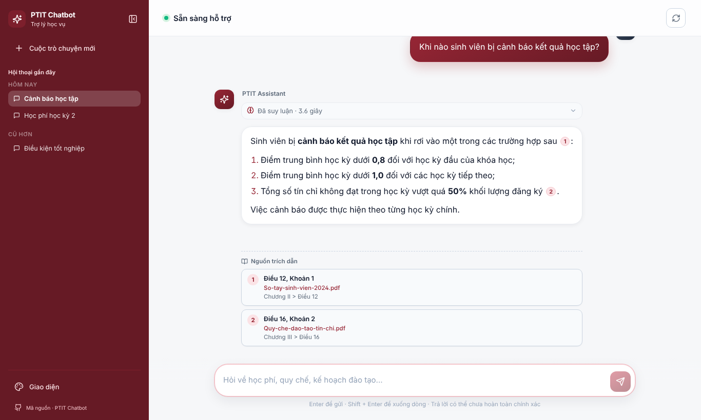
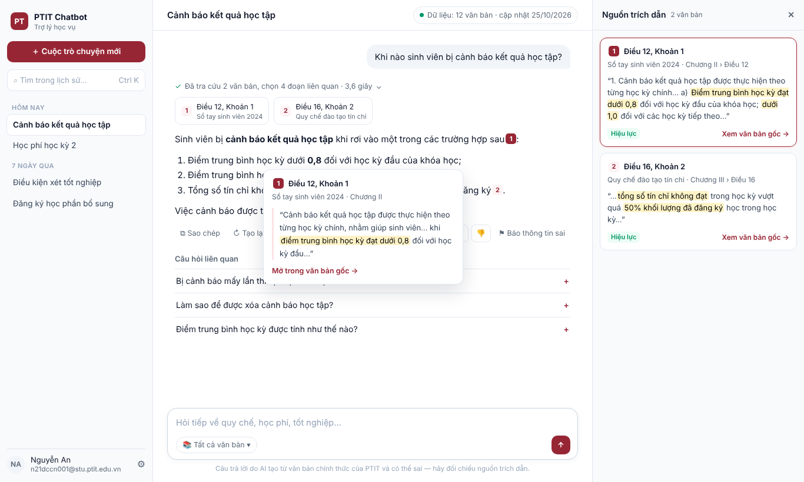
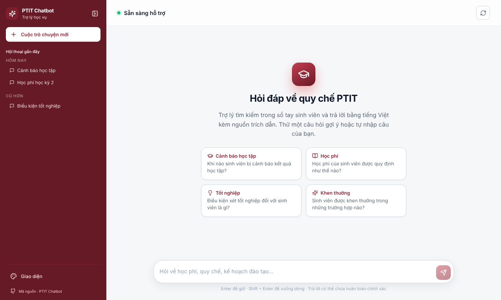
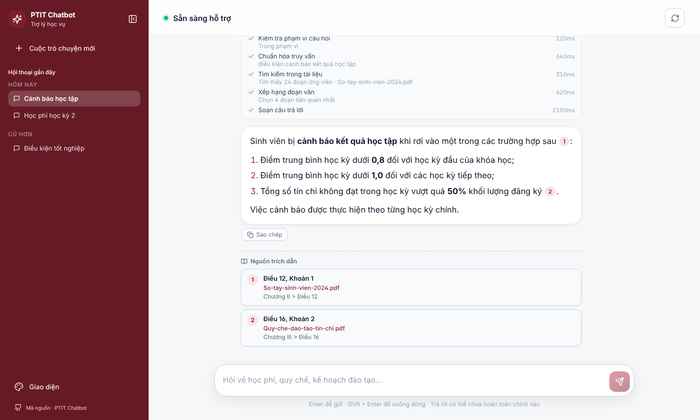
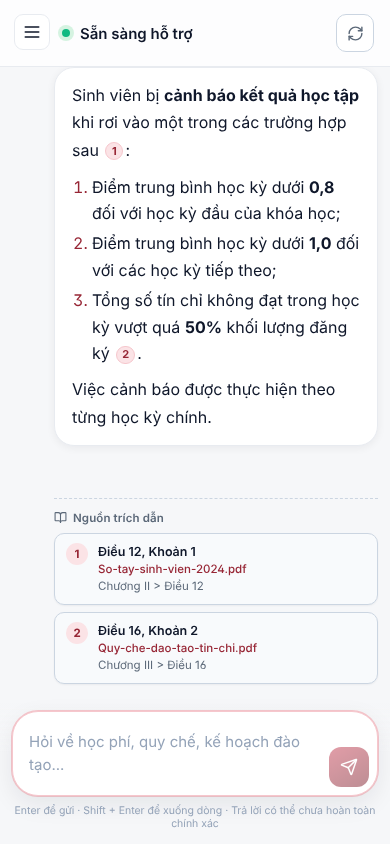

# Nghiên cứu giao diện hệ thống RAG trên thị trường và đề xuất cho PTIT Chatbot

- Task: `.agents/tasks/2026-10-30-rag-ui-market-research/`
- Ngày khảo sát: 2026-10-30
- Phạm vi: màn chat của sinh viên (`/`), có nhắc tới trang quản trị khi liên quan.
- Mockup đề xuất: [`mockups/chat-proposed.html`](mockups/chat-proposed.html) (HTML tĩnh, dữ liệu giả).

---

## 0. Tóm tắt

Giao diện hiện tại đã có nền tốt: stream câu trả lời, chip trích dẫn trong câu, panel quá trình suy luận, lịch
sử hội thoại, sáng/tối, a11y cơ bản. Khoảng cách lớn nhất so với các sản phẩm RAG trên thị trường nằm ở
**cách cho người dùng kiểm chứng câu trả lời**: nguồn trích dẫn hiện chỉ có tên điều/khoản và tên file, không
có đoạn trích, không mở được văn bản gốc. Đây là điểm mà Perplexity, ChatGPT search, NotebookLM, Onyx,
Kotaemon, RAGFlow đều làm và là lý do người dùng tin một hệ thống RAG.

Năm thay đổi nên làm trước (chi tiết ở §5):

1. **Thẻ xem nhanh khi hover/chạm vào trích dẫn `[n]`** gồm đoạn trích, điều/khoản, tên văn bản và nút "Mở
   văn bản gốc" (D-01). Cần backend trả thêm `excerpt` cho mỗi nguồn.
2. **Panel "Nguồn trích dẫn" bên phải** (desktop) / bottom sheet (mobile), đồng bộ với trích dẫn đang chọn,
   thay cho danh sách thẻ nằm cuối câu trả lời (D-02).
3. **Câu trả lời dạng văn bản toàn chiều rộng + hàng nguồn ở đầu**, bỏ bong bóng cho trợ lý (D-03).
4. **Phản hồi 👍/👎 + "Báo thông tin sai"** và **"Tạo lại"**, nút luôn hiện, không chỉ khi hover (D-05).
5. **Sidebar sáng** thay khối maroon toàn chiều cao, maroon chỉ dùng cho hành động chính — khớp hướng
   "Học vụ hiện đại" đã chốt ở task `2026-10-21-uiux-redesign-context` (D-08).

| Hiện tại | Đề xuất |
|---|---|
|  |  |

---

## 1. Phương pháp và giới hạn

- **Hiện trạng**: đọc mã nguồn `frontend/src` (App, ChatView, ReasoningPanel, ConversationList, MarkdownView,
  CSS token/layout/chat) và API `backend/app/api/`; chạy Vite dev, giả lập `/api/*` bằng Playwright để chụp
  màn chào, màn trả lời, panel suy luận ở desktop 1366×820 và mobile 390×844 (ảnh trong `assets/current-*`).
- **Thị trường**: tìm kiếm web ngày 2026-10-30 về Perplexity, ChatGPT search, Google NotebookLM, Onyx
  (Danswer), Kotaemon, RAGFlow, Dify, Open WebUI, Kapa.ai, chatbot sổ tay sinh viên của các trường, thư viện
  mẫu Shape of AI và một nghiên cứu về cách trình bày nguồn (arXiv 2512.12207).
- **Giới hạn**:
  - Không đăng nhập/dùng thử trực tiếp các sản phẩm; mô tả dựa trên tài liệu chính thức (Onyx, Dify, Kapa.ai)
    và bài phân tích của bên thứ ba (Perplexity, ChatGPT, NotebookLM). Chi tiết giao diện có thể đã đổi theo
    phiên bản; mục §3 ghi rõ nguồn từng nhận định.
  - Môi trường làm việc chặn truy cập trực tiếp `arxiv.org` và `aiuxplayground.com`, nên nội dung hai nguồn này
    lấy từ trích đoạn kết quả tìm kiếm, chưa đọc toàn văn.
  - Ảnh "hiện tại" dùng dữ liệu giả (2 nguồn, 5 bước pipeline) chứ không phải câu trả lời thật của mô hình.

---

## 2. Hiện trạng giao diện chat

| Màn chào | Panel suy luận mở | Mobile |
|---|---|---|
|  |  |  |

### Điểm mạnh nên giữ

- Trích dẫn `[n]` render thành chip trong câu, bấm vào cuộn tới thẻ nguồn và nhấp sáng 2 giây
  (`ChatView.jsx` `onMessageClick`).
- Panel suy luận có timeline bước RAG, tự thu gọn khi câu trả lời bắt đầu stream, mở lại được
  (`ReasoningPanel.jsx`, `ChatView.jsx` `appendChunk`).
- Câu hỏi gợi ý ở màn chào, nút dừng tạo, thử lại khi lỗi, tự cuộn chỉ khi người dùng đang ở cuối, nút cuộn
  xuống, live region cho trình đọc màn hình, Ctrl+B thu gọn sidebar, sáng/tối/hệ thống.

### Vấn đề quan sát được

| ID | Vấn đề | Bằng chứng |
|---|---|---|
| H-01 | Nguồn không có đoạn trích: người dùng chỉ thấy "Điều 12, Khoản 1 · So-tay-sinh-vien-2024.pdf", phải tự đi tìm văn bản để kiểm tra. | `backend/app/api/schemas.py` lớp `Source` (không có trường nội dung); thẻ nguồn trong `ChatView.jsx` |
| H-02 | Sinh viên không mở được văn bản gốc: endpoint file/chunk tài liệu đều yêu cầu quyền admin. | `backend/app/api/routes.py` `GET /documents/{id}/file`, `/chunks` có `Depends(require_admin)` |
| H-03 | Thẻ nguồn xếp dọc dưới câu trả lời, chiếm nhiều chiều cao; câu trả lời dài thì nguồn bị đẩy khỏi màn hình, bấm `[n]` phải cuộn xa rồi mất ngữ cảnh câu đang đọc. | ảnh `current-answer-desktop.png` |
| H-04 | Tên nguồn hiển thị tên file thô (`So-tay-sinh-vien-2024.pdf`, `Quy-che-dao-tao-tin-chi.pdf`), cả trong panel suy luận. | `ChatView.jsx` `source-document`, `ReasoningPanel.jsx` `stepDetailText` |
| H-05 | Panel suy luận dùng thuật ngữ kỹ thuật (kiểm tra phạm vi, chuẩn hoá truy vấn, xếp hạng đoạn văn, mili-giây) — hữu ích cho admin/dev, gây nhiễu với sinh viên. | `ReasoningPanel.jsx` `STEP_LABELS`, `step-ms` |
| H-06 | Không có phản hồi chất lượng (👍/👎, báo sai) nên không thu được tín hiệu để cải thiện truy xuất. Backend chưa có API feedback. | không có route/model `feedback` trong `backend/app` |
| H-07 | Nút "Sao chép" chỉ hiện khi rê chuột (`opacity: 0`), không thấy trên thiết bị cảm ứng; không có "Tạo lại". | `styles/chat.css` `.bubble-actions`, `.bubble-wrap:hover` |
| H-08 | Không gợi ý câu hỏi tiếp theo sau câu trả lời; gợi ý chỉ có ở màn chào. | `ChatView.jsx` `SUGGESTIONS` |
| H-09 | Header chiếm một hàng chỉ để hiện "Sẵn sàng hỗ trợ" và một nút làm mới trùng chức năng "Cuộc trò chuyện mới" ở sidebar; không hiện tiêu đề hội thoại. | `ChatView.jsx` `chat-header` |
| H-10 | Sidebar maroon toàn chiều cao áp đảo thị giác; màu nhận diện bị dùng cho vùng điều hướng thay vì hành động chính. Trái với quyết định "sidebar sáng thay panel maroon" của task redesign 2026-10-21. | `styles/layout.css` `.sidebar { background: var(--brand-800) }` |
| H-11 | Không cho biết chatbot đang dùng những văn bản nào, cập nhật khi nào — người dùng không biết câu trả lời có còn hiệu lực. | màn chào chỉ có mô tả chung |
| H-12 | Lịch sử hội thoại không có ô tìm kiếm; avatar người dùng là chữ "B" cố định. | `ConversationList.jsx`, `ChatView.jsx` |
| H-13 | Mobile: dòng gợi ý phím tắt (Enter/Shift+Enter) vô nghĩa trên điện thoại và bị xuống 2 dòng; thẻ nguồn chiếm gần nửa màn hình. | ảnh `current-answer-mobile.png` |

---

## 3. Khảo sát sản phẩm trên thị trường

### 3.1 Bảng so sánh mẫu thiết kế

Ký hiệu: ● có, rõ ràng · ◐ có một phần/tuỳ cấu hình · — không thấy trong nguồn đã đọc.

| Mẫu | Perplexity | ChatGPT search | NotebookLM | Onyx | Kotaemon | RAGFlow | Dify | Kapa.ai | **PTIT hiện tại** |
|---|---|---|---|---|---|---|---|---|---|
| Trích dẫn đánh số trong câu | ● | ● (chip) | ● | ● | ● | ● | ● | — | ● |
| Xem nhanh đoạn trích khi hover/chọn | ● | ● (popover 1/N) | ● | — | ● | ● | ◐ | — | — |
| Panel nguồn cạnh câu trả lời | ● | ● (sidebar) | ● (cột Sources) | ● (sidebar phải) | ● (Information panel) | ◐ | — | — | — (cuối câu trả lời) |
| Mở văn bản gốc tới đúng đoạn | ◐ (link web) | ◐ (link web) | ● | ◐ | ● (PDF viewer + highlight) | ● (định vị theo toạ độ chunk) | ◐ | ● (link tài liệu) | — |
| Điểm liên quan / cảnh báo độ tin cậy | — | — | — | — | ● | ● (similarity) | — | — | — |
| Câu hỏi gợi ý sau câu trả lời | ● | ◐ | ● | — | — | — | ● (3 câu) | ◐ (ví dụ ban đầu) | — |
| 👍/👎 phản hồi | ◐ | ● | ● | ● (admin xem được) | — | ◐ | ◐ | ● | — |
| Chọn phạm vi nguồn | ◐ (focus) | — | ● (tick nguồn) | ● (document sets) | ● | ● (knowledge base) | ◐ | ● (source groups) | — |
| Hiện quá trình tìm kiếm | ● (các bước) | ● | — | ◐ | ◐ | ◐ | ◐ | — | ● (chi tiết kỹ thuật) |

### 3.2 Ghi chú từng sản phẩm

**Perplexity** — Thứ tự "câu trả lời → nguồn → câu hỏi liên quan", nguồn đánh số, bấm được; khối nguồn luôn
hiện để kiểm tra mà không rời câu trả lời; dự đoán câu hỏi tiếp theo thay vì bắt người dùng tự nghĩ. Các bài
phân tích ghi nhận trạng thái hover nhanh, tinh tế. Bài học cho PTIT: đưa nguồn lên gần câu trả lời, thêm câu
hỏi liên quan. *Nguồn: 925studios, blakecrosley.com (phân tích của bên thứ ba).*

**ChatGPT search** — Ba tầng kiểm chứng: chip nguồn gắn vào từng nhận định → popover theo nhận định có phân
trang 1/N khi một ý có nhiều nguồn → sidebar "Sources" liệt kê thẻ (tiêu đề, thời gian, đoạn trích) mà câu trả
lời vẫn hiển thị. Điểm yếu được chỉ ra: sidebar không làm nổi thẻ tương ứng với chip vừa mở. Bài học: popover
theo trích dẫn + panel đồng bộ, và **phải** highlight thẻ đang được trỏ tới. *Nguồn: aiuxplayground.com
teardown, cloro.dev (bên thứ ba).*

**Google NotebookLM** — Bố cục 3 cột: Sources (trái, quản lý và tick chọn nguồn dùng để trả lời) · Chat (giữa)
· Studio (phải). Trích dẫn đánh số trong câu, chọn/hover hiện chính xác đoạn văn trong nguồn. Bài học: cho
chọn phạm vi văn bản (ví dụ chỉ "Quy chế đào tạo"), và trích dẫn phải dẫn tới đúng đoạn văn. *Nguồn: hướng
dẫn của Bowdoin, adventuresincre.com, lilys.ai.*

**Onyx (Danswer)** — Sidebar phải chứa nguồn và trích dẫn đã dùng cho câu trả lời; có thể chọn tài liệu trong
sidebar để đưa toàn văn vào câu hỏi tiếp theo. Có 👍/👎 khi hover câu trả lời và **admin xem được phản
hồi**; admin quản lý connector, document set. Bài học: vòng phản hồi người dùng → trang quản trị, rất hợp với
app admin đã tách ở FE-06. *Nguồn: docs.onyx.app (chính thức), README GitHub.*

**Kotaemon** (mã nguồn mở, Gradio) — "Information panel" hiển thị bằng chứng, trích dẫn và điểm chất lượng;
xem PDF trong trình duyệt với đoạn được highlight; cảnh báo khi đoạn truy xuất có độ liên quan thấp. Bài học:
nói rõ khi bằng chứng yếu thay vì trả lời tự tin. *Nguồn: README dự án, các trang tổng hợp.*

**RAGFlow** — Nhấn mạnh "grounded citations" và trực quan hoá chunk; có component xem tài liệu cho trích dẫn
trong chat, định vị đúng chỗ trong tài liệu bằng toạ độ chunk; trang Chunk cho xem/sửa kết quả chia đoạn.
Bài học: PTIT đã có màn tài liệu và sửa Markdown ở admin — có thể tái dùng cho trình xem văn bản phía sinh
viên. *Nguồn: knightli.com, mirror mã nguồn trên Hugging Face (cũ).*

**Dify** — Câu trả lời dùng knowledge base hiện trích dẫn đánh số trỏ về tài liệu và chunk; tuỳ chọn tự gợi ý 3
câu hỏi tiếp theo sau mỗi câu trả lời (gọi LLM riêng); câu mở đầu có câu hỏi gợi ý. *Nguồn: docs.dify.ai
(chính thức).*

**Open WebUI** — 👍/👎 kèm phản hồi dạng chữ, mục đích tạo dữ liệu đánh giá. *Nguồn: README dự án.*

**Kapa.ai** (widget hỏi đáp tài liệu) — Mỗi câu trả lời có link nguồn bấm được; 👍/👎 để đo chất lượng;
cấu hình được câu hỏi ví dụ, lời miễn trừ, giới hạn nhóm nguồn. *Nguồn: docs.kapa.ai (chính thức).*

**Chatbot sổ tay sinh viên của các trường** (EdUHK "Smart Student Handbook", ICTU, các sản phẩm thương mại) —
tập trung vào diễn giải lại văn bản quy chế bằng ngôn ngữ dễ hiểu; tài liệu công khai hầu như không mô tả cách
trình bày trích dẫn. Đây là khoảng trống PTIT có thể làm tốt hơn.

### 3.3 Nghiên cứu và thư viện mẫu

- **arXiv 2512.12207** *Not All Transparency Is Equal* — so sánh các cách trình bày nguồn trong tìm kiếm hội
  thoại; thiết kế thẻ hover khi rê vào badge trích dẫn giữ người đọc trong văn bản, người dùng đánh giá độ
  mạnh của bằng chứng kỹ hơn, đổi lại tải nhận thức tăng khi nguồn dày đặc. Hệ quả: thẻ hover nên ngắn
  (một đoạn trích, một nút), chi tiết để ở panel.
- **Shape of AI** (Emily Campbell) — nhóm *Wayfinders* (gợi ý, follow-up, nudges) giải quyết "trang trắng";
  nhóm *Trust indicators* (citations, disclosure, caveats) xây dựng niềm tin.

---

## 4. Mẫu thiết kế rút ra

| ID | Mẫu | Ý chính |
|---|---|---|
| P-01 | Answer-first, nguồn sát câu trả lời | Hàng nguồn rút gọn ngay trên/dưới câu trả lời, không đẩy xuống cuối. |
| P-02 | Trích dẫn có xem nhanh | Hover (desktop) / chạm (mobile) vào `[n]` → thẻ nhỏ: vị trí, văn bản, đoạn trích có highlight, "Mở văn bản gốc". |
| P-03 | Panel bằng chứng đồng bộ | Panel cạnh câu trả lời, thẻ tương ứng với trích dẫn đang trỏ được làm nổi. |
| P-04 | Mở tới đúng đoạn | Trình xem văn bản cuộn và highlight đúng điều/khoản. |
| P-05 | Tiến trình bằng ngôn ngữ người dùng | "Đã tra cứu 2 văn bản, chọn 4 đoạn · 3,6 giây"; chi tiết kỹ thuật chỉ cho admin. |
| P-06 | Vòng phản hồi | 👍/👎, báo sai có lý do; admin xem và lọc được. |
| P-07 | Wayfinders | Câu hỏi gợi ý ở màn chào và câu hỏi liên quan sau mỗi câu trả lời. |
| P-08 | Phạm vi và độ mới dữ liệu | Hiện tập văn bản đang dùng, ngày cập nhật; cho lọc theo văn bản. |
| P-09 | Thành thật khi bằng chứng yếu | Trạng thái riêng cho "không tìm thấy trong tài liệu" / "ngoài phạm vi", kèm hướng dẫn liên hệ phòng ban. |
| P-10 | Disclosure | Một dòng miễn trừ ngắn, cố định, nhắc đối chiếu nguồn. |

---

## 5. Đề xuất thay đổi

Mức ưu tiên: **P1** làm ngay (giá trị cao, ít phụ thuộc) · **P2** cần thay đổi backend nhỏ · **P3** mở rộng.
Cột "API" ghi thay đổi backend cần có; "—" nghĩa là chỉ sửa frontend.

| ID | Đề xuất | Giải quyết | Mẫu | Ưu tiên | API |
|---|---|---|---|---|---|
| D-01 | Thẻ xem nhanh trích dẫn | H-01, H-03 | P-02 | P1 | Thêm `excerpt` vào `Source` |
| D-02 | Panel "Nguồn trích dẫn" | H-03, H-13 | P-03 | P1 | dùng `excerpt` của D-01 |
| D-03 | Bố cục câu trả lời mới | H-03, H-09 | P-01 | P1 | — |
| D-04 | Tiến trình rút gọn cho sinh viên | H-05, H-04 | P-05 | P1 | — |
| D-05 | Hàng hành động: sao chép, tạo lại, 👍/👎, báo sai | H-06, H-07 | P-06 | P1 (UI) / P2 (lưu) | `POST /messages/{id}/feedback` |
| D-06 | Câu hỏi liên quan | H-08 | P-07 | P2 | `related_questions` trong event `done` |
| D-07 | Trình xem văn bản gốc cho sinh viên | H-02 | P-04 | P2 | endpoint công khai chỉ cho tài liệu đã được trích dẫn |
| D-08 | Sidebar sáng, header gọn | H-09, H-10, H-12 | — | P1 | — |
| D-09 | Thông tin phạm vi và độ mới dữ liệu | H-11 | P-08 | P2 | `GET /corpus/summary` |
| D-10 | Trạng thái "không tìm thấy"/"ngoài phạm vi" riêng | — | P-09 | P2 | cờ `grounded`/`out_of_scope` trong `done` |
| D-11 | Lọc phạm vi văn bản trong ô nhập | — | P-08 | P3 | `document_ids` trong `ChatRequest` |
| D-12 | Trang admin: xem phản hồi, câu hỏi chưa trả lời được | H-06 | P-06 | P3 | danh sách feedback cho admin |

### D-01 — Thẻ xem nhanh trích dẫn

- **Hiện tại**: bấm `[n]` cuộn xuống thẻ nguồn ở cuối, mất vị trí đang đọc; thẻ không có nội dung.
- **Đề xuất**: hover (desktop, trễ ~150 ms) hoặc chạm/Enter (mobile, bàn phím) vào chip `[n]` mở popover rộng
  ~340 px: số trích dẫn, `locator` ("Điều 12, Khoản 1"), tên văn bản thân thiện + chương, đoạn trích 2–4 dòng
  có highlight cụm từ khớp, liên kết "Mở trong văn bản gốc" (khi có D-07) và "Xem trong panel".
  Popover là `role="dialog"` không modal, Esc đóng, focus trở lại chip.
- **Backend**: thêm `excerpt: str | None` (≤ ~400 ký tự, cắt theo câu) vào `Source` trong
  `backend/app/api/schemas.py` và `generation/citations.py`; lưu cùng `message_metadata.sources` để mở lại
  hội thoại vẫn có. Trường tuỳ chọn nên không phá client cũ.
- **Fallback khi chưa có `excerpt`**: popover chỉ hiện vị trí + tên văn bản (như thẻ hiện nay).

### D-02 — Panel "Nguồn trích dẫn"

- Desktop ≥ 1200 px: cột phải ~360 px, mở tự động khi câu trả lời có nguồn, đóng được, nhớ trạng thái
  (`localStorage`). Mỗi thẻ: số, vị trí, văn bản › chương › điều, đoạn trích, "Xem văn bản gốc".
- Trỏ/chọn `[n]` trong câu trả lời → thẻ tương ứng được viền màu nhận diện và cuộn vào tầm nhìn (khắc phục điểm
  yếu của ChatGPT đã nêu ở §3.2). Chọn thẻ → highlight các `[n]` tương ứng trong câu trả lời.
- 768–1199 px: panel dạng drawer phủ bên phải. < 768 px: bottom sheet, mở từ hàng nguồn hoặc chip.
- Thay thế khối `.message-sources` dưới câu trả lời bằng hàng nguồn rút gọn (D-03).

### D-03 — Bố cục câu trả lời

- Câu trả lời của trợ lý hiển thị dạng văn bản toàn chiều rộng cột đọc (~720 px), **bỏ bong bóng và avatar**;
  câu hỏi của người dùng giữ bong bóng nhỏ nền xám, căn phải. Đây là quy ước chung của Perplexity, ChatGPT,
  Claude, NotebookLM, giúp Markdown dài (danh sách, bảng) dễ đọc hơn.
- Thứ tự: dòng tiến trình rút gọn (D-04) → hàng 2–4 "pill" nguồn (số + điều/khoản + tên văn bản, phần còn lại
  "+n") → nội dung → hàng hành động (D-05) → câu hỏi liên quan (D-06).
- Bỏ nhãn "PTIT Assistant"/"Bạn" lặp lại ở mỗi tin.

### D-04 — Tiến trình rút gọn cho sinh viên

- Khi đang chạy: một dòng trạng thái động bằng ngôn ngữ thường ("Đang tìm trong Sổ tay sinh viên…",
  "Đang soạn câu trả lời…"), giữ `aria-live` hiện có.
- Khi xong: "✓ Đã tra cứu 2 văn bản, chọn 4 đoạn liên quan · 3,6 giây ⌄". Mở ra hiện các bước với nhãn dễ hiểu,
  **không hiện mili-giây, không hiện tên file thô**; "chuỗi suy nghĩ" của mô hình (reasoning) đặt sau, thu gọn.
- Trang admin (`/admin`, màn chat) giữ timeline kỹ thuật đầy đủ như hiện nay — dùng prop `variant` cho
  `ReasoningPanel` thay vì hai component.
- Hiển thị tên văn bản thân thiện thay tên file: ưu tiên tiêu đề tài liệu từ metadata; tạm thời bỏ đuôi file,
  thay `-`/`_` bằng khoảng trắng.

### D-05 — Hàng hành động và phản hồi

- Nút luôn hiện (không chỉ khi hover), cỡ chạm ≥ 32 px: **Sao chép · Tạo lại** | **👍 · 👎 · Báo thông tin sai**.
- 👎 hoặc "Báo sai" mở popover nhỏ chọn lý do (Sai thông tin · Trích sai nguồn · Thiếu ý · Không liên quan ·
  Khác) + ô ghi chú tuỳ chọn. Gửi xong hiện "Cảm ơn phản hồi của bạn" và giữ trạng thái đã chọn.
- **Giai đoạn 1** (chưa có API): chỉ làm sao chép/tạo lại; nút phản hồi ẩn sau cờ cấu hình để tránh thu thập rồi
  bỏ đi. **Giai đoạn 2**: `POST /api/conversations/{cid}/messages/{mid}/feedback` `{rating: "up"|"down",
  reason?, comment?}`; event `done` cần trả `message_id` của tin trợ lý.

### D-06 — Câu hỏi liên quan

- 3 câu hỏi dạng danh sách dưới câu trả lời, bấm là gửi. Ẩn khi câu trả lời ngoài phạm vi hoặc lỗi.
- Backend: sinh trong cùng lời gọi (yêu cầu mô hình trả kèm khối JSON) hoặc lời gọi phụ sau `done` như Dify;
  thêm `related_questions: string[]` vào event `done` (trường tuỳ chọn). Cho admin tắt trong cấu hình nếu tốn
  chi phí.

### D-07 — Trình xem văn bản gốc cho sinh viên

- Từ thẻ nguồn → mở drawer/trang xem văn bản đã cuộn tới điều/khoản được trích và highlight đoạn.
- Tái dùng `OriginalDocumentViewer` và render Markdown đã parse (đã có ở admin). Với Markdown, định vị theo
  `section_path`/`heading`; với PDF, giai đoạn đầu mở đúng trang nếu có số trang trong metadata.
- Backend: endpoint công khai mới (ví dụ `GET /api/sources/{document_id}`) chỉ trả tài liệu đang được index và
  không lộ đường dẫn nội bộ — đúng nguyên tắc hiện tại của `public_citations`. `Source` cần thêm
  `document_id` (hoặc một khoá công khai) để frontend gọi được.

### D-08 — Sidebar sáng, header gọn

- Sidebar nền `--surface-soft`, viền phải mảnh; maroon chỉ dùng cho nút "Cuộc trò chuyện mới", logo, chip trích
  dẫn, trạng thái đang chọn (màn chat hiện không dùng `--accent` teal; giữ như vậy để chỉ có một màu nhấn).
- Thêm ô "Tìm trong lịch sử" (lọc phía client trên 50 hội thoại đang tải; Ctrl+K đưa focus).
- Chân sidebar: khu tài khoản (tên + email khi đăng nhập, nút "Đăng nhập" khi ẩn danh) — **trùng phạm vi với
  task `2026-10-28-landing-user-auth`** (§8) — và nút Cài đặt gom "Giao diện", link mã nguồn.
- Header: bỏ chấm "Sẵn sàng hỗ trợ" và nút làm mới trùng chức năng; thay bằng tiêu đề hội thoại (đổi tên tại
  chỗ) và chip phạm vi dữ liệu (D-09). Trạng thái "đang trả lời" đã có ở dòng tiến trình và nút Dừng.

### D-09 — Phạm vi và độ mới dữ liệu

- Màn chào: dưới tiêu đề hiện "Dựa trên 12 văn bản chính thức · cập nhật 25/10/2026 · Xem danh sách", mở modal
  liệt kê tên văn bản và ngày cập nhật.
- Header: chip nhỏ cùng thông tin.
- Backend: `GET /api/corpus/summary` công khai trả `{document_count, updated_at, documents: [{title,
  updated_at}]}`, không lộ đường dẫn/ID nội bộ.

### D-10 — Trạng thái "không tìm thấy" và "ngoài phạm vi"

- Khi guardrail từ chối hoặc không có đoạn đủ liên quan: thẻ trạng thái riêng (icon thông tin, không phải lỗi
  đỏ), câu giải thích ngắn, gợi ý cách hỏi lại và địa chỉ liên hệ phòng Giáo vụ/Công tác sinh viên (nội dung do
  admin cấu hình). Không hiện hàng nguồn rỗng.
- Backend: thêm cờ `answer_type: "grounded" | "no_evidence" | "out_of_scope"` vào event `done` (tuỳ chọn).

### D-11 — Lọc phạm vi văn bản (P3)

- Chip "Tất cả văn bản ▾" trong ô nhập, chọn một hoặc nhiều văn bản (giống tick nguồn của NotebookLM, document
  set của Onyx). Chip hiển thị lựa chọn hiện tại; áp dụng cho các câu hỏi tiếp theo của hội thoại.
- Backend: `document_ids?: string[]` trong `ChatRequest`, lọc ở bước retrieve.

### D-12 — Trang admin: phản hồi và câu hỏi chưa trả lời được (P3)

- Bảng phản hồi (lọc 👎, theo lý do, theo văn bản bị trích), mở thẳng hội thoại + timeline kỹ thuật để chẩn đoán.
- Danh sách câu hỏi rơi vào `no_evidence`/`out_of_scope` để biết cần bổ sung văn bản nào.

### Các điều chỉnh nhỏ khác

- Ô nhập: placeholder đổi thành "Hỏi tiếp…" khi đã có hội thoại; ẩn gợi ý phím tắt trên thiết bị cảm ứng
  (`@media (hover: none)`), giữ dòng miễn trừ ngắn một dòng.
- Màn chào: giữ 4 câu hỏi gợi ý, cho admin cấu hình danh sách thay vì hard-code `SUGGESTIONS`.
- Mobile: sidebar dạng drawer giữ nguyên; panel nguồn thành bottom sheet (D-02); hàng hành động cuộn ngang
  nếu thiếu chỗ.
- Avatar người dùng: dùng chữ cái đầu của tên khi đã đăng nhập; ẩn khi ẩn danh (D-03 đã bỏ avatar).

---

## 6. Tổng hợp thay đổi API (đều là trường/endpoint mới, tuỳ chọn, không phá hợp đồng NDJSON)

| Thay đổi | Phục vụ | Ghi chú |
|---|---|---|
| `Source.excerpt`, `Source.document_title`, `Source.document_id` (hoặc khoá công khai) | D-01, D-02, D-04, D-07 | lưu trong `message_metadata.sources` để mở lại hội thoại vẫn có |
| `done.message_id` | D-05 | id tin nhắn trợ lý vừa lưu |
| `done.related_questions: string[]` | D-06 | có thể tắt trong cấu hình |
| `done.answer_type` | D-10 | `grounded` mặc định |
| `POST /conversations/{cid}/messages/{mid}/feedback` | D-05 | kiểm tra quyền sở hữu hội thoại như các route hiện tại |
| `GET /sources/{document_id}` (công khai, chỉ tài liệu đã index) | D-07 | không trả đường dẫn nội bộ |
| `GET /corpus/summary` (công khai) | D-09 | |
| `ChatRequest.document_ids` | D-11 | |
| `GET /admin/feedback` | D-12 | `require_admin` |

---

## 7. Lộ trình đề xuất

| Giai đoạn | Nội dung | Phụ thuộc |
|---|---|---|
| **1 — Frontend** | D-03 bố cục câu trả lời, D-04 tiến trình rút gọn, D-08 sidebar sáng + header gọn, D-05 phần sao chép/tạo lại, D-01/D-02 ở chế độ fallback (chưa có đoạn trích), điều chỉnh mobile | phối hợp với task `landing-user-auth` cho `App.jsx` |
| **2 — Backend nhỏ + frontend** | `Source.excerpt` → bật đầy đủ D-01/D-02; feedback D-05; D-06; D-09; D-10 | giai đoạn 1 |
| **3 — Mở rộng** | D-07 trình xem văn bản gốc công khai, D-11 lọc văn bản, D-12 trang admin phản hồi | giai đoạn 2 |

Mỗi giai đoạn nên là một task riêng trong `.agents/tasks/` và một nhánh `feat/…` tách từ `dev`.

---

## 8. Phối hợp với công việc đang chạy

- **`2026-10-28-landing-user-auth`** (`in_progress`) sửa `frontend/src/App.jsx` (header/sidebar chat: tên người
  dùng, Đăng xuất/Đăng nhập), `appRoute.js`, `main.jsx` và chuyển app chat sang `/chat`. D-08 chạm cùng các
  file đó → nên triển khai sau khi task này merge, hoặc thống nhất trước với coordinator `claude-agent` vị trí
  khu tài khoản ở chân sidebar.
- **Hướng thị giác "Học vụ hiện đại"** (task `2026-10-21-uiux-redesign-context`): đề xuất này đi đúng hướng đã
  chốt (nền trung tính, sidebar sáng, maroon cho hành động chính). Tài liệu `docs/design/PTIT-Chatbot-System-
  Context.md` của task đó không có trên `dev`, nên đề xuất này không dựa vào nó.
- Ràng buộc kỹ thuật giữ nguyên: React 18 + Vite, CSS thuần theo `tokens.css`, icon `lucide-react`, không thêm
  thư viện UI; popover/panel tự viết, tái dùng `Modal` cho bottom sheet nếu phù hợp.

---

## 9. Câu hỏi cần người dùng quyết định

1. Có đồng ý thêm đoạn trích (`excerpt`) vào dữ liệu nguồn trả cho sinh viên không? Đây là nội dung văn bản
   công khai của trường nhưng sẽ làm phản hồi `done` và metadata hội thoại lớn hơn.
2. Có cho sinh viên xem văn bản gốc (D-07) không, hay chỉ đoạn trích? Một số văn bản có thể chỉ dành cho nội bộ.
3. Câu hỏi liên quan (D-06) sinh bằng lời gọi LLM phụ có chấp nhận chi phí/độ trễ thêm không?
4. Thứ tự ưu tiên: làm giai đoạn 1 ngay, hay chờ task đăng nhập merge rồi làm cùng D-08?

---

## 10. Nguồn tham khảo

- Perplexity: [925studios — Perplexity Design Breakdown](https://www.925studios.co/blog/perplexity-design-breakdown),
  [blakecrosley.com — Perplexity design guide](https://blakecrosley.com/fr/guides/design/perplexity)
- Trình bày nguồn: [arXiv 2512.12207 — Not All Transparency Is Equal](https://arxiv.org/pdf/2512.12207),
  [tóm tắt trên themoonlight.io](https://www.themoonlight.io/review/seeing-to-think-how-source-transparency-design-shapes-interactive-information-seeking-and-evaluation-in-conversational-ai)
- ChatGPT: [aiuxplayground — ChatGPT citations teardown](https://www.aiuxplayground.com/teardowns/chatgpt/citations),
  [aiuxplayground — Citations pattern](https://aiuxplayground.com/pattern/citations),
  [cloro.dev — citation pills](https://cloro.dev/docs/api-reference/endpoint/chatgpt/citation-pills)
- NotebookLM: [Bowdoin — NotebookLM first project](https://bowdoin.teamdynamix.com/TDClient/1814/Portal/KB/ArticleDet?ID=171371),
  [Adventures in CRE — NotebookLM guide (PDF)](https://www.adventuresincre.com/wp-content/uploads/2025/07/NotebookLM-Quide-for-AI.Edge-Users-2025.pdf),
  [lilys.ai — NotebookLM for beginners](https://lilys.ai/en/notes/notebooklm/use-notebooklm-beginners-google-ai)
- Onyx: [docs.onyx.app — Chat](https://docs.onyx.app/overview/core_features/chat), [GitHub danswer-ai/danswer](https://github.com/danswer-ai/danswer)
- Kotaemon: [osrepos — kotaemon](https://osrepos.com/repo/cinnamon-kotaemon.md), [sourcepulse — kotaemon](https://www.sourcepulse.org/projects/1833773)
- RAGFlow: [knightli.com — RAGFlow guide](https://knightli.com/en/2026/04/15/ragflow-rag-engine-guide/),
  [mirror mã nguồn pdf-previewer](https://huggingface.co/spaces/retopara/ragflow/tree/2435d05afc705f75c4cea332bd86e6b3e328e42c/web/src/components/pdf-previewer)
- Dify: [docs.dify.ai — Additional features](https://docs.dify.ai/en/cloud/use-dify/build/additional-features)
- Open WebUI: [README (mirror)](https://git.depeuter.dev/tdpeuter/open-webui/raw/tag/v0.1.102/README.md)
- Kapa.ai: [Website widget](https://docs.kapa.ai/integrations/website-widget), [Widget configuration](https://docs.kapa.ai/integrations/website-widget/configuration)
- Chatbot sổ tay sinh viên: [EdUHK — Smart Student Handbook](https://ai4edu.eduhk.hk/?p=483)
- Mẫu thiết kế AI: [Shape of AI — Wayfinders](https://www.shapeof.ai/pattern-types/wayfinders)
